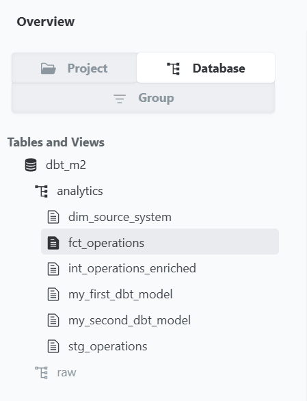
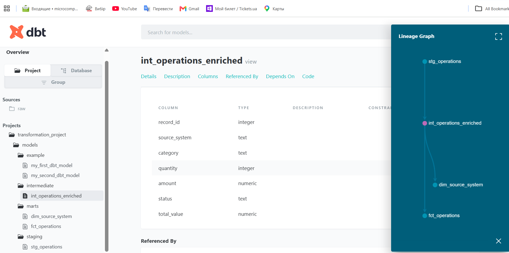
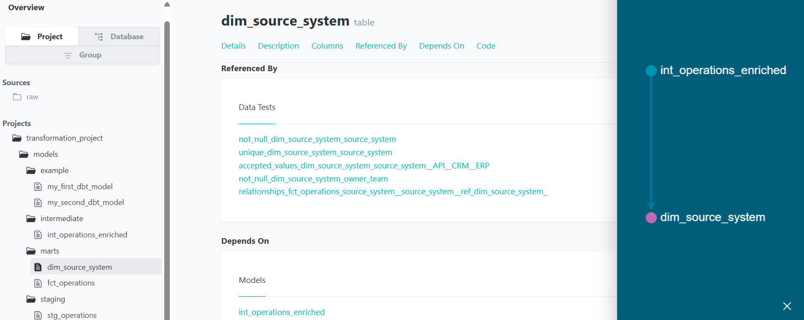
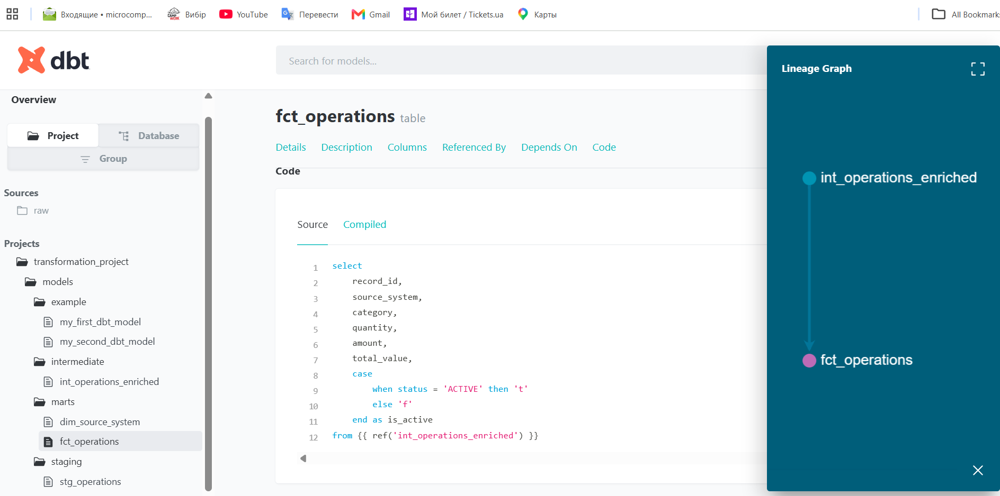
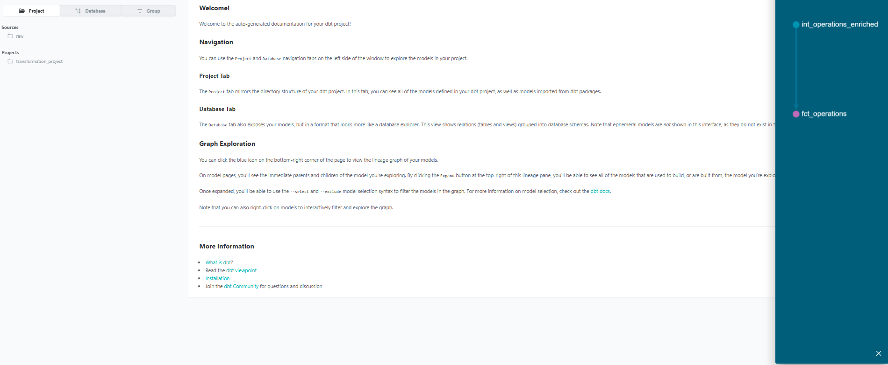
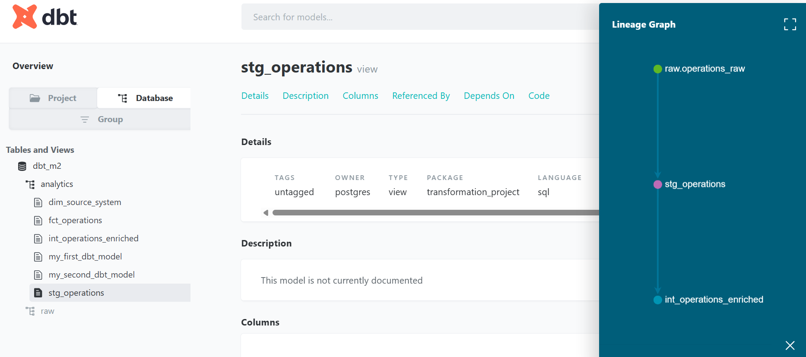

# Lakehouse Data Pipelines with Spark and dbt

## Module 2 — Transformation Engineering with dbt

**Executor:** R. Lisovenko  
**Date:** 28.10.2026- 30.10.2026

This module focuses on transformation engineering with **dbt Core** and **PostgreSQL**.  
The practical workflow covers source preparation, layered dbt models, materialization, data quality tests, generated documentation, and lineage.

---

## Contents

1. [Module Topics](#module-topics)
2. [Project Goal](#project-goal)
3. [Project Structure](#project-structure)
4. [Model Materialization Strategies](#23-model-materialization-strategies-in-dbt)
5. [Setting Up dbt Core with PostgreSQL](#24-setting-up-dbt-core-with-postgresql)
6. [Building Staging and Intermediate Models](#25-building-staging-and-intermediate-models)
7. [Building Fact and Dimension Models](#26-building-fact-and-dimension-models)
8. [Testing and Data Quality](#27-testing-and-data-quality)
9. [dbt Documentation and Lineage](#28-dbt-documentation-and-lineage)
10. [Key Takeaways](#key-takeaways)

---

## Module Topics

- ETL, ELT, and Analytics Engineering
- Layered Modelling with dbt Core
- Model Materialization Strategies
- Setting Up dbt Core with PostgreSQL
- Staging and Intermediate Models
- Fact and Dimension Models
- Testing and Documentation
- Data Contracts and Change Management

---

## Project Goal

Build a structured dbt project with:

- reusable SQL transformation models;
- clear staging, intermediate, and marts layers;
- PostgreSQL as the target database;
- automated data quality tests;
- generated dbt documentation;
- model lineage and dependency tracking;
- analytics-ready fact and dimension models.

---

## Project Structure

```text
module_2_dbt/
├── pic/
│   ├── dbt_dim_source_system.png
│   ├── dbt_docs_model_details.png
│   ├── dbt_docs_overview.png
│   ├── dbt_fct_operations.png
│   ├── dbt_int_operations_enriched.png
│   ├── dbt_lineage_graph.png
│   └── dbt_stg_operations.png
├── transformation_project/
│   ├── analyses/
│   ├── macros/
│   ├── models/
│   │   ├── example/
│   │   ├── intermediate/
│   │   ├── marts/
│   │   └── staging/
│   ├── seeds/
│   ├── snapshots/
│   ├── tests/
│   └── dbt_project.yml
├── README.md
└── requirements.txt
```

The shared Python virtual environment is stored at the course root and reused by Module 2.

---

## 2.3 Model Materialization Strategies in dbt

dbt models are written in SQL, but their results can be represented differently in the target database. These options are called **materializations**.

| Materialization | Description | Best Use |
|---|---|---|
| `view` | Stores the SQL definition; data is calculated when queried | Lightweight and frequently changing transformations |
| `table` | Stores the complete transformed result physically | Frequently queried and stable analytical models |
| `incremental` | Processes only new or changed records after the initial build | Large and continuously growing datasets |
| `ephemeral` | Exists only as reusable SQL compiled into downstream models | Small reusable intermediate transformations |

### Selection Principle

Materialization should be selected based on:

- dataset size;
- frequency of reuse;
- transformation cost;
- query performance requirements;
- storage requirements.

Typical approach:

```text
Lightweight transformation → view
Frequently reused model     → table
Large growing dataset       → incremental
Reusable helper logic       → ephemeral
```

### Key Principle

There is no single best materialization for every model.

```text
Query Performance ↔ Storage Cost ↔ Rebuild Cost ↔ Maintainability
```

Thoughtful materialization choices make dbt projects more efficient, scalable, and easier to maintain.

---

## 2.4 Setting Up dbt Core with PostgreSQL

### 2.4.1 Environment Check

Activate the shared virtual environment and verify Python and PostgreSQL:

```powershell
deactivate
..\.venv\Scripts\Activate.ps1
python --version
psql --version
```

Expected environment used in this module:

```text
Python 3.12.10
PostgreSQL 17.x
```

Official documentation:

[dbt PostgreSQL Setup](https://docs.getdbt.com/docs/local/connect-data-platform/postgres-setup)

### 2.4.2 Install dbt PostgreSQL Adapter

```powershell
python -m pip install --upgrade pip
python -m pip install dbt-postgres
dbt --version
where.exe dbt
```

`dbt-postgres` installs the PostgreSQL adapter together with the compatible dbt Core dependencies.

### 2.4.3 Module Requirements

From the course root:

```powershell
cd 3_2_DataEng-Lakehouse-Spark-dbt\module_2_dbt
type requirements.txt
```

Example `requirements.txt`:

```text
dbt-postgres==1.11.0
```

### 2.4.4 Create the PostgreSQL Database

Connect to PostgreSQL:

```powershell
psql -U postgres -d postgres
```

Create the database:

```sql
CREATE DATABASE dbt_m2;
```

Useful `psql` commands:

```text
\l    -- list databases
\q    -- quit
```

If the PostgreSQL password must be changed:

```sql
ALTER USER postgres WITH PASSWORD 'NewStrongPassword';
```

> Do not store a real database password in the repository.

### 2.4.5 Initialize the dbt Project

From `module_2_dbt`:

```powershell
dbt init transformation_project
```

Configuration used:

```text
adapter:  postgres
host:     localhost
port:     5432
user:     postgres
dbname:   dbt_m2
schema:   analytics
threads:  1
```

The generated project structure:

```text
transformation_project/
├── analyses/
├── macros/
├── models/
├── seeds/
├── snapshots/
├── tests/
└── dbt_project.yml
```

### 2.4.6 Validate the dbt Configuration

```powershell
cd transformation_project
dbt debug
```

A successful `dbt debug` confirms that:

- the project configuration is valid;
- the PostgreSQL adapter is available;
- the dbt profile is loaded;
- the database connection works;
- the environment is ready for transformation development.

### 2.4.7 Connect to the Module Database

```powershell
psql -U postgres -d dbt_m2
```

Inside `psql`:

```text
\c dbt_m2
\dn
\dt
```

---

## 2.5 Building Staging and Intermediate Models

### 2.5.1 Create the Raw Schema

```sql
CREATE SCHEMA IF NOT EXISTS raw;
```

Verify schemas:

```text
\dn
```

The database layers are separated conceptually as:

```text
raw        → source data
analytics  → dbt-generated analytical models
```

### 2.5.2 Create the Raw Source Table

```sql
CREATE TABLE raw.operations_raw (
    record_id INTEGER,
    source_system VARCHAR(50),
    category VARCHAR(100),
    quantity INTEGER,
    amount NUMERIC(10,2),
    status VARCHAR(50)
);
```

Verify the table definition:

```text
\d raw.operations_raw
```

### 2.5.3 Load Sample Source Data

```sql
INSERT INTO raw.operations_raw VALUES
(1, 'CRM', ' customer ', 12, 1500.50, 'active'),
(2, 'ERP', 'Inventory', 8, 2400.00, 'ACTIVE'),
(3, 'API', 'Orders', 15, 3200.75, 'pending'),
(4, 'CRM', 'Customer', 10, NULL, 'active'),
(5, 'ERP', ' inventory ', 20, 4100.00, 'ACTIVE'),
(6, 'API', 'Orders', 5, 2800.00, 'inactive'),
(7, 'CRM', 'Customer', 7, 1750.00, 'active'),
(8, 'ERP', 'Inventory', 6, 2200.00, 'pending');
```

Verify the source data:

```sql
SELECT *
FROM raw.operations_raw
ORDER BY record_id;
```

### 2.5.4 Define the dbt Source

**File:** `models/staging/sources.yml`

```yaml
version: 2

sources:
  - name: raw
    schema: raw
    tables:
      - name: operations_raw
```

This source definition allows dbt models to reference the raw PostgreSQL table through `source()`.

### 2.5.5 Create the Staging Model

**File:** `models/staging/stg_operations.sql`

```sql
select
    record_id,
    upper(trim(source_system)) as source_system,
    initcap(trim(category)) as category,
    case
        when quantity <= 0 then 1
        else quantity
    end as quantity,
    coalesce(amount, 0) as amount,
    upper(trim(status)) as status
from {{ source('raw', 'operations_raw') }}
```

The staging layer:

- standardizes `source_system`;
- normalizes `category`;
- handles invalid quantities;
- replaces missing amounts with `0`;
- standardizes status values.

### 2.5.6 Create the Intermediate Model

**File:** `models/intermediate/int_operations_enriched.sql`

```sql
select
    record_id,
    source_system,
    category,
    quantity,
    amount,
    status,
    quantity * amount as total_value
from {{ ref('stg_operations') }}
```

The intermediate model adds reusable business logic while keeping the staging model focused on cleaning and standardization.

### 2.5.7 Configure Materializations

**File:** `dbt_project.yml`

```yaml
name: 'transformation_project'
version: '1.0.0'
config-version: 2

profile: 'transformation_project'

model-paths: ["models"]
analysis-paths: ["analyses"]
test-paths: ["tests"]
seed-paths: ["seeds"]
macro-paths: ["macros"]
snapshot-paths: ["snapshots"]

target-path: "target"

clean-targets:
  - "target"
  - "dbt_packages"

models:
  transformation_project:
    staging:
      +materialized: view
    intermediate:
      +materialized: view
    marts:
      +materialized: table
    example:
      +materialized: view
```

Materialization strategy used in the project:

```text
staging      → view
intermediate → view
marts        → table
example      → view
```

### 2.5.8 Build and Inspect the Models

From the course root:

```powershell
dbt run --project-dir .\module_2_dbt\transformation_project
```

Or from inside the dbt project:

```powershell
cd module_2_dbt\transformation_project
dbt run
dbt ls
```

Inspect the generated staging model:

```sql
SELECT *
FROM analytics.stg_operations
ORDER BY record_id;
```

Inspect the generated intermediate model:

```sql
SELECT *
FROM analytics.int_operations_enriched
ORDER BY record_id;
```

---

## 2.6 Building Fact and Dimension Models

The marts layer converts reusable intermediate data into analytics-ready models.

### 2.6.1 Dimension Model

**File:** `models/marts/dim_source_system.sql`

```sql
select distinct
    source_system,
    case
        when source_system = 'CRM' then 'Customer Operations'
        when source_system = 'ERP' then 'Supply Operations'
        when source_system = 'API' then 'Platform Engineering'
        else 'Unknown'
    end as owner_team
from {{ ref('int_operations_enriched') }}
```

Purpose:

- one row per source system;
- descriptive ownership information;
- reusable dimension for analytical relationships.

### 2.6.2 Fact Model

**File:** `models/marts/fct_operations.sql`

```sql
select
    record_id,
    source_system,
    category,
    quantity,
    amount,
    status,
    total_value
from {{ ref('int_operations_enriched') }}
```

The fact model exposes the main operational measures and attributes for analytical use.

### 2.6.3 Build the Marts

```powershell
dbt run
dbt ls
```

Inspect the dimension:

```sql
SELECT *
FROM analytics.dim_source_system
ORDER BY source_system;
```

Inspect the fact table:

```sql
SELECT *
FROM analytics.fct_operations
ORDER BY record_id;
```

---

## 2.7 Testing and Data Quality

dbt data tests are declared in YAML and evaluated as validation queries.

The project tests cover:

- `not_null`;
- `unique`;
- `accepted_values`;
- `relationships`.

### 2.7.1 Run the Test Suite

```powershell
dbt test
```

The course models use tests to verify:

- required values are present;
- identifiers are unique;
- source-system values are valid;
- fact rows reference an existing source-system dimension value.

### 2.7.2 Relationship Test Demonstration

The relationship test validates that:

```text
fct_operations.source_system
        ↓
dim_source_system.source_system
```

To intentionally create an invalid relationship, the course inserts a record with a source system that does not exist in the dimension.

```sql
INSERT INTO analytics.fct_operations
(
    record_id,
    source_system,
    category,
    quantity,
    amount,
    total_value,
    is_active
)
VALUES
(
    999,
    'LEGACY',
    'Orders',
    2,
    1000.00,
    2000.00,
    true
);
```

Verify the inserted record:

```sql
SELECT *
FROM analytics.fct_operations
WHERE record_id = 999;
```

Run the selected tests:

```powershell
dbt test --select fct_operations
```

The relationship test should fail because `LEGACY` has no matching record in `dim_source_system`.

A direct SQL check for unmatched source systems:

```sql
SELECT *
FROM analytics.fct_operations
WHERE source_system NOT IN (
    SELECT source_system
    FROM analytics.dim_source_system
);
```

### 2.7.3 Remove the Invalid Test Record

```sql
DELETE FROM analytics.fct_operations
WHERE record_id = 999;

SELECT *
FROM analytics.fct_operations
WHERE record_id = 999;
```

Run the tests again:

```powershell
dbt test
```

The relationship test should now pass.

---

## 2.8 dbt Documentation and Lineage

### 2.8.1 Generate Documentation

```powershell
dbt docs generate
```

This generates dbt documentation artifacts such as the project manifest and catalog.

### 2.8.2 Start the Documentation Server

```powershell
dbt docs serve
```

Typical workflow:

```text
dbt docs generate
        ↓
manifest/catalog are generated
        ↓
dbt docs serve
        ↓
local documentation server starts
        ↓
dbt Docs opens in the browser
```

The documentation interface provides:

- model descriptions;
- columns and metadata;
- data tests;
- dependencies;
- source definitions;
- lineage.

### 2.8.3 Transformation Lineage

The implemented transformation flow is:

```text
raw.operations_raw
        ↓
stg_operations
        ↓
int_operations_enriched
      ↙                    ↘
dim_source_system      fct_operations
```

This architecture separates:

1. **Raw data** — unchanged source records.
2. **Staging** — cleaning and standardization.
3. **Intermediate** — reusable transformation logic.
4. **Marts** — analytics-ready dimensions and facts.

---

## dbt Documentation Screenshots

### dbt Model Details

This view shows the generated dbt documentation for a model, including metadata, columns, tests, and dependencies.



### Staging Model

The `stg_operations` model standardizes the raw operational data before downstream transformations.


### Intermediate Model

The `int_operations_enriched` model enriches staging data and provides reusable transformation logic for downstream fact and dimension models.



### Dimension Model

The `dim_source_system` model represents the source-system dimension and its descriptive ownership information.



### Fact Model

The `fct_operations` model contains operational facts and measures for reporting and analysis.



### dbt Documentation Overview

dbt Docs provides a generated interface for exploring project models, database objects, dependencies, tests, and lineage.



### dbt Lineage Graph

The lineage graph shows the complete transformation flow from the raw source through staging and intermediate layers to the final fact and dimension models.



---

## Key Takeaways

- dbt applies software-engineering practices to SQL-based data transformations.
- `source()` defines upstream source data.
- `ref()` creates explicit dependencies between dbt models.
- Staging models focus on cleaning and standardization.
- Intermediate models contain reusable transformation logic.
- Dimension models provide descriptive analytical context.
- Fact models provide measurable analytical data.
- Materialization should match model usage and workload.
- dbt tests validate data quality and relationships.
- dbt Docs makes models, metadata, tests, and lineage visible in one interface.
- A layered dbt project improves maintainability, transparency, and analytical reliability.
