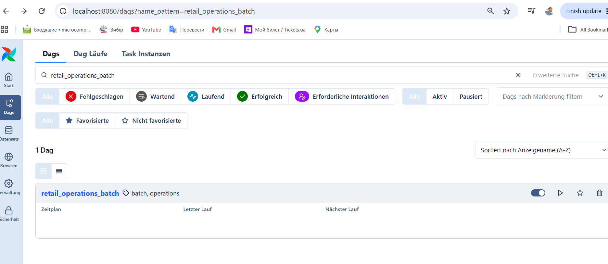
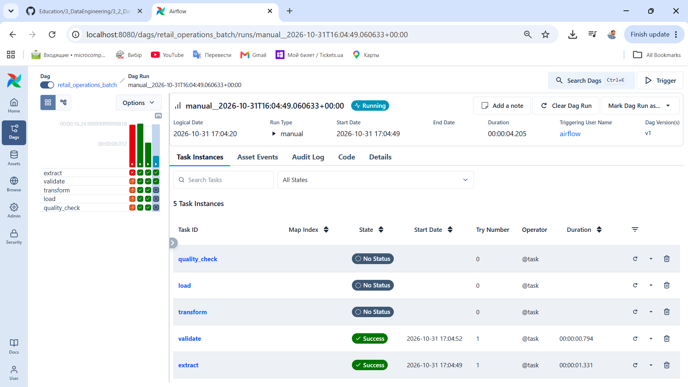
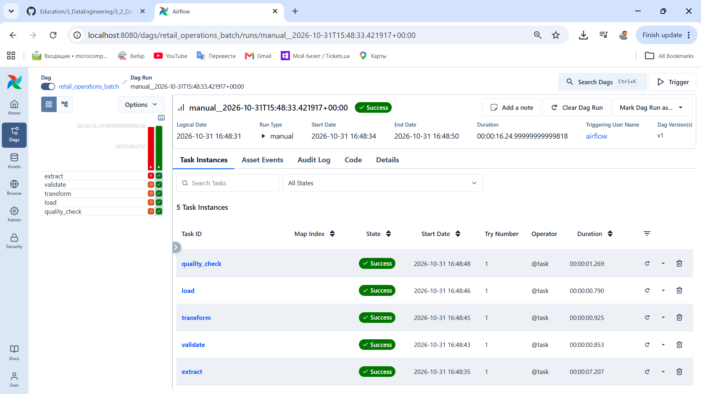
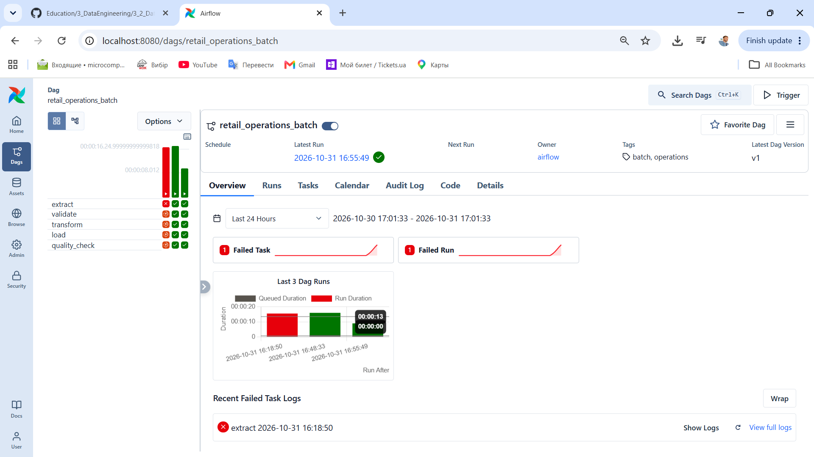
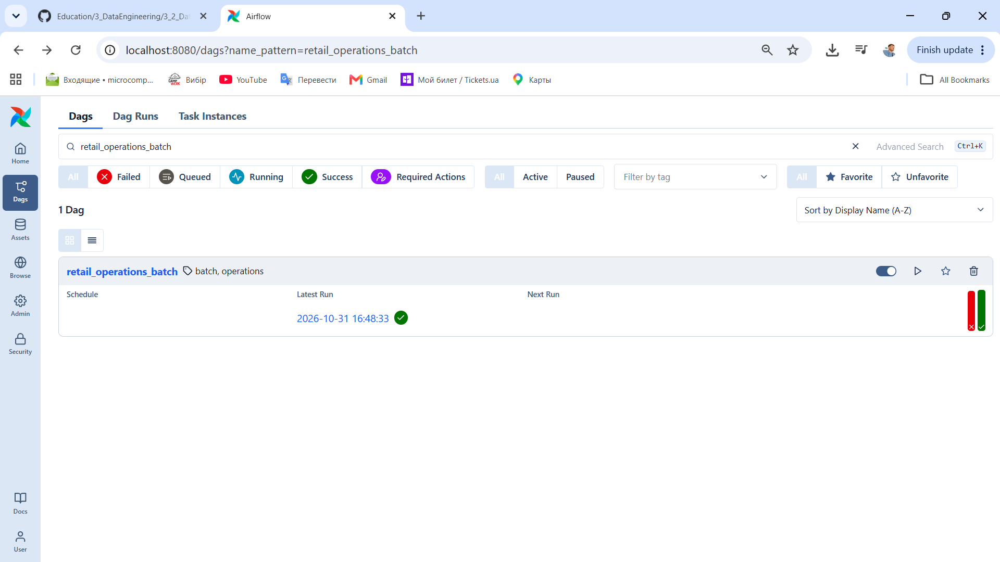

# Lakehouse Data Pipelines with Spark and dbt

## Module 3 — Data Pipelines

**Author:** R. Lisovenko  
**Lab date:** 31 October 2026  
**Environment:** Windows, PowerShell, Docker Desktop, Apache Airflow 3.1.7

### Overview

This lab covers the deployment of Apache Airflow with Docker Compose and the implementation of a batch-processing DAG for retail operations data. The workflow reads a CSV dataset, validates its records, applies transformations, writes a processed CSV file, and checks the resulting output.

The deployment uses PostgreSQL for Airflow metadata and Redis as the message broker for the CeleryExecutor. The configuration is intended for local development and training, not production use.

### 1. Project structure

The Airflow environment is maintained in a separate lab directory within Module 3:

```text
module_3_DataPipelines/
├── readme.md                          # This documentation
├── pic/                               # Screenshots referenced below
└── m3_1_Airflow with Docker Compose/
    ├── config/                        # Airflow configuration
    ├── dags/
    │   └── retail_operations_batch.py
    ├── data/
    │   └── operations_raw.csv         # Source dataset (8 records)
    ├── logs/                          # Airflow execution logs
    ├── output/
    │   └── operations_processed.csv   # Generated by the DAG
    ├── plugins/                       # Optional Airflow plugins
    ├── .env                           # Local environment settings
    └── docker-compose.yaml           # Airflow services and volumes
```

Unless indicated otherwise, run the PowerShell commands below from `m3_1_Airflow with Docker Compose`.

Create the directories if they are not already present:

```powershell
New-Item -ItemType Directory -Force -Path config, dags, data, logs, output, plugins | Out-Null
```

### 2. Docker Compose setup

#### Prerequisites

Docker Desktop must be running in Linux-container mode. Verify the installed CLI tools and the Docker Engine:

```powershell
docker --version
docker compose version
docker info
```

The lab was run with Docker 29.5.2 and Docker Compose v5.1.4. The host Python virtual environment is separate from Airflow's Python runtime inside Docker.

#### Obtain `docker-compose.yaml`

Download the official Airflow 3.1.7 Compose configuration into the lab directory:

```powershell
Invoke-WebRequest `
    -Uri "https://airflow.apache.org/docs/apache-airflow/3.1.7/docker-compose.yaml" `
    -OutFile "docker-compose.yaml"
```

This command **replaces** an existing file with the same name. Existing customizations should be backed up before downloading it again.

Create or edit `.env` with the following value for this Windows-based local setup:

```dotenv
AIRFLOW_UID=50000
```

The official Compose file defines the Airflow services together with PostgreSQL and Redis. To list the configured service names without starting containers:

```powershell
docker compose config --quiet
docker compose config --services
```

The lab configuration exposed the following services:

```text
redis
postgres
airflow-init
airflow-apiserver
airflow-dag-processor
airflow-scheduler
airflow-triggerer
airflow-worker
```

The service names displayed by `docker compose config --services` are the authoritative names for the local configuration.

#### Mount input and output directories

The default quick-start configuration mounts `dags`, `logs`, `config`, and `plugins`. This batch lab also requires `data` and `output`. Add the last two mappings under the existing **`x-airflow-common` → `volumes`** block in `docker-compose.yaml`, preserving the remaining configuration:

```yaml
# Relevant volume entries within x-airflow-common:
volumes:
  - ${AIRFLOW_PROJ_DIR:-.}/dags:/opt/airflow/dags
  - ${AIRFLOW_PROJ_DIR:-.}/logs:/opt/airflow/logs
  - ${AIRFLOW_PROJ_DIR:-.}/config:/opt/airflow/config
  - ${AIRFLOW_PROJ_DIR:-.}/plugins:/opt/airflow/plugins
  - ${AIRFLOW_PROJ_DIR:-.}/data:/opt/airflow/data
  - ${AIRFLOW_PROJ_DIR:-.}/output:/opt/airflow/output
```

These entries are a **fragment of the existing configuration**, not a complete replacement for `docker-compose.yaml`. The `data` mount makes the input CSV accessible to tasks; the `output` mount persists processed results on the host.

After changing volume mappings, validate the configuration and recreate the worker to apply them:

```powershell
docker compose config --quiet
docker compose up -d --force-recreate airflow-worker
```

#### Initialize and start Airflow

Initialize the Airflow metadata database and local administrator account:

```powershell
docker compose up airflow-init
```

Successful initialization ends with:

```text
airflow-init-1 exited with code 0
```

Then start the remaining services in detached mode and inspect their status:

```powershell
docker compose up -d
docker compose ps
docker compose ps -a
```

The `airflow-init` container is expected to stop after initialization. Runtime services should be running and, where health checks are defined, healthy.

#### Access the Airflow Web UI

Open **http://localhost:8080** in a browser. Port mapping `8080:8080` exposes the Airflow interface from the container on the host.

For the default local training configuration:

| Field | Value |
|---|---|
| Username | `airflow` |
| Password | `airflow` |

These default credentials are for local development only.

### 3. Batch DAG implementation

**DAG** stands for **Directed Acyclic Graph**. In Airflow, it defines a workflow and the dependencies between tasks without circular dependencies.

The DAG file is located at `dags/retail_operations_batch.py`, and the input data is stored in `data/operations_raw.csv`.

The sample input is a CSV file with the following fields and eight records:

```csv
record_id,source_system,category,quantity,amount,status
1,CRM,Customer,12,1500.50,ACTIVE
2,ERP,Inventory,8,2400.00,ACTIVE
3,API,Orders,15,3200.75,PENDING
4,CRM,Customer,10,1800.25,ACTIVE
5,ERP,Inventory,20,4100.00,ACTIVE
6,API,Orders,5,2800.00,INACTIVE
7,CRM,Customer,7,1750.00,ACTIVE
8,ERP,Inventory,6,2200.00,PENDING
```

Store this content in `data/operations_raw.csv` before running the DAG.

| DAG setting | Value |
|---|---|
| DAG ID | `retail_operations_batch` |
| Start date | `2026-08-01` |
| Schedule | `None` — manually triggered |
| Catchup | `False` |
| Tags | `batch`, `operations` |
| Number of tasks | 5 |

#### Processing flow

```text
┌───────────────────────────────────────────┐
│  1. EXTRACT                              │
│  Read operations_raw.csv                 │
└───────────────────────────────────────────┘
                     ↓
┌───────────────────────────────────────────┐
│  2. VALIDATE                             │
│  Check required fields and numeric data  │
└───────────────────────────────────────────┘
                     ↓
┌───────────────────────────────────────────┐
│  3. TRANSFORM                            │
│  Convert types and standardize values    │
└───────────────────────────────────────────┘
                     ↓
┌───────────────────────────────────────────┐
│  4. LOAD                                 │
│  Write operations_processed.csv          │
└───────────────────────────────────────────┘
                     ↓
┌───────────────────────────────────────────┐
│  5. QUALITY CHECK                        │
│  Verify the output file and record count │
└───────────────────────────────────────────┘
```

The TaskFlow API (`@dag` and `@task` from `airflow.sdk`) establishes task dependencies through function calls. With `schedule=None`, the DAG is executed manually rather than on a timer.

#### Validate DAG registration

Check the file and its Python syntax inside the DAG processor container:

```powershell
docker compose exec airflow-dag-processor ls -lh /opt/airflow/dags/
docker compose exec airflow-dag-processor python -m py_compile /opt/airflow/dags/retail_operations_batch.py
docker compose exec airflow-dag-processor airflow dags list-import-errors --local
```

List the registered DAGs or filter for the lab workflow:

```powershell
docker compose exec airflow-apiserver airflow dags list
docker compose exec airflow-apiserver airflow dags list | Select-String 'retail_operations_batch'
```

A successful registration contains `retail_operations_batch` with its source file under `/opt/airflow/dags/`. DAG discovery can take a short time after a file is saved; a container restart is not normally required.

### 4. Trigger and monitor the workflow

1. Open **http://localhost:8080** and select **DAGs**.
2. Search for `retail_operations_batch`.
3. Use the **Pause / Unpause** toggle to enable the DAG if necessary.
4. Select **Trigger → Single Run** to execute it manually.
5. Open the resulting DAG Run and inspect **Task Instances**, task status, and **Logs**.

Enabling the DAG does not automatically execute it because `schedule=None`.

**DAG list and manual trigger control:**



**Execution in progress:** `extract` and `validate` have succeeded; downstream tasks are still pending at the moment of capture.



**Successful DAG execution:** all five tasks have the `Success` state.



The successful run shown above completed in approximately **16.25 seconds**. Another successful run completed in approximately **9 seconds**. Run times can vary between executions.

#### DAG Overview

To inspect historical executions, open **DAGs → retail_operations_batch → Overview** and select **Last 24 Hours**.

The overview shows recent run durations, failed tasks and runs, the task-status grid, and links to error logs. At the time of the recorded overview, one initial failed execution was followed by two successful executions.



The DAG list also indicates the status of the latest completed run:



### 5. Output verification

After a successful run, the `load` task writes the processed dataset to the host-mounted output directory:

```text
m3_1_Airflow with Docker Compose/
└── output/
    └── operations_processed.csv
```

Inspect the generated file and verify the expected **eight data records**:

```powershell
Get-ChildItem .\output
Get-Content .\output\operations_processed.csv
(Import-Csv .\output\operations_processed.csv | Measure-Object).Count
```

The expected record count is `8` for the sample dataset. The output retains the validated and transformed records from the input CSV. The Airflow `quality_check` task also verifies that the output exists and that the number of loaded records is positive.

### 6. Troubleshooting and resolutions

The issues encountered during setup and execution are documented below with their causes and verification steps.

#### 6.1 Invalid Docker Compose YAML

**Symptom**

```text
yaml: construct errors:
line 1: cannot construct !!str `postgre...` into cli.named
```

**Cause:** A plain-text list of service names was placed in `docker-compose.yaml` instead of a YAML Compose definition. The output of `docker compose config --services` is diagnostic information, not file contents.

**Resolution:** Restore the complete official `docker-compose.yaml` and then apply only the required custom volume mappings. Validate it using:

```powershell
docker compose config --quiet
docker compose config --services
```

#### 6.2 Docker Engine connection unavailable

**Symptom**

```text
failed to connect to the docker API at npipe:////./pipe/dockerDesktopLinuxEngine
The system cannot find the file specified.
```

**Cause:** The Docker CLI was installed, but the Docker Desktop Linux Engine was not available.

**Resolution:** Start Docker Desktop, use Linux containers, and confirm engine connectivity before running Airflow:

```powershell
Start-Process 'C:\Program Files\Docker\Docker\Docker Desktop.exe'
docker info
docker ps
```

`docker --version` alone only confirms the presence of the CLI; it does not prove that the Docker Engine is running.

#### 6.3 DAG not listed in Airflow

**Symptom:** The initial `airflow dags list` output contained only built-in example DAGs.

**Cause:** `dags/retail_operations_batch.py` was present in the mounted directory but initially had a file size of **0 bytes**.

**Resolution:** Save the complete Python DAG code, verify its nonzero file size, check its syntax, and allow Airflow's DAG processor to discover it.

```powershell
Get-Item .\dags\retail_operations_batch.py | Select-Object Name, Length
docker compose exec airflow-dag-processor ls -lh /opt/airflow/dags/
docker compose exec airflow-dag-processor airflow dags list-import-errors --local
```

**Verification:** `retail_operations_batch` appeared in `airflow dags list` with `bundle_name` set to `dags-folder`. Manual restart was not necessary.

#### 6.4 Input CSV missing inside the container

**Symptom:** The first triggered run failed in `extract`:

```text
FileNotFoundError: [Errno 2] No such file or directory:
'/opt/airflow/data/operations_raw.csv'
```

The four downstream tasks showed `Upstream Failed`, because their dependency on `extract` was not satisfied.


**Cause:** `data/operations_raw.csv` existed on the Windows host, but the `data` directory was not mounted in the worker container. The standard quick-start Compose configuration does not include this lab-specific directory.

**Resolution:** Add the `data` and `output` mappings to `x-airflow-common` under `volumes`, as shown in Section 2, and recreate the worker:

```powershell
Test-Path .\data\operations_raw.csv
docker compose config --quiet
docker compose up -d --force-recreate airflow-worker
docker compose exec airflow-worker ls -lh /opt/airflow/data/operations_raw.csv
```

**Verification:** The next manual run completed all five tasks successfully. The original failed run remained in the DAG history, preserving the troubleshooting record.

### 7. Summary

The lab established a working Airflow 3.1.7 environment with Docker Compose, registered a manually triggered batch DAG, and completed the five-stage CSV-processing workflow. The initial failures demonstrated three operational requirements: valid Compose configuration, an available Docker Engine, and explicit host-to-container volume mappings for datasets and generated files.

**Reference:** [Apache Airflow 3.1.7 — Running Airflow in Docker](https://airflow.apache.org/docs/apache-airflow/3.1.7/howto/docker-compose/index.html)
