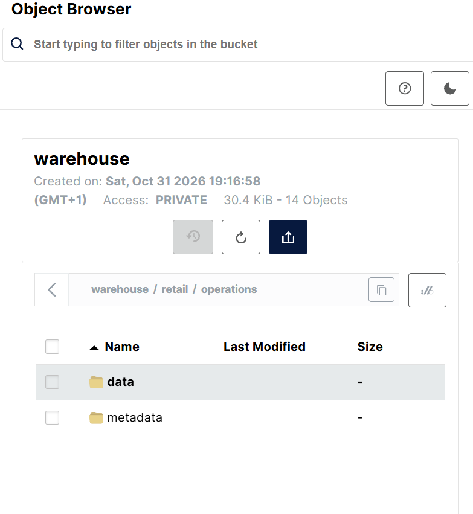
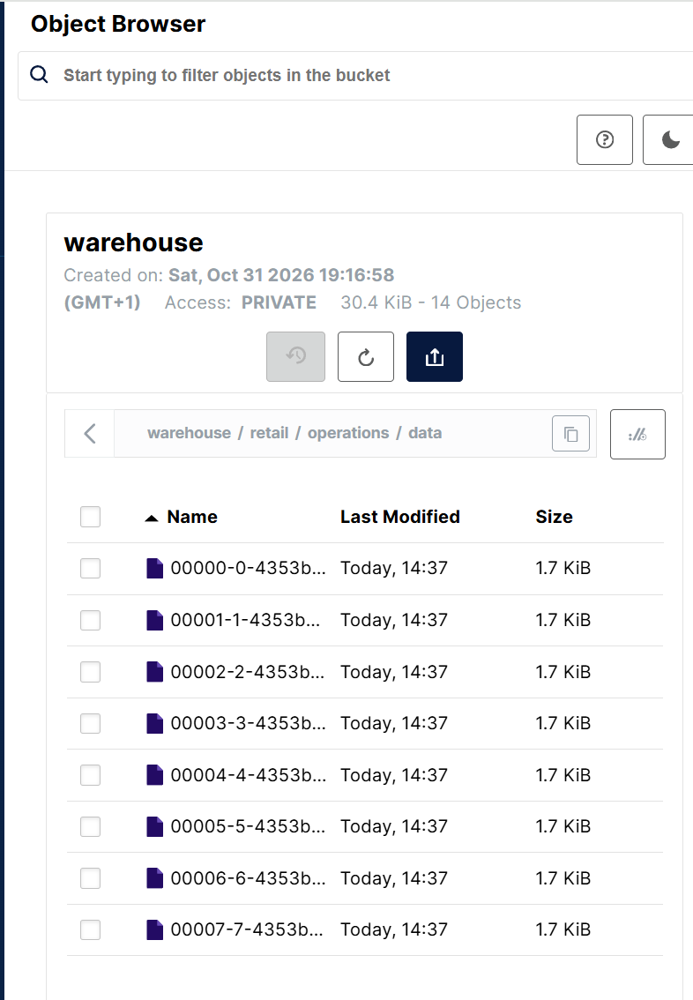
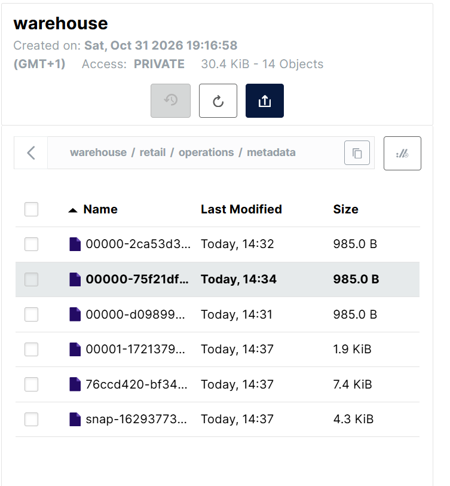

# Lakehouse Data Pipelines with Spark and dbt
**Course:** Lakehouse Data Pipelines with Spark and dbt  
**Module:** 3.2 — Data Pipelines  
**Executor:** R. Lisovenko  
**Date:** 31 October 2026

## Service Access Points

| Service | Local URL | Description |
|---|---|---|
| MinIO Console | http://localhost:9001 | Manage S3-compatible storage |
| Iceberg REST Catalog | http://localhost:8181 | Iceberg catalog API |
| Spark Web UI | http://localhost:8081 | Monitor Spark applications |
| Jupyter Notebook | http://localhost:8888 | Execute Spark notebooks |

### MinIO Warehouse

The `warehouse` bucket is automatically created
by the MinIO initialization container (`mc`).

Bucket URL:
http://localhost:9001/browser/warehouse

Development credentials:
- Username: `admin`
- Password: `password`

The bucket does not need to be created manually.

### Starting the Environment

```powershell
docker compose up -d
docker compose ps -a

## Module 3 — Data Pipelines / 3.2 Creating an Apache Iceberg Table on MinIO

### Overview

This laboratory introduces an Apache Iceberg table backed by MinIO object storage and accessed through Apache Spark. Docker Compose provides an isolated environment for Spark, a REST catalog, and an S3-compatible storage service.

**Current status:** The project directory and a draft Docker Compose configuration have been prepared. Container startup, table creation, and data queries have **not yet been verified**. The configuration is adapted from a public Spark–Iceberg–MinIO example; it is not confirmed to be the exact file used in the course video.

### Objectives

- Start the containerized Spark–Iceberg–MinIO environment.
- Verify access to MinIO and the Iceberg catalog.
- Create an Iceberg table and insert sample data.
- Query the table and inspect its metadata and stored objects.
- Record configuration changes, commands, and results.

### Components

| Component | Role |
|---|---|
| Apache Spark | Executes SQL and distributed data processing |
| Apache Iceberg | Table format supporting snapshots, schema evolution, and metadata management |
| Iceberg REST Catalog | Catalog interface used to identify and manage tables |
| MinIO | S3-compatible storage for table data and metadata files |
| Docker Compose | Defines and runs the local containers |

### Project structure

```text
m3_2_Iceberg Table on MinIO/
├── spark/                  # Spark files, if required by the lab
├── docker-compose.yml     # Compose configuration for this lab
└── readme.md              # This document
```

Depending on the Compose volume mappings, additional local folders such as `warehouse/`, `notebooks/`, or `minio-data/` may appear. They are not required to be created manually before validating the configuration.

### 1. Prerequisites

Docker Desktop must be running with Linux containers. From PowerShell:

```powershell
docker --version
docker compose version
docker info
```

The active Python virtual environment on the host does not control Python packages inside the Docker containers.

### 2. Docker Compose configuration

A `docker-compose.yml` file is required in this lab directory. The draft used for the local setup defines these services:

| Service | Purpose |
|---|---|
| `spark-iceberg` | Spark runtime for Iceberg operations |
| `rest` | Iceberg REST Catalog |
| `minio` | S3-compatible object storage |
| `mc` | One-time initialization of the MinIO warehouse bucket |

The local Compose example maps the MinIO Console to port `9001`, the catalog to `8181`, and Spark's container port `8080` to host port `8081` to avoid conflicting with the Airflow lab on host port `8080`.

These values describe the local draft configuration and should be checked against the actual `docker-compose.yml` before use. The development-only MinIO credentials in that draft are `admin` / `password`; they must not be used for a public deployment.

### 3. Validate and start the environment

Run all commands from `m3_2_Iceberg Table on MinIO`, **not** from the previous Airflow lab directory:

```powershell
# Check the available services and YAML syntax
docker compose config --services
docker compose config --quiet

# Start the configured services
docker compose up -d
docker compose pull minio mc

# Inspect running and one-time containers
docker compose ps -a
```

Expected service names for the draft configuration:

```text
spark-iceberg
rest
minio
mc
```

The `mc` container is designed to finish after bucket setup; an `Exited (0)` status for this one-time service may be normal. Other services should remain running.

Check the service logs if startup fails:

```powershell
docker compose logs --tail 80 spark-iceberg rest minio mc
```

### 4. Access points (after successful startup)

| Service | Address | Notes |
|---|---|---|
| MinIO Console | http://localhost:9001 | Login uses the local Compose credentials |
| Iceberg REST Catalog | http://localhost:8181 | Service endpoint, not a full management UI |
| Spark Web UI | http://localhost:8081 | May appear only while a Spark application is active |
| Jupyter | http://localhost:8888 | Access depends on container startup and authentication settings |

These addresses are based on the draft port mappings, **not** on an observed successful container run.
- Open 
http://localhost:9001

- Username: admin
- Password: password

### 5. Iceberg table creation

The practical steps below remain to be completed and documented once the local environment starts successfully:

1. Verify Spark access to the configured Iceberg catalog.
2. Confirm that the warehouse bucket exists in MinIO.
3. Create an Iceberg namespace and table.
4. Insert sample records and execute queries.
5. Inspect the object storage layout and table metadata.

The exact SQL statements and output will be recorded after execution, rather than assumed in advance.

### 6. Managing the environment

Stop this lab's containers without deleting named volumes:

```powershell
docker compose down
```

Avoid adding `-v` unless the intent is to delete associated volumes. Bind-mounted files and directories are managed separately.

----------------------
docker exec -it spark-iceberg /opt/spark/bin/spark-sql --conf spark.jars.ivy=/tmp/.ivy2 --packages org.apache.iceberg:iceberg-spark-runtime-3.5_2.12:1.10.1,org.apache.hadoop:hadoop-aws:3.3.4,com.amazonaws:aws-java-sdk-bundle:1.12.262

## 5. Iceberg Table Creation

### 5.1 Starting Spark SQL CLI

Apache Spark SQL CLI is used to create, manage, and query Apache Iceberg tables stored in MinIO.

The following command launches Spark SQL inside the Docker container and loads the required Iceberg and S3 dependencies.

**Original course command:**

```powershell
docker exec -it iceberg-spark /opt/spark/bin/spark-sql --conf spark.jars.ivy=/tmp/.ivy2 --packages org.apache.iceberg:iceberg-spark-runtime-3.5_2.12:1.10.1,org.apache.hadoop:hadoop-aws:3.3.4,com.amazonaws:aws-java-sdk-bundle:1.12.262
```

**Adapted command for the local Docker environment:**

```powershell
docker exec -it spark-iceberg /opt/spark/bin/spark-sql --conf spark.jars.ivy=/tmp/.ivy2 --packages org.apache.iceberg:iceberg-spark-runtime-3.5_2.12:1.10.1,org.apache.hadoop:hadoop-aws:3.3.4,com.amazonaws:aws-java-sdk-bundle:1.12.262
```

**Command parameters:**

| Parameter | Description |
|---|---|
| `docker exec -it` | Executes an interactive command inside a running container |
| `spark-iceberg` | Local Docker container running Apache Spark |
| `spark-sql` | Starts the Spark SQL command-line interface |
| `spark.jars.ivy=/tmp/.ivy2` | Sets the dependency cache directory |
| `iceberg-spark-runtime-3.5_2.12:1.10.1` | Provides Apache Iceberg integration for Spark 3.5 |
| `hadoop-aws:3.3.4` | Provides Hadoop S3 filesystem support |
| `aws-java-sdk-bundle:1.12.262` | Provides AWS SDK libraries for S3-compatible storage |

**Expected result:**

After initialization and dependency resolution, the Spark SQL prompt should appear:

```text
spark-sql>
```

**Note:** The local container name differs from the course example. The adapted command and dependency compatibility require verification in the local environment.
---------------------
### 5.2 Aligning the Iceberg Catalog Configuration with the Course

#### Purpose

During the laboratory, a configuration difference was identified between the original course environment and our local Docker setup.

| Configuration | Course Environment | Local Environment |
|---|---|---|
| Spark container | `iceberg-spark` | `spark-iceberg` |
| Iceberg catalog | `local` | `demo` |
| Namespace | `retail` | `retail` |
| Table | `operations` | `operations` |

The `SHOW CATALOGS;` command confirmed that our environment initially contained two catalogs: `demo` and `spark_catalog`.

To follow the instructor's SQL examples without modifying every statement, the Iceberg catalog configuration is adjusted from `demo` to `local`.

**This change affects the Spark catalog configuration only.** The existing MinIO bucket `warehouse` and its Docker volume remain unchanged.

#### Step 1 — Export the Spark Configuration

Exit Spark SQL:

```sql
quit;
```

Copy the existing configuration file from the Docker container to the local project directory:

```powershell
docker cp spark-iceberg:/opt/spark/conf/spark-defaults.conf ".\spark\spark-defaults.conf"
```

#### Step 2 — Rename the Iceberg Catalog

Open `spark/spark-defaults.conf`.

Replace the catalog configuration prefix:

```properties
spark.sql.catalog.demo
```

with:

```properties
spark.sql.catalog.local
```

Apply this change to all corresponding catalog properties, including the catalog implementation, REST URI, warehouse location, and S3 settings.

Set the default catalog, if required:

```properties
spark.sql.defaultCatalog local
```

Keep the existing endpoint URLs, credentials, warehouse path, and other configuration values unchanged.

#### Step 3 — Mount the Configuration File

Update the `spark-iceberg` service in `docker-compose.yml`.

Add the following volume mapping under its existing `volumes` section:

```yaml
- ./spark/spark-defaults.conf:/opt/spark/conf/spark-defaults.conf:ro
```

This ensures that the modified Spark configuration is loaded when the container starts and persists across container recreation.

#### Step 4 — Validate and Recreate the Spark Container

Validate the Docker Compose configuration:

```powershell
docker compose config --quiet
```

Recreate only the Spark container to apply the updated configuration:

```powershell
docker compose up -d --no-deps --force-recreate spark-iceberg
```

The MinIO and Iceberg REST Catalog services do not need to be recreated.

#### Step 5 — Verify the Updated Catalog

Start Spark SQL using the command documented in Section 5.1.

Run:

```sql
SHOW CATALOGS;
```

Expected output:

```text
local
spark_catalog
```

Verify the catalog configuration for Local:

```sql
SET spark.sql.catalog.local;
```

After confirming the configuration, continue with the original SQL statements from the course:

```sql
CREATE NAMESPACE IF NOT EXISTS local.retail;
```

#### Result

Once verified, the local Spark environment will use the same Iceberg catalog name as the course examples.

This adjustment improves reproducibility, simplifies following the instructor's SQL commands, and avoids unnecessary differences between the laboratory documentation and the local implementation.

**Note:** Container recreation is not the same as rebuilding a Docker image. The existing image is reused, and the container is recreated with the updated configuration. These steps are documented as a configuration procedure; successful verification must be recorded after execution.

--------Verify the catalog configuration for Demo :
```text
docker exec -it spark-iceberg /opt/spark/bin/spark-sql
```
```
CREATE NAMESPACE IF NOT EXISTS demo.retail;
SHOW NAMESPACES IN demo;
CREATE NAMESPACE IF NOT EXISTS demo.retail;
SHOW NAMESPACES IN demo;
```
```sql
CREATE TABLE demo.retail.operations (
    record_id INT,
    source_system STRING,
    category STRING,
    quantity INT,
    amount DOUBLE,
    status STRING
)
USING iceberg;
```

```sql
SHOW TABLES IN demo.retail;
```
```sql
SHOW CATALOGS;
```
### 5.3 Inserting Sample Data into Iceberg Table

```sql
INSERT INTO demo.retail.operations VALUES
(1, 'CRM', 'Customer', 12, 1500.50, 'ACTIVE'),
(2, 'ERP', 'Inventory', 8, 2400.00, 'ACTIVE'),
(3, 'API', 'Orders', 15, 3200.75, 'PENDING'),
(4, 'CRM', 'Customer', 10, 1800.25, 'ACTIVE'),
(5, 'ERP', 'Inventory', 20, 4100.00, 'ACTIVE'),
(6, 'API', 'Orders', 5, 2800.00, 'INACTIVE'),
(7, 'CRM', 'Customer', 7, 1750.00, 'ACTIVE'),
(8, 'ERP', 'Inventory', 6, 2200.00, 'PENDING');
```
```sql
SELECT * FROM demo.retail.operations;
```
### 5.4 Inspecting the Iceberg Table Metadata

The `DESCRIBE TABLE EXTENDED` command displays the table schema, metadata columns, storage location, provider, and table properties.

**Original course command:**

```sql
DESCRIBE TABLE EXTENDED local.retail.operations;
```

**Adapted command for our Docker environment:**

```sql
DESCRIBE TABLE EXTENDED demo.retail.operations;
```

#### Expected Table Information

| Property | Value | Description |
|---|---|---|
| Name | `demo.retail.operations` | Fully qualified table name in our environment |
| Type | `MANAGED` | Managed Iceberg table |
| Provider | `iceberg` | Apache Iceberg table format |
| Owner | `spark` | Table owner |
| Location | `s3a://warehouse/iceberg/retail/operations` | Table storage path in MinIO |
| Data Format | `iceberg/parquet` | Parquet data files managed by Iceberg |
| Format Version | `2` | Apache Iceberg table format version |
| Current Snapshot ID | Generated automatically | Identifies the current table snapshot |

#### Table Schema

| Column | Data Type |
|---|---|
| `record_id` | INT |
| `source_system` | STRING |
| `category` | STRING |
| `quantity` | INT |
| `amount` | DOUBLE |
| `status` | STRING |

#### Iceberg Metadata Columns

Apache Iceberg also exposes metadata columns such as:

- `_spec_id` — Partition specification identifier.
- `_partition` — Partition information.
- `_file` — Source data file path.
- `_pos` — Row position within the file.
- `_deleted` — Row deletion indicator.
- `_row_id` — Row identifier.
- `_last_updated_sequence_number` — Sequence number associated with the latest row update.

#### Result

The course output confirms that `operations` is a managed Apache Iceberg table using Parquet files and Iceberg format version 2.

The table is stored in the MinIO `warehouse` bucket. Iceberg manages the table metadata and snapshots, while Apache Spark executes SQL queries and data operations.

**Note:** The course uses the `local` catalog, while our Docker environment uses `demo`. The actual table location and properties should be verified using the adapted command.

### 5.5 Inspecting Iceberg Table Snapshots

Apache Iceberg maintains table snapshots to track changes and support versioned data management.

**Original course command:**

```sql
SELECT snapshot_id, operation
FROM local.retail.operations.snapshots;
```

**Adapted command for our Docker environment:**
```sql
SELECT COUNT(*) FROM demo.retail.operations;
SELECT * FROM demo.retail.operations.snapshots;
```
```sql
SELECT snapshot_id, operation
FROM demo.retail.operations.snapshots;
```

#### Result

#### Verified Iceberg Table Metadata

```sql
DESCRIBE TABLE EXTENDED demo.retail.operations;
```

| Property | Value |
|---|---|
| Name | `demo.retail.operations` |
| Type | `MANAGED` |
| Location | `s3://warehouse/retail/operations` |
| Provider | `iceberg` |
| Owner | `root` |
| Data Format | `iceberg/parquet` |
| Format Version | `2` |
| Compression | `zstd` |
| Current Snapshot ID | `1629377304228341931` |

The table contains eight successfully inserted records.
The current Iceberg snapshot is confirmed through
the table properties.

The direct metadata query using `.snapshots`
has not yet been successfully executed.

### 5.6 Verifying Iceberg Table Storage in MinIO

#### Objective

Verify that Apache Spark successfully created an Apache Iceberg
table and stored its data and metadata in MinIO object storage.

#### SQL Operations Performed

The following operations were completed using Spark SQL:

| SQL Command | Purpose | Result |
|---|---|---|
| `CREATE NAMESPACE IF NOT EXISTS demo.retail;` | Create an Iceberg namespace | Successful |
| `CREATE TABLE demo.retail.operations (...) USING iceberg;` | Create an Iceberg table | Successful |
| `SHOW TABLES IN demo.retail;` | Verify table registration | `operations` |
| `INSERT INTO demo.retail.operations VALUES (...);` | Insert sample data | 8 records inserted |
| `SELECT COUNT(*) FROM demo.retail.operations;` | Verify the record count | 8 |
| `DESCRIBE TABLE EXTENDED demo.retail.operations;` | Inspect table metadata | Successful |

#### Verified Table Properties

The following command was used to inspect the table:

```sql
DESCRIBE TABLE EXTENDED demo.retail.operations;
```

Actual results:

| Property | Value |
|---|---|
| Table | `demo.retail.operations` |
| Type | `MANAGED` |
| Provider | `iceberg` |
| Storage Location | `s3://warehouse/retail/operations` |
| Owner | `root` |
| Data Format | `iceberg/parquet` |
| Format Version | `2` |
| Compression | `zstd` |
| Current Snapshot ID | `1629377304228341931` |

#### Verification in MinIO Console

After executing the SQL commands, the MinIO Console was opened:

http://localhost:9001

The following storage path was inspected:

```text
warehouse/
└── retail/
    └── operations/
        ├── data/
        └── metadata/
```

**Observed results:**

- The `warehouse` bucket was accessible.
- The `retail/operations` path was created automatically.
- The `data` directory was present.
- The `metadata` directory was present.
- The MinIO Console displayed 14 objects and 30.4 KiB
  of storage for the entire `warehouse` bucket.

#### Storage Structure

| Directory | Description |
|---|---|
| `data/` | Stores table data files, typically in Parquet format |
| `metadata/` | Stores Iceberg metadata, manifests, and snapshot-related information |

The directories were created through Apache Iceberg operations.
No manual folder creation was required in MinIO.

#### Result

**Status: Successfully verified.**

Apache Spark successfully created and populated the
`demo.retail.operations` Iceberg table with eight records.

The table metadata confirmed Iceberg format version 2,
Parquet storage, ZSTD compression, and an active snapshot.

The MinIO Object Browser confirmed the physical storage
structure containing the `data` and `metadata` directories.

This demonstrates the integration of:

**Apache Spark → Apache Iceberg REST Catalog → MinIO**

The course environment uses the catalog name `local`,
while the local Docker environment uses `demo`.
Both configurations follow the same Iceberg workflow.



#### Iceberg Data Files



Eight data files were generated after inserting eight records
into the Iceberg table.

#### Iceberg Metadata Files



Six metadata files were observed, including snapshot-related
metadata generated by Apache Iceberg.


---------------------

### Reference

- [Databricks — docker-spark-iceberg (example environment)](https://github.com/databricks/docker-spark-iceberg)

The Docker Compose configuration may differ from the course author's setup. The observed service states and table operations should determine the remaining documentation.
