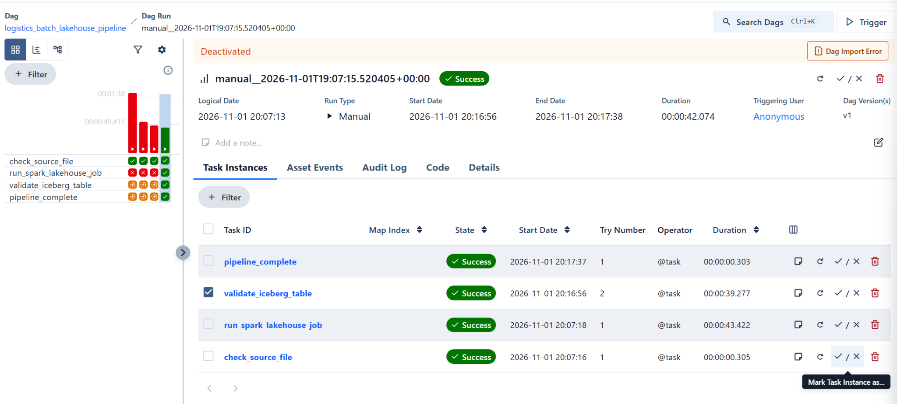
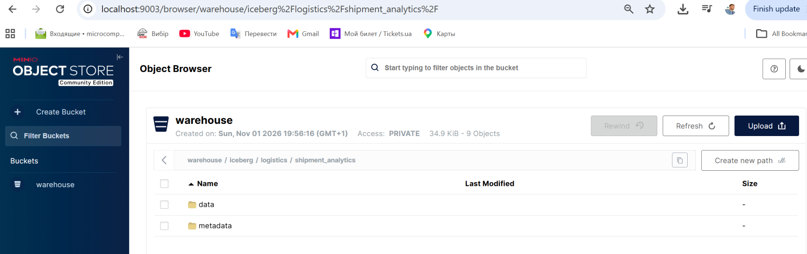
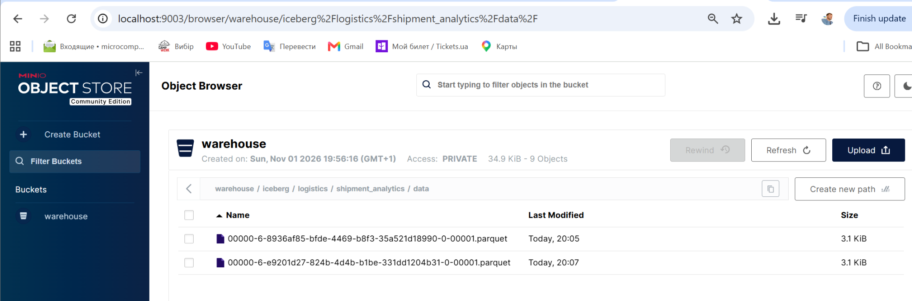
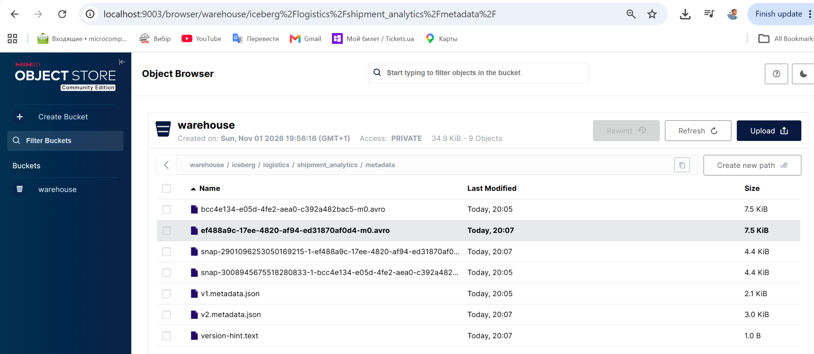

# Module 3 — Data Pipelines
**Executor:** LiR  
**Date:** 01 November 2026

## 3.3 Building an Orchestrated Batch Lakehouse Pipeline

**Course:** Lakehouse Data Pipelines with Spark and dbt  
**Module:** 3.3 — Data Pipelines  
**Executor:** R. Lisovenko  
**Completed:** 01 November 2026  
**Environment:** Windows, PowerShell, Docker Desktop with WSL2  
**Result:** **SUCCESS — 4/4 Airflow tasks; 8/8 shipment records validated**

---

## Contents

1. [Objective and business scenario](#1-objective-and-business-scenario)
2. [Architecture and technology stack](#2-architecture-and-technology-stack)
3. [Project structure and input data](#3-project-structure-and-input-data)
4. [Local environment, ports, and configuration](#4-local-environment-ports-and-configuration)
5. [Deployment and initial checks](#5-deployment-and-initial-checks)
6. [Spark transformation and Iceberg storage](#6-spark-transformation-and-iceberg-storage)
7. [Independent Spark and SQL verification](#7-independent-spark-and-sql-verification)
8. [Airflow orchestration and final execution](#8-airflow-orchestration-and-final-execution)
9. [Troubleshooting and resolutions](#9-troubleshooting-and-resolutions)
10. [MinIO verification and screenshots](#10-minio-verification-and-screenshots)
11. [Reproduction checklist and lessons learned](#11-reproduction-checklist-and-lessons-learned)

---

## 1. Objective and business scenario

### 1.1 Objective

Implement and verify a containerized batch Lakehouse pipeline that combines **Apache Airflow**, **Apache Spark**, **Apache Iceberg**, and **MinIO**. The workflow validates incoming data, performs batch transformations, writes an Iceberg table, checks the resulting record count, and reports completion.

### 1.2 Business scenario

A logistics company receives daily shipment records from multiple distribution centers. The incoming CSV deliberately contains data-quality problems:

- Inconsistent distribution center names and extra whitespace.
- Mixed capitalization in shipment statuses.
- A missing shipping cost.
- Numeric values that require consistent types and a calculated cost-per-package metric.

The laboratory processes **eight shipment records** and publishes them to an Iceberg table for subsequent SQL analysis.

### 1.3 Verified outcome

| Validation | Observed result |
|---|---|
| Source shipment records | 8 |
| Spark Job exit code | `0` |
| Iceberg table | `demo.logistics.shipment_analytics` |
| SQL `COUNT(*)` | 8 |
| Airflow task results | 4 of 4 `Success` |
| MinIO storage | Parquet data and Iceberg metadata present |

> **Scope:** These are results observed in the local laboratory on 01 November 2026. They are not production capacity or performance measurements.

## 2. Architecture and technology stack

### 2.1 Components

| Component | Version / image | Responsibility |
|---|---|---|
| Apache Airflow | `apache/airflow:3.3.1` | Schedule, execute, and monitor the DAG |
| Apache Spark | `apache/spark:3.5.7` | Read, validate, clean, and transform CSV data |
| Apache Iceberg | Spark runtime `1.10.1` | Manage tables, schema, and snapshots |
| MinIO | `cgr.dev/chainguard/minio:latest` | S3-compatible object storage |
| PostgreSQL | `postgres:16` | Airflow metadata database |
| Redis | `redis:7.2-bookworm` | Celery task broker |
| Docker Compose | Docker Desktop | Provision the laboratory services |

The Spark Job also uses `hadoop-aws:3.3.4` and `aws-java-sdk-bundle:1.12.262` to access S3-compatible storage.

### 2.2 Processing flow

```text
                     Airflow DAG
                         |
       check_source_file (source validation)
                         |
          run_spark_lakehouse_job
                         |
          Spark: read daily_shipments.csv
                    |            
             validate and clean
                    |
        calculate cost_per_package
                    |
          write Apache Iceberg table
                    |
         MinIO: warehouse/iceberg/
                    |
            validate_iceberg_table
                    |
              pipeline_complete
```

**Orchestration:** Airflow runs four dependent tasks. **Storage:** Iceberg table data and metadata are persisted as objects in MinIO; Airflow itself does not store the shipment data.

## 3. Project structure and input data

### 3.1 Directory layout

The following structure is used inside `module_3_DataPipelines`:

```text
m3_3_Orchestrated Batch Lakehouse Pipeline/
├── config/                         # Airflow configuration
├── dags/
│   └── logistics_lakehouse_pipeline.py
├── data/
│   ├── raw/
│   │   └── daily_shipments.csv
│   └── processed/                  # Reserved for intermediate output
├── logs/                           # Airflow execution logs
├── plugins/                        # Airflow plugins
├── spark/
│   ├── jobs/
│   │   └── batch_lakehouse_job.py
│   └── spark-defaults.conf
├── pic/                            # Screenshots for this README
├── docker-compose.yml
├── Scenario.md
└── readme.md
```

### 3.2 Preparing directories

Run from the project root in **PowerShell**:

```powershell
New-Item -ItemType Directory -Force -Path `
    'config', 'dags', 'data/raw', 'data/processed', `
    'logs', 'plugins', 'spark/jobs', 'pic' | Out-Null
```

Populate the actual files (`docker-compose.yml`, the Airflow DAG, the Spark Job, `spark-defaults.conf`, and the CSV) before deploying. Empty placeholder Python files are **not** valid pipeline implementations.

### 3.3 Input CSV

**Path on Windows (relative to the lab):** `data/raw/daily_shipments.csv`  
**Path inside Airflow and Spark containers:** `/opt/project/data/raw/daily_shipments.csv`

The CSV has the columns:

```csv
shipment_id,distribution_center,destination,package_count,shipping_cost,shipment_status,shipment_date
```

Eight records are provided for the laboratory. One record (`SHP004`) has a missing shipping cost; several names and statuses use inconsistent capitalization.

## 4. Local environment, ports, and configuration

### 4.1 Service endpoints

Several earlier laboratories were already running. Separate **host ports** were assigned to avoid Docker port collisions.

| Service | Windows host endpoint | Docker-internal endpoint | Role |
|---|---|---|---|
| Airflow Web UI | `http://localhost:8083` | `http://airflow-apiserver:8080` | DAG management |
| MinIO Console | `http://localhost:9003` | `http://minio:9001` | Object Browser |
| MinIO S3 API | `http://localhost:9002` | `http://minio:9000` | Spark/Iceberg storage |
| PostgreSQL | Not published to host | `postgres:5432` | Airflow metadata |
| Redis | Not published to host | `redis:6379` | Celery broker |
| Spark | No host UI port required | Container: `lakehouse-spark` | Spark SQL / Spark Job |

Other running laboratories:

| Laboratory | Existing endpoint | Why it matters |
|---|---|---|
| 3.1 — Airflow with Docker Compose | `http://localhost:8080` | Already occupies host port 8080 |
| 3.2 — Iceberg Table on MinIO | `http://localhost:9001` (Console) | Already occupies host port 9001 |
| 3.2 — Iceberg Table on MinIO | `http://localhost:9000` (S3 API) | Already occupies host port 9000 |

**Networking rule:** `localhost` is used from Windows, whereas `minio`, `postgres`, and other Docker service names are used **inside the Compose network**. Container IP addresses are dynamic and should not be hard-coded.

### 4.2 Docker Compose port adjustments

The following are the relevant excerpts, **not a complete Compose file**:

```yaml
services:
  airflow-apiserver:
    ports:
      - "127.0.0.1:8083:8080"

  minio:
    image: cgr.dev/chainguard/minio:latest
    container_name: lakehouse-minio
    ports:
      - "127.0.0.1:9002:9000"
      - "127.0.0.1:9003:9001"
    environment:
      MINIO_ROOT_USER: admin
      MINIO_ROOT_PASSWORD: password123
    command: ["server", "/data", "--console-address", ":9001"]
    volumes:
      - minio-data:/data
```

The internal ports **remain** `8080`, `9000`, and `9001`. Only the host-side mappings change. Within Docker, Spark continues to use `http://minio:9000`.

> **Credentials:** `admin` / `password123` were used only for this local educational deployment. If publishing or reusing the Compose file, replace the sample password and configure secrets using a local `.env` or another secret-management mechanism.

### 4.3 Spark and Iceberg configuration

**File:** `spark/spark-defaults.conf`  
**Mounted location in Spark:** `/opt/spark/conf/spark-defaults.conf`

```properties
# Iceberg SQL integration
spark.sql.extensions org.apache.iceberg.spark.extensions.IcebergSparkSessionExtensions

# Iceberg Hadoop catalog
spark.sql.catalog.demo org.apache.iceberg.spark.SparkCatalog
spark.sql.catalog.demo.type hadoop
spark.sql.catalog.demo.warehouse s3a://warehouse/iceberg

# Hadoop S3A connection to MinIO
spark.hadoop.fs.s3a.impl org.apache.hadoop.fs.s3a.S3AFileSystem
spark.hadoop.fs.s3a.endpoint http://minio:9000
spark.hadoop.fs.s3a.path.style.access true
spark.hadoop.fs.s3a.connection.ssl.enabled false
spark.hadoop.fs.s3a.access.key admin
spark.hadoop.fs.s3a.secret.key password123
spark.hadoop.fs.s3a.aws.credentials.provider org.apache.hadoop.fs.s3a.SimpleAWSCredentialsProvider
```

**Catalog naming:** The completed local setup uses the catalog name **`demo`**. Commands copied from environments using `local` must be adjusted accordingly, for example `demo.logistics.shipment_analytics`.

**Warehouse:** The bucket is `warehouse`; the Iceberg storage prefix is **`iceberg`**, yielding `s3a://warehouse/iceberg`. This subdirectory is necessary for the configuration used in this laboratory.

### 4.4 File mounts and Docker access

The Spark container needs the `data/` and `spark/` directories mounted under `/opt/project/`. The Airflow Worker also needs to see these files, as well as the Docker CLI and a working connection to the Docker Engine.

The DAG executes commands such as `docker exec lakehouse-spark ...` through `subprocess.run()`. Mounting the Docker socket makes this approach possible but grants the container substantial control over the Docker host. **Use only in a trusted local lab.**

## 5. Deployment and initial checks

### 5.1 Start the services

Open PowerShell in `m3_3_Orchestrated Batch Lakehouse Pipeline`:

```powershell
docker compose config --quiet
docker compose pull minio
docker compose up -d
docker compose ps -a
```

`docker compose config --quiet` checks YAML validity before deployment. Image downloads can be slow on the first run; already-downloaded layers are normally cached for later starts.

### 5.2 Expected container states

The Compose project contains **10 containers**:

| Service/container | Successful state |
|---|---|
| `lakehouse-postgres` | `Up (healthy)` |
| `lakehouse-redis` | `Up (healthy)` |
| `lakehouse-minio` | `Up` |
| `lakehouse-spark` | `Up` |
| `lakehouse-airflow-init` | `Exited (0)` — **normal**, one-time initialization |
| `lakehouse-airflow-apiserver` | `Up (healthy)` |
| `lakehouse-airflow-scheduler` | `Up` |
| `lakehouse-airflow-worker` | `Up` |
| `lakehouse-airflow-triggerer` | `Up` |
| `lakehouse-airflow-dag-processor` | `Up` |

If some services remain in `Created`, inspect the actual Docker error before restarting or changing the YAML.

### 5.3 Verify Airflow and Spark prerequisites

```powershell
# Confirm that the worker includes Docker CLI
docker compose exec airflow-worker sh -c "command -v docker || echo DOCKER_CLI_MISSING"

# Confirm that the worker can reach the Docker Engine
docker compose exec airflow-worker docker inspect lakehouse-spark --format '{{.State.Status}}'

# Confirm source data are mounted in the worker
docker compose exec airflow-worker ls /opt/project/data/raw/daily_shipments.csv

# Confirm source and job file are mounted in Spark
docker exec lakehouse-spark ls /opt/project/data/raw/daily_shipments.csv
docker exec lakehouse-spark ls /opt/project/spark/jobs/batch_lakehouse_job.py

# Confirm Spark configuration is visible
docker exec lakehouse-spark cat /opt/spark/conf/spark-defaults.conf
```

The observed Docker status was `running`, and the CSV, Spark Job, and configuration file were accessible.

### 5.4 Create the MinIO bucket

1. Open **http://localhost:9003** (the MinIO Console for **Module 3.3**).
2. Sign in with the local demonstration credentials configured in Compose.
3. Create a **private** bucket named `warehouse` if it does not already exist.
4. Do not upload or manually create the `data/` and `metadata/` table folders. Iceberg writes these after the Spark Job runs successfully.

The bucket from Module 3.2 is separate and is **not** automatically shared with Module 3.3.

## 6. Spark transformation and Iceberg storage

### 6.1 Airflow DAG implementation

**File:** `dags/logistics_lakehouse_pipeline.py`  
**DAG ID:** `logistics_batch_lakehouse_pipeline`  
**Schedule:** Manual (`schedule=None`); `catchup=False`

| Task | Function |
|---|---|
| `check_source_file` | Check that the source CSV exists and is nonempty |
| `run_spark_lakehouse_job` | Execute `spark-submit` in `lakehouse-spark` |
| `validate_iceberg_table` | Run Spark SQL and check the expected eight records |
| `pipeline_complete` | Log the successful completion of all stages |

Task dependency chain:

```text
check_source_file
    -> run_spark_lakehouse_job
    -> validate_iceberg_table
    -> pipeline_complete
```

### 6.2 Spark Job implementation

**File:** `spark/jobs/batch_lakehouse_job.py`

The job:

1. Reads `daily_shipments.csv` with column headers and schema inference.
2. Verifies that required columns exist and that records are present.
3. Normalizes distribution center and destination names with `trim()` and `initcap()`.
4. Normalizes shipment statuses with `trim()` and `upper()`.
5. Casts counts and costs to numeric types and replaces missing shipping costs with `0.0`.
6. Calculates `cost_per_package`, avoiding division by zero.
7. Adds a `processed_at` timestamp.
8. Creates/uses the `demo.logistics` namespace and writes the Iceberg table.
9. Reads the resulting table, verifies eight records, summarizes shipment statuses, and inspects Iceberg snapshot metadata.

**Correct input path:**

```python
INPUT_PATH = "/opt/project/data/raw/daily_shipments.csv"
TABLE_NAME = "demo.logistics.shipment_analytics"
```

**Iceberg table write:**

```python
(
    curated_df.writeTo(TABLE_NAME)
    .using("iceberg")
    .createOrReplace()
)
```

**Rerun behavior:** `createOrReplace()` is appropriate for this disposable demonstration dataset, but it replaces the target table when the job is rerun. Do not reuse this pattern against production data without a deliberate replacement strategy.

### 6.3 Expected storage layout

```text
MinIO bucket: warehouse
└── iceberg/
    └── logistics/
        └── shipment_analytics/
            ├── data/           # Parquet data files
            └── metadata/       # Iceberg metadata JSON, Avro and snapshots
```

## 7. Independent Spark and SQL verification

The Spark application was debugged **independently from Airflow**. This separated transformation and storage failures from DAG orchestration failures.

### 7.1 Start interactive Spark SQL

Run in PowerShell. The dependency list is reused by the SQL CLI and the Spark Job:

```powershell
$SparkPackages = 'org.apache.iceberg:iceberg-spark-runtime-3.5_2.12:1.10.1,org.apache.hadoop:hadoop-aws:3.3.4,com.amazonaws:aws-java-sdk-bundle:1.12.262'

docker exec -it lakehouse-spark /opt/spark/bin/spark-sql --master 'local[2]' --conf spark.jars.ivy=/tmp/.ivy2 --packages $SparkPackages
```

On successful startup, the terminal shows `spark-sql (default)>`. Routine `WARN` lines for Hive settings or native Hadoop libraries did not prevent this lab from running.

### 7.2 Create and inspect the Iceberg namespace

Run the following **inside the Spark SQL CLI**, not at the PowerShell prompt:

```sql
CREATE NAMESPACE IF NOT EXISTS demo.logistics;
SHOW NAMESPACES IN demo;
SHOW TABLES IN demo.logistics;
```

A previously encountered `NoSuchNamespaceException` occurred while listing namespaces before the warehouse namespace structure existed. The `CREATE NAMESPACE` command initialized the required storage path.

**Catalog diagnostic:** `SHOW CATALOGS;` initially displayed only `spark_catalog`. User-defined Spark catalogs may be loaded on demand, so `SHOW NAMESPACES IN demo;` is a more direct test of this particular catalog.

### 7.3 Run the Spark Job directly

Return to PowerShell (type `QUIT;` inside Spark SQL if needed), then run:

```powershell
# Set in a new PowerShell session if not already defined:
$SparkPackages = 'org.apache.iceberg:iceberg-spark-runtime-3.5_2.12:1.10.1,org.apache.hadoop:hadoop-aws:3.3.4,com.amazonaws:aws-java-sdk-bundle:1.12.262'

docker exec lakehouse-spark /opt/spark/bin/spark-submit --master 'local[2]' --conf spark.jars.ivy=/tmp/.ivy2 --packages $SparkPackages /opt/project/spark/jobs/batch_lakehouse_job.py
$LASTEXITCODE
```

Verified output:

```text
LOGISTICS BATCH LAKEHOUSE PIPELINE COMPLETED SUCCESSFULLY
```

`$LASTEXITCODE` returned **`0`**.

### 7.4 Verify table data with SQL

In Spark SQL:

```sql
SHOW TABLES IN demo.logistics;

SELECT COUNT(*) AS record_count
FROM demo.logistics.shipment_analytics;

SELECT *
FROM demo.logistics.shipment_analytics
ORDER BY shipment_id;
```

The count query returned **8 rows in the table**. For additional Iceberg validation, snapshot metadata can be inspected with:

```sql
SELECT snapshot_id, operation
FROM demo.logistics.shipment_analytics.snapshots;
```

These commands are **SQL** and must be executed inside Spark SQL, or passed through `spark-sql -e "..."` from PowerShell.

## 8. Airflow orchestration and final execution

### 8.1 Open the correct Airflow instance

Open **http://localhost:8083/dags**. Port `8080` belongs to the previous laboratory and does not show the Module 3.3 DAG.

Find `logistics_batch_lakehouse_pipeline`, enable it if paused, and use **Trigger DAG** for a manual run.

### 8.2 Iceberg validation command in the DAG

The validation task must address the correct catalog (`demo`) and use the tested Spark master configuration:

```python
sql_query = (
    "SELECT COUNT(*) AS record_count "
    "FROM demo.logistics.shipment_analytics"
)

command = [
    "docker",
    "exec",
    SPARK_CONTAINER,
    "/opt/spark/bin/spark-sql",
    "--master",
    "local[2]",
    "--conf",
    "spark.jars.ivy=/tmp/.ivy2",
    "--packages",
    SPARK_PACKAGES,
    "-e",
    sql_query,
]
```

The SQL command had been confirmed independently before it was aligned with the DAG. Airflow was then used to retry the failed validation task without repeating the already successful extraction and transformation work.

### 8.3 Final observed run

**DAG run:** `manual__2026-11-01T19:07:15.520405+00:00`  
**Run result:** `Success`  
**Observation:** The validation task was cleared and successfully retried (attempt 2); all four tasks finished green.

| Task | Final status |
|---|---|
| `check_source_file` | Success |
| `run_spark_lakehouse_job` | Success |
| `validate_iceberg_table` | Success (attempt 2) |
| `pipeline_complete` | Success |



**Important status distinction:** The successful historical run was confirmed by Airflow. The final screenshot also showed an old **`Deactivated` / `Dag Import Error`** banner. That separate DAG registration warning was **not independently confirmed as cleared**; it should not be presented as a verified clean DAG import state. See Section 9.10.

## 9. Troubleshooting and resolutions

The issues below occurred while adapting the laboratory to an existing local Docker installation. Each resolution was tested incrementally instead of replacing the whole environment.

### 9.1 Summary of failures and fixes

| # | Symptom / error | Identified cause | Resolution and verification |
|---|---|---|---|
| 1 | MinIO image pull denied | `minio/minio:latest` was unavailable to the local Docker pull | Switched to `cgr.dev/chainguard/minio:latest` |
| 2 | `mapping values are not allowed in this context` | YAML line contained duplicate `image: image:` | Fixed to a single `image:` entry; validated with `docker compose config --quiet` |
| 3 | `Bind for 0.0.0.0:8080 failed` | Earlier Airflow occupied host port 8080 | Mapped Module 3.3 Airflow to `127.0.0.1:8083:8080` |
| 4 | `Bind for 127.0.0.1:9000 failed` | Earlier MinIO occupied port 9000 | Mapped MinIO to host ports 9002 (API) and 9003 (Console) |
| 5 | Containers stuck in `Created` | Compose startup stopped after networking errors | Corrected port mappings, reran `docker compose up -d`; inspected `ps -a` |
| 6 | `0 Dags` at `localhost:8080` | Browser opened the previous laboratory's Airflow | Switched to `localhost:8083`; verified one DAG |
| 7 | Spark `exit code 1`; CSV `[PATH_NOT_FOUND]` | Spark Job used an obsolete `/home/iceberg/...` path | Changed `INPUT_PATH` to `/opt/project/data/raw/daily_shipments.csv` |
| 8 | `invalidDatabaseNameError` for `demo.logistics` | Iceberg catalog `demo` was not registered in the active Spark configuration | Added `spark.sql.catalog.demo` and related properties to `spark-defaults.conf` |
| 9 | S3A `path must be absolute` | HadoopCatalog failed when working from the S3 bucket root | Changed the warehouse from `s3a://warehouse/` to `s3a://warehouse/iceberg` |
| 10 | `NoSuchNamespaceException` | Warehouse namespace had not been initialized | Created `demo.logistics` through Spark SQL; verified in MinIO |
| 11 | Airflow `Unable to validate the Iceberg table` | The DAG validation command differed from the working manual Spark SQL invocation | Aligned catalog/table and added `--master local[2]`; cleared and retried the task successfully |
| 12 | `404 DAG not found`, `Dag Import Error` | Missing closing parenthesis introduced while editing the DAG | Restored Python syntax and resumed execution; historical warning required follow-up |

### 9.2 Docker image and YAML validation

The initial MinIO image failed to pull:

```text
pull access denied for minio/minio
```

The replacement image was:

```yaml
image: cgr.dev/chainguard/minio:latest
```

During editing, the accidental line below caused a Compose parse failure:

```yaml
# Incorrect
image: image: cgr.dev/chainguard/minio:latest

# Correct
image: cgr.dev/chainguard/minio:latest
```

**Diagnostic:**

```powershell
docker compose config --quiet
```

### 9.3 Host networking and incorrect Airflow instance

Docker cannot bind two running services to the same host TCP port. The existing labs used Airflow `8080` and MinIO `9000`/`9001`; the new lab was therefore assigned Airflow `8083` and MinIO `9002`/`9003`.

The failure was initially visible as containers remaining in `Created` state. After correcting the port mappings, the deployment completed and the Module 3.3 Airflow UI showed the expected single DAG.

**Diagnostics:**

```powershell
docker compose ps -a
docker compose logs --tail 30 airflow-apiserver minio
```

### 9.4 Spark path mismatch and the first failed Job

The initial Airflow task `run_spark_lakehouse_job` failed with a nonzero Spark exit code. A standalone Spark launch revealed the actionable exception:

```text
[PATH_NOT_FOUND]
file:/home/iceberg/data/raw/daily_shipments.csv
```

The correct mount in the new environment was `/opt/project/data/raw/daily_shipments.csv`. Once corrected, Spark read, validated, and transformed all eight source records.

A separate basic Spark SQL test (`SELECT 1 AS test;`) succeeded, confirming that the Spark engine itself could execute SQL.

### 9.5 Catalog registration and S3A root-path problem

Spark initially interpreted `demo.logistics` incorrectly because the `demo` Iceberg catalog was not available. Defining the `demo` Hadoop Catalog enabled Iceberg to resolve the catalog.

The subsequent `SHOW NAMESPACES IN demo;` reached HadoopCatalog but failed with:

```text
java.lang.IllegalArgumentException: path must be absolute
... org.apache.hadoop.fs.s3a.s3guard.PathMetadata
... org.apache.iceberg.hadoop.HadoopCatalog
```

The configured warehouse had been the bucket root (`s3a://warehouse/`). Changing it to `s3a://warehouse/iceberg` eliminated this specific error. The bucket `warehouse` was created in the **Module 3.3** MinIO instance, not copied from Module 3.2.

### 9.6 Namespace initialization

After the root-path issue was fixed, listing namespaces produced:

```text
NoSuchNamespaceException: Namespace does not exist
```

A valid bucket alone does not guarantee that an Iceberg namespace exists. Initializing the namespace solved the next step:

```sql
CREATE NAMESPACE IF NOT EXISTS demo.logistics;
```

MinIO Object Browser then showed the `warehouse/iceberg/logistics/` prefix.

### 9.7 Spark Job isolated from Airflow

Running `spark-submit` directly exposed processing errors without Airflow's additional wrapper. This made it possible to distinguish:

- Problems in Spark startup or dependencies.
- Incorrect input file paths.
- Iceberg catalog and S3A configuration issues.
- Errors originating from Airflow orchestration itself.

The final direct Spark Job printed `LOGISTICS BATCH LAKEHOUSE PIPELINE COMPLETED SUCCESSFULLY` and returned exit code `0`.

### 9.8 Airflow validation task failed independently

The first two Airflow tasks succeeded, but `validate_iceberg_table` returned:

```text
RuntimeError: Unable to validate the Iceberg table
```

Spark SQL queried the same table directly and returned a count of `8`. This isolated the remaining problem to the DAG's validation subprocess invocation. The command was updated to match the working Spark SQL configuration, notably `--master local[2]`, and the failed task was cleared and retried.

**Observed outcome:** The validation task became `Success` on attempt 2, followed by `pipeline_complete`.

*The exact subprocess failure mechanism was not independently recovered from the truncated Airflow log; the documented resolution is based on the successful retest.*

### 9.9 Python syntax error during a DAG update

A closing parenthesis was accidentally omitted during an edit to the DAG. Airflow then showed:

```text
Dag Import Error
Deactivated
404 Not Found — DAG not found
```

The syntax was corrected, allowing the existing task run to complete successfully. Before declaring the **current DAG registration** error-free, validate the Python file and check the DAG processor's import errors:

```powershell
docker compose exec airflow-dag-processor python -m py_compile /opt/airflow/dags/logistics_lakehouse_pipeline.py
docker compose exec airflow-dag-processor airflow dags list-import-errors
```

### 9.10 Remaining UI warning

The last successful historical run still displayed a `Deactivated` / `Dag Import Error` banner. Since a clean `list-import-errors` result was not supplied after the final edit, the documentation records this as **a separate item to verify**, not as a confirmed ongoing Python failure or as a fully resolved warning.

A successful historical DAG run and an error-free **current DAG import state** are different checks. After checking import errors, refresh the Airflow UI and inspect the DAG registration status.

## 10. MinIO verification and screenshots

### 10.1 Iceberg table directories

**Console:** http://localhost:9003  
**Bucket:** `warehouse`  
**Table:** `demo.logistics.shipment_analytics`  
**Storage path:** `warehouse/iceberg/logistics/shipment_analytics/`

The Object Browser showed `data/` and `metadata/` under the Iceberg table path.



### 10.2 Parquet data files

The `data/` directory contained **two Parquet files** after repeated successful executions. The number of files does **not** represent the number of table rows; `SELECT COUNT(*)` independently verified **8** current records.



### 10.3 Iceberg metadata and snapshots

The `metadata/` directory contained Avro manifest-related files, snapshot metadata, versioned table metadata (`v1.metadata.json`, `v2.metadata.json`), and `version-hint.text`. These files are managed by Iceberg rather than maintained manually.



### 10.4 Airflow execution evidence

The final Airflow screenshot documents the **4/4 successful task results**. The historical import-warning banner is addressed separately in Section 9.10.


## 11. Reproduction checklist and lessons learned

### 11.1 Reproduction checklist

1. Open PowerShell in the Module 3.3 directory and verify that all source/configuration files are populated.
2. Run `docker compose config --quiet` and `docker compose up -d`.
3. Confirm the intended service ports: Airflow `8083`, MinIO Console `9003`, MinIO S3 API `9002`.
4. Check that PostgreSQL/Redis are healthy, Spark is running, and Airflow API Server is healthy. `airflow-init` may exit with `0`.
5. Check the Worker-to-Docker connection and the mounted CSV/Spark script.
6. Create the `warehouse` bucket in the **Module 3.3** MinIO Console if necessary.
7. Verify the `demo` catalog and initialize `demo.logistics` using Spark SQL.
8. Run the Spark Job independently; confirm output and exit code `0`.
9. Query `demo.logistics.shipment_analytics`; confirm `COUNT(*) = 8`.
10. Trigger or retry the Airflow DAG at `http://localhost:8083/dags` and verify four green tasks.
11. Check current DAG import errors separately from the historical run status.
12. Inspect the Parquet and Iceberg metadata objects in MinIO.

### 11.2 Lessons learned

- **Local environment compatibility matters.** Docker images, host ports, and mounted paths must be adapted to services already running on the host.
- **Container addresses are not host addresses.** Windows uses `localhost:<published-port>`; Docker services communicate using Compose service names and internal ports.
- **Debug in layers.** Confirm the source file, Spark engine, Spark Job, Iceberg Catalog, S3A storage, and SQL query independently before retrying the complete DAG.
- **Data correctness requires SQL validation.** Successful file creation alone does not prove that eight records were committed to the table.
- **Iceberg data and metadata are distinct.** Parquet files store data; metadata JSON, Avro files, and snapshots track table state.
- **Preserve failure evidence.** Logs, executed commands, and screenshots make a local pipeline reproducible and maintainable.
- **Reruns have consequences.** `createOrReplace()` modifies the Iceberg table; repeated sample runs may generate additional storage objects and snapshots.

**Conclusion:** The local orchestrated batch Lakehouse pipeline was implemented and verified end to end. Spark processed the eight-record sample, Apache Iceberg persisted the table in MinIO, and the Airflow run completed successfully with **4 of 4 tasks**. Current DAG import-warning cleanup remains a separate operational verification.
