# NovaForge Manufacturing — Orchestrated Analytics Lakehouse

**Course:** Lakehouse Data Pipelines with Spark and dbt  
**Track:** Module 3 — Practice Project  
**Project:** Manufacturing Analytics Lakehouse  
**Executor:** R. Lisovenko  
**Implementation and verification:** 1–2 November 2026 (extended hands-on work beyond the course's 30-minute reading estimate)  
**Documentation updated:** 3 November 2026  
**Status:** **COMPLETED — core manufacturing lakehouse project**, verified with Airflow **7/7** successful tasks, dbt **65/65** successful build operations and **12** Iceberg production rows. The Coursera practice-project reading item is marked complete.  
**Extensions — Steps 15 and 16:** **COMPLETED (code and documentation prepared)**; standalone schema-evolution and compaction scripts **have not been executed or verified**. These optional extensions are not prerequisites for the verified core DAG.  
**Initial project status (historical, before the first run):** “Implementation prepared; Docker integration and end-to-end execution are pending local verification.” The later results below document how this initial status changed after testing.  
**Current local environment:** Following repeated unexpected laptop shutdowns, the NovaForge-specific Docker containers, named volumes and images were removed. Results in this README are **historical evidence from 2 November**, not claims that the stack is still running. A fresh build and data initialization would be required for new runtime tests.

### Completion and evidence

| Component | Status | Evidence / scope |
|---|---|---|
| Source preparation and Python unit tests | **Completed / verified** | Four unit tests passed; Parquet generated from quality seed |
| Airflow orchestration and Spark processing | **Completed / verified** | DAG 7/7 SUCCESS, 2m 58s |
| dbt transformation, data quality and documentation | **Completed / verified** | 18 models + 47 tests = 65 successful build operations; dbt Docs generated |
| Apache Iceberg / MinIO publication | **Completed / verified** | 12 manufacturing production rows and snapshot metadata |
| Step 14 — Spark performance analysis | **Completed / verified** | 12 operations; 1,032 runtime minutes |
| **Step 15 — Iceberg schema evolution** | **Completed (script and documentation)** | `iceberg_operations_demo.py` prepared; execution **not verified** |
| **Step 16 — Iceberg compaction** | **Completed (script and documentation)** | `compact_iceberg.py` prepared; execution **not verified** |

> **Evidence convention:** “Completed (script and documentation)” means the exercise has been implemented and documented, **not** that a successful runtime log exists. No output, table mutation or benchmark is claimed for Steps 15–16.


## 1. Project Objective and Business Scenario

NovaForge Manufacturing operates multiple facilities with production lines, machine operations, quality inspections, maintenance events, and manufacturing orders. Source systems provide CSV, JSON Lines, and Parquet datasets. The objective is to standardize these inputs, create consistent analytical fact and dimension models, and publish selected results into an open lakehouse that supports Iceberg snapshots, updates, and schema evolution.

The files in this repository are a **standalone practice project**, separate from Modules 3.1, 3.2 and 3.3. All sample records are synthetic. The project reuses known tool versions but has its **own Compose services, data volumes, container names, ports, and database schemas**.

## 2. Architecture and Data Flow

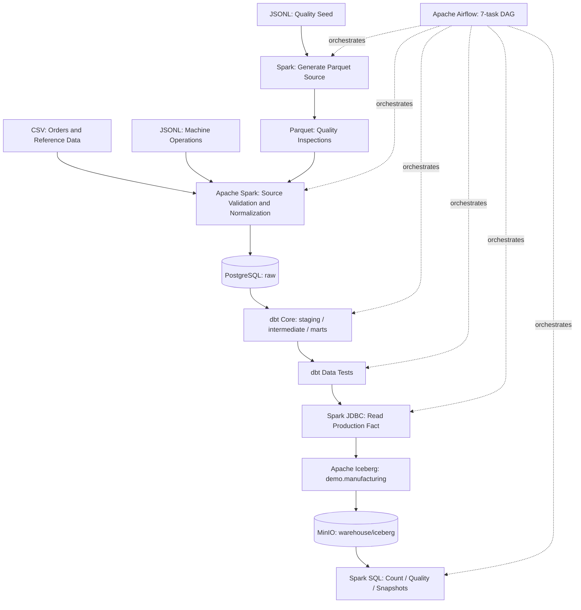

**Responsibilities:** PySpark processes incoming data; PostgreSQL holds source and dbt analytical relations; dbt creates reusable staging, intermediate and marts models; Airflow controls dependencies and retries; Iceberg manages table state and snapshots; MinIO stores the underlying S3A Parquet and metadata objects.

## 3. Isolated Services, Ports and Naming

The project deliberately avoids ports already used by previous laboratories.

| Service | Browser / host URL | Container address | Container name |
|---|---|---|---|
| Airflow API/UI | **http://localhost:8084** | `http://airflow-apiserver:8080` | `novaforge-airflow-apiserver` |
| MinIO S3 API | **http://localhost:9004** | `http://minio:9000` | `novaforge-minio` |
| MinIO Console | **http://localhost:9005** | `http://minio:9001` | `novaforge-minio` |
| dbt Docs (on demand) | **http://localhost:8085** | `dbt:8080` | `novaforge-dbt` |
| PostgreSQL | not published | `postgres:5432` | `novaforge-postgres` |
| Redis | not published | `redis:6379` | `novaforge-redis` |
| Spark | Docker CLI only | `spark` | `novaforge-spark` |

**Previous labs (not modified):** Airflow 3.1: `8080`; Airflow 3.3: `8083`; MinIO 3.2: `9000/9001`; MinIO 3.3: `9002/9003` (API/Console).

**Database:** PostgreSQL `manufacturing` (schemas `raw`, `staging`, `intermediate`, `marts`) and separate Airflow metadata database `airflow`. **Iceberg catalog:** `demo`. **Iceberg namespace:** `demo.manufacturing`. **Published table:** `demo.manufacturing.manufacturing_production_metrics`. **Warehouse:** `s3a://warehouse/iceberg`.

MinIO/PostgreSQL demo credentials are in `.env`; a copy of the template is included for immediate local experimentation. **Airflow uses `simple_auth_manager_all_admins=true` and does not require a login in this isolated lab**. These values and authentication settings are **not for production or public deployment**. Do not commit `.env` to GitHub.

## 4. Project Structure

```text
m3_4_Practice_NovaForge_Manufacturing_Lakehouse/
├── .env                        # local-only example values (gitignored)
├── .env.example
├── .gitignore
├── docker-compose.yml
├── README.md
├── Scenario.md
├── docker/
│   ├── airflow.Dockerfile
│   ├── dbt.Dockerfile
│   └── postgres-init/01-databases.sql
├── dags/novaforge_manufacturing_lakehouse.py
├── data/
│   ├── raw/                   # CSV and JSONL, plus generated Parquet
│   ├── seed/quality_inspections.jsonl
│   └── processed/
├── spark/
│   ├── conf/spark-defaults.conf
│   └── jobs/                  # ingest, validation, Iceberg, execution analysis
├── dbt/
│   ├── dbt_project.yml
│   ├── profiles.yml
│   ├── macros/
│   ├── models/staging/
│   ├── models/intermediate/
│   ├── models/marts/
│   └── tests/
├── sql/
├── scripts/
├── tools/init_minio.py
├── tests/
├── docs/
├── config/
├── logs/
└── pic/
```

See [Architecture](docs/ARCHITECTURE.md), [Data Dictionary](docs/DATA_DICTIONARY.md), and [Practice Requirements](docs/PROJECT_REQUIREMENTS.md).

## 5. Setup and First Run — Windows / PowerShell

### 5.1 Prerequisites

- Windows with Docker Desktop running in Linux-container mode.
- Docker Engine and Docker Compose installed; sufficient disk space and memory for PostgreSQL, Redis, MinIO, Spark, dbt and Airflow.
- The terminal working directory must be **this project folder**, not a previous module folder.
- Host ports `8084`, `8085`, `9004` and `9005` must be available.
- Internet access is required **on first Docker build** to pull images and install Python/JAR dependencies.

### 5.2 Prepare environment

```powershell
# Run from the directory containing docker-compose.yml:
if (-not (Test-Path .env)) { Copy-Item .env.example .env }
docker compose config --quiet
```

**Sequence matters:** Create `.env` **before** checking the Docker Compose configuration, because Compose may reference variables from that file.

The included `.env` uses local demo values. Customize it before sharing the project with anyone else. Do not change Docker internal addresses (`postgres:5432`, `minio:9000`) when changing Windows host ports.

### 5.3 Build and start isolated services

The NovaForge environment was built using Docker Compose.
```powershell
docker compose up -d --build
```

The build completed successfully for the custom Airflow and dbt images, and Docker initialized the project network and persistent volumes.
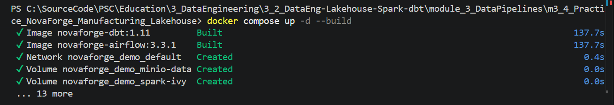

```powershell
docker compose ps -a
```

The NovaForge environment was deployed as an independent Docker Compose project.

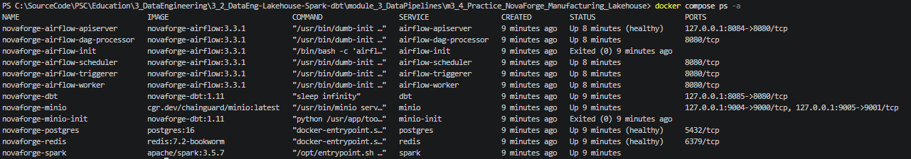

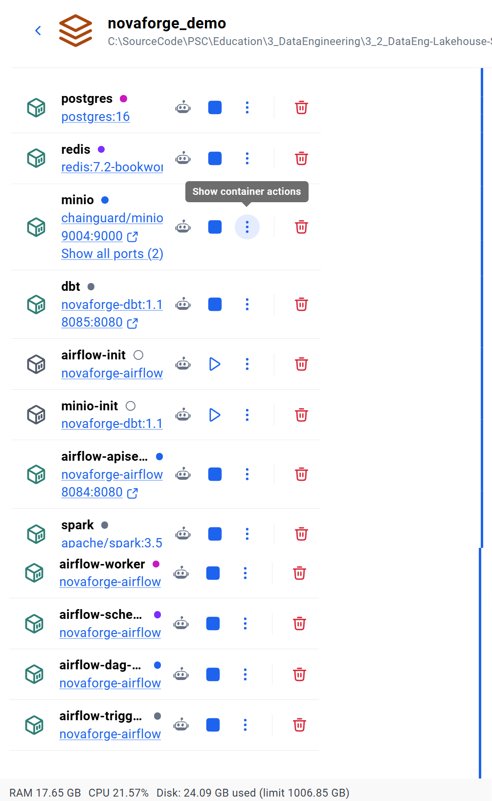

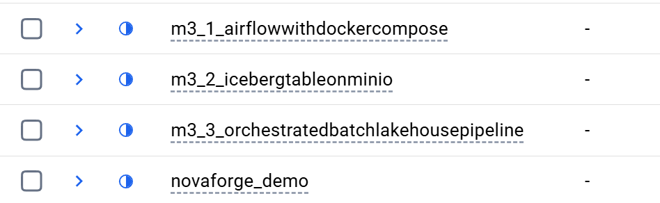


At first start, Docker initializes two PostgreSQL databases, prepares stable `raw` tables and creates the **MinIO bucket `warehouse` automatically**. `novaforge-airflow-init` and `novaforge-minio-init` should finish with `Exited (0)`; this is normal. Other services should be running. API health may take time.

### 5.4 Check services

### Docker Services — Initialization Logs

The initialization logs were inspected using:

```powershell
docker compose logs --tail 40 minio-init airflow-init airflow-apiserver
```

The MinIO warehouse bucket was initialized successfully.

Airflow database migrations completed successfully:

- Airflow metadata tables created.
- Database migration completed.
- Initialization containers exited with code 0.

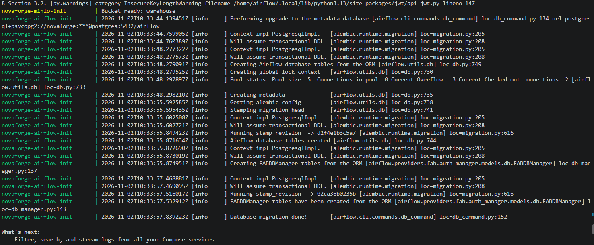


```powershell
docker compose exec airflow-worker python -c "import docker; print(docker.from_env().ping())"
```

**Expected Docker API result:** `True` (distinct from `dbt debug`, which should report `All checks passed`). If the Docker API check returns a socket permission error, see [Troubleshooting](docs/TROUBLESHOOTING.md) (Docker socket group/UID).


### Spark Container — Source Data Verification

The availability of manufacturing source datasets inside the Spark container was verified using:

```powershell
docker exec novaforge-spark ls /opt/project/data/raw
```

The command successfully listed the manufacturing source files, confirming that the Docker volume mount is accessible to Spark.

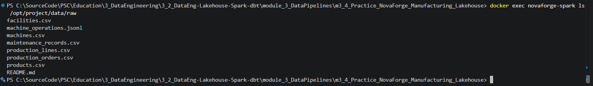

### dbt dependency troubleshooting — missing Git, then repaired

The initial `dbt debug` exposed a missing `git` executable inside the dbt image (some packages rely on Git). The issue was fixed by adding Git to `docker/dbt.Dockerfile` and rebuilding **only** the dbt service:

```powershell
# Historical fix; only rebuild dbt again if the Git executable is missing:
docker compose exec dbt dbt debug --project-dir /usr/app --profiles-dir /usr/app
docker compose up -d --no-deps --build dbt
docker compose exec dbt git --version
```

The final command should print the installed Git version; its exact patch number is image-dependent.

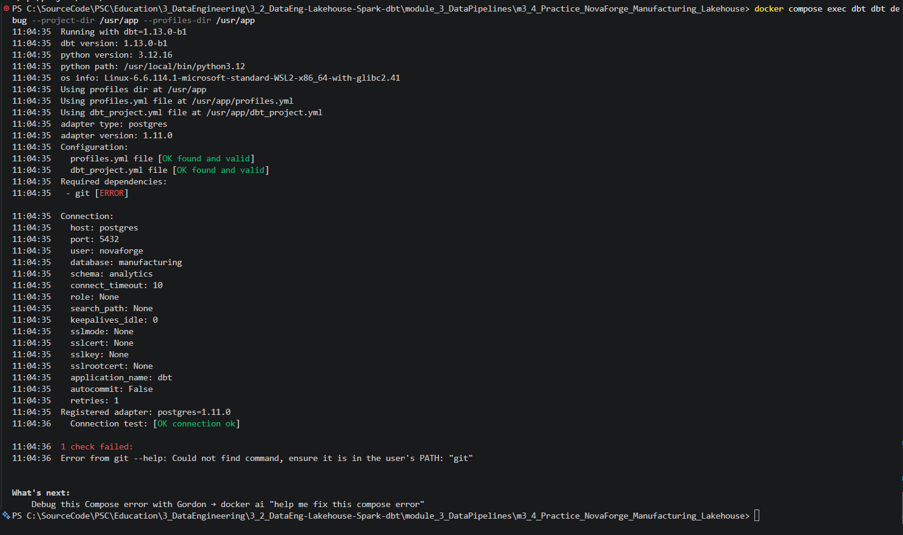
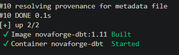

### dbt Debug — Successful Verification After Fix

After installing Git in the dbt Docker image and rebuilding the container, the configuration and PostgreSQL connection were verified again.

- Let’s run the dbt check again:
```powershell
docker compose exec dbt dbt debug --project-dir /usr/app --profiles-dir /usr/app
```

**Result:** All checks passed successfully.

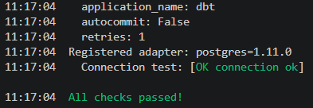

The issue was resolved by adding Git to the Docker image. The dbt environment is now ready for model execution and testing.


### 5.5 Execute through Apache Airflow

### Airflow DAG — Import and Registration Verification

The Airflow DAG was checked for import errors and successful registration.

```powershell
docker compose exec airflow-dag-processor airflow dags list-import-errors
docker compose exec airflow-dag-processor airflow dags list
```

**Verification results:**
- Import errors: None (`No data found`).
- DAG ID: `novaforge_manufacturing_lakehouse`
- Owner: `R. Lisovenko`
- DAG registration: Successful
- Initial DAG state: Paused

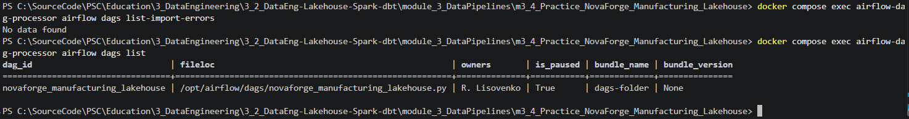


Open **http://localhost:8084** and locate DAG **`novaforge_manufacturing_lakehouse`**. Unpause it, then choose **Trigger → Single Run**.

The execution consists of seven ordered tasks:

```text
check_source_files
    → prepare_parquet_source
    → run_pyspark_processing
    → run_dbt_transformations
    → run_dbt_tests
    → write_iceberg_output
    → validate_final_results
```

### Airflow DAG — Registration and First Execution

The `novaforge_manufacturing_lakehouse` DAG was successfully registered and displayed in the Apache Airflow interface.

**Airflow UI:** http://localhost:8084

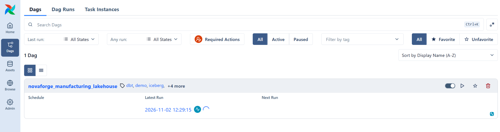

#### Initial Pipeline Execution

The DAG was activated and manually triggered to verify the end-to-end manufacturing lakehouse workflow.

The pipeline contains seven sequential tasks, including source validation, Parquet preparation, PySpark processing, dbt transformations, dbt testing, Iceberg storage, and final validation.

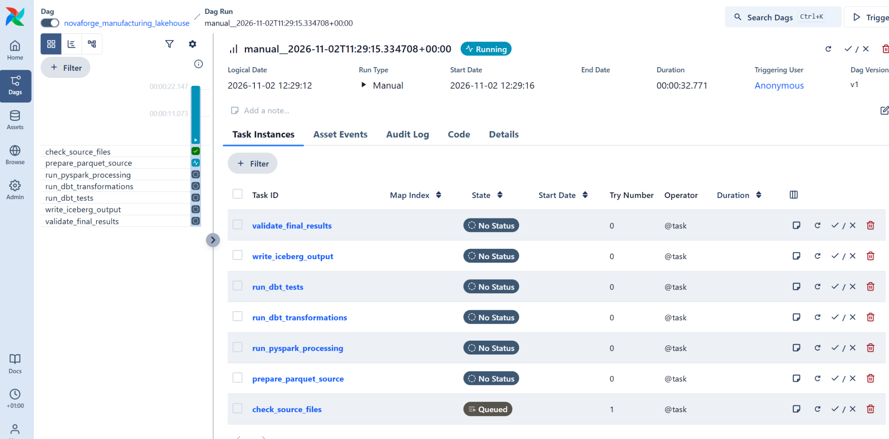

**Execution status (first-run checkpoint): Running — final results pending.**  
**Next checkpoint: FAILED.** The `prepare_parquet_source` task failed because the Spark Ivy cache directories were missing. This was subsequently fixed, and a **later DAG run succeeded 7/7** (see the result below).

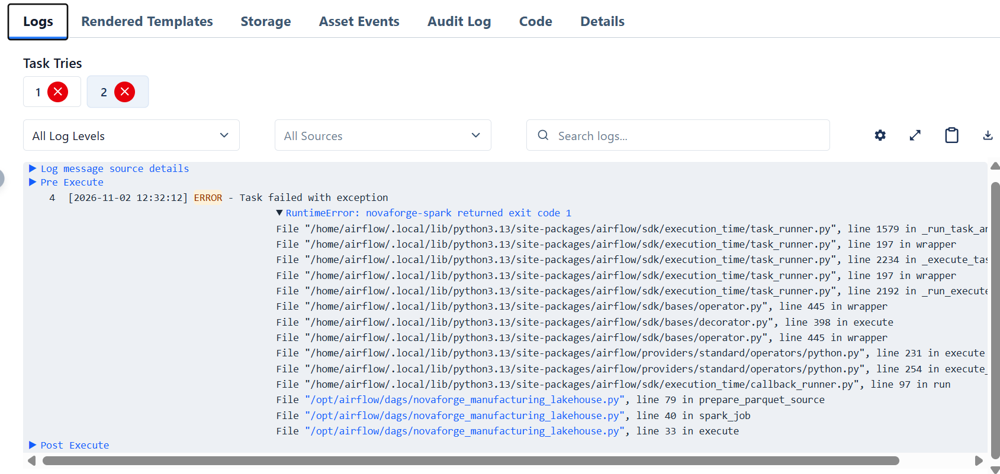


### Troubleshooting — Fixing Missing Apache Ivy Cache Directories

During the execution of the `prepare_parquet_source` task, Apache Spark failed to resolve its external dependencies.

**Error:**

```text
java.io.FileNotFoundException:
/tmp/.ivy2/cache/resolved-org.apache.spark-spark-submit-parent-...xml
(No such file or directory)
```

**Root Cause:**

Apache Spark uses Apache Ivy to resolve and cache external packages, including Apache Iceberg, Hadoop AWS, AWS Java SDK, and PostgreSQL JDBC.

The required cache directories were missing inside the `novaforge-spark` Docker container. As a result, Spark could not write its dependency resolution files, and the job terminated with exit code `1`.

**Resolution:**

The missing directories were created inside the running Spark container, and write permissions were granted.

**Step 1 — Create the Ivy directories:**

```powershell
docker exec -u root novaforge-spark sh -c 'mkdir -p /tmp/.ivy2/cache /tmp/.ivy2/jars && chmod -R a+rwX /tmp/.ivy2'
```

**Step 2 — Verify the directories and permissions:**

```powershell
docker exec novaforge-spark sh -c 'ls -ld /tmp/.ivy2 /tmp/.ivy2/cache /tmp/.ivy2/jars'
```

**Verification Result:**

```text
drwxrwxrwx 4 root root 4096 /tmp/.ivy2
drwxrwxrwx 2 root root 4096 /tmp/.ivy2/cache
drwxrwxrwx 2 root root 4096 /tmp/.ivy2/jars
```

The output confirms that the required Ivy directories now exist and are writable.

**Step 3 — Retry the Spark Job:**

```powershell
docker exec novaforge-spark /opt/spark/bin/spark-submit --master "local[2]" --conf spark.jars.ivy=/tmp/.ivy2 --packages "org.apache.iceberg:iceberg-spark-runtime-3.5_2.12:1.10.1,org.apache.hadoop:hadoop-aws:3.3.4,com.amazonaws:aws-java-sdk-bundle:1.12.262,org.postgresql:postgresql:42.7.5" /opt/project/spark/jobs/bootstrap_quality_parquet.py
```

**Step 4 — Check the exit code:**

```powershell
$LASTEXITCODE
```

**Historical checkpoint after the directory fix:** Directory creation and permission verification completed successfully; Spark job execution still needed separate verification.  
**Observed result later on 2 November 2026:** The manually retried Parquet preparation job completed with **exit code `0`**, reporting **12 quality-inspection records**. A subsequent complete Airflow run also succeeded (**7/7**).

**Note:** The permission change was applied to the running container for local development. For a reproducible deployment, directory initialization and appropriate ownership should be included in the Docker configuration.

**Screenshot — Ivy Cache Directory Fix:**

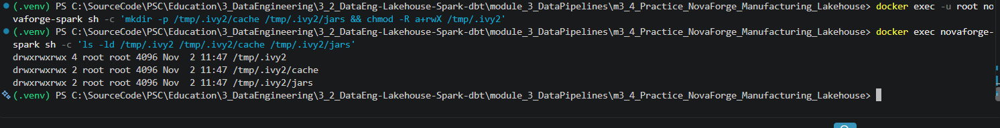


The DAG is **manual only**, with `catchup=False` and **one task retry**. The first Spark task creates an actual Parquet dataset from the supplied quality-inspection JSON seed. After that, the main Spark job reads all three formats.


### Airflow Pipeline — Successful Execution

After resolving the Apache Ivy cache directory issue, the NovaForge Manufacturing Lakehouse pipeline was executed again.

**Execution Results:**
- DAG: `novaforge_manufacturing_lakehouse`
- Execution date: November 2, 2026
- Status: **SUCCESS**
- Completed tasks: **7/7**
- Total execution time: **2 minutes 58 seconds**

All pipeline stages completed successfully:

1. `check_source_files` — SUCCESS
2. `prepare_parquet_source` — SUCCESS
3. `run_pyspark_processing` — SUCCESS
4. `run_dbt_transformations` — SUCCESS
5. `run_dbt_tests` — SUCCESS
6. `write_iceberg_output` — SUCCESS
7. `validate_final_results` — SUCCESS

The successful run confirms end-to-end orchestration of source validation, Parquet preparation, Spark processing, dbt transformations and testing, Iceberg storage, and final validation.

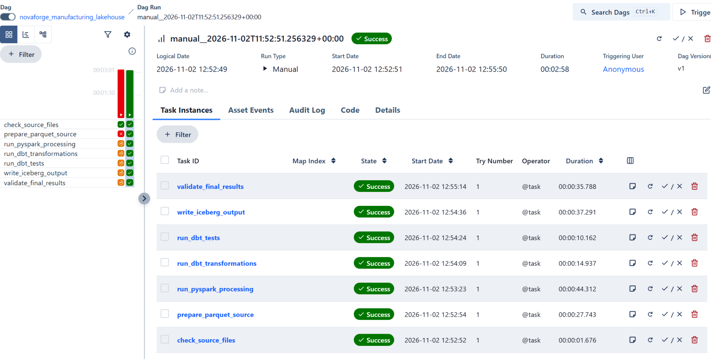


### 5.6 Verified core-pipeline results (2 November 2026)

**Historical checklist status before the successful rerun:** The input, dbt model creation, Iceberg publication and seven green Airflow tasks were *expected outcomes, not yet verified results*. The list immediately below records the subsequent successful verification, not predictions.

- Input dataset included **12 production orders**, **12 machine operations** and **12 quality inspections**, plus reference and maintenance rows.
- PostgreSQL and dbt analytical layers (`staging`, `intermediate`, `marts`) were populated; dbt build reported **65/65 successful operations**.
- Apache Iceberg published **12 production fact rows** to `demo.manufacturing.manufacturing_production_metrics`.
- MinIO Object Browser showed `warehouse/iceberg/manufacturing/manufacturing_production_metrics/` with `data/` and `metadata/`.
- The final Airflow DAG run completed **7/7 SUCCESS**.

These are **historically verified results**. The NovaForge Docker environment and its persisted local training data were later removed; a fresh run requires rebuilding the stack.


## 6. Independent Component Commands

**Spark packages** (Iceberg, S3A, AWS SDK and PostgreSQL JDBC) are downloaded on first use. `spark/jobs/common.py` documents the same dependency versions used by the Airflow DAG.

### MinIO Console — Login

The MinIO Object Storage Console is accessible at:
http://localhost:9005/

- Username: see `MINIO_ROOT_USER` in the local `.env` file (sample setup: `admin`).
- Password: see `MINIO_ROOT_PASSWORD` in the local `.env` file; do not publish real credentials in this README.

The local MinIO instance stores Apache Iceberg tables and manufacturing datasets. These are example local credentials only; do not reuse them for a network-accessible deployment.

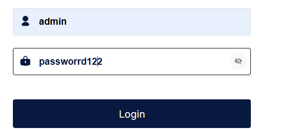


### MinIO — Apache Iceberg Table Structure

The MinIO Object Browser confirms that the manufacturing Iceberg table was successfully created.

**MinIO Console:** http://localhost:9005

**Iceberg Table:** `demo.manufacturing.manufacturing_production_metrics`

**Storage Path:**
```text
warehouse/
└── iceberg/
    └── manufacturing/
        └── manufacturing_production_metrics/
            ├── data/
            └── metadata/
```

- **data/** — Stores the processed manufacturing data in Parquet format.
- **metadata/** — Contains Iceberg metadata, manifests, and snapshot information.

The presence of both directories confirms that the Iceberg table structure was created in MinIO.

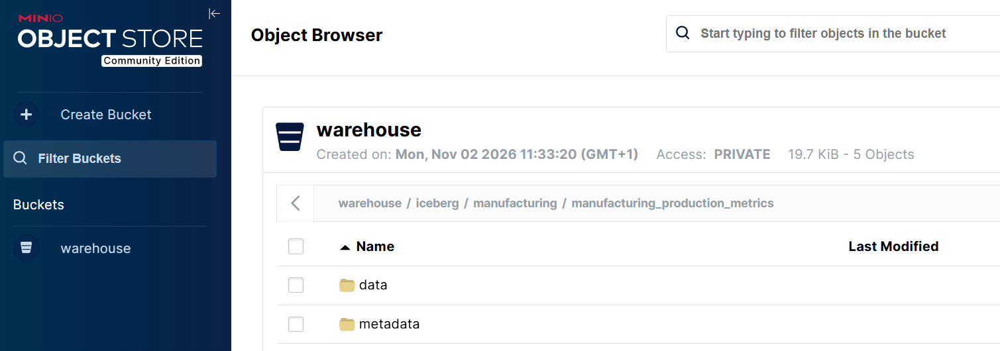


### 6.1 Build the Parquet source (if not running Airflow)

```powershell
docker exec novaforge-spark /opt/spark/bin/spark-submit --master "local[2]" --conf spark.jars.ivy=/tmp/.ivy2 --packages "org.apache.iceberg:iceberg-spark-runtime-3.5_2.12:1.10.1,org.apache.hadoop:hadoop-aws:3.3.4,com.amazonaws:aws-java-sdk-bundle:1.12.262,org.postgresql:postgresql:42.7.5" /opt/project/spark/jobs/bootstrap_quality_parquet.py
```

**Note:** Running full ingestion manually after a previous successful DAG requires clearing the existing `raw` table rows as Airflow does; otherwise, rows will accumulate. For repeatable end-to-end testing, use Airflow.

### 6.2 Open Spark SQL

```powershell
docker exec -it novaforge-spark /opt/spark/bin/spark-sql --master "local[2]" --conf spark.jars.ivy=/tmp/.ivy2 --packages "org.apache.iceberg:iceberg-spark-runtime-3.5_2.12:1.10.1,org.apache.hadoop:hadoop-aws:3.3.4,com.amazonaws:aws-java-sdk-bundle:1.12.262,org.postgresql:postgresql:42.7.5"
```

In the `spark-sql>` prompt:

```sql
SHOW NAMESPACES IN demo;
SHOW TABLES IN demo.manufacturing;
SELECT COUNT(*) FROM demo.manufacturing.manufacturing_production_metrics;
SELECT * FROM demo.manufacturing.manufacturing_production_metrics;
SELECT snapshot_id, operation, committed_at
FROM demo.manufacturing.manufacturing_production_metrics.snapshots;
```

Type `QUIT;` to leave Spark SQL. These SQL commands must **not** be typed directly into PowerShell.


### Apache Iceberg — Spark SQL Validation

The manufacturing Iceberg table was successfully verified using the interactive Spark SQL CLI.

**1. Verify the Iceberg namespace:**

```sql
SHOW NAMESPACES IN demo;
```

Result: `manufacturing`

**2. Verify the table:**

```sql
SHOW TABLES IN demo.manufacturing;
```

Result: `manufacturing_production_metrics`

**3. Validate the record count:**

```sql
SELECT COUNT(*) AS record_count
FROM demo.manufacturing.manufacturing_production_metrics;
```

Result: **12 records**

**4. Verify Iceberg snapshots:**

```sql
SELECT snapshot_id, operation, committed_at
FROM demo.manufacturing.manufacturing_production_metrics.snapshots;
```

**Results:**

| Property | Value |
|---|---|
| Catalog | `demo` |
| Namespace | `manufacturing` |
| Table | `manufacturing_production_metrics` |
| Records | 12 |
| Snapshot operation | `append` |
| Snapshot ID | `900431332694668248` |
| Snapshot timestamp | `2026-11-02 11:55:09.368` |
| Validation status | SUCCESS |

The results confirm that the manufacturing dataset was stored successfully in Apache Iceberg and that a table snapshot was created.

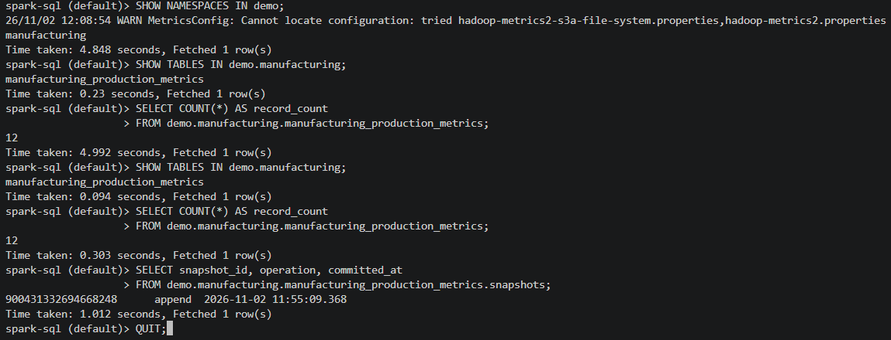


### 6.3 Inspect dbt outputs and lineage

```powershell
docker compose exec dbt dbt run --project-dir /usr/app --profiles-dir /usr/app
docker compose exec dbt dbt test --project-dir /usr/app --profiles-dir /usr/app
docker compose exec dbt dbt docs generate --project-dir /usr/app --profiles-dir /usr/app
# Keep the next terminal open while viewing the docs:
docker compose exec dbt dbt docs serve --project-dir /usr/app --profiles-dir /usr/app --host 0.0.0.0 --port 8080
```

### dbt Build — Successful Model Execution and Testing

The complete dbt project was validated using:

```powershell
docker compose exec dbt dbt build --project-dir /usr/app --profiles-dir /usr/app
```

**Execution Results:**

- Table models: 9
- View models: 9
- Data tests: 47
- Total operations: 65
- Passed: 65
- Warnings: 0
- Errors: 0
- Execution time: 5.69 seconds

**Final Status: SUCCESS — All 65 checks passed.**

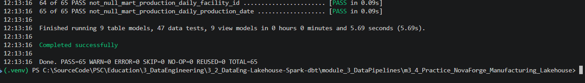


### dbt Documentation — Successful Generation

The dbt documentation catalog was generated using:

```powershell
docker compose exec dbt dbt docs generate --project-dir /usr/app --profiles-dir /usr/app
```

**Results:**
- Models: 18
- Data tests: 47
- Sources: 8
- Macros: 478
- Adapter: PostgreSQL 1.11.0
- Catalog: `/usr/app/target/catalog.json`
- Status: SUCCESS

The documentation catalog was generated successfully and is ready for exploration through dbt Docs.

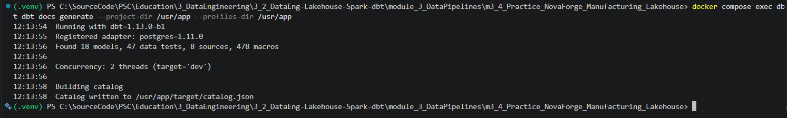


Open **http://localhost:8085** to inspect compiled model documentation and lineage. See [dbt README](dbt/README.md).

### dbt Docs Overview

The dbt documentation interface is available and shows the project structure, source definitions, and project folders.

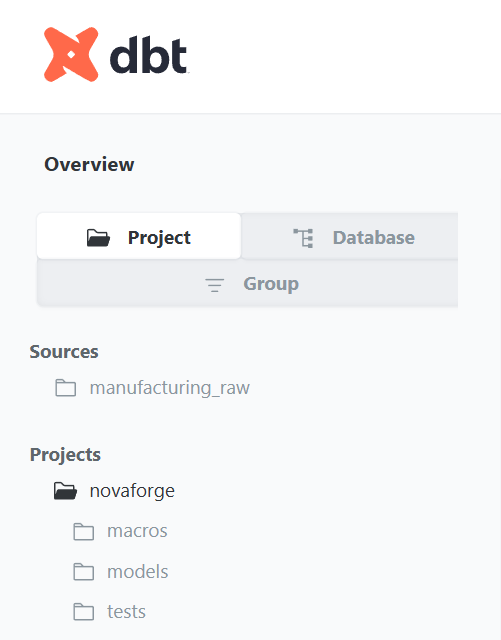


### dbt Documentation — Complete Project Structure

The NovaForge dbt documentation was successfully generated and opened at `http://localhost:8085`.

The project structure includes staging models, intermediate transformations, analytical marts, custom data quality tests, and reusable macros.

**Complete Project Hierarchy:**

```text
dbt Docs
├── Sources
│   └── manufacturing_raw
│
└── Projects
    └── novaforge
        ├── macros/
        │   └── generate_schema_name
        │
        ├── models/
        │   ├── intermediate/
        │   │   └── int_production_enriched
        │   │
        │   ├── marts/
        │   │   ├── dim_date
        │   │   ├── dim_facility
        │   │   ├── dim_machine
        │   │   ├── dim_product
        │   │   ├── dim_production_line
        │   │   ├── fact_machine_operations
        │   │   ├── fact_production
        │   │   ├── fact_quality_inspections
        │   │   └── mart_production_daily
        │   │
        │   └── staging/
        │       ├── stg_facilities
        │       ├── stg_machine_operations
        │       ├── stg_machines
        │       ├── stg_maintenance_records
        │       ├── stg_production_lines
        │       ├── stg_production_orders
        │       ├── stg_products
        │       └── stg_quality_inspections
        │
        └── tests/
            ├── assert_nonnegative_production
            └── assert_quality_units
```

**Project Summary:**

| Component | Count |
|---|---:|
| Staging models | 8 |
| Intermediate models | 1 |
| Analytical mart models | 9 |
| Total dbt models | 18 |
| Data tests | 47 |
| Data sources | 8 |
| dbt build results | 65/65 PASS |

The documentation confirms that the manufacturing analytics project is organized into distinct transformation layers, supporting maintainability, data quality verification, and model lineage analysis.

**Screenshot — Complete dbt Project Hierarchy:**

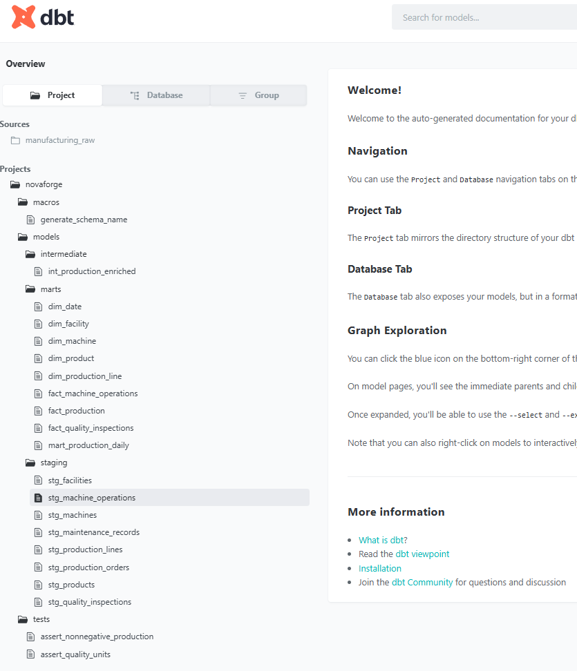

### dbt Lineage Examples

The following screenshots show example lineage relationships between staging, intermediate, fact, and mart models in the NovaForge dbt project.

### 1. Lineage for `fact_machine_operations`

This lineage graph shows how machine operation facts are built from staging models such as machine operations, machines, and production orders.

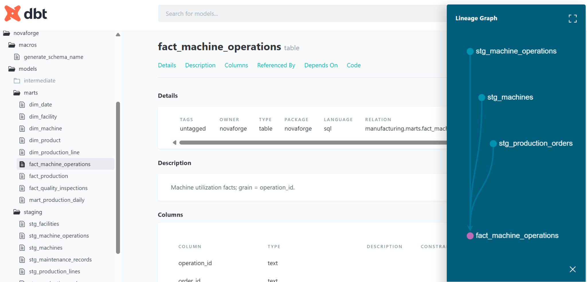

---

### 2. Lineage for `fact_production`

This lineage graph shows how the `fact_production` model is built from the intermediate production model and how it feeds downstream reporting and data quality checks.

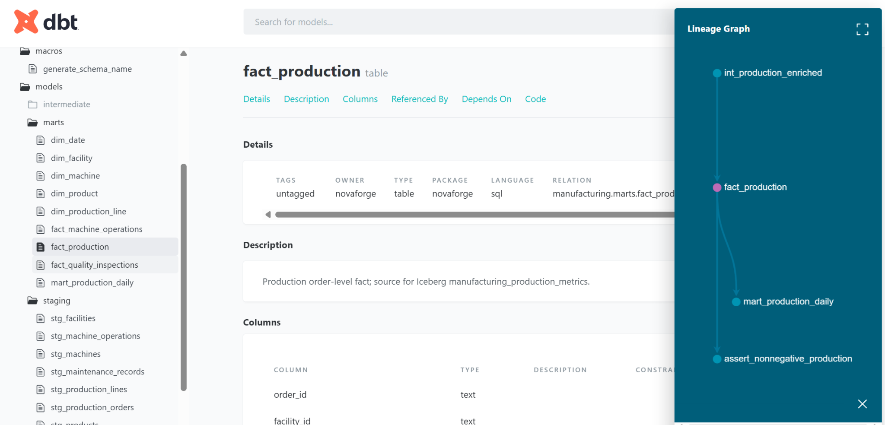

---

### 3. Lineage for `fact_quality_inspections`

This lineage graph shows how quality inspection facts are created from production orders and raw quality inspection staging data.

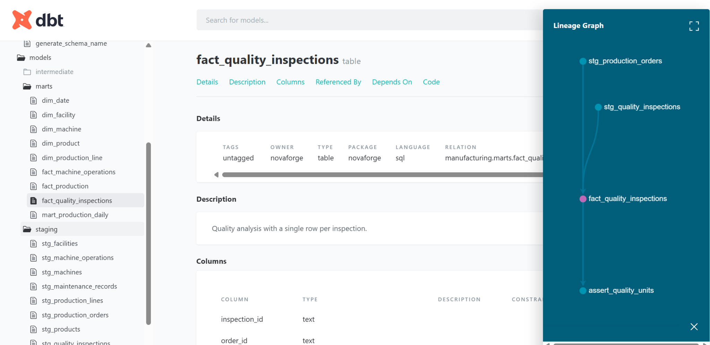

---

### 4. Lineage for `mart_production_daily`

This lineage graph shows the final reporting mart, which is built from the production fact model and represents daily manufacturing metrics at the facility level.

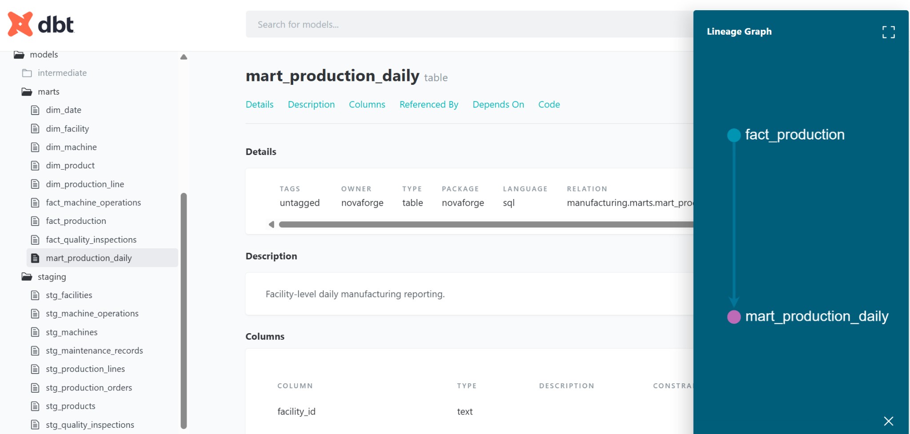

### 6.4 Spark partitioning, shuffles and caching

The script is run with the same Iceberg, Hadoop AWS, AWS SDK and PostgreSQL packages used by the DAG; a bare `spark-submit` command is not equivalent in a clean container.

### Spark Performance Analysis — Execution Plan and Aggregation

The Spark performance analysis script was executed to inspect query execution plans, data filtering, and aggregation operations.

**Execution command:**

```powershell
docker exec novaforge-spark /opt/spark/bin/spark-submit --master "local[2]" --conf spark.jars.ivy=/tmp/.ivy2 --packages "org.apache.iceberg:iceberg-spark-runtime-3.5_2.12:1.10.1,org.apache.hadoop:hadoop-aws:3.3.4,com.amazonaws:aws-java-sdk-bundle:1.12.262,org.postgresql:postgresql:42.7.5" /opt/project/spark/jobs/analyze_spark.py
```

**Analysis Results:**

The execution plan includes JSON file scanning, partition filters, and pushed filters.

Machine operation records were grouped by machine ID to calculate operation counts and total runtime.

| Machine ID | Operations | Runtime (minutes) |
|---|---:|---:|
| M01 | 3 | 240 |
| M02 | 3 | 252 |
| M03 | 3 | 264 |
| M04 | 3 | 276 |
| **Total** | **12** | **1,032** |

The output demonstrates successful reading, filtering, and aggregation of manufacturing machine operation data.

**Screenshot — Spark Execution Plan and Aggregation:**

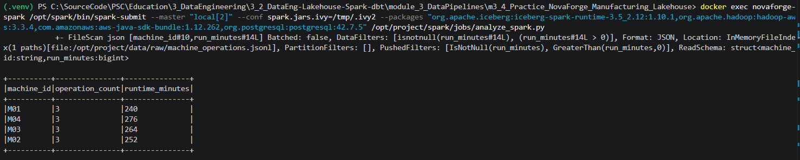


This educational script shows `.explain(True)`, partitions, a narrow filter/select, an aggregate that introduces a shuffle, and explicit cache/unpersist.

## 7. Data Models and Business Metrics

| Layer | Relation | Grain / purpose |
|---|---|---|
| Raw | `raw.production_orders` | Production order |
| Raw | `raw.machine_operations` | Machine operation |
| Raw | `raw.quality_inspections` | Quality inspection |
| Staging | `staging.stg_*` | Standardized input views |
| Intermediate | `intermediate.int_production_enriched` | One row per order, events aggregated before joining |
| Fact | `marts.fact_production` | One row per order |
| Fact | `marts.fact_quality_inspections` | One row per inspection |
| Fact | `marts.fact_machine_operations` | One row per operation |
| Dimensions | `marts.dim_facility`, `dim_production_line`, `dim_machine`, `dim_product`, `dim_date` | One row per entity/date |
| Reporting | `marts.mart_production_daily` | Facility × production date |
| Lakehouse | `demo.manufacturing.manufacturing_production_metrics` | One row per production order |

Key measures include actual units, rejected units, defect rate, machine runtime, downtime and calculated production duration. Dimensions support facility, line, product and date reporting. Source files include a planned example of `energy_consumption_kwh` for schema evolution discussion.

## 8. Iceberg Snapshots, Updates, Schema Evolution and Compaction — Steps 15 and 16

### Status and scope (documentation review: 3 November 2026)

**Historical status at the end of the 2 November run:** Seven validation stages had been completed, while Iceberg Schema Evolution, Compaction and the final documentation review remained pending.  
**Core lakehouse: COMPLETED and runtime-verified on 2 November 2026.** The main Airflow DAG produced an Iceberg table with 12 rows and confirmed snapshot metadata. The two advanced, **optional** follow-up scripts were added to the project and their intended operations are documented below.

| Exercise | Implementation | Runtime evidence |
|---|---|---|
| **Step 15 — Schema Evolution and Snapshots** | **COMPLETED — `iceberg_operations_demo.py` prepared and documented** | **Not run / not verified** |
| **Step 16 — Data-file Compaction** | **COMPLETED — `compact_iceberg.py` prepared and documented** | **Not run / not verified** |

These exercises use a **separate demonstration Iceberg table** rather than intentionally modifying the production metrics table. They do **not** form part of the seven-task DAG and are **not required to claim completion of the verified core project**.


> **Evidence note:** The status image above was captured before the documentation review; it may display older task states. Do not present it as runtime evidence for Steps 15–16. The Docker infrastructure was removed afterward, so neither script was run during this documentation update.

### Step 15 — Iceberg Schema Evolution and Snapshots — Completed implementation

**Purpose:** Demonstrate an isolated Iceberg table lifecycle: initial table creation, row-level updates, schema changes with `ALTER TABLE`, and inspection of snapshot history. Unlike rewriting ordinary Parquet files, Iceberg records table changes through versioned metadata and snapshots.

**Project script:** `spark/jobs/iceberg_operations_demo.py`  
**Implementation/documentation:** **COMPLETED**  
**Execution/result:** **NOT VERIFIED** (no successful run log or screenshot is available).

To execute **only after the laptop is stable and the NovaForge stack has been rebuilt**, from PowerShell:

```powershell
docker exec novaforge-spark /opt/spark/bin/spark-submit --master "local[2]" --conf spark.jars.ivy=/tmp/.ivy2 --packages "org.apache.iceberg:iceberg-spark-runtime-3.5_2.12:1.10.1,org.apache.hadoop:hadoop-aws:3.3.4,com.amazonaws:aws-java-sdk-bundle:1.12.262,org.postgresql:postgresql:42.7.5" /opt/project/spark/jobs/iceberg_operations_demo.py
```

**Verification criteria for a future run:**

1. The script exits with code `0` and reports the demonstration table's identifier.
2. The table's schema reflects the intended `ALTER TABLE` change.
3. The post-update data matches the intended `UPDATE` operation.
4. A snapshot query shows the relevant table history.

The table name, exact columns, affected rows and snapshot IDs must be taken from **actual script output**; they are intentionally not invented here. See [Lakehouse Operations](docs/ICEBERG_OPERATIONS.md).

### Step 16 — Iceberg Data-file Compaction — Completed implementation

**Purpose:** Demonstrate maintenance of small Parquet data files using Iceberg's `rewrite_data_files` maintenance action. Compaction rewrites eligible files into a more efficient layout without changing the logical row contents.

**Project script:** `spark/jobs/compact_iceberg.py`  
**Implementation/documentation:** **COMPLETED**  
**Execution/result:** **NOT VERIFIED** (no successful run log or screenshot is available).

Run only **after Step 15 has created its isolated demo table** and once the system is stable:

```powershell
docker exec novaforge-spark /opt/spark/bin/spark-submit --master "local[2]" --conf spark.jars.ivy=/tmp/.ivy2 --packages "org.apache.iceberg:iceberg-spark-runtime-3.5_2.12:1.10.1,org.apache.hadoop:hadoop-aws:3.3.4,com.amazonaws:aws-java-sdk-bundle:1.12.262,org.postgresql:postgresql:42.7.5" /opt/project/spark/jobs/compact_iceberg.py
```

**Verification criteria for a future run:**

1. The script exits with code `0`.
2. `rewrite_data_files` reports how many data files, if any, were rewritten.
3. The row count and logical dataset remain unchanged.
4. If files were rewritten, relevant snapshot and data-file metadata reflect the new layout.

**Interpretation:** On a tiny synthetic dataset, Iceberg may legitimately rewrite **zero data files**. This is an expected possible outcome, **not** an observed result for this run. See [Lakehouse Operations](docs/ICEBERG_OPERATIONS.md).

### Practical conclusion

Steps 15 and 16 are **completed as prepared, documented extensions**. Runtime testing remains an optional future verification task and must not be confused with the successful production-metrics publication already verified by the seven-task Airflow DAG.

## 9. Historical Reprocessing, Catchup and Retries

For a one-date demonstration, trigger the Airflow DAG with JSON configuration:

```json
{"batch_date": "2026-10-30"}
```

A dated run processes orders for that date. Raw fact tables and dbt marts represent the **selected current batch**; the Iceberg publisher performs an **order_id MERGE** to retain previously published rows from other batches. A normal trigger without parameters processes both sample dates. The DAG is intentionally manual (`schedule=None`, `catchup=False`), so automatic scheduled backfill has **not** been implemented. See [Backfill and Reprocessing Strategy](docs/BACKFILL.md) for the safe production design, rerun semantics, and limitations.

## 10. Troubleshooting and Validation Checklist

Use the [Troubleshooting Guide](docs/TROUBLESHOOTING.md) for port conflicts, image pulls, DAG imports, Docker socket permissions, missing files, Postgres permissions, Iceberg catalog setup and MinIO S3A paths. The [Execution Checklist](docs/EXECUTION_CHECKLIST.md) separates expected results from actual test evidence.

Useful commands:

```powershell
docker compose config --quiet
docker compose ps -a
docker compose logs --tail 50 airflow-worker airflow-dag-processor spark dbt
docker compose exec airflow-dag-processor airflow dags list-import-errors
docker compose exec airflow-dag-processor python -m py_compile /opt/airflow/dags/novaforge_manufacturing_lakehouse.py
# Source-only unit checks do not require Docker:
python -m unittest discover -s tests -v
```

After testing, save real screenshots in `pic/` and update the checklist. Do not describe untested commands as successful.

## 11. Stop, Rebuild and Restart Safely

For a **normal** stop that retains project data:

```powershell
# Stop this project only; retain named volumes and Iceberg data:
docker compose down
# Later, while retained images and volumes still exist:
docker compose up -d
```

**Recorded cleanup after the 2 November 2026 laptop incidents:** The NovaForge containers, project-named images and volumes were removed. This means an ordinary `docker compose up -d` may no longer be sufficient to restore the former datasets or custom images. **After the computer is stable and has passed hardware checks**, a fresh environment can be initialized with:

```powershell
if (-not (Test-Path .env)) { Copy-Item .env.example .env }
docker compose config --quiet
docker compose up -d --build
```

This rebuild creates **new training data**; it does not recover the removed PostgreSQL/MinIO volumes or past Iceberg snapshots. Avoid starting the 12-service stack until the laptop's unexpected shutdowns have been resolved.

**Never use `docker compose down -v` unless intentionally discarding this project's PostgreSQL and MinIO training datasets.** Do not use global `docker system prune --volumes` while other laboratory environments are needed.

## 12. Engineering Decisions and Known Limitations

- Separate Compose project, ports and container names prevent collisions with earlier labs.
- Stable PostgreSQL raw tables are initialized once; the Airflow DAG truncates rows before PySpark **append**, avoiding the table-drop problem with dependent dbt views.
- dbt builds PostgreSQL views/tables; Spark exports the trusted production fact to Iceberg using a record-key `MERGE` for repeatable publication.
- The sample uses Spark `local[2]`, so distributed-execution observations are educational; performance at industrial scale has not been benchmarked.
- Airflow accesses the local Docker Engine via a mounted socket. This is powerful and appropriate **only for a trusted local sandbox**; production deployments need a safer executor / container orchestration design.
- Local sample credentials and unencrypted internal traffic are **not production security**.
- The separate schema-evolution and compaction scripts (Steps 15–16) are **implemented and documented**, but their **runtime execution was not verified**. They must not be represented as completed runs.
- This repository documents a successfully tested **historical** deployment; the local NovaForge Docker images/containers/volumes were subsequently removed.
- Image links assume the corresponding screenshot files remain in `pic/`; verify those relative paths before publishing.

**Final project deliverable:** An independent, documented and **core-validated** manufacturing analytics lakehouse using PySpark, dbt, Airflow, PostgreSQL, MinIO and Apache Iceberg. The optional Steps 15–16 are completed as documented extensions, with execution evidence explicitly outstanding.

**Author:** R. Lisovenko
