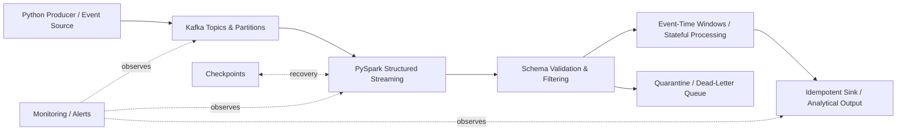

# Streaming Data Pipelines with Kafka and Spark

**Course:** Streaming Data Pipelines with Kafka and Spark  
**Provider:** Edureka / Coursera  
**Executor:** R. Lisovenko  
**Prepared:** 05 November 2026  
**Location:** Deutschland  
**Status:** In progress — course materials indexed; exercises and assessments not yet verified.

## 1. About This Course

This repository contains structured learning notes and supporting course material references for the Coursera course **Streaming Data Pipelines with Kafka and Spark**. The course covers event streaming with Apache Kafka, real-time processing using PySpark Structured Streaming, and operational reliability for streaming data pipelines.

It follows the completed learning track **Data Engineering Foundations with SQL and Python** and **Lakehouse Data Pipelines with Spark and dbt**. Unlike the preceding batch lakehouse project, this course focuses on continuous event ingestion, stream processing, state management, and recovery.

## 2. Module Index

| Module | Content | Course Materials | Video Remaining* | Reading Remaining* | Graded Assessments | Status |
|---|---|---|---:|---:|---:|---|
| 1 | [Event Streaming with Apache Kafka](module_1_Kafka_EventStreaming/README.md) | 14 listed items | 36 min | 40 min | 1 | Pending |
| 2 | [Streaming Processing with PySpark](module_2_PySpark_StructuredStreaming/README.md) | 12 listed items | 31 min | 20 min | 1 | Pending |
| 3 | [Quality, Monitoring, and Delivery](module_3_Quality_Monitoring_Delivery/README.md) | 13 listed items | 34 min | 50 min | 1 | Pending |

*The time figures reproduce the remaining-time figures shown in the supplied Coursera course outline on 05 November 2026; they are not a live progress tracker.

## 3. Study Roadmap

### Module 1 — Event Streaming with Apache Kafka

Learn event-driven architecture, event keys and ordering, Kafka topics/partitions, producers and consumers, consumer groups, offsets, delivery semantics, retention, log compaction, and replay.

### Module 2 — Streaming Processing with PySpark

Learn Structured Streaming, Kafka ingestion, event-time windows and watermarks, stateful/stateless processing, checkpointing, output modes, and reliable streaming sinks.

### Module 3 — Quality, Monitoring, and Delivery

Learn schema and data quality checks, DLQ/quarantine patterns, consumer lag and backpressure, observability, restart behavior, and resilient open-source pipeline design. The course includes the **Smart Energy streaming practice project** and a logistics scenario role play.

## 4. Key Architecture (Conceptual, Not Yet Implemented)



**Architecture status:** Study/reference design only. No live Kafka, Spark, DLQ, or monitoring deployment is claimed here.

## 5. Repository Structure

```text
3_3_DataEng-Streaming-Kafka-Spark/
├── README.md
├── module_1_Kafka_EventStreaming/
│   └── README.md
├── module_2_PySpark_StructuredStreaming/
│   └── README.md
├── module_3_Quality_Monitoring_Delivery/
│   └── README.md
└── pic/               # Screenshots and diagrams (when available)
```

## 6. Documentation and Evidence Conventions

- Keep the supplied Coursera lesson names and links in each module README.
- Record **actual** terminal commands, output, errors, fixes, and screenshots as practice progresses.
- Distinguish **planned**, **tested**, and **completed** clearly; do not invent execution results.
- Store screenshots in `pic/` and use relative Markdown image paths.
- Include both conceptual notes and practical examples, with English documentation suited to a GitHub portfolio.

## 7. Course Completion Tracking

| Milestone | Status | Date / Evidence |
|---|---|---|
| Module 1 — Kafka | Not completed | — |
| Module 2 — PySpark Structured Streaming | Not completed | — |
| Module 3 — Quality, Monitoring, and Delivery | Not completed | — |
| Final assessed course completion | Not completed | — |
| Certificate | Not yet awarded | — |

## 8. Reference

- [Coursera — Streaming Data Pipelines with Kafka and Spark](https://www.coursera.org/learn/streaming-data-pipelines-kafka-spark)

---

**R. Lisovenko — Deutschland, 05 November 2026.**
