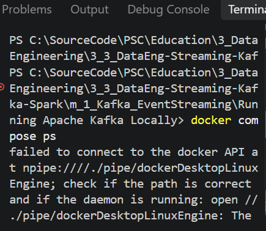
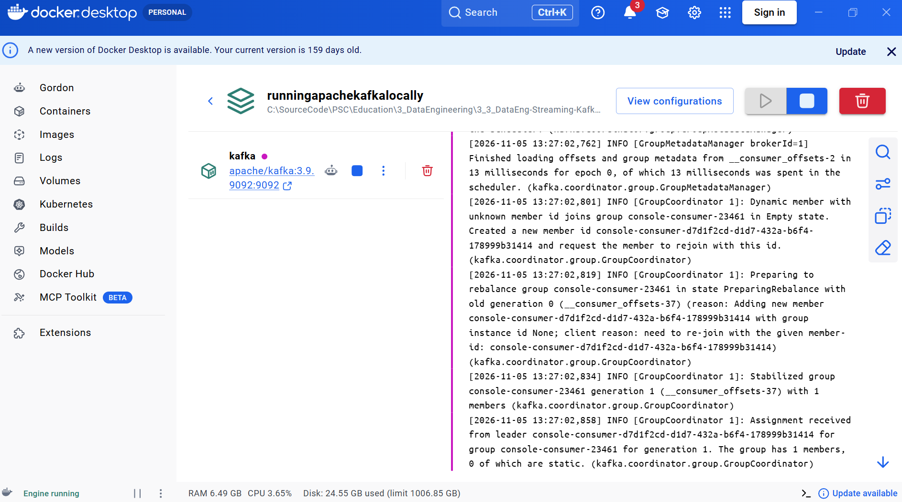
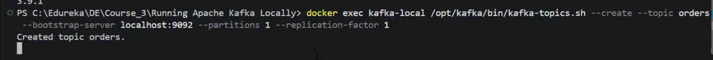
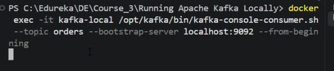
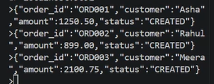
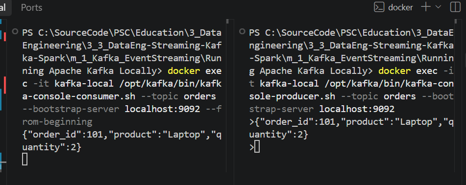

# m1 — Running Apache Kafka Locally

**Course:** Streaming Data Pipelines with Kafka and Spark  
**Provider:** Edureka / Coursera  
**Module:** 1 — Event Streaming with Apache Kafka  
**Lab:** Running Apache Kafka Locally  
**Author / Executor:** R. Lisovenko  
**Date:** 05 November 2026  

**Status:** Completed — Kafka 3.9.1 started, `orders` topic created, and a Producer → Consumer message delivery verified.

## 1. Objective and scenario

An e-commerce company receives order events during the day. Inventory, payment, notification, and analytics systems may need to consume those events independently. This exercise uses **one local Kafka broker** to demonstrate publishing orders to a topic and consuming them.

**Flow:** `Console Producer → Kafka Broker → orders Topic → Console Consumer`

Kafka provides the event transport and storage. A producer does not need to know which downstream consumer reads its messages.

### Lab environment

| Component | Configuration |
|---|---|
| Operating environment | Windows, PowerShell, Visual Studio Code |
| Container runtime | Docker Desktop, Linux containers |
| Kafka image | `apache/kafka:3.9.1` |
| Kafka container | `kafka-local` |
| Kafka process mode | KRaft, single node (broker + controller) |
| Kafka service name | `kafka` |
| Host bootstrap address | `localhost:9092` |
| Topic | `orders` |
| Partitions | `1` |
| Replication factor | `1` (training only; not fault-tolerant) |

> **Important:** The original course `docker-compose.yml` is provided unchanged. It does **not** define a persistent Kafka data volume. `docker compose stop` preserves the existing container and its data, but `docker compose down` **removes that container and may destroy the locally stored topics and events**. Do not use `down` if you want to keep this lab's messages.

## 2. Project files

```text
Running Apache Kafka Locally/
├── README.md
├── docker-compose.yml
├── Scenario                     # original Edureka scenario
├── scripts/
│   ├── start_kafka.ps1
│   └── check_kafka.ps1
└── pic/
    ├── kafka_initial_docker_connection_error.png
    ├── kafka_docker_desktop_running.png
    ├── kafka_topic_created.png
    ├── kafka_consumer_waiting.png
    ├── kafka_producer_three_orders.png
    └── kafka_producer_consumer_verified.png
```

**Working directory:** Open **this exact folder** in VS Code. All `docker compose` commands below must run from the directory containing `docker-compose.yml`.

## 3. Quick start — exact command sequence

Use this section when repeating the lab. The numbered sections below explain each command and show real screenshots.

**Terminal A — start Kafka and create the topic** (run these commands one by one):

```powershell
# 0. Start Docker Desktop from Windows and wait for "Engine running".
docker version

# 1. Validate the Compose file (from this lab directory).
docker compose config
docker compose config --services

# 2. Launch Kafka.
docker compose up -d
docker compose ps
docker compose logs kafka --tail 50

# 3. Check the installed Kafka version.
docker exec kafka-local /opt/kafka/bin/kafka-topics.sh --version

# 4. Create the topic (the first time only).
docker exec kafka-local /opt/kafka/bin/kafka-topics.sh --create --topic orders --bootstrap-server localhost:9092 --partitions 1 --replication-factor 1

# 5. Inspect the topic.
docker exec kafka-local /opt/kafka/bin/kafka-topics.sh --list --bootstrap-server localhost:9092
docker exec kafka-local /opt/kafka/bin/kafka-topics.sh --describe --topic orders --bootstrap-server localhost:9092
```

**Terminal B — start Consumer and leave it open:**

```powershell
docker exec -it kafka-local /opt/kafka/bin/kafka-console-consumer.sh --topic orders --bootstrap-server localhost:9092 --from-beginning
```

**Terminal C — start Producer and leave it open:**

```powershell
docker exec -it kafka-local /opt/kafka/bin/kafka-console-producer.sh --topic orders --bootstrap-server localhost:9092
```

Then **paste a single-line JSON event into Terminal C and press Enter**:

```json
{"order_id":101,"product":"Laptop","quantity":2}
```

**Expected:** The same line appears in Terminal B (the Consumer). Press **Ctrl+C** in the Producer and Consumer terminals to exit their interactive sessions.

## 4. Detailed procedure and execution evidence

### Step 1 — Start Docker Desktop and verify the Docker Engine

1. Launch **Docker Desktop** from the Windows Start menu.
2. Wait until the bottom-left status reports **Engine running**.
3. Open VS Code in the lab folder and run:

```powershell
docker version
```

**Expected:** Docker prints both a **Client** section and a **Server** section. A Client-only response means the Docker Engine is not available yet.

**Actual troubleshooting history:** The first attempts failed with the error below because the Linux Docker Engine was not running:

```text
failed to connect to the docker API at
npipe:////./pipe/dockerDesktopLinuxEngine
The system cannot find the file specified.
```



This was a **Docker Engine connection issue**, not a Kafka configuration error. After Docker Desktop was started, Kafka ran successfully.

### Step 2 — Confirm the Compose configuration

```powershell
docker compose config
docker compose config --services
```

The first command renders and validates the Compose configuration; the second lists its services.

**Expected service:**

```text
kafka
```

The supplied `docker-compose.yml` sets `KAFKA_PROCESS_ROLES=broker,controller` (single-node KRaft), the host listener at port `9092`, and an internal Docker listener at `29092`.

### Step 3 — Start Kafka and inspect logs

```powershell
docker compose up -d
docker compose ps
docker compose logs kafka --tail 50
```

**Expected:** Service `kafka` / container `kafka-local` is **Up**. Logs should indicate that the broker started; routine consumer-group or coordinator messages are normal. If the container is still starting, repeat the `ps` and `logs` commands.



**Observed:** Docker Desktop showed the Kafka container running on port `9092`, and the Kafka broker logged consumer group activity.

### Step 4 — Verify Kafka version

```powershell
docker exec kafka-local /opt/kafka/bin/kafka-topics.sh --version
```

**Verified output:**

```text
3.9.1
```

The command is executed **inside the running container**, so a local Windows Java installation is not required for this Docker-based lab.

### Step 5 — Create the `orders` topic

Run **once on a fresh Kafka container**:

```powershell
docker exec kafka-local /opt/kafka/bin/kafka-topics.sh --create --topic orders --bootstrap-server localhost:9092 --partitions 1 --replication-factor 1
```

**Verified output:**

```text
Created topic orders.
```



**Repeat-run note:** If Kafka replies that `orders` already exists, **do not delete it**. Continue with the topic inspection commands below.

### Step 6 — List and describe the topic

```powershell
# Show available topics.
docker exec kafka-local /opt/kafka/bin/kafka-topics.sh --list --bootstrap-server localhost:9092

# Show the partition and replication configuration.
docker exec kafka-local /opt/kafka/bin/kafka-topics.sh --describe --topic orders --bootstrap-server localhost:9092
```

**Expected details:**

```text
Topic: orders
PartitionCount: 1
ReplicationFactor: 1
```

Kafka also reports partition identifiers, broker leader information, replica IDs, and ISR membership. These values can differ depending on the container state. The topic was successfully created; the commands above can be rerun when reproducing the lab.

### Step 7 — Start the Console Consumer (Terminal B)

Open a **second VS Code PowerShell terminal** and run:

```powershell
docker exec -it kafka-local /opt/kafka/bin/kafka-console-consumer.sh --topic orders --bootstrap-server localhost:9092 --from-beginning
```

The terminal can remain blank while waiting for messages. This is **normal**.

- `-it` keeps the terminal interactive.
- `--topic orders` reads the `orders` topic.
- `--from-beginning` starts reading the **retained** messages from the beginning, for this new console consumer group.



### Step 8 — Start the Console Producer (Terminal C)

Open a **third VS Code PowerShell terminal** and run:

```powershell
docker exec -it kafka-local /opt/kafka/bin/kafka-console-producer.sh --topic orders --bootstrap-server localhost:9092
```

When the `>` prompt appears, enter one JSON event per line and press **Enter** after each line.

**Verified end-to-end test message:**

```json
{"order_id":101,"product":"Laptop","quantity":2}
```

**Additional synthetic order events entered during the lesson:**

```json
{"order_id":"ORD001","customer":"Asha","amount":1250.50,"status":"CREATED"}
{"order_id":"ORD002","customer":"Rahul","amount":899.00,"status":"CREATED"}
{"order_id":"ORD003","customer":"Meera","amount":2100.75,"status":"CREATED"}
```



These three order messages are documented as **entered in the Producer**; their individual Consumer receipts were not separately captured in the screenshots.

### Step 9 — Verify Producer → Kafka → Consumer delivery

Return to **Terminal B**, where the Consumer is running. It should print the message as soon as Kafka makes it available.

**Verified received event:**

```json
{"order_id":101,"product":"Laptop","quantity":2}
```



**Observed result: SUCCESS.** The screenshot shows the Producer publishing the laptop order in the right-hand terminal and the Consumer receiving the same event in the left-hand terminal.

This verifies the path: `Producer → Kafka broker / orders → Consumer`.

### Step 10 — Exit the interactive clients

1. Switch to Terminal C (Producer), then press **Ctrl+C**.
2. Switch to Terminal B (Consumer), then press **Ctrl+C**.
3. Kafka remains running in Docker; stopping the CLI tools does not stop the broker.

## 5. Start, stop, and resume safely

**Stop the Kafka service without removing its container:**

```powershell
docker compose stop
```

**Resume the existing stopped container:**

```powershell
docker compose start
docker compose ps
```

**Or start/create it if needed:**

```powershell
docker compose up -d
```

**Delete the lab container and network only when you intentionally want to reset this exercise:**

```powershell
docker compose down
```

> **Data warning:** This original teaching Compose file has no named volume for Kafka data. `docker compose down` removes the container and **the orders topic and messages can be lost**. `docker compose down -v` is not appropriate when preserving Kafka data. A persistent data volume should be added for a longer-lived project.

The included optional PowerShell helpers can start or check this lab from its own folder:

```powershell
.\scripts\start_kafka.ps1
.\scripts\check_kafka.ps1
```

## 6. Troubleshooting

| Symptom | Likely reason | Recommended action |
|---|---|---|
| `dockerDesktopLinuxEngine` pipe not found | Docker Desktop / Linux engine is not running | Open Docker Desktop; wait for **Engine running**; run `docker version` |
| `No such container: kafka-local` | Container not created or removed | Check `docker compose ps -a`; run `docker compose up -d` |
| `container is not running` | Kafka is stopped | Run `docker compose start` or `docker compose up -d` |
| `Topic 'orders' already exists` | Topic was created in an earlier run | Continue with `--list` or `--describe`; do not recreate |
| Consumer waits silently | No messages published yet, or waiting for new records | Send a message from the Producer; keep the Consumer terminal open |
| Consumer displays old messages | `--from-beginning` replays retained messages | This is expected; Kafka keeps events based on retention settings |
| Port `9092` already in use | Another Kafka/broker/container is using the port | Check `docker ps`; stop conflicting service before continuing |

**Resource note:** The lab runs one Kafka broker. On a laptop previously affected by unexpected shutdowns, monitor system temperatures and fan behavior. Stop the exercise if thermal or power instability recurs; do not add Spark containers until the computer is stable.

## 7. Results and learning outcomes

| Check | Status | Evidence |
|---|---|---|
| Docker Engine availability | **PASS after fix** | Engine running screenshot and Kafka startup |
| Kafka image / version | **PASS** | `3.9.1` from Kafka CLI |
| Topic creation | **PASS** | `Created topic orders.` screenshot |
| Producer event publishing | **PASS** | Terminal showing JSON event submission |
| Consumer delivery | **PASS** | Same `order_id=101` event visible in Consumer |
| Full three-order consumption | Not separately documented | Producer screenshot only |
| Long-term data persistence after `down` | Not configured | No Compose named volume |

**Concepts practiced:** Kafka broker, KRaft, topics, partitions, replication factor, Producer, Consumer, event retention and replay, Docker Compose, and basic troubleshooting.

---

**R. Lisovenko**  
**Deutschland, November 2026**
