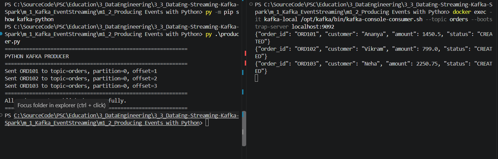
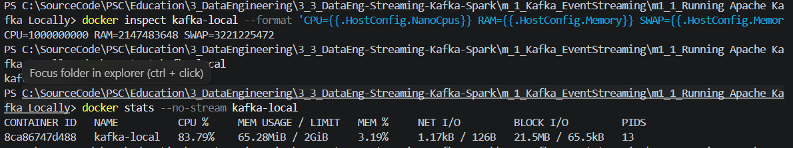
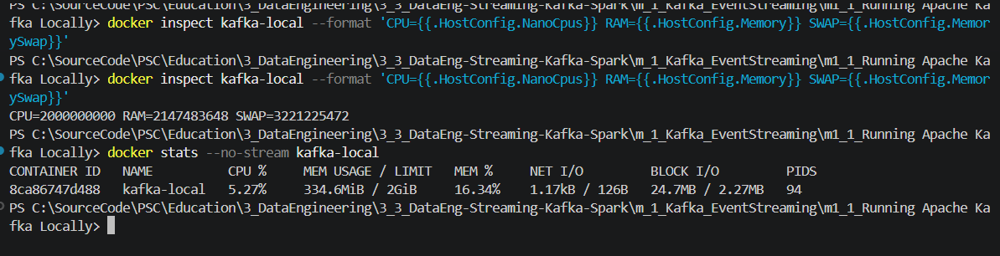
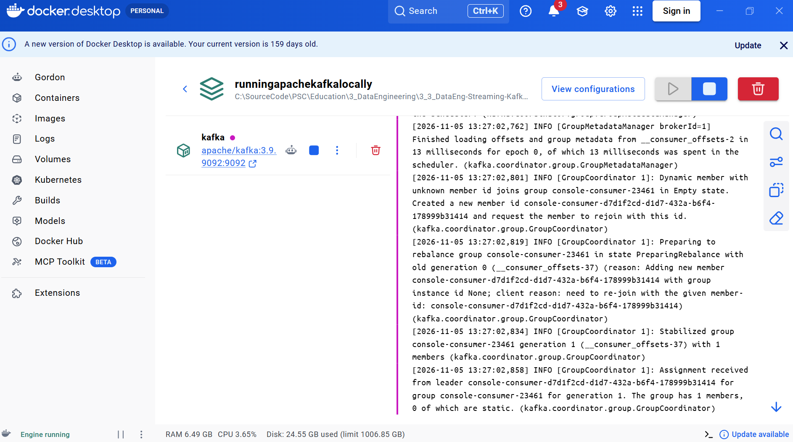
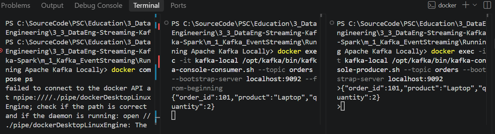

# m1_2 — Producing Events with Python

**Course:** Streaming Data Pipelines with Kafka and Spark  
**Module:** 1 — Event Streaming with Apache Kafka  
**Lab:** Producing Events with Python  
**Executor:** R. Lisovenko  
**Started:** 05 November 2026  
**Completed:** 06 November 2026  
**Location:** Deutschland  
**Status:** **COMPLETED — Python Producer and Consumer verified (SUCCESS).**

## 1. Objective

Publish structured customer-order events from Python into an existing Apache Kafka topic (`orders`). The source code is the **original Edureka `producer.py`**, supplied with the course. This lab reuses the single-node Kafka 3.9.1 broker configured in **m1_1 — Running Apache Kafka Locally**. **Do not deploy a second broker.**

**Architecture:** `Python producer.py (Windows) → localhost:9092 → Kafka broker (Docker / kafka-local) → orders topic → Console Consumer`

The previous lab confirmed successful end-to-end delivery of a console-produced event. This lab introduces JSON serialization and acknowledgment metadata from the `kafka-python` library.

## 2. Project layout and prerequisites

```text
m_1_Kafka_EventStreaming/
├── m1_1_Running Apache Kafka Locally/
│   └── docker-compose.yml              # Existing Kafka broker definition
└── m1_2_Producing Events with Python/
    ├── README.md                       # This step-by-step guide
    ├── producer.py                     # Original Edureka course code
    ├── requirements.txt                # kafka-python==2.2.15
    ├── scripts/
    │   └── check_kafka_resources.ps1   # Optional read-only verification helper
    └── pic/
        ├── kafka_docker_desktop_running.png
        ├── kafka_1cpu_startup_stats.png
        ├── kafka_2cpu_stable_stats.png
        ├── kafka_producer_consumer_previous_lab.png
        ├── kafka_python_dependency_verified.png
        └── kafka_python_producer_consumer_success.png
```

- Windows, PowerShell and Visual Studio Code.
- Docker Desktop with **Linux Engine running**, and the existing `kafka-local` container from Lab m1_1.
- A local Python installation. **The verified run used Python 3.14 via the Windows `py` launcher**, with `kafka-python==2.2.15`. A separate `.venv` is optional for future reproducible runs; it was **not** confirmed as used in the recorded execution. **No local Java/JDK is needed for this Windows Python producer**, since the broker runs inside Docker.
- Kafka's `orders` topic should already exist. The host port is `9092`.
- Avoid running Spark, Airflow or other lab stacks at the same time on this laptop.

> **Hardware note:** The Fujitsu CELSIUS H760 previously experienced increased fan noise and unexpected power-offs. Following servicing, this lab should be run only when the laptop is stable. Container CPU/RAM limits can reduce resource competition but **cannot prevent overheating or hardware-related shutdowns**. Monitor actual CPU temperature separately. Stop immediately if there is rapid temperature rise, severe fan noise, or another unexpected power-off.

## 3. Quick start — Windows PowerShell

Run commands from **this lab's directory** (`m1_2_Producing Events with Python`) unless explicitly noted.

### 3.1 Check Docker and reuse the existing broker

1. Start Docker Desktop manually and wait for **Engine running**.
2. Check connectivity (both Client and Server must be present):

```powershell
docker version
docker ps -a --filter "name=kafka-local"
```

**If `kafka-local` exists**, use the existing container rather than `docker compose up` from a different folder:

```powershell
# Apply/reapply the known working lab limits, without removing the container:
docker update --cpus=2 --memory=2g --memory-swap=3g kafka-local
# Start it only if it is not running already:
docker start kafka-local
```

`docker start` may report that the container is already running; in that case, simply continue. Do not repeat `docker compose up -d` from this m1_2 folder: it has no broker Compose file, and running `up` from a different Compose project can produce a **container-name conflict**.

**Only if the container does not exist:** go to the sibling **m1_1** folder where `docker-compose.yml` is stored, add the limits shown in §4.2 to the existing `kafka` service, validate it and create the broker:

```powershell
# In m1_1_Running Apache Kafka Locally, where docker-compose.yml exists:
docker compose config --quiet
docker compose up -d kafka
```

Then return to this m1_2 folder.

### 3.2 Check status, resource limits, and the topic

```powershell
docker ps --filter "name=kafka-local"
docker inspect kafka-local --format 'CPU={{.HostConfig.NanoCpus}} RAM={{.HostConfig.Memory}} SWAP={{.HostConfig.MemorySwap}}'
docker stats --no-stream kafka-local
docker exec kafka-local /opt/kafka/bin/kafka-topics.sh --list --bootstrap-server localhost:9092
docker exec kafka-local /opt/kafka/bin/kafka-topics.sh --describe --topic orders --bootstrap-server localhost:9092
```

Expected limits after the resource update:

```text
CPU=2000000000 RAM=2147483648 SWAP=3221225472
```

These correspond to **2 CPU-equivalents**, **2 GiB RAM**, and **3 GiB combined RAM + swap** (up to 1 GiB swap beyond RAM). For a compact one-command health check, you may also run the supplied **read-only** helper: `./scripts/check_kafka_resources.ps1`. The `orders` topic should be listed. If Kafka is still starting, do not stress the machine; allow the broker to become ready before running the producer.

### 3.3 Verify Python and install the required client

On this Windows machine, the `python` command originally returned **`Python was not found`**. The working command was `py`, which selected the installed **Python 3.14**. Reproduce the *verified* setup with:

```powershell
py --version
py -m pip show kafka-python
# Only if the package is missing:
py -m pip install -r requirements.txt
py -m pip show kafka-python
```

The course's `requirements.txt` pins **`kafka-python==2.2.15`**. On 05 Nov 2026, `py -m pip show kafka-python` confirmed the version **2.2.15** installed under the Python 3.14 site-packages directory.


> **Recommended for a new environment (optional, not the configuration shown in the verified screenshot):** create an isolated virtual environment before installing dependencies, for example `py -3.14 -m venv .venv`, then use `.\.venv\Scripts\python.exe -m pip install -r requirements.txt` and `.\.venv\Scripts\python.exe .\producer.py`. This avoids altering global Python packages. Do not recreate the environment merely to reproduce an already successful run.

### 3.4 Open a Consumer first — Terminal A (recommended)

```powershell
docker exec -it kafka-local /opt/kafka/bin/kafka-console-consumer.sh --topic orders --bootstrap-server localhost:9092
```

Leave this terminal running while starting the Python Producer in the second terminal. This command was used in the verified run and reads new incoming messages. Add `--from-beginning` **only if you want to replay retained messages**; older orders from Lab m1_1 may then also appear. Identify the new events by their IDs `ORD101`, `ORD102` and `ORD103`. This is only a client, not another Kafka broker.

### 3.5 Execute the Python Producer — Terminal B

From the `m1_2_Producing Events with Python` directory:

```powershell
py .\producer.py
```

This is the exact command used for the verified 06 Nov 2026 run (using Python 3.14 and the already installed `kafka-python` package). If you intentionally created a `.venv` as described above, use `.\.venv\Scripts\python.exe .\producer.py` instead.

The supplied `producer.py` sends **three synthetic order events** (one per second):

```json
{"order_id":"ORD101","customer":"Ananya","amount":1450.50,"status":"CREATED"}
{"order_id":"ORD102","customer":"Vikram","amount":799.00,"status":"CREATED"}
{"order_id":"ORD103","customer":"Neha","amount":2250.75,"status":"CREATED"}
```

**Actual verified Producer output — 06 Nov 2026:**

```text
PYTHON KAFKA PRODUCER
Sent ORD101 to topic=orders, partition=0, offset=1
Sent ORD102 to topic=orders, partition=0, offset=2
Sent ORD103 to topic=orders, partition=0, offset=3
All order events published successfully.
```

The console Consumer displayed the three matching JSON messages. **Both sides of the exchange are visible in the following actual project screenshot:**



The offsets `1`, `2`, `3` are **observed values for this particular run**, not constants. They can differ on a later run depending on existing messages. The original Edureka code calls `future.get(timeout=10)` to wait for the broker acknowledgment, and then `flush()` and `close()` to finish the session cleanly.

### 3.6 Verify and stop safely

- **Verified on 06 Nov 2026:** Terminal A displayed all three `ORD101`–`ORD103` events sent by Terminal B.
- The evidence screenshot is stored in `pic/kafka_python_producer_consumer_success.png`. For future runs, save a new screenshot and note that its offsets may differ.
- Press **Ctrl+C** in the interactive consumer terminal.
- **To stop but retain the existing Kafka container**, run:

```powershell
docker stop kafka-local
```

Then use **Quit Docker Desktop**. When no other WSL2 workloads are needed, `wsl --shutdown` releases its Linux VM resources. **Do not use** `docker compose down -v` or `docker rm kafka-local` for this exercise; the original m1_1 Compose file has no persistent Kafka data volume, so removing the container can lose topics and messages.

## 4. Kafka resource settings and troubleshooting history

### 4.1 Why the broker was limited

In Lab m1_1, Docker Desktop was observed to increase the laptop fan speed. Closing Docker Desktop reduced the noise. We therefore limited Kafka to **2 CPU-equivalents, 2 GiB RAM, and 3 GiB RAM+swap** while running only a single broker. These are **local training limits**, not production Kafka recommendations.

The initial attempt to change only CPU and RAM failed with:

```text
Memory limit should be smaller than already set memoryswap limit,
update the memoryswap at the same time
```

**Correction (run against the existing container):**

```powershell
docker update --cpus=2 --memory=2g --memory-swap=3g kafka-local
```

The limits were subsequently verified using `docker inspect`:

```text
CPU=2000000000 RAM=2147483648 SWAP=3221225472
```





| Snapshot (05 Nov 2026) | Limit | Kafka CPU reported | Kafka memory reported | State of observation |
|---|---|---:|---:|---|
| Earlier sample | 1 CPU equivalent | **83.79%** | **65.28 MiB / 2 GiB** | Broker startup/warm-up; 13 PIDs |
| Later sample | 2 CPU equivalents | **5.27%** | **334.6 MiB / 2 GiB** | Broker further into startup/steady operation; 94 PIDs |

**Interpretation:** The later sample was much lower, but these are **single snapshots from different startup phases**, not a controlled CPU-performance benchmark. It would be incorrect to claim that doubling the CPU limit alone caused the drop. Docker CPU percentage expresses usage relative to CPU capacity and can exceed 100% when multiple cores are available. Also note that the 2 GiB limit was verified; the container's original WSL-wide 3.826 GiB shown in earlier `docker stats` was **not** a per-container memory limit.

### 4.2 Keep the limits in m1_1 `docker-compose.yml`

`docker update` modifies the **existing container**. It does **not edit the Compose file**, so a recreated broker could lose these limits. To preserve them for future setups, add the following **three properties inside the existing `kafka` service** of the **m1_1** Compose file. Keep all course settings (`image`, `ports`, and `environment`) unchanged:

```yaml
services:
  kafka:
    image: apache/kafka:3.9.1
    container_name: kafka-local
    cpus: 2.0
    mem_limit: 2g
    memswap_limit: 3g
    # Keep the original ports: and environment: blocks here.
```

This code block is an illustrative **fragment**, not a replacement for your full `docker-compose.yml`.



### 4.3 Common errors and remedies

| Symptom | Cause / safe action |
|---|---|
| `dockerDesktopLinuxEngine` pipe not found | Docker Desktop / Linux Engine is not running. Launch Docker Desktop and confirm `docker version` shows **Server**. |
| `Conflict. The container name "/kafka-local" is already in use` | Existing broker belongs to another Compose project. Reuse it with `docker start kafka-local`; **do not delete it just to remove the conflict**. |
| `Memory limit should be smaller than ... memoryswap` | Supply `--memory` and `--memory-swap` **together**. |
| `CPUs=0 Memory=0` | No per-container CPU/RAM quota is set. Verify and apply intended limits. |
| `NoBrokersAvailable` / connection timeout in Python | Check Docker Engine, `kafka-local` status, port `9092`, and topic readiness; do not launch another broker. |
| `No module named kafka` | Install `requirements.txt` inside the **active Python virtual environment**. |
| `Topic orders not found` | Inspect with `kafka-topics.sh --list`; create once from m1_1 only if missing. |
| Fan becomes much louder or system unstable | Stop Kafka and Docker, check CPU temperature and power/cooling hardware. Container quotas are **not thermal safety controls**. |

For reference: [Docker Compose resource fields](https://docs.docker.com/reference/compose-file/services/) and [Docker container update](https://docs.docker.com/reference/cli/docker/container/update/).

## 5. Evidence and validation checklist

| Item | Result | Evidence |
|---|---|---|
| Kafka 3.9.1 broker and topic `orders` | **Verified in m1_1** | [m1_1 README](../m1_1_Running%20Apache%20Kafka%20Locally/README.md) |
| Earlier console Producer → Consumer delivery | **Verified in m1_1** |  |
| Docker Desktop / Kafka container running | **Verified** |  |
| Container resource limits: 2 CPU, 2 GiB RAM, 3 GiB RAM+swap | **Verified on 05 Nov** | `docker inspect`, startup/steady-state screenshots in §4 |
| `kafka-python==2.2.15` in Python 3.14 | **Verified on 05 Nov** |  |
| Python Producer sent `ORD101` / `ORD102` / `ORD103` | **SUCCESS — 06 Nov** |  |
| Kafka Console Consumer received all 3 Python events | **SUCCESS — 06 Nov** | Same two-terminal screenshot |

- [x] Reused Apache Kafka 3.9.1 and the existing `orders` topic.
- [x] Documented the actual Docker resource limits and troubleshooting history.
- [x] Verified `kafka-python==2.2.15` in Python 3.14 using `py -m pip show kafka-python`.
- [x] Executed `py .\producer.py` and confirmed Kafka acknowledgment metadata.
- [x] Confirmed delivery of three JSON order events in the console Consumer.
- [x] Included the successful execution screenshot in `pic/`.

**Final lab status: SUCCESS — 06 November 2026.**

## 6. Learning outcomes

- Produce JSON events with `KafkaProducer` and `value_serializer`.
- Reuse a local Kafka cluster instead of creating a new broker for each exercise.
- Understand the role of `bootstrap_servers`, topics, partitions and offsets.
- Wait for acknowledgments (`future.get`) and close the producer cleanly.
- Compare broker start-up and steady-state resource metrics without confusing correlation with causation.


---

**R. Lisovenko**  
**Deutschland, November 2026**  
**Lab started:** 05 November 2026  
**Lab completed:** 06 November 2026  
**Status: SUCCESS**
