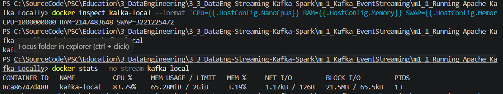
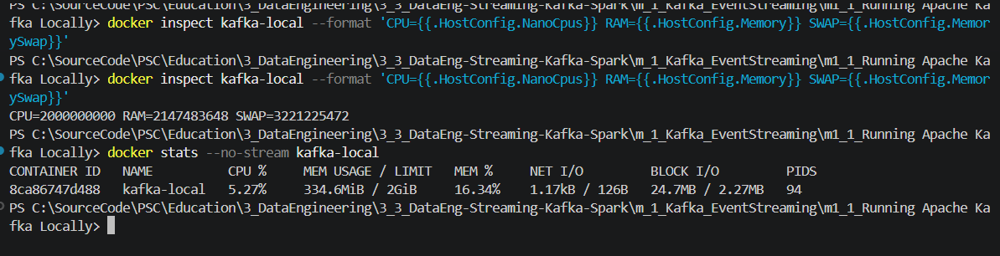
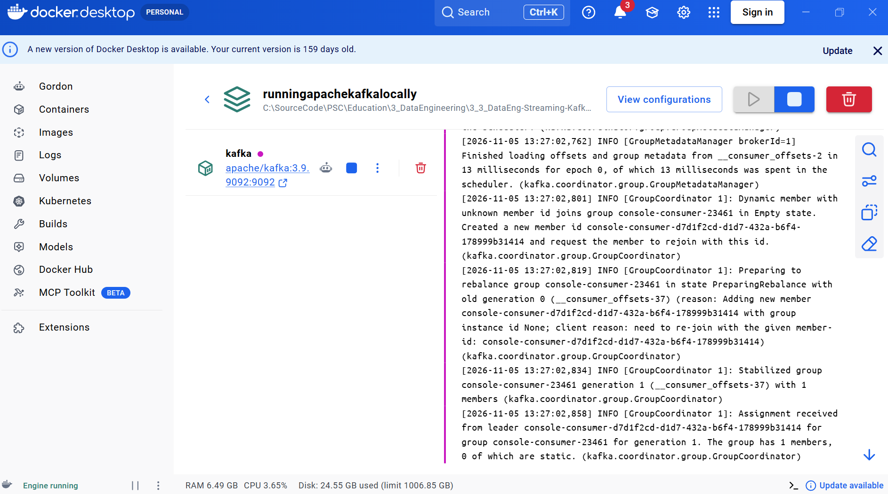
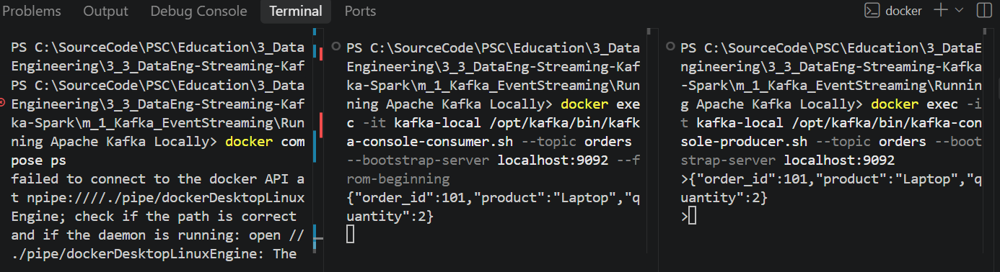
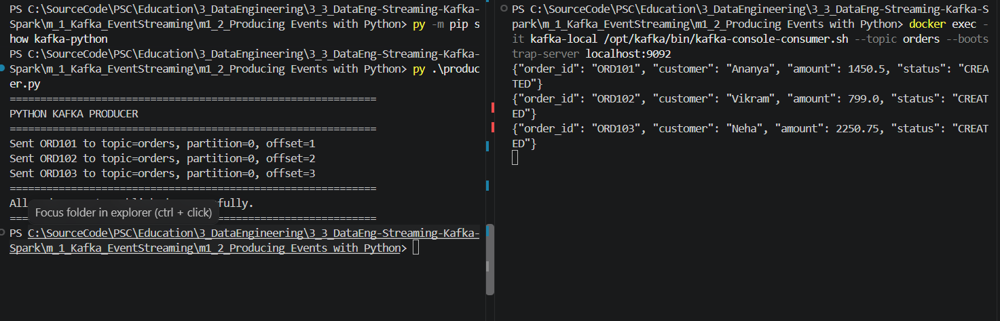

# m1_2 — Producing Events with Python

**Course:** Streaming Data Pipelines with Kafka and Spark  
**Provider:** Edureka / Coursera  
**Module:** 1 — Event Streaming with Apache Kafka  
**Lab:** Producing Events with Python  
**Executor:** R. Lisovenko  
**Prepared:** 05 November 2026  
**Location:** Deutschland  
**Status:** **Ready to run**. Kafka broker and console Producer/Consumer were previously verified in Lab m1_1; **the Python producer in this lab has not yet been execution-verified**.

## 1. Objective

Publish structured customer-order events from Python into an existing Apache Kafka topic (`orders`). The source code is the **original Edureka `producer.py`**, supplied with the course. This lab reuses the single-node Kafka 3.9.1 broker configured in **m1_1 — Running Apache Kafka Locally**. **Do not deploy a second broker.**

**Architecture:** `Python producer.py (Windows) → localhost:9092 → Kafka broker (Docker / kafka-local) → orders topic → Console Consumer`

The previous lab confirmed successful end-to-end delivery of a console-produced event. This lab introduces JSON serialization and acknowledgment metadata from the `kafka-python` library.

## 2. Project layout and prerequisites

```text
m_1_Kafka_EventStreaming/
├── m1_1_Running Apache Kafka Locally/
│   └── docker-compose.yml              # Existing Kafka broker definition
└── m1_2_Producing Events with Python/
    ├── README.md                       # This step-by-step guide
    ├── producer.py                     # Original Edureka course code
    ├── requirements.txt                # kafka-python==2.2.15
    ├── scripts/
    │   └── check_kafka_resources.ps1   # Optional read-only verification helper
    └── pic/
        ├── kafka_docker_desktop_running.png
        ├── kafka_1cpu_startup_stats.png
        ├── kafka_2cpu_stable_stats.png
        └── kafka_producer_consumer_previous_lab.png
```

- Windows, PowerShell and Visual Studio Code.
- Docker Desktop with **Linux Engine running**, and the existing `kafka-local` container from Lab m1_1.
- A local Python installation (Python 3.12 is a suitable choice when installed). The host Python environment is used to run `producer.py`; **no local Java/JDK is needed for this producer**.
- Kafka's `orders` topic should already exist. The host port is `9092`.
- Avoid running Spark, Airflow or other lab stacks at the same time on this laptop.

> **Hardware note:** The Fujitsu CELSIUS H760 previously experienced increased fan noise and unexpected power-offs. Following servicing, this lab should be run only when the laptop is stable. Container CPU/RAM limits can reduce resource competition but **cannot prevent overheating or hardware-related shutdowns**. Monitor actual CPU temperature separately. Stop immediately if there is rapid temperature rise, severe fan noise, or another unexpected power-off.

## 3. Quick start — Windows PowerShell

Run commands from **this lab's directory** (`m1_2_Producing Events with Python`) unless explicitly noted.

### 3.1 Check Docker and reuse the existing broker

1. Start Docker Desktop manually and wait for **Engine running**.
2. Check connectivity (both Client and Server must be present):

```powershell
docker version
docker ps -a --filter "name=kafka-local"
```

**If `kafka-local` exists**, use the existing container rather than `docker compose up` from a different folder:

```powershell
# Apply/reapply the known working lab limits, without removing the container:
docker update --cpus=2 --memory=2g --memory-swap=3g kafka-local
# Start it only if it is not running already:
docker start kafka-local
```

`docker start` may report that the container is already running; in that case, simply continue. Do not repeat `docker compose up -d` from this m1_2 folder: it has no broker Compose file, and running `up` from a different Compose project can produce a **container-name conflict**.

**Only if the container does not exist:** go to the sibling **m1_1** folder where `docker-compose.yml` is stored, add the limits shown in §4.2 to the existing `kafka` service, validate it and create the broker:

```powershell
# In m1_1_Running Apache Kafka Locally, where docker-compose.yml exists:
docker compose config --quiet
docker compose up -d kafka
```

Then return to this m1_2 folder.

### 3.2 Check status, resource limits, and the topic

```powershell
docker ps --filter "name=kafka-local"
docker inspect kafka-local --format 'CPU={{.HostConfig.NanoCpus}} RAM={{.HostConfig.Memory}} SWAP={{.HostConfig.MemorySwap}}'
docker stats --no-stream kafka-local
docker exec kafka-local /opt/kafka/bin/kafka-topics.sh --list --bootstrap-server localhost:9092
docker exec kafka-local /opt/kafka/bin/kafka-topics.sh --describe --topic orders --bootstrap-server localhost:9092
```

Expected limits after the resource update:

```text
CPU=2000000000 RAM=2147483648 SWAP=3221225472
```

These correspond to **2 CPU-equivalents**, **2 GiB RAM**, and **3 GiB combined RAM + swap** (up to 1 GiB swap beyond RAM). For a compact one-command health check, you may also run the supplied **read-only** helper: `./scripts/check_kafka_resources.ps1`. The `orders` topic should be listed. If Kafka is still starting, do not stress the machine; allow the broker to become ready before running the producer.

### 3.3 Prepare Python in a dedicated virtual environment

```powershell
# This command is for Windows when Python 3.12 is installed:
py -3.12 -m venv .venv
# If 3.12 is not installed, use a compatible installed Python:
# py -3 -m venv .venv

.\.venv\Scripts\Activate.ps1
python -m pip install -r requirements.txt
python -m pip show kafka-python
```

The exact library version from Edureka is **`kafka-python==2.2.15`**. An existing, suitable `.venv` can be reused. If PowerShell blocks activation, use the virtual environment interpreter directly: `./.venv/Scripts/python.exe -m pip install -r requirements.txt` and `./.venv/Scripts/python.exe producer.py`.

### 3.4 Open a Consumer first — Terminal A (recommended)

```powershell
docker exec -it kafka-local /opt/kafka/bin/kafka-console-consumer.sh --bootstrap-server localhost:9092 --topic orders --from-beginning
```

Leave this terminal running. Because the topic already contains records from Lab m1_1, **earlier orders may also appear**. Identify the new Python events by their IDs `ORD101`, `ORD102` and `ORD103`. This is a verification tool, not a second Kafka broker.

### 3.5 Execute the Python Producer — Terminal B

From the `m1_2_Producing Events with Python` directory:

```powershell
.\.venv\Scripts\Activate.ps1
python .\producer.py
```

The supplied `producer.py` sends **three synthetic order events** (one per second):

```json
{"order_id":"ORD101","customer":"Ananya","amount":1450.50,"status":"CREATED"}
{"order_id":"ORD102","customer":"Vikram","amount":799.00,"status":"CREATED"}
{"order_id":"ORD103","customer":"Neha","amount":2250.75,"status":"CREATED"}
```

**Expected console pattern (not yet captured in this lab):**

```text
PYTHON KAFKA PRODUCER
Sent ORD101 to topic=orders, partition=0, offset=<generated offset>
Sent ORD102 to topic=orders, partition=0, offset=<generated offset>
Sent ORD103 to topic=orders, partition=0, offset=<generated offset>
All order events published successfully.
```

Actual offsets depend on the existing records in `orders`; **do not hardcode or assume offset numbers**. The `future.get(timeout=10)` call waits for Kafka's acknowledgment for each send. `flush()` and `close()` complete the producer session.

### 3.6 Verify and stop safely

- Confirm that Terminal A displays all three new `ORD101`–`ORD103` events.
- Save screenshots of the Python output and matching consumer output to `pic/` before declaring this lab complete.
- Press **Ctrl+C** in the interactive consumer terminal.
- **To stop but retain the existing Kafka container**, run:

```powershell
docker stop kafka-local
```

Then use **Quit Docker Desktop**. When no other WSL2 workloads are needed, `wsl --shutdown` releases its Linux VM resources. **Do not use** `docker compose down -v` or `docker rm kafka-local` for this exercise; the original m1_1 Compose file has no persistent Kafka data volume, so removing the container can lose topics and messages.

## 4. Kafka resource settings and troubleshooting history

### 4.1 Why the broker was limited

In Lab m1_1, Docker Desktop was observed to increase the laptop fan speed. Closing Docker Desktop reduced the noise. We therefore limited Kafka to **2 CPU-equivalents, 2 GiB RAM, and 3 GiB RAM+swap** while running only a single broker. These are **local training limits**, not production Kafka recommendations.

The initial attempt to change only CPU and RAM failed with:

```text
Memory limit should be smaller than already set memoryswap limit,
update the memoryswap at the same time
```

**Correction (run against the existing container):**

```powershell
docker update --cpus=2 --memory=2g --memory-swap=3g kafka-local
```

The limits were subsequently verified using `docker inspect`:

```text
CPU=2000000000 RAM=2147483648 SWAP=3221225472
```





| Snapshot (05 Nov 2026) | Limit | Kafka CPU reported | Kafka memory reported | State of observation |
|---|---|---:|---:|---|
| Earlier sample | 1 CPU equivalent | **83.79%** | **65.28 MiB / 2 GiB** | Broker startup/warm-up; 13 PIDs |
| Later sample | 2 CPU equivalents | **5.27%** | **334.6 MiB / 2 GiB** | Broker further into startup/steady operation; 94 PIDs |

**Interpretation:** The later sample was much lower, but these are **single snapshots from different startup phases**, not a controlled CPU-performance benchmark. It would be incorrect to claim that doubling the CPU limit alone caused the drop. Docker CPU percentage expresses usage relative to CPU capacity and can exceed 100% when multiple cores are available. Also note that the 2 GiB limit was verified; the container's original WSL-wide 3.826 GiB shown in earlier `docker stats` was **not** a per-container memory limit.

### 4.2 Keep the limits in m1_1 `docker-compose.yml`

`docker update` modifies the **existing container**. It does **not edit the Compose file**, so a recreated broker could lose these limits. To preserve them for future setups, add the following **three properties inside the existing `kafka` service** of the **m1_1** Compose file. Keep all course settings (`image`, `ports`, and `environment`) unchanged:

```yaml
services:
  kafka:
    image: apache/kafka:3.9.1
    container_name: kafka-local
    cpus: 2.0
    mem_limit: 2g
    memswap_limit: 3g
    # Keep the original ports: and environment: blocks here.
```

This code block is an illustrative **fragment**, not a replacement for your full `docker-compose.yml`.



### 4.3 Common errors and remedies

| Symptom | Cause / safe action |
|---|---|
| `dockerDesktopLinuxEngine` pipe not found | Docker Desktop / Linux Engine is not running. Launch Docker Desktop and confirm `docker version` shows **Server**. |
| `Conflict. The container name "/kafka-local" is already in use` | Existing broker belongs to another Compose project. Reuse it with `docker start kafka-local`; **do not delete it just to remove the conflict**. |
| `Memory limit should be smaller than ... memoryswap` | Supply `--memory` and `--memory-swap` **together**. |
| `CPUs=0 Memory=0` | No per-container CPU/RAM quota is set. Verify and apply intended limits. |
| `NoBrokersAvailable` / connection timeout in Python | Check Docker Engine, `kafka-local` status, port `9092`, and topic readiness; do not launch another broker. |
| `No module named kafka` | Install `requirements.txt` inside the **active Python virtual environment**. |
| `Topic orders not found` | Inspect with `kafka-topics.sh --list`; create once from m1_1 only if missing. |
| Fan becomes much louder or system unstable | Stop Kafka and Docker, check CPU temperature and power/cooling hardware. Container quotas are **not thermal safety controls**. |

For reference: [Docker Compose resource fields](https://docs.docker.com/reference/compose-file/services/) and [Docker container update](https://docs.docker.com/reference/cli/docker/container/update/).

## 5. Evidence and validation checklist

| Item | Result | Evidence |
|---|---|---|
| Kafka 3.9.1 broker and topic `orders` | **Verified in m1_1** | [m1_1 README](../m1_1_Running%20Apache%20Kafka%20Locally/README.md) |
| Prior console Producer → Consumer delivery | **Verified in m1_1** |  |
| Updated container resource limits | **Verified** | `docker inspect` output and comparison screenshots above |
| Python dependencies | **Not yet verified** | Record `pip show kafka-python` |
| Python Producer `ORD101` / `ORD102` / `ORD103` | **Pending execution** | Save screenshot to `pic/python_producer_orders_sent.png` |
| Console Consumer receives the three Python events | **Pending execution** | Save screenshot to `pic/python_consumer_orders_received.png` |

- [x] Reused Kafka course version 3.9.1 and topic `orders`.
- [x] Documented the actual Docker resource limits and troubleshooting.
- [ ] Created/activated Python virtual environment and installed `kafka-python==2.2.15`.
- [ ] Ran `python producer.py` and checked its Kafka acknowledgment output.
- [ ] Confirmed three new Python events in Console Consumer.
- [ ] Added Python Producer and Consumer screenshots, then marked the lab completed.

## 6. Learning outcomes

- Produce JSON events with `KafkaProducer` and `value_serializer`.
- Reuse a local Kafka cluster instead of creating a new broker for each exercise.
- Understand the role of `bootstrap_servers`, topics, partitions and offsets.
- Wait for acknowledgments (`future.get`) and close the producer cleanly.
- Compare broker start-up and steady-state resource metrics without confusing correlation with causation.


----------------------

py -m pip install kafka-python==2.2.15

python -m pip show kafka-python
docker exec -it kafka-local /opt/kafka/bin/kafka-console-consumer.sh --topic orders --bootstrap-server localhost:9092


### Python Producer and Consumer — Successful Execution

The Python Kafka Producer successfully published three JSON events
to the `orders` topic using `kafka-python`.

**Verified results:**
- ORD101 — partition 0, offset 1
- ORD102 — partition 0, offset 2
- ORD103 — partition 0, offset 3

All three events were successfully received by the Kafka Console Consumer.



---

**R. Lisovenko**  
**Deutschland, Start 05 November 2026**
**Status: SUCCESS — November 6, 2026**
