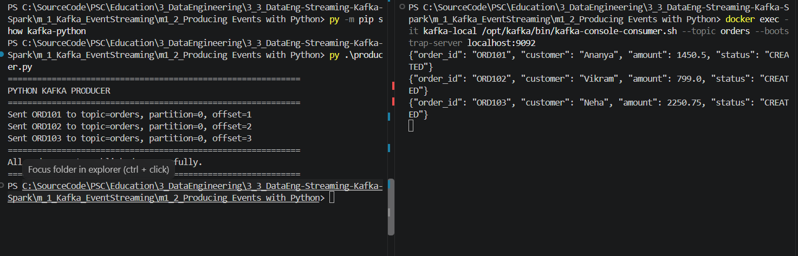
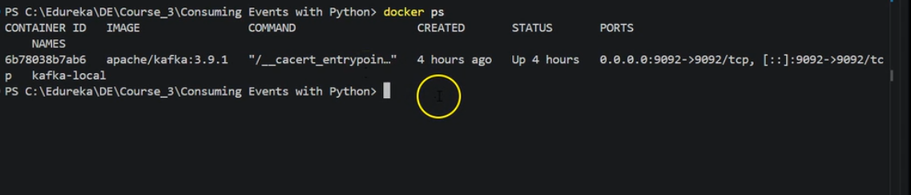
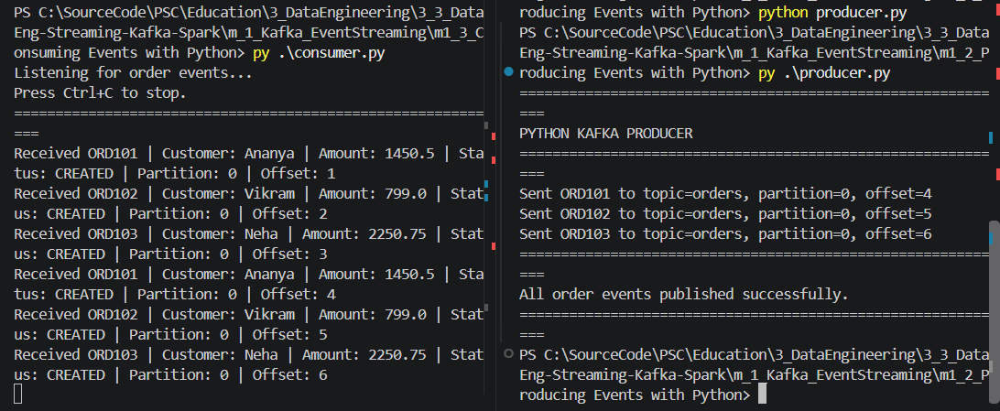

# m1_3 — Consuming Events with Python

**Course:** Streaming Data Pipelines with Kafka and Spark  
 
**Module:** 1 — Event Streaming with Apache Kafka  
**Lab:** 3 — Consuming Events with Python  
**Executor:** R. Lisovenko  
**Prepared:** 06 November 2026  
**Location:** Deutschland  
**Status:** **READY TO EXECUTE** — the Python Consumer has not yet been verified in this lab. The existing broker and the previous Python Producer → Console Consumer exercise were verified separately.

## 1. Objective

Run the **original Edureka `consumer.py`** using `kafka-python` to read JSON order events from the existing Apache Kafka topic `orders`. Observe the message contents, partition number and offset, and understand how a **consumer group** tracks its reading position.

**Data flow:**

```text
Python Producer (Lab m1_2) --> Kafka topic 'orders' --> Python Consumer (Lab m1_3)
   py producer.py          Docker: kafka-local             py consumer.py
```

**Important:** This lab **reuses Kafka 3.9.1 from m1_1**. Do not create a second Kafka broker or delete the existing `kafka-local` container.

## 2. Project files

```text
m_1_Kafka_EventStreaming/
├── m1_1_Running Apache Kafka Locally/    # Kafka Docker Compose configuration
├── m1_2_Producing Events with Python/    # Verified Python Producer
└── m1_3_Consuming Events with Python/
    ├── README.md                         # This complete lab procedure
    ├── consumer.py                       # Original Edureka course code
    ├── requirements.txt                  # kafka-python==2.2.15
    └── pic/
        ├── course_reference_kafka_running.png
        ├── previous_lab_python_producer_consumer_success.png
        ├── python_consumer_received_orders.png   # Add after successful lab execution
        └── kafka_consumer_group_status.png        # Optional, add after inspection
```

Only the first two PNGs are supplied initially; the last two names are **planned evidence**, not existing screenshots.

## 3. Prerequisites and safe resource limits

- Windows PowerShell / Visual Studio Code and Docker Desktop with **Linux Engine running**.
- Existing container **`kafka-local`** using `apache/kafka:3.9.1`, host port `9092`.
- Existing Kafka topic **`orders`** (previous labs).
- Windows Python: the machine previously used **Python 3.14** through the **`py`** launcher. `python` without the launcher was not found in PowerShell.
- Python library **`kafka-python==2.2.15`**, already verified in Lab m1_2.

The existing Kafka container has the following **verified resource limits** (06 November 2026):

| Setting | Limit | Docker inspect value |
|---|---|---|
| CPU quota | **2 CPU-equivalents** | `NanoCpus=2000000000` |
| RAM | **2 GiB** | `Memory=2147483648` |
| RAM + Swap | **3 GiB** | `MemorySwap=3221225472` |

These were chosen after observing increased laptop fan noise during Docker operation. Limiting Docker's resources can reduce load but **does not guarantee thermal safety**. Because the Fujitsu CELSIUS H760 previously experienced unexpected shutdowns, monitor temperature and stability. Stop the lab if severe fan noise, overheating, or instability returns. Avoid running Spark and Airflow at the same time.

### Previous-lab evidence (not proof of this consumer's execution)



**Course video reference:** the instructor begins by checking that `kafka-local` is running with `docker ps`.



## 4. Step-by-step lab instructions (PowerShell)

Run these commands from **`m1_3_Consuming Events with Python`** unless another location is specified.

### Step 1 — Start Docker Desktop and check the existing broker

Open Docker Desktop and wait for **Engine running**, then:

```powershell
docker version
docker ps -a --filter "name=kafka-local"
```

If the container exists but is stopped, start it without creating a new one:

```powershell
docker start kafka-local
```

If it is already running, **do not start another Kafka instance**.

```powershell
docker ps --filter "name=kafka-local"
docker stats --no-stream kafka-local
```

If the Docker API pipe is unavailable (`dockerDesktopLinuxEngine` not found), Docker Desktop's Linux Engine is not running. Fix that before running Python. If you see a **container name conflict**, reuse `kafka-local` rather than removing it.

### Step 2 — Confirm container CPU/RAM limits

```powershell
docker inspect kafka-local --format 'CPU={{.HostConfig.NanoCpus}} RAM={{.HostConfig.Memory}} SWAP={{.HostConfig.MemorySwap}}'
```

Expected:

```text
CPU=2000000000 RAM=2147483648 SWAP=3221225472
```

If the limits are missing, apply the **existing training configuration**:

```powershell
docker update --cpus=2 --memory=2g --memory-swap=3g kafka-local
```

Use `--memory` and `--memory-swap` **together**: setting memory alone previously failed with a memory-swap conflict. Recheck with `docker inspect`. These settings affect the existing container only; make sure the corresponding Compose configuration in **m1_1** has `cpus: 2.0`, `mem_limit: 2g`, `memswap_limit: 3g` for future recreation.

### Step 3 — Verify the Kafka topic

```powershell
docker exec kafka-local /opt/kafka/bin/kafka-topics.sh --list --bootstrap-server localhost:9092

docker exec kafka-local /opt/kafka/bin/kafka-topics.sh --describe --topic orders --bootstrap-server localhost:9092
```

Confirm that `orders` exists. The original course topic was created with **1 partition** and **replication factor 1**. If the topic is absent, check the first lab's README before creating it again.

### Step 4 — Verify Python and the client library

```powershell
py --version
py -m pip show kafka-python
```

Expected client package: **`kafka-python 2.2.15`**. Only if it is missing from the interpreter used to run this lab:

```powershell
py -m pip install -r .\requirements.txt
```

`requirements.txt` contains:

```text
kafka-python==2.2.15
```

A separate virtual environment is optional. If one is created, install requirements inside it and use its Python interpreter consistently. Do **not** install unrelated Java or Spark packages for this Python Consumer.

### Step 5 — Start the Edureka Python Consumer (Terminal A)

Open a PowerShell terminal in this lab folder:

```powershell
py .\consumer.py
```

Expected startup text:

```text
============================================================
PYTHON KAFKA CONSUMER
============================================================
Listening for order events...
Press Ctrl+C to stop.
============================================================
```

**The terminal stays open and waits for records.** That is normal. With a new consumer group, retained historical records may appear immediately.

### Step 6 — Publish new order events (Terminal B)

If no events appear or you want a repeatable demonstration, **keep Terminal A running**. Open a second terminal and run the already verified Edureka Producer from Lab m1_2:

```powershell
py "..\m1_2_Producing Events with Python\producer.py"
```

This creates three order events (illustrative payloads from the supplied Edureka script):

```json
{"order_id":"ORD101","customer":"Ananya","amount":1450.50,"status":"CREATED"}
{"order_id":"ORD102","customer":"Vikram","amount":799.00,"status":"CREATED"}
{"order_id":"ORD103","customer":"Neha","amount":2250.75,"status":"CREATED"}
```

Kafka assigns offsets based on prior messages; **do not expect fixed offset numbers** on a later run. The previous execution in Lab m1_2 returned partition `0`, offsets `1`, `2`, `3`, but a repeat may produce higher offsets.

### Step 7 — Verify the Python Consumer output

The Edureka `consumer.py` should print lines resembling:

```text
Received ORD101 | Customer: Ananya | Amount: 1450.5 | Status: CREATED | Partition: 0 | Offset: <actual>
Received ORD102 | Customer: Vikram | Amount: 799.0 | Status: CREATED | Partition: 0 | Offset: <actual>
Received ORD103 | Customer: Neha | Amount: 2250.75 | Status: CREATED | Partition: 0 | Offset: <actual>
```

The **exact offsets must be taken from your real output**. After successful execution, capture a screenshot with both terminals and save it as:

`pic/python_consumer_received_orders.png`

Then add this image to the README:

```markdown

```

**Status:** PENDING — do not mark this step `SUCCESS` until the real Python Consumer output is confirmed.

### Step 8 — Inspect the consumer group (optional)

In a third terminal:

```powershell
docker exec kafka-local /opt/kafka/bin/kafka-consumer-groups.sh --bootstrap-server localhost:9092 --describe --group order-processing-group
```

This can report `CURRENT-OFFSET`, `LOG-END-OFFSET`, and `LAG` for the group. Group assignment and lag information may depend on whether the consumer is actively running. A small lag is expected after it catches up; don't assume zero without checking.

### Step 9 — Stop without deleting Kafka data

In Terminal A, press **Ctrl+C**. The course script catches `KeyboardInterrupt` and calls `consumer.close()`.

When finished with the lab:

```powershell
docker stop kafka-local
```

Then use **Quit Docker Desktop**. Optionally, if no other WSL2 work is active:

```powershell
wsl --shutdown
```

**Do not run `docker compose down -v` or remove `kafka-local`.** The original m1_1 course Compose configuration does not define a persistent data volume; deleting the container can lose stored topic data.

## 5. How the original `consumer.py` works

The original Edureka implementation (included in this folder) configures:

| Option | Purpose |
|---|---|
| `KafkaConsumer("orders")` | Subscribe to the `orders` topic. |
| `bootstrap_servers="localhost:9092"` | Connect to the existing local Kafka broker from Windows. |
| `group_id="order-processing-group"` | Join a named Kafka consumer group. |
| `auto_offset_reset="earliest"` | Read from earliest available offset **only when the group has no valid committed offset**. |
| `enable_auto_commit=True` | Automatically commit the group's consumed positions. |
| `value_deserializer=...json.loads(...)` | Decode JSON message values to Python dictionaries. |
| `message.partition` / `message.offset` | Display the physical partition and message position. |
| `consumer.close()` | Close the consumer on exit. |

**Important offset behavior:** `auto_offset_reset="earliest"` does **not** override an existing committed offset. If the same consumer group already processed messages, restarting it may show no old records. To verify again, **run the Producer to publish new events**. Do not delete the group or modify the original course code just to force a replay.

## 6. Troubleshooting

| Problem | What to check |
|---|---|
| `python` is not recognized by Windows | Run `py .\consumer.py`, not bare `python`, as verified on this system. |
| `No module named 'kafka'` | Check the running interpreter with `py -m pip show kafka-python`; install `requirements.txt` for that interpreter. |
| `NoBrokersAvailable` | Ensure Docker Desktop is running, `kafka-local` is up, and `9092` is exposed. |
| Consumer starts but no messages appear | Publish new messages from m1_2; check the group offset behavior above. |
| `KeyError: 'customer'` or similar | This original consumer expects fields `order_id`, `customer`, `amount`, `status`. Some earlier demo events used a different schema (`product`, `quantity`). Publish the course's compatible events and inspect payloads before restarting. |
| Error: container name already in use | Reuse the existing `kafka-local` container, do not start a second Compose project. |
| Kafka memory-swap limit conflict | Set `--memory` and `--memory-swap` together, as in Step 2. |
| Fan noise / unexpected shutdown | Stop the lab, close Docker and check hardware temperatures and system stability. |

## 7. Execution and evidence checklist

| Check | Status | Evidence |
|---|---|---|
| Original Edureka `consumer.py` and `requirements.txt` included | **READY** | Files in this folder |
| Kafka 3.9.1 and topic `orders` previously used | **VERIFIED IN PRIOR LABS** | m1_1 / m1_2 results |
| Python Producer successfully published ORD101–ORD103 | **VERIFIED IN m1_2** | Previous-lab screenshot above |
| Python Consumer starts with `py .\consumer.py` | **PENDING** | Add terminal screenshot |
| Python Consumer prints ORD101–ORD103 | **PENDING** | `pic/python_consumer_received_orders.png` after run |
| Consumer-group offset/lag inspected | **OPTIONAL / PENDING** | Add screenshot if executed |

## 8. Learning outcomes

After completing the lab, the learner should be able to:

- Connect to Kafka using `KafkaConsumer` in Python.
- Deserialize JSON values and read order events continuously.
- Explain `topic`, `partition`, `offset`, and `consumer group`.
- Understand how committed offsets affect replay after a restart.
- Safely reuse and stop the existing Docker Kafka broker.
- Validate message delivery with real terminal output and screenshots.

---

**R. Lisovenko**  
**Deutschland, 06 November 2026**
