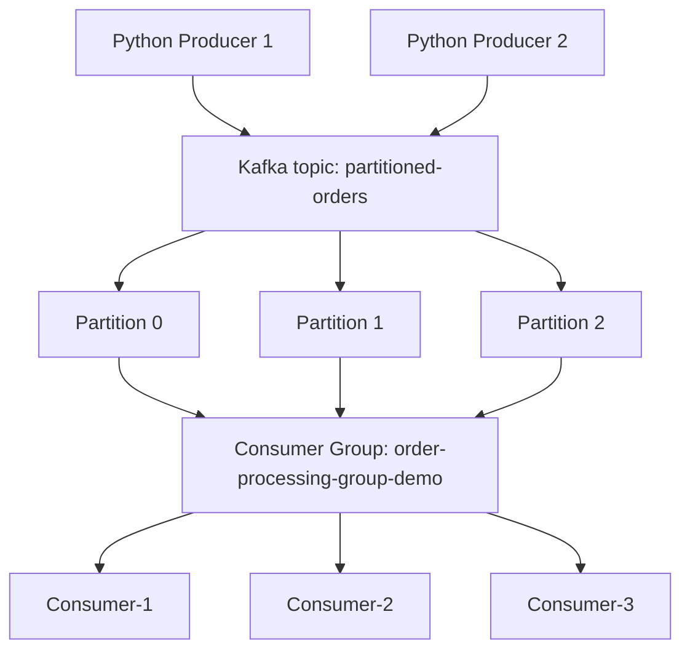

# m1_4 — Working with Kafka Partitions and Consumer Groups

**Course:** Streaming Data Pipelines with Kafka and Spark (Edureka / Coursera)  
**Module:** 1 — Event Streaming with Apache Kafka  
**Lab:** 4 — Working with Kafka Partitions and Consumer Groups  
**Executor:** R. Lisovenko  
**Location:** Deutschland  
**Date:** 06 November 2026  
**Status:** **CORE LAB COMPLETED — SUCCESS**. Multi-producer/multi-consumer experiment performed. **Exact final group assignments and a controlled failure/rebalance test were not separately verified with Kafka CLI.**


## 1. Objective and verified outcome

This laboratory uses the **original Edureka `producer.py` and `consumer.py`** with the existing Apache Kafka **3.9.1** broker (`kafka-local`) from Lab m1_1. Its purpose is to demonstrate keyed event routing into topic **`partitioned-orders`**, partition-specific offsets, and parallel consumption by multiple independent Python processes in **one consumer group**.

**What was actually demonstrated on 06 November 2026:**

- The existing Kafka broker was reused; no second Kafka container was created.
- The new topic **`partitioned-orders`** was created and verified with **3 partitions (0, 1, 2)** and **replication factor 1**.
- The original Producer successfully published `PORD101`–`PORD106` with customer keys.
- With **two Consumers**, `customer-A` records went to **partition 1**, while `customer-B` and `customer-C` records went to **partition 2**; both Consumers received records.
- The Producer was run repeatedly, resulting in **new offsets** and repeated *example order IDs*. Kafka did not automatically deduplicate the events.
- A later experiment used **two Producer terminals and three Consumer terminals**. Both Producers reported success and consumers processed incoming records. One Consumer could remain without visible records even though the program was waiting normally.

**Important limitation:** A screenshot of terminal output alone does **not** establish the exact *simultaneous* partition assignments or prove a controlled rebalancing event. A third Consumer waiting does not mean it has failed: it may have been assigned partition 0, which received no events with our three sample keys. Use the group-description commands in §5 to inspect actual assignments.

## 2. How the architecture works



*The arrows from the group to consumers show possible assignments, not that all records are broadcast to every consumer. Kafka assigns each partition to **one** member at a time within a consumer group.*

| Concept | What it means in this lab |
|---|---|
| **Producer** | Independent process that **writes** messages to Kafka. Multiple Producers may write to the same topic concurrently. |
| **Topic** | Named stream of records: `partitioned-orders`. |
| **Partition** | Ordered, append-only log within the topic, with its **own** offset sequence. It is not a Docker container or a simple manually created piece of a file. |
| **Message key** | For a stable partitioning scheme, records with the same key are routed to the same partition; ordering is guaranteed within a partition, not globally across the topic. |
| **Offset** | Record position **inside one particular partition**. Offsets do not by themselves guarantee that events can never be lost or processed twice. |
| **Consumer** | Independent process that **reads** records. It stays running and waits for new data. |
| **Consumer group** | Coordinates which member owns which partitions and tracks committed reading progress. |
| **Rebalance** | Reassignment of partition ownership when group membership changes (e.g., a Consumer joins or exits). **The partition's stored data does not physically move as a result.** |

**Parallelism vs. multithreading:** This experiment demonstrates *parallel event handling across separate Python Consumer processes*, each in a VS Code terminal. It does **not** demonstrate several threads executing inside a single Python process. Multiple terminal panes are only a way to observe these independent processes.

For this particular Producer and topic, the observed routing was:

| Key | Observed partition | Orders |
|---|---:|---|
| `customer-A` | **1** | `PORD101`, `PORD104` |
| `customer-B` | **2** | `PORD102`, `PORD105` |
| `customer-C` | **2** | `PORD103`, `PORD106` |

**Partition 0 had no events from these example keys in the recorded runs.** With three partitions and three Consumers in the same group, a Consumer assigned to that empty partition can appear idle. The assignment can change as members join/leave, so do not assume which named Consumer owns partition 0 without running `--members --verbose`.

## 3. Project contents and prerequisites

```text
m1_4_Working with Kafka Partitions and Consumer Groups/
├── README.md                         # Full lab report and reproducible instructions
├── README.txt                        # Short PowerShell command reference
├── producer.py                       # Original Edureka producer
├── consumer.py                       # Original Edureka consumer
├── requirements.txt                  # kafka-python==2.2.15
└── pic/
    ├── edureka_lab4_title.png
    ├── kafka_resource_limits_previous_lab.png
    ├── 01_topic_three_partitions.png
    ├── 02_two_consumers_waiting.png
    ├── 03_first_run_two_consumers.png
    ├── 04_repeated_parallel_runs.png
    └── 05_two_producers_three_consumers.png
```

**Environment:** Windows / PowerShell / VS Code; Python 3.14 invoked via `py` (the `python` command did not work on this PC); `kafka-python==2.2.15`; Docker Desktop / Linux Engine; Kafka 3.9.1 at `localhost:9092` in `kafka-local`.

**Resource controls previously verified:** Kafka **2 CPU equivalents**, **2 GiB RAM**, **3 GiB combined RAM + swap**. Stop the unrelated Airflow/Spark stacks while completing this lab. This limits resource usage, **not physical temperature**. The previous laptop power-off issues warrant investigation if they recur.

## 4. Reproduce the experiment — precise terminal commands

Run all Python commands from the **Lab 4 folder** shown in the heading above. A VS Code *terminal pane* represents an independent PowerShell session, so a `CONSUMER_NAME` set in one pane does not carry over to another.

### 4.1 Prepare Kafka — once, in a free terminal

Start Docker Desktop manually and wait for **Engine running**. Reuse the existing broker:

```powershell
docker ps -a --filter "name=kafka-local"
# Only if the container is currently stopped:
docker start kafka-local

docker inspect kafka-local --format 'CPU={{.HostConfig.NanoCpus}} RAM={{.HostConfig.Memory}} SWAP={{.HostConfig.MemorySwap}}'
docker stats --no-stream kafka-local
```

Expected resource quota (when the earlier limits are in effect):

```text
CPU=2000000000 RAM=2147483648 SWAP=3221225472
```

If those container limits are missing, and only when appropriate for the machine:

```powershell
docker update --cpus=2 --memory=2g --memory-swap=3g kafka-local
```

> `docker update` changes the existing container, **not** its Compose source file. Store the same limits in the existing `kafka` service in m1_1 `docker-compose.yml` if the broker may later be recreated. Do not create a second `kafka-local` or use `docker compose down -v`.

Verify Python and the library, installing only if absent:

```powershell
py --version
py -m pip show kafka-python
# Only if requirements are missing:
py -m pip install -r .\requirements.txt
```

Create topic **once**, without deleting any existing Kafka data:

```powershell
docker exec kafka-local /opt/kafka/bin/kafka-topics.sh --create --if-not-exists --topic partitioned-orders --bootstrap-server localhost:9092 --partitions 3 --replication-factor 1

docker exec kafka-local /opt/kafka/bin/kafka-topics.sh --describe --topic partitioned-orders --bootstrap-server localhost:9092
```

Actual result: **PartitionCount: 3**, **ReplicationFactor: 1**, partitions **0 / 1 / 2**.


### 4.2 Basic exercise — one Producer and two Consumers

Open **three PowerShell terminals** in this same Lab 4 folder. **Start Consumers first**; they will remain active. On this Windows PC, use `py`, not `python`.

**Terminal 1 — Consumer-1:**

```powershell
$env:CONSUMER_NAME="Consumer-1"; py .\consumer.py
```

**Terminal 2 — Consumer-2:**

```powershell
$env:CONSUMER_NAME="Consumer-2"; py .\consumer.py
```

Both instances use `group_id="order-processing-group-demo"` **inside the original `consumer.py`**. The `CONSUMER_NAME` environment variable is only a printed label; it **does not select or force a partition**.


**Terminal 3 — Producer:**

```powershell
py .\producer.py
```

The producer prints `All partitioned order events published successfully.`; both Consumers together received the events. For the observed initial run, `Consumer-1` received `PORD101` and `PORD104` from partition 1; `Consumer-2` received `PORD102`, `PORD103`, `PORD105`, `PORD106` from partition 2.


### 4.3 Extended experiment — five terminal panes

This is the **additional real experiment** performed after the course's basic example. Five terminal panes were used: **two Producers** and **three Consumers**, all running in the same Lab 4 working directory. Each Producer is a separate invocation of the same original script; each Consumer is a separate process in the **same** group.

| VS Code terminal | Role | Enter this exact PowerShell command |
|---|---|---|
| **1** | Producer-1 | `py .\producer.py` |
| **2** | Producer-2 | `py .\producer.py` |
| **3** | Consumer-1 | `$env:CONSUMER_NAME="Consumer-1"; py .\consumer.py` |
| **4** | Consumer-2 | `$env:CONSUMER_NAME="Consumer-2"; py .\consumer.py` |
| **5** | Consumer-3 | `$env:CONSUMER_NAME="Consumer-3"; py .\consumer.py` |

**Execution order:**

1. Start **Consumer-1** (Terminal 3), **Consumer-2** (Terminal 4), and **Consumer-3** (Terminal 5). Leave the commands running; “Waiting for partition assignments and order events...” is expected.
2. Wait briefly for the Consumer Group to settle.
3. Run **Producer-1** and **Producer-2** in Terminals 1 and 2, close together in time. They are independent; no different Python file or special environment variable is needed for Producers.
4. Examine the output from all three Consumers. A Consumer that received an empty partition may display no new orders.
5. If repeating, invoke `py .\producer.py` again. **Each run appends new Kafka records**, even if the example `PORD...` IDs are unchanged.


**What is and isn't proven by this screenshot:** Both Producer terminals printed success. The Consumer output shows records and advancing partition-specific offsets; the rightmost `Consumer-2` terminal also shows partition 1 messages. Since the displayed scrollback spans earlier and later periods, and group membership may have changed, **the image does not establish that two Consumers owned partition 1 at the same instant**. Kafka allows at most one active owner of a partition in one Consumer Group at a time (outside brief transition effects). Check live assignments using §5.

Earlier repeat-run evidence (additional offsets):


### 4.4 Optional controlled rebalance experiment — not yet verified

To explicitly test *rebalancing*, with three Consumers running:

1. Inspect current assignments using §5.
2. Press **Ctrl+C** in one Consumer terminal, for example `Consumer-2` (not in a Producer terminal).
3. Wait for reassignment and inspect current assignments again.
4. Run `py .\producer.py` in a free Producer terminal and observe which **remaining** Consumer reads partition 1 or 2.

**Do not mark this optional experiment “verified” without before/after assignment output.** You can return to it when revising Consumer Groups later.

## 5. Inspect actual group membership, assignments, and offsets

In a **free Producer terminal** (after its script has finished), while the Consumers are still running:

```powershell
# Discover actual consumer group names:
docker exec kafka-local /opt/kafka/bin/kafka-consumer-groups.sh --bootstrap-server localhost:9092 --list

# Show committed offsets, partition log end offsets, lag, and members:
docker exec kafka-local /opt/kafka/bin/kafka-consumer-groups.sh --bootstrap-server localhost:9092 --describe --group order-processing-group-demo

# Show the exact CURRENT partition assignments per group member:
docker exec kafka-local /opt/kafka/bin/kafka-consumer-groups.sh --bootstrap-server localhost:9092 --describe --group order-processing-group-demo --members --verbose
```

The `--members --verbose` output is the appropriate evidence for **which Consumer currently owns partition 0, 1, and 2**. Names like `Consumer-1` are printed only by the Python script; Kafka CLI typically identifies members using generated client/member IDs. Neither screenshot terminal positions nor repeated offset sequences alone prove current ownership. Some lag/commit information may update after a small delay.

**Offsets are scoped to partitions:** partition 1 offset 5 and partition 2 offset 5 represent **different records**. An offset advances when new records are appended to that partition; committed offsets track group progress. In this lab `enable_auto_commit=True` and `auto_offset_reset="earliest"` means the earliest offset applies *only when a committed group offset does not exist*. Repeated runs therefore generally read **new** records rather than replaying all historical ones.

## 6. Troubleshooting and lessons learned

| Observation / issue | Cause, result, or safe resolution |
|---|---|
| `python` shows “Python was not found” | Use `py .\producer.py` / `py .\consumer.py` on this Windows system. |
| `Unexpected token 'py'` after `CONSUMER_NAME` | Separate commands with `;` or Enter: `$env:CONSUMER_NAME="Consumer-1"; py .\consumer.py`. |
| Third Consumer waits without receiving orders | Possible normal result when partition 0 receives none of the demo keys. Confirm actual assignments with `--members --verbose`; waiting alone is not proof of group state. |
| Consumer names are `Consumer-1`, `Consumer-2`, `Consumer-3` | These are **labels**, not a directive to Kafka's partition assignor. The shared `group_id` controls membership. |
| Same `PORD101` etc. appears repeatedly | Multiple Producer runs append separate messages; the examples reuse order IDs, and no deduplication is implemented. |
| `customer-B` and `customer-C` went to the same partition | Different keys can hash to the same partition; keys do **not** guarantee a distinct partition per customer. |
| Some Consumer outputs show a partition in multiple panes | Logs may show **different times / after rebalancing**. Do not infer concurrent ownership without live assignment verification. |
| `--if-not-exists` leaves topic unchanged | If the topic already exists, it does not recreate it or reset its offsets. |
| `dockerDesktopLinuxEngine` unavailable or broker missing | Start Docker Desktop, check `docker ps -a`, and start **existing** `kafka-local`. Do not create another fixed-name container. |
| Airflow stack used ~188% Docker CPU earlier | Airflow is unrelated to Lab 4; keep that stack stopped when running Kafka on the laptop. |
| Fan noise or system instability | Stop the lab and investigate; container CPU/RAM quotas are not a thermal protection mechanism. |

## 7. Evidence and completion status

| Verification | Result | Evidence |
|---|---|---|
| Apache Kafka broker reused (v3.9.1) | **SUCCESS** | Earlier labs |
| Kafka quota: 2 CPU, 2 GiB RAM, 3 GiB RAM+swap | **Previously verified** | `pic/kafka_resource_limits_previous_lab.png` |
| Topic `partitioned-orders` / 3 partitions / RF=1 | **SUCCESS** | `pic/01_topic_three_partitions.png` |
| Two Consumers in same group waiting and receiving events | **SUCCESS** | `pic/02_two_consumers_waiting.png`, `pic/03_first_run_two_consumers.png` |
| Six keyed events `PORD101`–`PORD106` sent | **SUCCESS** | `pic/03_first_run_two_consumers.png` |
| Two Producer terminals / three Consumer terminals | **Observed successful Producer runs** | `pic/05_two_producers_three_consumers.png` |
| Partition 1 and 2 routing with increasing offsets | **SUCCESS** | `pic/03_first_run_two_consumers.png`, `pic/04_repeated_parallel_runs.png` |
| Exact final Consumer Group member-to-partition assignments (CLI) | **NOT CAPTURED** | Run `--members --verbose` |
| Controlled stop/rejoin rebalancing with before/after assignments | **OPTIONAL — NOT YET TESTED** | Return later |

**Conclusion:** The core lab was completed successfully, showing **parallel consumption of keyed Kafka events across multiple independent Python processes**. Parallelism is partition-based, and the number of actively useful Consumer instances is bounded by partition count for a single Consumer Group. This is a local teaching demonstration, not a throughput benchmark or a production cluster.

## 8. Safe shutdown

Stop the running Python Consumers individually using **Ctrl+C** in their terminal panes. Producer scripts already exit after sending. Only when no other lab requires Kafka:

```powershell
docker stop kafka-local
```

Quit Docker Desktop when finished; optionally `wsl --shutdown` only if no other WSL workload is needed. Avoid `docker compose down -v` or deleting the existing broker, because topics/messages may be lost if storage is not on a persistent volume.

## 9. Source and reference

- Original Edureka laboratory scripts (`producer.py`, `consumer.py`), preserved unchanged.
- [Streaming Data Pipelines with Kafka and Spark — Coursera](https://www.coursera.org/learn/streaming-data-pipelines-kafka-spark)
- [Apache Kafka documentation: Consumer Groups](https://kafka.apache.org/documentation/#consumerconfigs)

---

**R. Lisovenko**  
**Deutschland, 06 November 2026**
