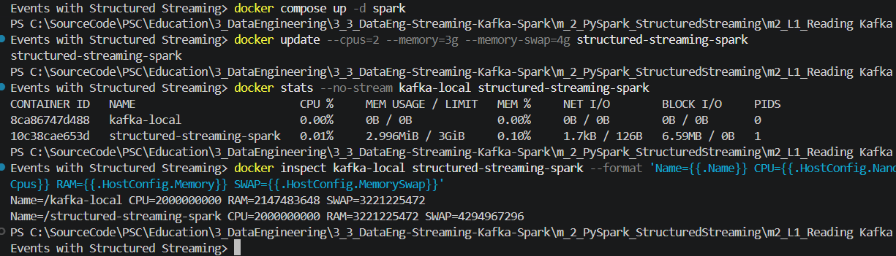
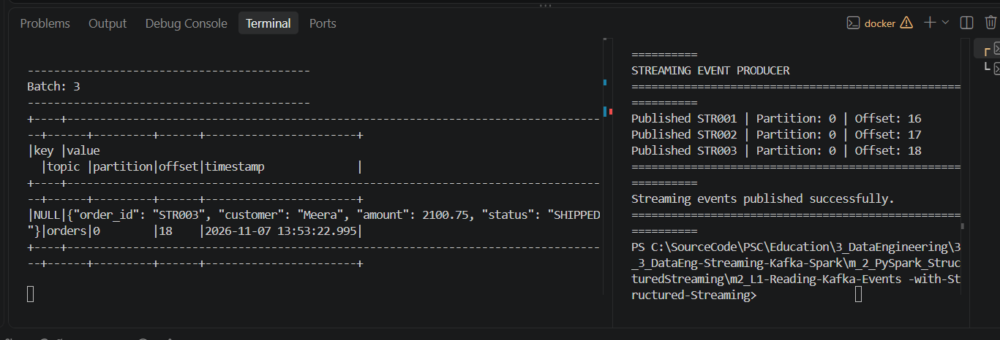

# m2_L1 — Reading Kafka Events with Structured Streaming

**Course:** Streaming Data Pipelines with Kafka and Spark  
**Module:** 2 — Streaming Processing with PySpark  
**Lab:** Reading Kafka Events with Structured Streaming  
**Executor:** R. Lisovenko  
**Prepared:** 07 November 2026  

**Status:** **COMPLETED AND VERIFIED — 07 November 2026**. The Kafka Producer published all three sample events, and Spark Structured Streaming received them in micro-batches 1–3 (Kafka offsets **16–18**).

## Resource limits — verified before running the lab

The two Docker containers were configured with CPU and RAM caps to reduce resource contention on the training laptop **before starting Spark jobs**. A limit is a maximum, **not reserved memory**, and it does not guarantee that the operating system will never lag or that the CPU will not overheat.

### Actual settings verified on 07 November 2026

| Container | Image | CPU quota | RAM quota | RAM + swap ceiling | Verification |
|---|---|---:|---:|---:|---|
| `kafka-local` | `apache/kafka:3.9.1` | 2 CPU equivalents | 2 GiB | 3 GiB | `CPU=2000000000 RAM=2147483648 SWAP=3221225472` |
| `structured-streaming-spark` | `apache/spark:3.5.7` | 2 CPU equivalents | 3 GiB | 4 GiB | `CPU=2000000000 RAM=3221225472 SWAP=4294967296` |

**First-time setup, in the Lab 1 PowerShell directory** (only recreate Spark with Compose if the Spark container does not yet exist):

```powershell
# 1. Reuse the existing Kafka container from Module 1 (do not recreate it).
docker ps -a --filter "name=kafka-local"
docker update --cpus=2 --memory=2g --memory-swap=3g kafka-local

# 2. Create/start the Spark container using the lab's existing Compose service.
docker compose -f .\docker-compose.yml up -d spark

# 3. Immediately cap the Spark container BEFORE starting spark-submit.
docker update --cpus=2 --memory=3g --memory-swap=4g structured-streaming-spark

# 4. Verify the limits, actual run state, and current usage.
docker inspect kafka-local structured-streaming-spark --format 'Name={{.Name}} CPU={{.HostConfig.NanoCpus}} RAM={{.HostConfig.Memory}} SWAP={{.HostConfig.MemorySwap}}'
docker ps -a --filter "name=kafka-local" --filter "name=structured-streaming-spark"
docker stats --no-stream kafka-local structured-streaming-spark
```

> **Important:** This setup's `docker update` changes the **existing containers**, not `docker-compose.yml`. For persistence across Spark container recreation, add these properties under the *existing* `spark:` service in the local `docker-compose.yml` (keep all original image, command, and volume settings unchanged):
>
> ```yaml
>     cpus: 2.0
>     mem_limit: 3g
>     memswap_limit: 4g
> ```
>
> The Kafka Compose definition belongs to **Module 1**; keep its previously configured 2 CPU / 2 GiB / 3 GiB values rather than creating a second Kafka service here.

**Observed snapshot (not a benchmark):** Spark was idle at **0.01% CPU, 2.996 MiB / 3 GiB**, with **1 PID**. Kafka displayed **0.00% CPU, 0 B / 0 B and 0 PIDs**, consistent with a *stopped* container, **not** a running broker consuming zero resources. Check `docker ps` to confirm run state. These figures do not demonstrate Spark streaming-job performance; they only verify that resource quotas were applied and show idle/stopped states.



For a resource-constrained laptop, keep unrelated stacks (Airflow, Iceberg/MinIO and other Compose projects) **stopped**, start only Kafka and Spark, and stop both after the lab. If severe fan noise, unexpected shutdowns, or thermal instability occurs, stop immediately and investigate cooling or power issues.

## 1. Objective

Read real-time Kafka events using **Apache Spark Structured Streaming**. The course-provided Python Producer publishes three JSON order records to a pre-existing Kafka topic; the Spark reader continuously displays their Kafka metadata and JSON payload in the console.

**Data flow:**

```text
Windows / PowerShell                           Docker shared network
+-------------------------+                  +-------------------------+
| producer.py             |                  | Kafka broker            |
| kafka-python            |--- localhost:9092 --> kafka-local             |
| STR001, STR002, STR003  |                  | topic: orders           |
+-------------------------+                  | internal port: 29092    |
                                             +------------+------------+
                                                          |
                                                   kafka-local:29092
                                                          |
                                             +------------v------------+
                                             | Apache Spark 3.5.7      |
                                             | streaming_reader.py     |
                                             | readStream / writeStream|
                                             | console sink            |
                                             +-------------------------+
```

**Scope:** This lab demonstrates Kafka ingestion into a streaming DataFrame and a console sink. It does **not** implement JSON schema parsing, windowed aggregation, persistent checkpoints, or a production streaming sink; those are separate lessons.

## 2. Original course files and project structure

Keep the **existing Lab 1 folder name exactly as it is**. Save these documentation files alongside the unchanged Edureka source files:

```text
<existing Lab 1 folder>/
├── README.md                   # Verified procedure and evidence
├── README.txt                  # Quick PowerShell command reference
├── producer.py                 # Original Edureka Python Producer (unchanged)
├── streaming_reader.py         # Original Edureka Spark reader (unchanged)
├── docker-compose.yml          # Original Spark service definition (unchanged)
├── requirements.txt            # Original course requirements (unchanged)
├── pic/
│   ├── kafka_spark_resource_limits_2026-11-07.png
│   └── kafka_spark_producer_reader_success_2026-11-07.png
└── logs/
    ├── spark_reader_dns_failure_2026-11-07.txt
    └── spark_reader_success_2026-11-07.txt
```

The Edureka scripts and Docker Compose file are **not modified** in this documentation update. The earlier uploaded quick-reference TXT accidentally contained commands for Module 1 / Lab 4; this replacement is specific to **Module 2 / Lab 1**.

### Key settings in the original files

| File | Actual setting / behavior |
|---|---|
| `docker-compose.yml` | Only service `spark`, image `apache/spark:3.5.7`; container `structured-streaming-spark`; local folder mapped to `/opt/project`; idle command `tail -f /dev/null` |
| `producer.py` | Connects to `localhost:9092`; sends JSON records `STR001` (Asha, `CREATED`), `STR002` (Rahul, `PAID`), `STR003` (Meera, `SHIPPED`) to `orders`; pauses 2 seconds between sends |
| `streaming_reader.py` | Creates Spark session `KafkaStructuredStreamingReader` in `local[*]` mode; connects to `kafka-local:29092`; subscribes to `orders`; starts at `latest` for a new query |
| `requirements.txt` | `kafka-python==2.2.15` and `pyspark==3.5.7` |

The producer does **not specify a Kafka key**, so the reader's `key` column is expected to be `NULL` for these messages. The `value` column remains JSON **text**, not automatically parsed columns.

## 3. Prerequisites and compatibility notes

- Windows, PowerShell, VS Code, Docker Desktop using Linux containers.
- The previously created, **existing** `kafka-local` broker from Module 1 (Apache Kafka 3.9.1), with topic **`orders`**. **Do not create a second Kafka broker.**
- Kafka must expose an internal Docker listener advertised as **`kafka-local:29092`**, because the original reader has that address hard-coded. The previous Kafka Compose configuration for the course includes `HOST://localhost:9092` and `DOCKER://kafka-local:29092`; check the **running container** rather than assuming it is configured identically.
- The Windows `py` launcher and `kafka-python==2.2.15` for the **host-side Producer**. On this PC, `py` works whereas `python` may be unavailable.
- Spark is run **inside the `apache/spark:3.5.7` container**. There is no need to install PySpark 3.5.7 into the Windows Python 3.14 environment just to run this Docker-based lab; host PySpark compatibility is separate from the container runtime.
- Internet access for Maven dependencies **may be needed on the first Spark run** to download the Kafka connector JARs.

> **Resource caution:** In the preceding Kafka labs, the Fujitsu CELSIUS H760 showed elevated fan activity with Docker; previous unexpected shutdowns were also reported. Limit concurrent containers, avoid Airflow/MinIO stacks, and stop if the laptop becomes unstable. Docker CPU quotas cannot guarantee safe temperatures.

## 4. Step-by-step execution (Windows PowerShell)

Run commands from **this Lab 1 directory**, unless another location is explicitly stated. Use **separate VS Code terminals** and keep the Spark reader running before publishing events.

### Step 1 — Start Docker Desktop and reuse the existing Kafka broker

Start Docker Desktop manually and wait for **Engine running**. In **Terminal 1 (setup)**:

```powershell
docker version
docker ps -a --filter "name=kafka-local"
```

Only if Kafka is stopped:

```powershell
docker start kafka-local
```

Validate the topic and the listener configuration:

```powershell
docker exec kafka-local /opt/kafka/bin/kafka-topics.sh --describe --topic orders --bootstrap-server localhost:9092
docker inspect kafka-local --format '{{range .Config.Env}}{{println .}}{{end}}' | Select-String 'KAFKA_LISTENERS|KAFKA_ADVERTISED_LISTENERS'
```

**Required for the unmodified reader:** the advertised Docker listener should contain `DOCKER://kafka-local:29092` (and the corresponding listener must actually listen on port 29092). If it does not, stop here and adjust the **existing broker configuration** deliberately; do not blindly replace the reader address with `localhost:9092`, because `localhost` inside the Spark container refers to Spark's own container.

### Step 2 — Start Spark and connect it to the **existing Kafka network**

This lab was run with Kafka from **Module 1**, already connected to Docker network `runningapachekafkalocally_default`. Spark was created under a separate Docker Compose project and initially could not resolve Kafka. **No new Kafka broker or network was needed.**

In the left VS Code PowerShell terminal, from the Lab 1 directory:

```powershell
# Verify the existing Kafka broker. Start it only if stopped.
docker ps -a --filter "name=kafka-local"
# docker start kafka-local    # ONLY if stopped

# Start Spark without attaching the terminal to the idle container.
docker compose -f .\docker-compose.yml up -d spark

# Confirm the actual existing Kafka network (observed value shown below).
docker inspect kafka-local --format '{{range $name, $net := .NetworkSettings.Networks}}{{$name}} {{end}}'
# Observed: runningapachekafkalocally_default

# ONE-TIME CONNECTION: run only when Spark is not yet in that network.
docker network connect runningapachekafkalocally_default structured-streaming-spark

# Verify Docker DNS *inside* the Spark container.
docker exec structured-streaming-spark getent hosts kafka-local
# Observed: 172.22.0.2      kafka-local
```

An `endpoint already exists` message means Spark is already connected; do not repeat the connection command. Docker-assigned IPs can change across runs, so use the container hostname `kafka-local`, not a hard-coded IP, in applications.

**Resource caps applied to the existing containers** (only if not already configured; these are the values used for this run):

```powershell
docker update --cpus=2 --memory=2g --memory-swap=3g kafka-local
docker update --cpus=2 --memory=3g --memory-swap=4g structured-streaming-spark
docker inspect kafka-local structured-streaming-spark --format 'Name={{.Name}} CPU={{.HostConfig.NanoCpus}} RAM={{.HostConfig.Memory}} SWAP={{.HostConfig.MemorySwap}}'
```

> **Verified issue and fix (07 Nov 2026):** The first Spark attempt failed with `Couldn't resolve server kafka-local:29092` and `No resolvable bootstrap urls given in bootstrap.servers`. The Kafka container was healthy from the Windows Producer's perspective, but the Spark container lacked Docker DNS connectivity. Attaching Spark to `runningapachekafkalocally_default` fixed name resolution and enabled the successful run. See [failed log](./logs/spark_reader_dns_failure_2026-11-07.txt).

### Step 3 — Confirm the two containers are running

```powershell
docker ps --filter "name=kafka-local" --filter "name=structured-streaming-spark"
docker inspect kafka-local structured-streaming-spark --format '{{.Name}} -> {{range $name, $net := .NetworkSettings.Networks}}{{$name}} {{end}}'
docker exec structured-streaming-spark getent hosts kafka-local
```

The existing Spark Compose command is `tail -f /dev/null`; it intentionally keeps the container alive. Starting the Compose service is **not** the same as starting the Structured Streaming Python job.

### Step 4 — Start the Structured Streaming reader (LEFT terminal)

The Kafka Structured Streaming data source requires an **additional Spark Kafka Connector**. It is not enabled simply by calling `.format("kafka")` in the course script. Run the Spark job inside the container and supply the Kafka connector matching Spark 3.5.7:

```powershell
docker exec -it structured-streaming-spark /opt/spark/bin/spark-submit --conf spark.jars.ivy=/tmp/.ivy2 --packages org.apache.spark:spark-sql-kafka-0-10_2.12:3.5.7 /opt/project/streaming_reader.py
```

Leave the left terminal running. The exact `spark-submit` command above is the one that succeeded, including the explicit Ivy cache path. At startup, the script prints:

```text
SPARK STRUCTURED STREAMING - KAFKA READER
Connected to Kafka topic: orders
Waiting for streaming events...
Press Ctrl+C to stop.
```

**Important:** `Connected to Kafka topic: orders` is a fixed `print()` string in the course code and **is not by itself proof of a successful network connection**. Check that Spark starts the streaming query without errors. On the first run, the connector download can take time.

### Step 5 — Send the sample JSON events (RIGHT terminal)

Open the **right VS Code terminal** next to the running Spark Reader (split view), still in the lab folder. Check the host-side Kafka Python package:

```powershell
py --version
py -m pip show kafka-python
```

Only if the package is missing:

```powershell
py -m pip install kafka-python==2.2.15
```

Do not blindly install the whole `requirements.txt` into Python 3.14 when running Spark inside Docker: the host Producer needs `kafka-python`, and PySpark 3.5.7 is already provided by the Spark image.

Then publish the three orders:

```powershell
py .\producer.py
```

The script attempts to send three events, waiting for Kafka acknowledgment and reporting the **actual** assigned partition and offset:

| Order ID | Customer | Amount | Status |
|---|---|---:|---|
| `STR001` | Asha | 1250.50 | `CREATED` |
| `STR002` | Rahul | 899.00 | `PAID` |
| `STR003` | Meera | 2100.75 | `SHIPPED` |

On successful execution it ends with:

```text
Streaming events published successfully.
```

The actual partition IDs and offsets depend on the broker state and cannot be predicted in advance.

### Step 6 — Verify the **actual** Spark streaming output (LEFT terminal)

Once the Reader was active, the Windows Producer sent all three events. The Producer completed successfully and printed the **actual** Kafka offsets:

```text
STREAMING EVENT PRODUCER
Published STR001 | Partition: 0 | Offset: 16
Published STR002 | Partition: 0 | Offset: 17
Published STR003 | Partition: 0 | Offset: 18
Streaming events published successfully.
```

Spark then displayed the data as console micro-batches. Its first `Batch: 0` was **empty**, which is normal for a stream just starting. Subsequent batches contained:

| Spark batch | Order ID | Customer | Amount | Status | Kafka topic | Partition | Offset | Event timestamp |
|---:|---|---|---:|---|---|---:|---:|---|
| 1 | `STR001` | Asha | 1250.50 | `CREATED` | `orders` | 0 | 16 | `2026-11-07 13:53:18.964` |
| 2 | `STR002` | Rahul | 899.00 | `PAID` | `orders` | 0 | 17 | `2026-11-07 13:53:20.989` |
| 3 | `STR003` | Meera | 2100.75 | `SHIPPED` | `orders` | 0 | 18 | `2026-11-07 13:53:22.995` |

The two-pane VS Code screenshot below shows **Spark's Batch 3 on the left** and **the successful Producer output for all three orders on the right**. The [complete successful Spark console log](./logs/spark_reader_success_2026-11-07.txt) provides separate evidence of Batches 0–3.



**Interpretation:** `key = NULL` is expected because the original Producer does not set a Kafka message key. The JSON payload stays in the string-valued `value` column. All three events were written to partition 0 of the existing `orders` topic; their offsets are monotonic within that partition. The data shown in the screenshot and the log are actual measured output, not predicted offsets.

The reader contains:

```python
.option("startingOffsets", "latest")
```

Consequently, start the Reader **first** and run the Producer **second**. Each later Producer run writes **new** events with the same demonstration order IDs and higher offsets; Kafka does not automatically deduplicate those JSON order IDs. Earlier on 07 November the Producer reported offsets **10–12** in a different run, but the **verified successful end-to-end run** was at **16–18**.

### Step 7 — Save and document execution evidence

The following files are included with this documentation package:

| File | Evidence |
|---|---|
| [`pic/kafka_spark_resource_limits_2026-11-07.png`](./pic/kafka_spark_resource_limits_2026-11-07.png) | Verified Docker CPU and RAM configuration |
| [`pic/kafka_spark_producer_reader_success_2026-11-07.png`](./pic/kafka_spark_producer_reader_success_2026-11-07.png) | Original user screenshot: working Spark Batch 3 and Producer publishing offsets 16–18 |
| [`logs/spark_reader_dns_failure_2026-11-07.txt`](./logs/spark_reader_dns_failure_2026-11-07.txt) | First failure, caused by Docker name resolution |
| [`logs/spark_reader_success_2026-11-07.txt`](./logs/spark_reader_success_2026-11-07.txt) | Successful Spark session with Batches 0–3, all records and timestamps |

Additional screenshots showing Batches 1 and 2 may be added later; they are **not required** to validate the run because the provided console log confirms both.

### Step 8 — Stop safely

1. Press **Ctrl+C** in the **LEFT terminal** to stop the Spark reader after capturing the output.
2. The Producer in the **RIGHT terminal** exits automatically after publishing the three events.
3. If you are finished with Spark, stop **only the Spark service** from any free PowerShell terminal in the Lab 1 directory:

   ```powershell
   docker compose -f .\docker-compose.yml stop spark
   ```

4. If the next lab does not need Kafka, optionally stop the existing broker:

   ```powershell
   docker stop kafka-local
   ```

5. Quit Docker Desktop if finished. Do **not** remove `kafka-local`, run `docker compose down -v`, or start the Airflow stack: the Kafka container's data may not have an independent persistent volume.

## 5. Troubleshooting

| Symptom | Likely cause / action |
|---|---|
| Spark says `Failed to find data source: kafka` | Kafka connector missing. Use `spark-submit --packages org.apache.spark:spark-sql-kafka-0-10_2.12:3.5.7 ...`; ensure downloads succeed. |
| **Observed:** `Couldn't resolve server kafka-local:29092` / DNS failure | Spark was not attached to Kafka's existing network. Connect Spark to `runningapachekafkalocally_default`, then verify with `docker exec structured-streaming-spark getent hosts kafka-local`. **Resolved and retested successfully on 07 Nov 2026.** |
| `Connection refused` / broker unreachable on `kafka-local:29092` | Inspect the **running broker** environment for the Docker listener and advertised address; verify its internal port and network. |
| Console shows no new events or only an empty `Batch: 0` | Reader uses `startingOffsets=latest`. Start the reader first, wait until the query is active, then run Producer while it is running. An initial empty batch is normal. |
| `python` is not recognized on Windows | Use `py`, as in `py .\producer.py`. |
| `No module named kafka` on host | Install `kafka-python==2.2.15` for the Python interpreter used by `py`. |
| Spark container is up but nothing prints | Compose command only keeps the container alive. Run `spark-submit` separately in Terminal 2. |
| `key` is `NULL` | Expected: original Producer sends no Kafka message key. |
| Duplicate sample IDs | Rerunning Producer creates new records with the same sample IDs; Kafka offsets differ. |
| Spark JVM out of memory / laptop fan too loud | Stop and review Spark CPU/RAM configuration, running containers and actual hardware temperature. |
| Connector download times out or Ivy cache permissions fail | First run may require Maven access. The **verified successful command** includes `--conf spark.jars.ivy=/tmp/.ivy2`. |

## 6. Key concepts from this lab

| Concept | Meaning in this exercise |
|---|---|
| Producer | `producer.py` writes JSON values to topic `orders`. |
| Kafka topic/partition | Kafka stores events in partitioned append-only logs; offsets identify positions in their respective partitions. |
| Streaming DataFrame | `spark.readStream.format("kafka").load()` defines a streaming source with Kafka metadata and binary `key`/`value`. |
| Casting | `col("key").cast("string")` and `col("value").cast("string")` make Kafka binary fields printable. |
| Console sink | `.writeStream.format("console").outputMode("append")` displays arriving rows. |
| Spark micro-batches | Spark processes new available records repeatedly while the streaming query remains active. |
| Starting offsets | `latest` skips previously existing events for a new query without checkpoint state. |
| Docker network | `kafka-local:29092` is a broker address for containers on a shared network, not the host's `localhost:9092`. |

This is **distributed stream ingestion with Spark**, not proof of multi-threaded record processing across several Kafka Consumers in the Module 1 sense. It demonstrates a separate Spark streaming application consuming Kafka events. Its actual degree of parallelism depends on Spark tasks, Kafka partition count and the runtime environment.

## 7. Validation checklist — final verified state

- [x] Original Edureka Producer, Spark Reader, Compose service, and dependencies examined and left unchanged.
- [x] Existing Kafka 3.9.1 broker reused, without introducing a second broker.
- [x] CPU/RAM caps inspected: Kafka **2 CPU / 2 GiB RAM / 3 GiB incl. swap**; Spark **2 CPU / 3 GiB RAM / 4 GiB incl. swap**.
- [x] Docker DNS failure reproduced and diagnosed from actual Spark traceback.
- [x] Spark attached to existing Docker network `runningapachekafkalocally_default`.
- [x] Docker DNS verified from Spark: `172.22.0.2 kafka-local`.
- [x] Spark Kafka Connector for Spark 3.5.7 resolved; streaming Reader started successfully.
- [x] Windows Python Producer published `STR001`, `STR002`, and `STR003` to Kafka `orders` topic, partition 0, offsets **16–18**.
- [x] Spark console confirmed micro-batches **1–3** with the same events and offsets; initial Batch 0 was empty.
- [x] Actual two-pane success screenshot included under `pic/` and linked in the README.
- [x] Full success and initial failure logs preserved under `logs/`.

**Lab result: END-TO-END PIPELINE VERIFIED — Windows Python Producer → Apache Kafka (`orders`) → Apache Spark Structured Streaming → console sink.**

---

**R. Lisovenko**  
**Deutschland, 07 November 2026**
