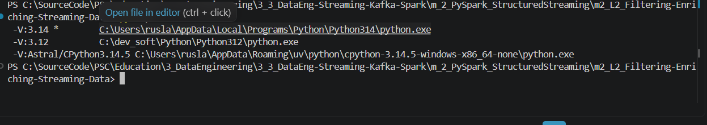
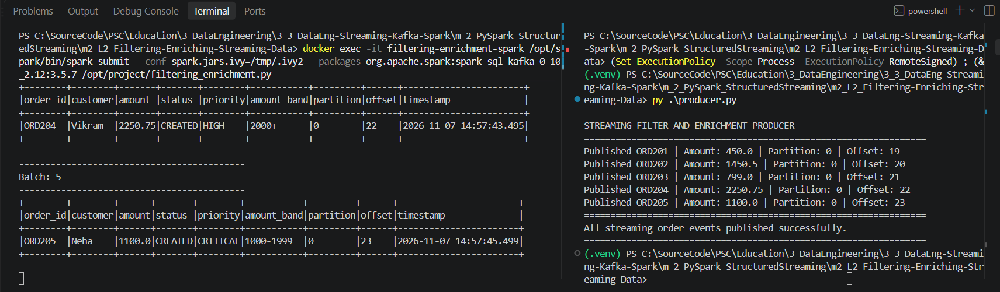

# m2_L2 — Filtering and Enriching Streaming Data

**Course:** Streaming Data Pipelines with Kafka and Spark (Edureka / Coursera)  
**Module:** 2 — Streaming Processing with PySpark  
**Lab:** 2 — Filtering and Enriching Streaming Data  
**Date:** 07 November 2026  
**Status:** **Kafka-to-Spark streaming confirmed with real Lab 2 records; enrichment validation incomplete because the observed `priority` values contradict the supplied transformation code.**

## 1. Objective

Consume JSON order events from Kafka topic `orders`, parse them into a Spark Structured Streaming DataFrame, filter out orders below `1000`, and enrich the remaining rows with `priority` and `amount_band` fields. Display the result in the Spark console sink.

**Pipeline:** Windows Python Producer → Kafka broker `kafka-local` → Spark Structured Streaming (`filtering-enrichment-spark`) → JSON parsing → filter (`amount >= 1000`) → enrichment → console.

This lab **reuses the existing Kafka broker** from Module 1. No new Kafka broker is needed. Keep the supplied course scripts unchanged.

## 2. Python environment verification (Windows VS Code)

The available interpreters were checked with:

```powershell
py -0p
```

The screenshot confirms Python **3.14** (default) and **3.12** are available. A Python 3.14 installation is not required for running Spark inside Docker; Python 3.12 may be used for a local editor environment with PySpark 3.5.7.



### Optional: local imports for VS Code / Pylance

Only if the editor highlights `pyspark.sql` as unresolved, from the Lab 2 directory:

```powershell
py -3.12 -m venv .venv
.\.venv\Scripts\python.exe -m pip install --upgrade pip
.\.venv\Scripts\python.exe -m pip install pyspark==3.5.7 kafka-python==2.2.15
.\.venv\Scripts\python.exe -c "from pyspark.sql import SparkSession; from pyspark.sql.functions import col, from_json, when; from pyspark.sql.types import StructType, StructField, StringType, DoubleType; print('PySpark imports OK')"
```

In VS Code: **Python: Select Interpreter** → `./.venv/Scripts/python.exe`. Creating the virtual environment and installing these packages were *recommended*; successful execution is not yet evidenced by a log.

## 3. Docker prerequisites and safe resource limits

Run Docker Desktop. Use PowerShell inside the **Lab 2 directory**, containing `docker-compose.yml`, `filtering_enrichment.py`, and `producer.py`.

Verify the existing Kafka container is running:

```powershell
docker ps -a --filter "name=kafka-local"
# Only if stopped:
docker start kafka-local
```

Inspect available Compose services (verified output: `spark`):

```powershell
docker compose config --services
```

Create/start the dedicated Lab 2 Spark container:

```powershell
docker compose up -d spark
docker compose ps
```

**Observed:** Compose started `filtering-enrichment-spark`, image `apache/spark:3.5.7`; its status was `Up`.

Set limits before submitting a Spark job. These quotas reduce load but do not guarantee safe laptop temperatures:

```powershell
docker update --cpus=2 --memory=3g --memory-swap=4g filtering-enrichment-spark
docker stats --no-stream kafka-local filtering-enrichment-spark
```

**Note:** An existing Spark container from Lab 1 (`structured-streaming-spark`) does not need to be running for this lab. Stop unused services to conserve resources; do not delete the Kafka broker.

## 4. Connect Lab 2 Spark to the existing Kafka Docker network

The Lab 1 Kafka container uses Docker network `runningapachekafkalocally_default`, identified with:

```powershell
docker inspect kafka-local --format '{{range $name, $net := .NetworkSettings.Networks}}{{$name}} {{end}}'
```

Connect the **existing Lab 2 Spark container** to this network once:

```powershell
docker network connect runningapachekafkalocally_default filtering-enrichment-spark
```

If Docker reports `endpoint already exists`, the container is already attached. Verify name resolution inside Spark:

```powershell
docker exec filtering-enrichment-spark getent hosts kafka-local
```

**Expected:** an IP address followed by `kafka-local`, e.g., `172.22.0.2 kafka-local`. The exact IP can vary. **This Lab 2 DNS check has not yet been supplied as execution evidence**; the name resolved successfully for the Lab 1 container after the same network fix.

## 5. Start Spark Structured Streaming (left terminal)

Run the original Spark submit command provided by the instructor:

```powershell
docker exec -it filtering-enrichment-spark /opt/spark/bin/spark-submit --conf spark.jars.ivy=/tmp/.ivy2 --packages org.apache.spark:spark-sql-kafka-0-10_2.12:3.5.7 /opt/project/filtering_enrichment.py
```


### Observed Spark / Kafka connector initialization — 07 November 2026

The actual execution output showed:

- Spark version: **3.5.7**.
- Java: **11.0.27** in a Linux / WSL2 Docker environment.
- Dependency resolution: **11 modules and 11 JAR artifacts resolved/downloaded** for this run.
- The Ivy report showed `11 artifacts copied` into the new container's cache.
- A `WARN NativeCodeLoader` message appeared; this commonly indicates that Spark uses built-in Java implementations rather than a native Hadoop library and is not, by itself, a streaming failure.


**Evidence scope:** this screenshot confirms successful connector resolution and the start of Spark initialization. It does **not** by itself prove that streaming rows have been processed. Leave the Spark terminal running and wait for the query to start before sending new events.

## 6. Produce new events (right terminal)

The reader subscribes to `orders` with `startingOffsets="latest"`. Start the Spark reader first, then run the course Producer in another terminal from the same Lab 2 directory:

```powershell
py .\producer.py
```

If the Lab 2 Producer differs from the previous Lab 1 version, use the **supplied Lab 2 Producer unchanged** and record its actual output. Events published **before** a fresh reader starts may not be displayed because of the `latest` setting.

## 7. Filtering and enrichment logic

The supplied `filtering_enrichment.py` uses:

```python
filtered_stream = parsed_stream.filter(col("amount") >= 1000)

enriched_stream = (
    filtered_stream
    .withColumn("priority", when(col("amount") >= 2000, "CRITICAL").otherwise("HIGH"))
    .withColumn("amount_band", when(col("amount") >= 2000, "2000+").otherwise("1000-1999"))
)
```

This block is syntactically valid; it preserves the instructor's original logic. The band text `1000-1999` is a **label**, so decimal amounts such as `1999.99` also fall in that band.

For comparison, the **three sample orders from Lab 1** illustrate the expected rule; the actual Lab 2 Producer uses `ORD201`–`ORD205`:

| Event | Amount | Filtered output | `priority` | `amount_band` |
|---|---:|---|---|---|
| `STR001` (Asha) | 1250.50 | Retained | `HIGH` | `1000-1999` |
| `STR002` (Rahul) | 899.00 | Excluded | — | — |
| `STR003` (Meera) | 2100.75 | Retained | `CRITICAL` | `2000+` |

Actual offsets and batch numbers are assigned at runtime; do not reuse Lab 1 offsets as Lab 2 evidence. The actual Lab 2 run is recorded below.

## 8. Actual Lab 2 execution — Producer and Spark side by side

**Observed:** 07 November 2026, in two VS Code PowerShell terminals. The left terminal ran the Spark Structured Streaming reader, while the right terminal executed the Lab 2 Python Producer *after the reader started*:

```powershell
# Left terminal — keep this running
# (the exact Spark command is documented in Section 5)
docker exec -it filtering-enrichment-spark /opt/spark/bin/spark-submit --conf spark.jars.ivy=/tmp/.ivy2 --packages org.apache.spark:spark-sql-kafka-0-10_2.12:3.5.7 /opt/project/filtering_enrichment.py

# Right terminal — new PowerShell session, in the Lab 2 folder
py .\producer.py
```

The **Producer confirmed all five Kafka messages** on topic `orders`, partition `0`:

| Order | Amount | Partition | Kafka offset | Expected filter result |
|---|---:|---:|---:|---|
| `ORD201` | 450.00 | 0 | 19 | Excluded (`amount < 1000`) |
| `ORD202` | 1450.50 | 0 | 20 | Retained |
| `ORD203` | 799.00 | 0 | 21 | Excluded (`amount < 1000`) |
| `ORD204` | 2250.75 | 0 | 22 | Retained |
| `ORD205` | 1100.00 | 0 | 23 | Retained |

The Producer ended with `All streaming order events published successfully.`

In the **Spark console**, the visible rows confirmed that incoming Kafka records were consumed and displayed by Structured Streaming:

| Observed batch | Order | Customer | Amount | `priority` shown | `amount_band` shown | Offset |
|---|---|---|---:|---|---|---:|
| 4 | `ORD204` | Vikram | 2250.75 | `HIGH` | `2000+` | 22 |
| 5 | `ORD205` | Neha | 1100.00 | `CRITICAL` | `1000-1999` | 23 |



### Important validation finding: incorrect `priority` values

The **observed `amount_band` values are consistent** with the supplied transformation logic, but the **observed `priority` values are reversed** for these two records. Under the provided `filtering_enrichment.py`, the expected values are:

- `ORD204`, `2250.75` → `CRITICAL`, **not** the displayed `HIGH`.
- `ORD205`, `1100.00` → `HIGH`, **not** the displayed `CRITICAL`.

This is **not** a syntax or Kafka connectivity failure: streaming records have arrived. It is a discrepancy between the previously supplied Python source and the application output. **Do not mark the enrichment logic as verified yet.** The available screenshot does not show the `ORD202` Spark batch or enough history to verify every filtered record; those require a complete console capture.

**Next check:** inspect the *actual mounted file* used by Spark with:

```powershell
docker exec filtering-enrichment-spark sh -c 'grep -n -A 13 "enriched_stream =" /opt/project/filtering_enrichment.py'
```

Compare it with the version open in VS Code and verify that `priority` is assigned by `when(col("amount") >= 2000, "CRITICAL").otherwise("HIGH")`. If the file was updated while a query was already running, stop the reader with `Ctrl+C` and relaunch the Spark job before rerunning the Producer. Do not modify the original exercise script without documenting the change.

## 9. Validation and screenshots

- [x] Available Windows Python interpreters verified (`py -0p`).
- [x] Compose service `spark` found.
- [x] Dedicated `filtering-enrichment-spark` container created and reported `Up`.
- [x] Spark 3.5.7 startup and Kafka connector dependency resolution captured.
- [ ] Network / Kafka DNS resolution documented for **this** Lab 2 container.
- [x] Spark Structured Streaming query shown running with live Kafka records (batches 4–5).
- [x] New Producer run and emitted Kafka offsets 19–23 captured.
- [ ] Filtering and enrichment fully validated: visible rows are present, but `priority` output conflicts with supplied source; `ORD202` and excluded-record history not captured.
- [x] Side-by-side Spark/Producer screenshot saved in `pic/`.

**Screenshot files included in this draft:**

```text
pic/
  python_interpreters_py_0p_2026-11-07.png
  spark_submit_command_teacher_2026-11-07.png
  spark_connector_initialization_2026-11-07.png
  lab2_kafka_producer_spark_batches_2026-11-07.png
```

### Troubleshooting

| Symptom | Action |
|---|---|
| `No such container: filtering-enrichment-spark` | Run `docker compose up -d spark` in the Lab 2 directory and verify with `docker compose ps`. |
| `DNS resolution failed for kafka-local` | Connect Lab 2 Spark to `runningapachekafkalocally_default`, then run `getent hosts kafka-local`. |
| Spark prints nothing after it starts | Wait for the Structured Streaming query; then send *new* events with the Producer. |
| `pyspark.sql` underlined in VS Code | Select a Python 3.12 virtual environment with PySpark installed; Docker execution is independent. |
| Unexpectedly high laptop load | Check `docker stats`, stop unused containers, and monitor hardware temperature. |

## 10. Stop safely

Once evidence is captured, press **Ctrl+C** in the streaming reader terminal. Then, if the container is no longer required:

```powershell
docker compose stop spark
```

Keep Kafka running only if required for the next lab. Avoid `docker compose down -v` or deleting existing Kafka data.

---

*Documented from the observed Lab 2 setup, Spark initialization and live Producer/Reader output. Enrichment remains to be reconciled with the supplied code before full validation.*
