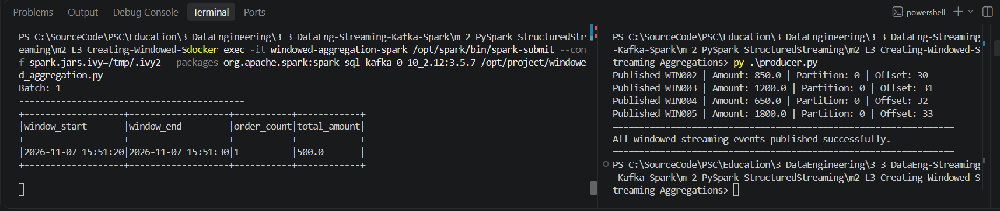

# m2_L3 — Creating Windowed Streaming Aggregations

**Course:** Streaming Data Pipelines with Kafka and Spark (Edureka / Coursera)  
**Module:** 2 — Streaming Processing with PySpark  
**Lab:** Creating Windowed Streaming Aggregations  
**Prepared by:** R. Lisovenko  
**Date:** 07 November 2026  
**Status:** **STREAMING VERIFIED IN PART — Producer published five orders; Spark Batch 1 confirmed; remaining window results not yet captured**

> This README documents the **original instructor-provided lab files** and a reproducible Windows/PowerShell workflow. The execution evidence from 07 November 2026 confirms a successful Producer run and one Spark windowed-aggregation row. Remaining window results have not yet been captured in the submitted screenshot; distinguish expected results from observations.

## 1. Course material and scenario


An e-commerce company receives customer orders continuously through Apache Kafka. During peak hours, its operations team needs an aggregated view of activity: **the number of orders arriving in each 10-second interval and the total monetary value of those orders**. The data engineering team uses PySpark Structured Streaming to compute these metrics.

**Goal:** ingest Kafka order events, parse their JSON payloads, convert `event_time` to a timestamp, aggregate events by **10-second event-time tumbling windows**, and print the updated counts and sums to the Spark console.

This is **not** a sliding 10-minute window: the supplied code uses `window(event_timestamp, "10 seconds")` with no slide interval, so it creates non-overlapping 10-second windows.

### Original course files


```text
m_2_PySpark_StructuredStreaming/
└── m2_L3_Creating-Windowed-Streaming-Aggregations/
    ├── Scenario                    # Original problem statement
    ├── windowed_aggregation.py     # Original PySpark streaming application
    ├── producer.py                 # Original Kafka event producer
    ├── docker-compose.yml          # Original Docker Compose configuration
    ├── requirements.txt            # Original Python package list
    ├── README.md                   # This documentation
    ├── README.txt                  # Short, copy-ready PowerShell guide
    └── pic/
        ├── course_creating_windowed_streaming_aggregations.png
        ├── lab3_supplied_course_files.png
        └── lab3_windowed_aggregation_producer_spark_2026-11-07.png
```

The instructor-supplied source files are **not modified** by this documentation. Their names above are their normal project filenames; uploaded transfer names may contain suffixes such as `(2)` or `(6)`.

### Verified source-file settings

| File | Provided configuration |
|---|---|
| `docker-compose.yml` | One service called `spark`, image `apache/spark:3.5.7`, container `windowed-aggregation-spark`, command `tail -f /dev/null`, current folder mounted at `/opt/project` |
| `windowed_aggregation.py` | `SparkSession` named `WindowedStreamingAggregation`; reads topic `orders` via `kafka-local:29092`, `startingOffsets=latest`; parses JSON; event-time windows of `10 seconds`; `count(*)` and `sum(amount)`; `console` sink, `update` mode |
| `producer.py` | Uses host Kafka listener `localhost:9092`; publishes `WIN001`–`WIN005` with an event-time timestamp assigned just before each send; waits 3 seconds between records |
| `requirements.txt` | `kafka-python==2.2.15`, `pyspark==3.5.7` |
| `Scenario` | E-commerce order counts and total order value for each 10-second interval |

## 2. Pipeline architecture

```text
Windows / PowerShell                      Docker: existing Kafka network
┌─────────────────────────────┐          ┌──────────────────────────────┐
│ producer.py                 │          │ kafka-local                  │
│ KafkaProducer               │          │ Topic: orders                │
│ 5 JSON orders + event_time  │─9092────>│ Host listener: localhost:9092│
└─────────────────────────────┘          │ Docker listener: 29092      │
                                       └────────────┬─────────────────┘
                                                    │ kafka-local:29092
                                                    ▼
                                       ┌──────────────────────────────┐
                                       │ windowed-aggregation-spark   │
                                       │ Apache Spark 3.5.7           │
                                       │ readStream → from_json       │
                                       │ to_timestamp → window(10s)   │
                                       │ count + sum → console/update │
                                       └──────────────────────────────┘
```

**Host vs. container addresses matter:** `localhost:9092` works for the Producer running on Windows. Inside the Spark container, `localhost` refers to the Spark container itself; the Kafka address in the supplied reader is therefore `kafka-local:29092`. Both containers must share a user-defined Docker network.

## 3. Prerequisites and computer-resource precautions

- Windows PowerShell and VS Code; Docker Desktop running in Linux-container mode.
- **Reuse** the existing Kafka container `kafka-local` from Module 1. **Do not create a second Kafka broker** or erase the existing topic.
- Existing Kafka topic `orders` and its internal Docker listener `kafka-local:29092`.
- The Windows Python launcher `py`; `kafka-python==2.2.15` must be available to the interpreter used by the Producer.
- A Spark container created by **this lab's** Compose file; do not reuse the Lab 1 or Lab 2 Spark container by changing its original course setup.
- Kafka Connector `org.apache.spark:spark-sql-kafka-0-10_2.12:3.5.7` provided at `spark-submit` launch; Maven download may require internet the first time for this new container.

### Resource caps used in previous labs

The previous exercises used these caps on the training computer. **Apply and verify them for the new Lab 3 Spark container; they are not claimed to be already configured here.**

| Container | CPU limit | RAM limit | RAM + swap ceiling |
|---|---:|---:|---:|
| Existing `kafka-local` | 2 CPUs | 2 GiB | 3 GiB |
| New `windowed-aggregation-spark` | 2 CPUs | 3 GiB | 4 GiB |

Limits reduce competition for resources but do **not** guarantee thermal safety. Keep unrelated Airflow, Iceberg/MinIO and other Docker workloads stopped. Monitor laptop temperature and fans; stop a job if the machine becomes unstable.

## 4. Setup — PowerShell, in the original Lab 3 folder

Open the existing **`m2_L3_Creating-Windowed-Streaming-Aggregations`** folder in VS Code. Use two terminal panes: **left = Spark Reader**, **right = Python Producer**. Run the setup commands in a free terminal **before** launching the Spark job.

### Step 1 — Verify and start the existing Kafka broker

```powershell
# Start Docker Desktop and wait until the engine is ready.
docker ps -a --filter "name=kafka-local"

# Run ONLY when kafka-local is currently stopped:
docker start kafka-local

# Confirm that topic orders exists (do not recreate it unnecessarily).
docker exec kafka-local /opt/kafka/bin/kafka-topics.sh --describe --topic orders --bootstrap-server localhost:9092
```

The `docker start` command only starts the **existing** broker, preserving its current container and configuration. If `orders` does not exist, investigate the previous lab setup before starting Lab 3.

### Step 2 — Create/start the Lab 3 Spark container

The provided Compose file defines only one service, `spark`, with `container_name: windowed-aggregation-spark`.

```powershell
docker compose config --services
docker compose up -d spark
docker compose ps
```

Expected service: `spark`. Expected running container: `windowed-aggregation-spark` using `apache/spark:3.5.7`.

**Note:** The Compose command `tail -f /dev/null` deliberately keeps the container running without starting the Spark job. That job is launched separately in Step 5.

### Step 3 — Apply and inspect CPU/RAM quotas

```powershell
# Only when these resource caps are appropriate for the current machine:
docker update --cpus=2 --memory=2g --memory-swap=3g kafka-local
docker update --cpus=2 --memory=3g --memory-swap=4g windowed-aggregation-spark

# Read back the actual values and resource usage:
docker inspect kafka-local windowed-aggregation-spark --format 'Name={{.Name}} CPU={{.HostConfig.NanoCpus}} RAM={{.HostConfig.Memory}} SWAP={{.HostConfig.MemorySwap}}'
docker stats --no-stream kafka-local windowed-aggregation-spark
```

The commands above update live containers; they do not alter the instructor's `docker-compose.yml`. If the Spark container is recreated later, recheck its limits before running jobs.

### Step 4 — Attach Lab 3 Spark to the **existing Kafka network**

In Lab 1 and Lab 2, the working Kafka Docker network was:

```text
runningapachekafkalocally_default
```

This is a **previously verified network name**, not a new network to create. Check it first:

```powershell
docker inspect kafka-local --format '{{range $name, $net := .NetworkSettings.Networks}}{{$name}} {{end}}'
```

If the result still contains `runningapachekafkalocally_default`, attach the new Spark container **once**:

```powershell
docker network connect runningapachekafkalocally_default windowed-aggregation-spark
```

If Docker says `endpoint already exists`, the container is already attached; do not repeat the operation. If the Kafka network name is different, substitute the name **actually returned by `docker inspect`**.

Verify DNS inside the new Spark container:

```powershell
docker exec windowed-aggregation-spark getent hosts kafka-local
```

**Expected:** a resolved container IP followed by `kafka-local`, for example `172.22.0.2 kafka-local`. The IP is environment-dependent. An empty result means the connection is **not** verified; fix the shared network before running Spark.

### Step 5 — Launch windowed aggregation in the **left terminal**

The exact Spark submit command matching the provided course code is:

```powershell
docker exec -it windowed-aggregation-spark /opt/spark/bin/spark-submit --conf spark.jars.ivy=/tmp/.ivy2 --packages org.apache.spark:spark-sql-kafka-0-10_2.12:3.5.7 /opt/project/windowed_aggregation.py
```

The `--conf spark.jars.ivy=/tmp/.ivy2` setting places the Ivy dependency cache in a writable location; `--packages` supplies Spark's Kafka data source connector. The command runs **inside** Docker, using the unchanged instructor code.

**Optional lower-shuffle-parallelism launch** if the laptop struggles with the 200 default shuffle partitions:

```powershell
docker exec -it windowed-aggregation-spark /opt/spark/bin/spark-submit --conf spark.jars.ivy=/tmp/.ivy2 --conf spark.sql.shuffle.partitions=2 --packages org.apache.spark:spark-sql-kafka-0-10_2.12:3.5.7 /opt/project/windowed_aggregation.py
```

Choose **one** launch command; do not run both simultaneously. The optional setting changes Spark's runtime shuffle parallelism, **not** the original Python source. Wait for the application messages:

```text
WINDOWED STREAMING AGGREGATIONS
Connected to Kafka topic: orders
Applying 10-second event-time windows
Calculating order count and total amount
Waiting for streaming events...
```

These messages come from `print()` statements and alone do not prove that Kafka connectivity succeeds. The streaming console should start without fatal exceptions. In particular, the first `Batch: 0` may be empty and that is normal.

### Step 6 — Start the Producer in the **right terminal**

In a **separate PowerShell terminal** in the same Lab 3 folder:

```powershell
py --version
py -m pip show kafka-python
```

Only if `kafka-python` is missing from that interpreter:

```powershell
py -m pip install kafka-python==2.2.15
```

Then, **after the Spark streaming query is running**, publish the test orders:

```powershell
py .\producer.py
```

The Producer should report one Kafka partition and offset per record, followed by:

```text
All windowed streaming events published successfully.
```

**Do not type `py .\producer.py` in the left terminal while `spark-submit` is running:** that terminal is occupied by the Spark process, not at a PowerShell prompt. Run it in the separate right terminal.

### Optional — VS Code PySpark imports

The original `requirements.txt` lists `pyspark==3.5.7` as well as `kafka-python==2.2.15`. The Spark job already has PySpark in the Docker image; **a Windows PySpark installation is not required to run this Docker lab**. If VS Code/Pylance marks `from pyspark...` imports as missing, you can set up a **separate Python 3.12** editor environment without changing your Python 3.14 installation:

```powershell
py -3.12 -m venv .venv
.\.venv\Scripts\python.exe -m pip install --upgrade pip
.\.venv\Scripts\python.exe -m pip install pyspark==3.5.7 kafka-python==2.2.15
```

Then use **Python: Select Interpreter** in VS Code and choose `.venv\Scripts\python.exe`. You can also run the Producer with `.\.venv\Scripts\python.exe .\producer.py` in the right pane. Add `.venv/` to `.gitignore`; do not commit the interpreter environment to GitHub.

## 5. Sample data and expected aggregation semantics

### Original five test orders

| Order | Customer | Amount | Event timestamp |
|---|---|---:|---|
| `WIN001` | Asha | 500.00 | Generated in UTC immediately before send |
| `WIN002` | Rahul | 850.00 | Generated in UTC immediately before send |
| `WIN003` | Meera | 1,200.00 | Generated in UTC immediately before send |
| `WIN004` | Vikram | 650.00 | Generated in UTC immediately before send |
| `WIN005` | Neha | 1,800.00 | Generated in UTC immediately before send |
| **Total (single Producer run)** | **5 orders** | **5,000.00** | Across the populated windows |

The original Producer waits **3 seconds after each record**, so the timestamps span multiple seconds. Which records fall in a particular window depends on the **actual clock times at runtime**. Consequently, do **not** invent fixed window assignments, batch numbers, Kafka offsets, or per-window totals ahead of execution. The overall amounts sum to 5,000 for the five unique messages of **one** Producer run, provided they all reach the streaming query and are assigned to windows.

### Spark transformation steps

1. **Read Kafka:** subscribe to topic `orders` using `spark.readStream.format("kafka")`.
2. **Parse JSON:** decode `value` with `from_json` into `order_id`, `customer`, `amount`, `event_time`.
3. **Convert timestamps:** `to_timestamp(event_time)` produces the event-time column.
4. **Group by 10-second window:** `groupBy(window(event_timestamp, "10 seconds"))`.
5. **Aggregate:** `count("*")` → `order_count`; `sum("amount")` → `total_amount`.
6. **Output:** `writeStream.format("console").outputMode("update")`.

Expected console columns:

```text
+-------------------+-------------------+-----------+------------+
|window_start       |window_end         |order_count|total_amount|
+-------------------+-------------------+-----------+------------+
|... actual run-time window boundaries and aggregate values ...  |
+-------------------+-------------------+-----------+------------+
```

**Interpret `update` mode carefully:** each micro-batch prints **newly updated aggregate rows**, not a complete immutable final table. A window may appear in several batches with increasing `order_count` and `total_amount`; **do not sum repeated console snapshots**, because that double-counts the same window's current aggregate.

### Event-time semantics and state limitation

- The Producer assigns `event_time` in **UTC** (`datetime.now(timezone.utc).isoformat()`). The Spark console display timezone can depend on the Spark session timezone; inspect actual timestamps rather than assuming a displayed local time.
- Window boundaries use event time, **not** the Kafka arrival timestamp.
- `window(..., "10 seconds")` creates **fixed non-overlapping (tumbling) windows**, not a rolling/sliding window.
- The provided script does **not** call `.withWatermark(...)`. It therefore does **not** configure event-time watermark-based state cleanup. This is acceptable as a small teaching demo but can cause unbounded state retention in a long-lived stream with continually new windows.
- No **persistent `checkpointLocation`** is configured. Spark may create a temporary checkpoint for this console demonstration; this is not production-grade recovery or durable exactly-once output.
- The code does **not** filter, deduplicate, or group by customer. It aggregates **all valid events by their 10-second event-time window**.
- Rerunning the Producer publishes more records with the **same order IDs** but new timestamps and offsets; Kafka does not deduplicate them automatically.

## 6. Execution evidence — 07 November 2026

### Verified live run: PowerShell Producer (right) and Spark (left)

The screenshot below shows the actual Lab 3 execution in **two VS Code PowerShell panes**. The left pane runs `windowed_aggregation.py` through `spark-submit` in the `windowed-aggregation-spark` container. The right pane runs `py .\producer.py` on the Windows host. It is **observed evidence**, not a mock-up.



**Before this result:** The previous Lab 1 and Lab 2 Spark containers were stopped to reduce load. In the Lab 3 folder, `docker compose up -d spark` created the `windowed-aggregation-spark` container; its resource caps were set with `docker update --cpus=2 --memory=3g --memory-swap=4g`. The container was connected to the existing Kafka network using `docker network connect runningapachekafkalocally_default windowed-aggregation-spark`. The DNS test returned `172.22.0.3 kafka-local`. The left terminal then started `spark-submit`, and the right terminal published new events after the query was running. No second Kafka broker or modifications to the original course scripts were needed.

**Observed Producer output:** `All windowed streaming events published successfully.` The visible lines show the following Kafka metadata:

| Event | Amount | Kafka partition | Offset | Evidence |
|---|---:|---:|---:|---|
| `WIN001` | 500.00 | 0 | — | Spark row containing 500.00 is consistent with WIN001; its Producer line/offset is above the visible portion of this screenshot |
| `WIN002` | 850.00 | 0 | **30** | Visible in right pane |
| `WIN003` | 1200.00 | 0 | **31** | Visible in right pane |
| `WIN004` | 650.00 | 0 | **32** | Visible in right pane |
| `WIN005` | 1800.00 | 0 | **33** | Visible in right pane |

Offsets are Kafka positions within a partition, not Spark Batch IDs. The probable offset preceding 30 for `WIN001` is **not independently visible**, so it is intentionally not recorded as verified.

**Observed Spark output, left terminal:**

```text
Batch: 1
+-------------------+-------------------+-----------+------------+
|window_start       |window_end         |order_count|total_amount|
+-------------------+-------------------+-----------+------------+
|2026-11-07 15:51:20|2026-11-07 15:51:30|1          |500.0       |
+-------------------+-------------------+-----------+------------+
```

This confirms that Spark **successfully parsed at least one Kafka event, assigned it to a 10-second event-time window, and calculated `count` and `sum`**. The visible `500.0` corresponds to the sample `WIN001` amount. The screenshot does **not** show subsequent Spark batches for `WIN002`–`WIN005`, so the full expected amount of 5,000.00 across all windows is not yet verified from this evidence.

| Checkpoint | Verification status |
|---|---|
| Lab 3 Spark container launched | **Verified** — container used by successful Spark job |
| Shared Kafka network and DNS | **Verified** — `172.22.0.3 kafka-local` in previous terminal output |
| Spark Kafka connector and streaming query | **Verified** — windowed result produced |
| Producer publishes `WIN001`–`WIN005` | **Verified** — success message and course-provided five-event Producer; visible offsets for `WIN002`–`WIN005` |
| Partition and Kafka offsets | **Partially verified** — partition 0, offsets 30–33 visible; `WIN001` offset not shown |
| First 10-second window and aggregate | **Verified** — Batch 1, 15:51:20–15:51:30, count 1, amount 500.0 |
| Later windows and complete 5,000.00 sum | **Not yet captured** — obtain later Spark batches before final verification |

**Additional recommended evidence:** scroll the **left** Spark pane to later batches and capture the remaining windowed aggregation rows, ideally beside the full five-line Producer output. Avoid adding together repeated `update` snapshots of the same window.

## 7. Troubleshooting

| Symptom | Cause / action |
|---|---|
| `No such container: windowed-aggregation-spark` | In the Lab 3 folder run `docker compose up -d spark`, then check `docker compose ps`. The Lab 1/2 Spark containers have **different names**. |
| `DNS resolution failed for kafka-local` | Spark is not connected to the existing Kafka Docker network. Inspect Kafka networks, connect `windowed-aggregation-spark`, rerun `getent hosts kafka-local`. |
| `Failed to find data source: kafka` | Start `spark-submit` with `--packages org.apache.spark:spark-sql-kafka-0-10_2.12:3.5.7`. |
| `Connection refused` / KafkaAdminClient error | Check Kafka is running and advertises `kafka-local:29092` on its internal listener. |
| `Batch: 0` prints with no rows | Usually normal: start the Producer in another terminal **after** Spark Reader is running. `startingOffsets=latest` skips old events. |
| Typing `py producer.py` appears as plain text in the Spark terminal | That terminal is occupied by `spark-submit`; run Producer in a separate **PowerShell** pane. |
| No `WIN...` events reach the aggregate | Verify Producer success and shared network, confirm the Producer publishes to `orders`, and ensure emitted JSON has an `event_time` value. |
| Same window repeated across Spark batches | Expected with `outputMode("update")`; the latest print reflects its updated aggregate. |
| `WARN NativeCodeLoader` or temporary checkpoint warning | Often informational for this lab. Investigate actual `ERROR`, failed query, or traceback messages separately. |
| Spark processing is slow / laptop resource pressure | Close other Docker projects. Optionally launch with `--conf spark.sql.shuffle.partitions=2`; verify caps and available memory. |

## 8. Safe shutdown

When finished, stop the **left terminal** Spark query with **Ctrl+C**. The Producer finishes on its own. From a free PowerShell terminal in the Lab 3 folder:

```powershell
# Stop only the Lab 3 Spark container; preserve its configuration.
docker compose stop spark

# Only if no subsequent lab needs the existing Kafka broker:
docker stop kafka-local
```

Do **not** run `docker compose down -v`, delete Kafka volumes, or remove the `kafka-local` container. Avoid stopping Kafka while another lab is still using it.

## 9. Validation checklist

- [x] Original scenario, Producer, Spark source, Compose, and requirements reviewed.
- [x] Source code uses 10-second **event-time tumbling** windows and console `update` mode.
- [x] Original screenshot of course title included.
- [x] Original screenshot of supplied course files included.
- [x] Reusable Docker startup, resource, networking, and PowerShell commands documented.
- [x] Lab 3 Spark container created and Spark execution confirmed (resource-limit command issued; verification snapshot not captured).
- [x] Existing Kafka broker and shared-network DNS verified (`172.22.0.3 kafka-local`).
- [x] Spark streaming job started and produced a 10-second window aggregate.
- [x] Five events published; visible Kafka offsets 30–33 for WIN002–WIN005 (WIN001 offset not visible).
- [x] First observed window result checked (Batch 1: count 1, total 500.0).
- [x] Live execution screenshot embedded in `pic/`.
- [ ] All later window results captured and the lab marked **COMPLETE**.

---

**R. Lisovenko · 07 November 2026**  
**Lab 3 status: Producer and Spark windowed aggregation running successfully; first batch verified, remaining windows pending screenshot verification.**
