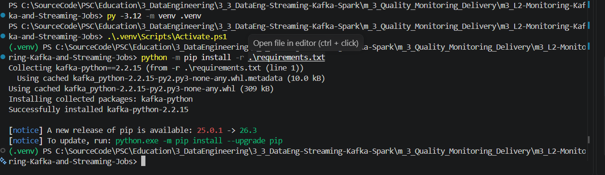
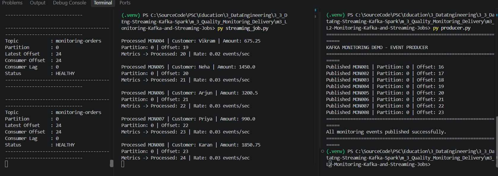
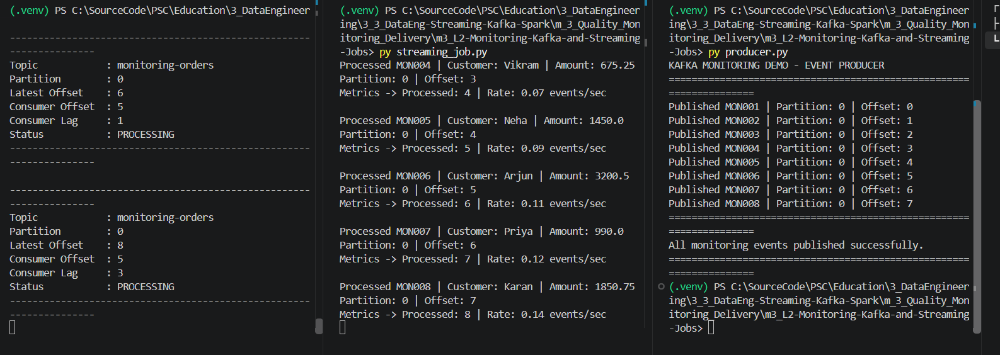
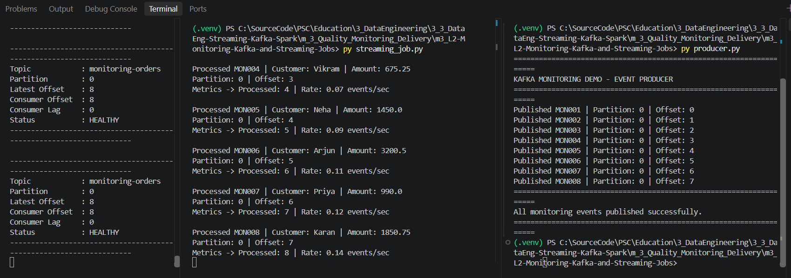

# m3_L2 — Monitoring Kafka and Streaming Jobs

**Module:** 3 — Quality, Monitoring, and Delivery  
**Lab:** Monitoring Kafka and Streaming Jobs  
**Executor:** LiR.  
**Status:** **COMPLETED — EXECUTION VERIFIED**  
**Execution and documentation:** 08 November 2026

## 1. Objective

Monitor a Kafka-based streaming application using a Python event producer, a streaming consumer, and an independent monitoring process. Observe the relationship between **published records**, **processed records**, **committed consumer-group offsets**, **consumer lag**, and **processing throughput**.

The original lab uses **Python Kafka clients**, not Spark Structured Streaming. A Spark container, Spark Kafka Connector, and additional Docker network are not required for this exercise.

### Processing architecture

```text
                              Apache Kafka: kafka-local
                          Topic: monitoring-orders (partition 0)
                                           ^
                                           |
       producer.py  ----------------------+      Publishes MON001–MON008
       Host: localhost:9092               |
                                           +------------------------+
                                                                    |
                                                                    v
                           streaming_job.py (KafkaConsumer)
                           Group: order-streaming-job
                           Reads records and auto-commits offsets
                           Displays processed count and average rate
                                                                    |
                                                                    v
                                        Console processing metrics

       kafka_monitor.py (independent monitor)
         -> Kafka end offset + group's committed offset
         -> Consumer lag + status every 3 seconds
```

## 2. Project structure and original files

```text
m3_L2-Monitoring-Kafka-and-Streaming-Jobs/
├── README.md
├── README.txt
├── kafka_monitor.py
├── streaming_job.py
├── producer.py
├── requirements.txt
├── .venv/                                       # local only; exclude from Git
└── pic/
    ├── lab2_project_directory_2026-11-08.png
    ├── python_venv_requirements_install_2026-11-08.png
    ├── lab2_monitor_job_producer_processing_2026-11-08.png
    └── lab2_monitor_job_producer_healthy_2026-11-08.png
```


The original Python programs and requirements were not modified. The uploaded files use the normal local filenames `kafka_monitor.py`, `streaming_job.py`, `producer.py`, and `requirements.txt`.

### Confirmed configuration

| File | Actual implementation |
|---|---|
| `requirements.txt` | `kafka-python==2.2.15` |
| `producer.py` | Publishes eight order events (`MON001`–`MON008`) to `monitoring-orders`; one-second delay between sends; `localhost:9092` |
| `streaming_job.py` | `KafkaConsumer` with group ID `order-streaming-job`, `auto_offset_reset="earliest"`, and `enable_auto_commit=True`; prints cumulative processed count and average rate |
| `kafka_monitor.py` | Monitors partition `0`, polls latest and committed offsets every three seconds, and prints consumer lag and a simple status |

### Monitor calculation and thresholds

```python
lag = max(latest_offset - consumer_offset, 0)
```

| Consumer lag | Lab status |
|---:|---|
| `0` | `HEALTHY` |
| `1–3` | `PROCESSING` |
| `4 or more` | `LAGGING` |

These are **thresholds defined by the example script**; they are not native Kafka broker-health classifications. The monitor examines **partition 0 only**. A zero lag indicates no outstanding committed backlog **for that partition and consumer group**, not a guarantee that the entire system is healthy.

The consumer's `Rate` metric is calculated as **records processed since process start / elapsed wall-clock time**. It is an average since startup, not instantaneous throughput or a load-test benchmark.

## 3. Environment preparation — verified

The existing Kafka container, `kafka-local`, was reused; no second broker was created. Python 3.12 was selected for an isolated per-lab environment.

### Step 1 — Check Kafka

In a PowerShell terminal inside the Lab 2 directory:

```powershell
docker ps -a --filter "name=kafka-local"
# Only if the existing broker is stopped:
docker start kafka-local
# Confirm running state:
docker ps --filter "name=kafka-local"
```

### Step 2 — Create and activate Python virtual environment

```powershell
py -3.12 -m venv .venv
.\.venv\Scripts\Activate.ps1
```

The PowerShell prompt should begin with `(.venv)`. Activate it separately in every new terminal, or call `.\.venv\Scripts\python.exe` explicitly.

### Step 3 — Install from requirements.txt

```powershell
python -m pip install -r .\requirements.txt
```

**Observed installation result:**

```text
Collecting kafka-python==2.2.15 (from -r .\requirements.txt (line 1))
Installing collected packages: kafka-python
Successfully installed kafka-python-2.2.15
```

The installation completed successfully. The notice about a newer pip version was informational, not an installation error.

### Step 4 — Verify Kafka Python imports

```powershell
python -c "from kafka import KafkaProducer, KafkaConsumer; from kafka.admin import KafkaAdminClient; print('Kafka monitoring dependencies OK')"
```

For VS Code, use **Python: Select Interpreter** and choose `.venv\Scripts\python.exe`. The environment directory must not be committed to Git.

### Step 5 — Ensure the topic exists

```powershell
docker exec kafka-local /opt/kafka/bin/kafka-topics.sh --create --if-not-exists --topic monitoring-orders --bootstrap-server localhost:9092 --partitions 1 --replication-factor 1

docker exec kafka-local /opt/kafka/bin/kafka-topics.sh --describe --topic monitoring-orders --bootstrap-server localhost:9092
```

The single partition matches the unchanged monitor script (`PARTITION = 0`). The `--if-not-exists` option does not delete, recreate, or reset an existing topic.

## 4. Execution procedure — three VS Code terminals

Use three PowerShell terminals opened in the same Lab 2 directory. Activate `.venv` in each terminal, or call the interpreter directly as shown below.

### Terminal 1 — Streaming Job (start first)

```powershell
.\.venv\Scripts\python.exe .\streaming_job.py
```

This Python consumer reads from topic `monitoring-orders`, joins group `order-streaming-job`, and reports each processed record and cumulative average rate. Starting it first also establishes the consumer group for monitoring.

### Terminal 2 — Kafka Monitor

```powershell
.\.venv\Scripts\python.exe .\kafka_monitor.py
```

This monitor runs continuously and reports latest offset, committed consumer-group offset, consumer lag, and a lab-defined status every three seconds. If it was started before the consumer group became available, restart it once the streaming job is running.

### Terminal 3 — Event Producer

```powershell
.\.venv\Scripts\python.exe .\producer.py
```

Start Producer only after the streaming job and monitor are running. It publishes the following eight sample orders:

| Event | Customer | Amount |
|---|---|---:|
| `MON001` | Asha | 1200.00 |
| `MON002` | Rahul | 850.50 |
| `MON003` | Meera | 2100.00 |
| `MON004` | Vikram | 675.25 |
| `MON005` | Neha | 1450.00 |
| `MON006` | Arjun | 3200.50 |
| `MON007` | Priya | 990.00 |
| `MON008` | Karan | 1850.75 |

The Producer exits after successful publication. The Monitor and Streaming Job continue running until stopped.

## 5. Observed execution results — verified

The three-terminal execution completed successfully. The original scripts were used without code changes.

### 5.1 Kafka Producer

The Producer published **eight messages** to topic `monitoring-orders` in **partition 0**.

| Published record | Partition | Kafka offset |
|---|---:|---:|
| `MON001` | 0 | 0 |
| `MON002` | 0 | 1 |
| `MON003` | 0 | 2 |
| `MON004` | 0 | 3 |
| `MON005` | 0 | 4 |
| `MON006` | 0 | 5 |
| `MON007` | 0 | 6 |
| `MON008` | 0 | 7 |

Producer confirmation:

```text
All monitoring events published successfully.
```

The offsets `0–7` are **actual observed offsets for this execution**, not values hard-coded into the Producer. Re-running the Producer appends new Kafka records at new offsets.

### 5.2 Streaming Job

The streaming consumer processed all **eight events**. The final visible record was:

```text
Processed MON008 | Customer: Karan | Amount: 1850.75
Partition: 0 | Offset: 7
Metrics -> Processed: 8 | Rate: 0.14 events/sec
```

**Observed processed records:** `8`. The last displayed average rate, `0.14 events/sec`, reflects elapsed wall-clock time since that consumer process started and should not be interpreted as a maximum Kafka throughput measurement.

### 5.3 Consumer lag: temporary backlog and catch-up

Two snapshots demonstrate the progress of the consumer group:

| Snapshot | Latest offset | Committed group offset | Consumer lag | Monitor status |
|---|---:|---:|---:|---|
| During processing | 6 | 5 | 1 | `PROCESSING` |
| During processing | 8 | 5 | 3 | `PROCESSING` |
| After catch-up | 8 | 8 | **0** | **`HEALTHY`** |

Kafka offsets denote positions in a partition. After processing records with offsets `0–7`, the **next position is 8**. The final committed consumer offset `8` is therefore consistent with eight records processed, and the computed lag is zero:

```text
Latest Offset   : 8
Consumer Offset : 8
Consumer Lag    : 0
Status          : HEALTHY
```

The transient lag of `1–3` was consistent with consumption and auto-commit progress being observed at different moments. Kafka auto-commits and the monitor's three-second polling interval can cause the displayed lag to temporarily differ from the records already printed by the consumer.

## 6. Additional verification

Use a free terminal to inspect the Kafka consumer group's committed progress:

```powershell
docker exec kafka-local /opt/kafka/bin/kafka-consumer-groups.sh --bootstrap-server localhost:9092 --describe --group order-streaming-job
```

A live Kafka CLI snapshot may differ from the monitor's output if the job is still processing or auto-committing offsets. The values above refer to the recorded execution.

## 7. Troubleshooting and operational notes

| Symptom | Investigation |
|---|---|
| `NoBrokersAvailable` | Verify Docker Desktop, running `kafka-local`, and `localhost:9092` host listener. |
| `No module named kafka` | Use the `.venv` interpreter and reinstall from `requirements.txt`. |
| Streaming job shows no new events | Check topic, broker, group ID, and previously committed offsets; `earliest` is not applied when committed group offsets already exist. |
| Monitor shows a lag despite printed messages | Auto-commit and monitoring intervals differ; allow time for the group commit and next monitor sample. |
| `LAGGING` persists | Check whether the streaming job is running, processing and committing; inspect consumer errors and partition assignment. |
| Lag is 0 but the system is unresponsive | A zero committed lag for partition 0 alone is not a complete service-health check. |
| No group offsets initially available | Run the streaming job first and restart the monitor after group initialization. |

### Safe shutdown

Stop both persistent processes with `Ctrl+C`: first Kafka Monitor, then Streaming Job. Producer exits automatically. If no further exercise needs Kafka:

```powershell
docker stop kafka-local
```

Do not remove the broker, topic, or its data. Add `.venv/` to `.gitignore`.

## 8. Conclusion

The lab demonstrates working visibility into Kafka events, the consumption rate of a Python streaming job, and the consumer group's offset progress. The observed lag temporarily reached `1–3` during processing, then returned to **`0`** when the committed offset caught up with the latest offset. The final monitor status was **`HEALTHY`**.

**Final verification:** 8 events published, 8 processed, partition 0, offsets 0–7, committed offset 8, consumer lag 0.

**Execution status: COMPLETED — VERIFIED.**

## 9. Execution evidence — screenshots

### Environment preparation

Python 3.12 `.venv` was created and activated. Installation from `requirements.txt` completed with `Successfully installed kafka-python-2.2.15`.


### Final Monitoring Verification

The pipeline successfully processed all published events.

- Topic: `monitoring-orders`
- Partition: `0`
- Published offsets: `16–23`
- Latest offset: `24`
- Consumer offset: `24`
- Consumer lag: `0`
- Final status: `HEALTHY`


### Three-terminal execution — active processing

The Producer successfully published eight events. The Streaming Job processed records while the Monitor showed temporary lag (`1` and `3`) with status `PROCESSING`.



### Final result — consumer fully caught up

The final screenshot shows all eight records published and processed, **Latest Offset = 8**, **Consumer Offset = 8**, **Consumer Lag = 0**, and **Status = HEALTHY**.


