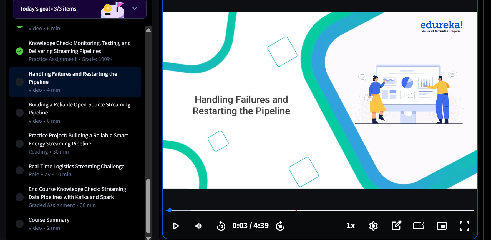

# m3_L3 — Handling Failures and Restarting the Pipeline

**Executor:** Li R.  
**Topic:** Failure detection, consumer offset management, and controlled recovery in a Kafka-based Python pipeline  
**Status:** Prepared for execution; runtime results not yet verified  
**Date:** 08 November 2026

## 1. Objective

Demonstrate how a Python Kafka consumer handles a deliberately failed event, preserves diagnostic context, and resumes processing after restarting in recovery mode. The example illustrates why the consumer must **not commit the failed event's offset** and why retaining the event in Kafka is important for replay.

The project uses Python and `kafka-python` against an **existing** Kafka broker. It does **not** require a Spark container, a new Kafka cluster, or modifications to the supplied source scripts.



## 2. Project files

```text
m3_L3-Handling-Failures-Restarting-Pipeline/
├── README.md                 # Detailed instructions and execution notes
├── README.txt                # Quick PowerShell reference
├── pipeline.py               # Failure-aware Kafka consumer (supplied)
├── producer.py               # Kafka producer with five demonstration events (supplied)
├── requirements.txt          # kafka-python==2.2.15 (supplied)
├── failed_event.json         # Example failure record; may be overwritten at runtime
└── pic/
    ├── lab3_handling_failures_lesson_2026-11-08.png
    └── lab3_project_directory_2026-11-08.png
```


**Source integrity:** The provided `pipeline.py` and `producer.py` have not been modified. When copying the supplied files into the project, keep the conventional names `producer.py` and `requirements.txt`.

## 3. Pipeline design

```text
Python producer.py          Apache Kafka                 Python pipeline.py
------------------        ------------------           --------------------------
FAIL001 ... FAIL005  --->  topic: failure-orders  --->  group: failure-recovery-pipeline
localhost:9092              partition / offsets          manual offset commits
                                                           |
                                                           +-- ordinary event --> print + commit
                                                           |
                                                           +-- FAIL003 (failure mode)
                                                               --> save failed_event.json
                                                               --> stop without committing FAIL003

Restart: python pipeline.py --recover
    -> consume from last committed position -> process FAIL003 and later records
```

### Configurations confirmed from the supplied scripts

| Property | Actual configuration |
|---|---|
| Topic | `failure-orders` |
| Consumer group | `failure-recovery-pipeline` |
| Kafka bootstrap server | `localhost:9092` (Windows host) |
| Start position without a committed offset | `auto_offset_reset="earliest"` |
| Automatic commits | Disabled (`enable_auto_commit=False`) |
| Commit strategy | `consumer.commit()` after successful processing |
| Recovery switch | `--recover` |
| Failure record | `failed_event.json`, written in the current working directory |
| Dependency | `kafka-python==2.2.15` |

## 4. Environment preparation (Windows PowerShell)

Run the following commands **from the Lab 3 folder**, where the Python files and `requirements.txt` are located.

### Step 1 — Verify the existing Kafka broker

Start Docker Desktop and wait until its engine is ready.

```powershell
docker ps -a --filter "name=kafka-local"
```

Only if the existing broker is stopped:

```powershell
docker start kafka-local
```

Check the broker is running:

```powershell
docker ps --filter "name=kafka-local"
```

The scripts connect to Kafka through the host's `localhost:9092`. Do not create a second broker or stop other projects unless needed to free resources.

### Step 2 — Create an isolated Python 3.12 environment

```powershell
py -3.12 -m venv .venv
.\.venv\Scripts\Activate.ps1
python -m pip install -r .\requirements.txt
python -c "from kafka import KafkaProducer, KafkaConsumer; print('Kafka Python OK')"
```

Expected import check: `Kafka Python OK`.

Use **Python: Select Interpreter** in VS Code to choose `.venv\Scripts\python.exe`. Activate `.venv` separately in each new terminal. Add `.venv/` to `.gitignore` (the environment is not a source artifact).

### Step 3 — Verify or create the Kafka topic

```powershell
docker exec kafka-local /opt/kafka/bin/kafka-topics.sh --create --if-not-exists --topic failure-orders --bootstrap-server localhost:9092 --partitions 1 --replication-factor 1
docker exec kafka-local /opt/kafka/bin/kafka-topics.sh --describe --topic failure-orders --bootstrap-server localhost:9092
```

These commands reuse the existing broker. If the topic already exists, its partition configuration is not modified. The illustrative offsets below apply to a **fresh topic and fresh consumer group only**; offsets in an existing topic will differ.

## 5. Execution — simulate a failure and recover

### Step 4 — Terminal LEFT: start the pipeline in normal mode

```powershell
.\.venv\Scripts\Activate.ps1
python .\pipeline.py
```

The application prints `Recovery Mode : OFF` and waits for new events. Leave this terminal running.

### Step 5 — Terminal RIGHT: publish the test events

Open a second PowerShell terminal in the same folder:

```powershell
.\.venv\Scripts\Activate.ps1
python .\producer.py
```

The producer attempts to publish the following five events:

| Event | Customer | Amount | Simulated failure? | Expected normal-mode behavior |
|---|---|---:|---|---|
| `FAIL001` | Asha | 1200.00 | No | Process and commit |
| `FAIL002` | Rahul | 850.50 | No | Process and commit |
| `FAIL003` | Meera | -999.00 | **Yes** | Save error and stop before commit |
| `FAIL004` | Vikram | 1750.00 | No | Sent to Kafka; not reached before simulated failure |
| `FAIL005` | Neha | 2450.25 | No | Sent to Kafka; not reached before simulated failure |

There is a one-second pause between published events. The producer can finish writing `FAIL004` and `FAIL005` even after the consumer stops at `FAIL003`.

### Step 6 — Inspect the failure record

The pipeline catches the simulated exception and writes a JSON record to `failed_event.json`, including the original event, Kafka topic, partition, offset, and error text.

```powershell
Get-Content .\failed_event.json
```

**Provided example:** The uploaded `failed_event.json` shows `FAIL003` in topic `failure-orders`, partition `0`, offset `2`, with the error `Simulated processing failure for demonstration`. This is a *supplied reference record*, not evidence that the pipeline has already run successfully in the current environment.

**Important:** A new failure can **overwrite** `failed_event.json` because the script opens it with mode `"w"`. If the original record must be retained, copy it before executing the lab.

### Step 7 — Terminal LEFT: restart in recovery mode

Once the original pipeline has stopped and the producer has finished, run:

```powershell
python .\pipeline.py --recover
```

Expected console header: `Recovery Mode : ON`.

The consumer continues from its previously committed offset (if a commit exists for the same group). In a fresh single-partition run it should replay `FAIL003`, then consume `FAIL004` and `FAIL005`. Allow it to process these events, then stop with `Ctrl+C`.

**Why replay works:** Manual commits occur after successful messages. The failure for `FAIL003` happens **before** `consumer.commit()`, so that record remains uncommitted and can be retried on restart.

### Step 8 — Confirm progress with Kafka CLI (optional)

```powershell
docker exec kafka-local /opt/kafka/bin/kafka-consumer-groups.sh --bootstrap-server localhost:9092 --describe --group failure-recovery-pipeline
```

Check the committed position after recovery. For a fresh topic containing five records in partition 0, the committed **next offset** should be `5`, after processing offsets `0` through `4`. Actual values may differ if the topic or group was reused.

## 6. What the code does — and does not do

- **Demonstrates:** Controlled exception handling, JSON failure diagnostics, manual Kafka offset commits, and recovery of an uncommitted message.
- **Does not validate amounts:** The negative `-999.00` on `FAIL003` is **not** rejected by an amount-validation rule. The exception is triggered by the explicit `simulate_failure` flag.
- **Recovery mode:** `--recover` bypasses that simulated exception; it does **not correct** the negative amount or implement business-rule validation.
- **Not a production DLQ:** `failed_event.json` is a single local diagnostic file, not a persistent distributed dead-letter topic or fault-tolerant storage system.
- **No exactly-once sink:** Printed output and `consumer.commit()` are not an atomic transaction. A crash between an external side effect and committing an offset can cause reprocessing. A real output sink would require suitable idempotency or transactional handling.
- **Consumer group state matters:** `auto_offset_reset="earliest"` applies only if no valid committed position exists for that consumer group. Rerunning the lab with previously committed offsets may skip earlier records.
- **Error reporting:** The outer `except Exception: pass` suppresses propagation of the processing error; rely on the visible failure message and JSON record rather than exit code alone.

## 7. Evidence to capture after execution

| Screenshot | Evidence needed | Status |
|---|---|---|
| `pic/lab3_python_environment_prepared.png` | Python 3.12 `.venv`, installed dependency | Pending |
| `pic/lab3_failure_detected.png` | Normal-mode failure at `FAIL003`, Kafka offset and failure file | Pending |
| `pic/lab3_failed_event_json.png` | Saved event metadata and failure reason | Pending |
| `pic/lab3_recovery_processed_remaining_events.png` | Recovery mode consumes `FAIL003`–`FAIL005` | Pending |
| `pic/lab3_final_consumer_offsets.png` | Committed offset after recovery (optional) | Pending |

The two images already embedded above document the lesson title and folder layout, **not the execution results**. Add execution screenshots only after actual commands have been run and verified.

## 8. Troubleshooting

| Symptom | Action |
|---|---|
| `No module named kafka` | Activate `.venv`; run `python -m pip install -r .\requirements.txt` |
| `NoBrokersAvailable` | Check Docker Desktop, `kafka-local`, and host port `9092` |
| Producer/consumer shows no events | Confirm topic name, broker connectivity, and existing consumer group offsets |
| No simulated failure on restart | The group may already have advanced past `FAIL003`; `earliest` does not reset a committed group |
| Failure file not found | Check the PowerShell current working directory (`Get-Location`) |
| Repeated failure without recovery flag | Run `python .\pipeline.py --recover` after inspecting the saved failure |
| `--recover` processes a negative amount | This is expected for the unmodified demonstration; amount validation is not implemented |

## Conclusion

This lab illustrates a central Kafka recovery principle: **commit a record's progress only after its processing step succeeds**. When the simulated processing failure occurs, the event remains available for replay. Restarting the same consumer group in recovery mode can resume processing from the saved Kafka position.

**Final status:** Execution instructions and reference artifacts prepared. Actual runtime recovery remains to be verified.
