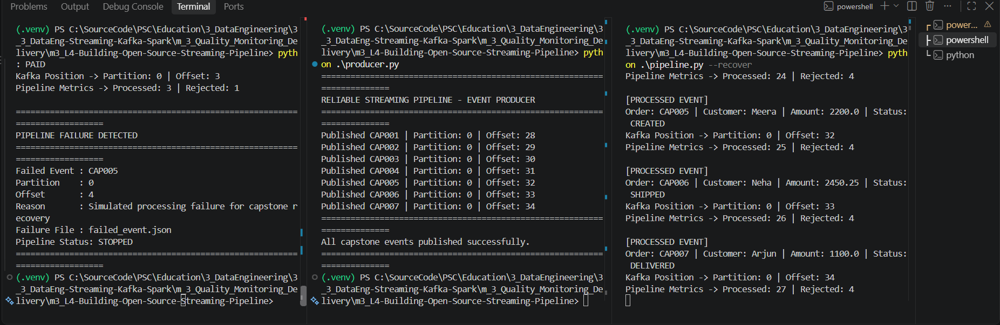

# m3_L4 — Building an Open-Source Streaming Pipeline

**Module:** 3 — Quality, Monitoring, and Delivery  
**Lab:** 4 — Building an Open-Source Streaming Pipeline  
**Executor:** Li R.  
**Execution evidence:** 08 November 2026  
**Status:** **COMPLETED — terminal evidence captured (failure, event publication, and recovery)**

## 1. Introduction

This lab demonstrates the operational behavior of an open-source streaming pipeline when it encounters problematic events and processing failures. The observed execution includes a Python event producer, a streaming processing application, failure reporting, recovery mode, and runtime metrics.

The focus is on **maintaining processing continuity**, **preserving error information**, and **verifying processing after a restart**. The screenshot accompanying this documentation confirms that these activities were demonstrated in the local environment.

## 2. Objective

The lab aims to:

1. Start a Kafka-backed processing pipeline in a Python virtual environment.
2. Publish representative order events from an event producer.
3. Observe event handling, including a deliberately simulated processing failure.
4. Record the failed event and its Kafka position for investigation.
5. Restart the pipeline in recovery mode.
6. Confirm that event processing resumes and operational counters are displayed.

## 3. Workflow and Components

```text
Python Producer
    |
    | Published order events (CAP001 ... CAP007)
    v
Apache Kafka
    |
    | Partition / offset metadata
    v
Python Streaming Pipeline
    |-- Processed events + runtime metrics
    |-- Rejected records / validation handling
    |-- Failure details -> failed_event.json
    `-- Recovery mode -> continued event processing
```

The terminal capture shows these entry-point commands:

| Component | Observed command | Purpose |
|---|---|---|
| Pipeline | `python .\pipeline.py` | Normal processing, before failure |
| Producer | `python .\producer.py` | Publish order events |
| Recovery | `python .\pipeline.py --recover` | Start the pipeline in recovery mode |

**Environment:** VS Code PowerShell terminals with an active local `.venv` Python environment. Kafka is accessed using the existing local broker from the preceding labs. The uploaded evidence does not independently establish the precise Python package versions, Kafka topic name, consumer group, or the full implementation of these scripts.

## 4. Environment Preparation

These are practical commands for repeating the workflow from the lab directory. **Reuse the existing `.venv` and Kafka broker when already configured**; do not recreate or reset existing Kafka data.

### 4.1 Check the environment

```powershell
# Run in m3_L4-Building-Open-Source-Streaming-Pipeline
py -0p
Test-Path .\.venv\Scripts\python.exe
Test-Path .\requirements.txt

docker ps -a --filter 'name=kafka-local'
```

If the environment has already been created, activate it:

```powershell
.\.venv\Scripts\Activate.ps1
python -c "import sys; print(sys.executable)"
```

### 4.2 First-time setup (only if required)

```powershell
py -3.12 -m venv .venv
.\.venv\Scripts\Activate.ps1

# Run only if requirements.txt is present in this lab directory:
python -m pip install -r .\requirements.txt
```

Check the actual package list in `requirements.txt` before installing it; a copy of the Lab 4 source files was not supplied with the screenshot. This document does **not** assume that dependencies are identical to previous labs.

### 4.3 Start Kafka only if stopped

```powershell
docker ps --filter 'name=kafka-local'
# If the broker exists but is stopped:
docker start kafka-local
```

**Note:** Do not run `docker compose down -v`, delete topics, or remove the existing broker. Repeated Producer executions append new records and receive new Kafka offsets.

## 5. Execution Procedure

Use separate PowerShell terminals in the same lab directory. Activate `.venv` in each terminal as needed.

### Terminal 1 — Normal processing

```powershell
.\.venv\Scripts\Activate.ps1
python .\pipeline.py
```

Observe processed events and the pipeline's handling of invalid or problematic records. In the captured failure attempt, the pipeline eventually reported an exception for `CAP005`.

### Terminal 2 — Event Producer

```powershell
.\.venv\Scripts\Activate.ps1
python .\producer.py
```

The Producer publishes order events and displays their Kafka partitions and assigned offsets. It exits after publication.

### Terminal 3 — Recovery

After the normal pipeline reports a failure and stops:

```powershell
.\.venv\Scripts\Activate.ps1
python .\pipeline.py --recover
```

Verify processing resumes and watch the displayed `Processed` and `Rejected` counters.

### Inspect saved failure information

```powershell
Test-Path .\failed_event.json
Get-Content .\failed_event.json
```

The screenshot confirms that the pipeline reported `failed_event.json` as its failure file. The contents of this file for Lab 4 were not uploaded for independent verification.

## 6. Verified Execution Results

### 6.1 Normal run — failure detection

An earlier execution visible in the **left terminal** reached a simulated failure:

| Field | Observed value |
|---|---|
| Failed event | `CAP005` |
| Partition | `0` |
| Kafka offset | `4` |
| Reason | `Simulated processing failure for capstone recovery` |
| Failure file | `failed_event.json` |
| Pipeline status | `STOPPED` |
| Previously displayed metrics | `Processed: 3`, `Rejected: 1` |

This confirms that the application displayed the failing event's identity, Kafka location, and error information rather than silently continuing.

### 6.2 Producer — later publication attempt

The **middle terminal** shows a successful Producer run:

| Event ID | Kafka partition | Kafka offset |
|---|---:|---:|
| `CAP001` | 0 | 28 |
| `CAP002` | 0 | 29 |
| `CAP003` | 0 | 30 |
| `CAP004` | 0 | 31 |
| `CAP005` | 0 | 32 |
| `CAP006` | 0 | 33 |
| `CAP007` | 0 | 34 |

Output message: `All capstone events published successfully.`

**Important distinction:** The failure at offset `4` and this publication at offsets `28–34` are evidence from **different publication attempts**. An order ID may be reused when the Producer is run again; Kafka assigns new offsets to the new messages.

### 6.3 Recovery mode — continued processing

The **right terminal** shows `python .\pipeline.py --recover` processing the following records:

| Event ID | Customer | Amount | Status | Partition | Offset |
|---|---|---:|---|---:|---:|
| `CAP005` | Meera | 2200.0 | CREATED | 0 | 32 |
| `CAP006` | Neha | 2450.25 | SHIPPED | 0 | 33 |
| `CAP007` | Arjun | 1100.0 | DELIVERED | 0 | 34 |

The displayed counters progressed from `Processed: 24 / Rejected: 4` to **`Processed: 27 / Rejected: 4`**. These are the numbers reported by the running application, **not a claim that the last Producer run contained 27 unique records**.

The screenshot confirms that these three records were processed in recovery mode and that the shown rejected counter remained unchanged during those final three events. It does not, by itself, establish exactly-once output guarantees or the details of consumer-offset commits.

## 7. Execution Evidence

The following screenshot shows the three PowerShell terminals side by side: the earlier failure, a successful seven-event publication, and resumed processing in recovery mode.



**Evidence summary:**

- Failure identified and recorded: `CAP005`, partition `0`, offset `4` (earlier attempt).
- Producer publication succeeded for seven records, offsets `28–34` (later attempt).
- Recovery output confirmed for `CAP005–CAP007`, offsets `32–34`.
- Latest visible metrics: `Processed: 27`, `Rejected: 4`.

## 8. Reliability and Operational Considerations

### Failure context

A useful failure record includes the original event, Kafka topic/partition/offset, exception message, and processing timestamp if available. The observed pipeline reports a JSON file for the failure; inspect its contents before replaying production events.

### Restart behavior

A recovery mechanism should preserve consumer progress and retry only eligible events. A failed event must not be marked as successfully completed before the required processing and output operations succeed. The exact implementation must be assessed from the source code rather than inferred from terminal output alone.

### Data quality versus recovery

**Restarting a pipeline is not the same as correcting an invalid business value.** Recovery mode may bypass a simulated exception for demonstration, but data validation and sink idempotency remain separate concerns.

### Duplicate handling

Repeatedly running the Producer creates new Kafka records even if `order_id` values are reused. Business-level deduplication, if required, must be defined independently of Kafka offsets.

## 9. Troubleshooting

| Symptom | Check / action |
|---|---|
| `No module named kafka` | Activate the correct `.venv`, inspect `requirements.txt`, and install dependencies into that environment. |
| `NoBrokersAvailable` | Confirm that `kafka-local` is running and the script's configured bootstrap address is reachable. |
| No events visible | Confirm Kafka topic and consumer-group settings in the actual source, then verify the Producer ran successfully. |
| New offsets differ from earlier screenshots | Expected when messages are published again; old Kafka records are not overwritten. |
| Failure repeats after restart | Check whether recovery mode is enabled and whether the original failure condition was actually corrected. |
| Duplicate business results after retry | Review offset handling, idempotent output writes, and business identifiers. |
| `.venv` cannot be activated | Run the local interpreter explicitly: `.\.venv\Scripts\python.exe .\pipeline.py`. |

## 10. Final Verification

| Validation item | Status | Evidence |
|---|---|---|
| Normal pipeline reported a simulated failure | **Verified** | Left terminal |
| Failed event identity, partition, offset and failure file displayed | **Verified** | Left terminal |
| Producer successfully published `CAP001–CAP007` | **Verified** | Middle terminal |
| Recovery mode processed `CAP005–CAP007` | **Verified** | Right terminal |
| `Processed` counter advanced to 27 | **Verified as displayed** | Right terminal |
| Source-level review of all validation/commit rules | **Not assessed** | Source files not supplied |
| Exactly-once external sink guarantees | **Not assessed** | Not demonstrated by screenshot |

**Result:** The demonstrated capstone workflow completed the intended failure, publication, and recovery observations. The attached screenshot provides the recorded execution evidence.

---

**Executor: Li R.**  
**Recorded: 08 November 2026**
