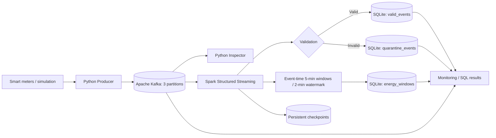
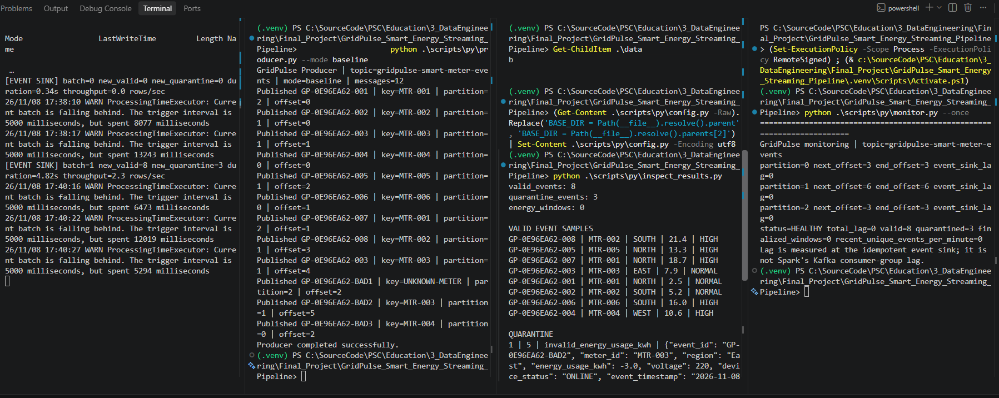
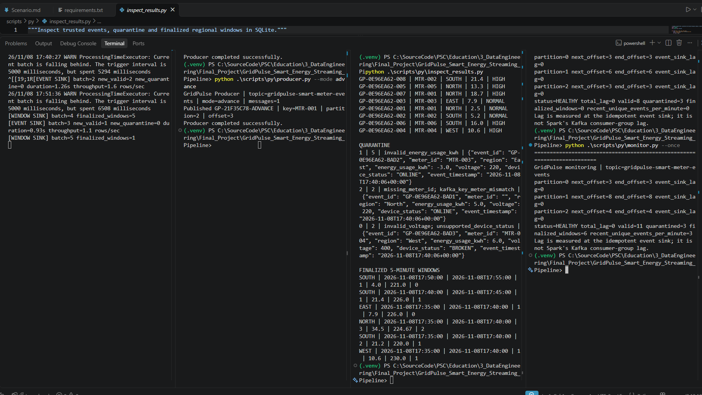
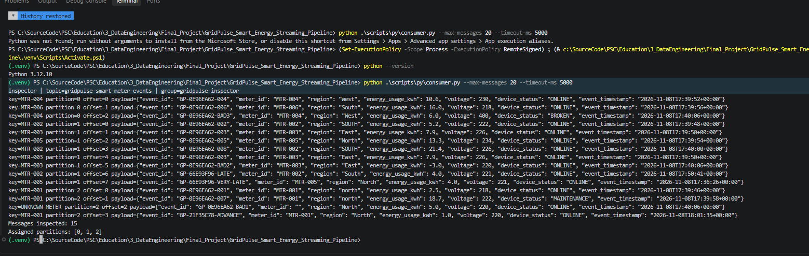
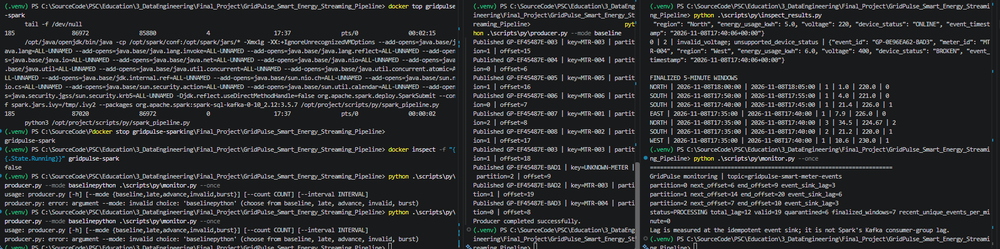
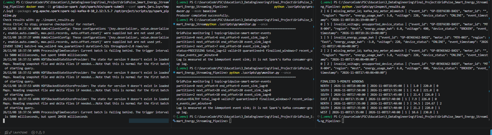
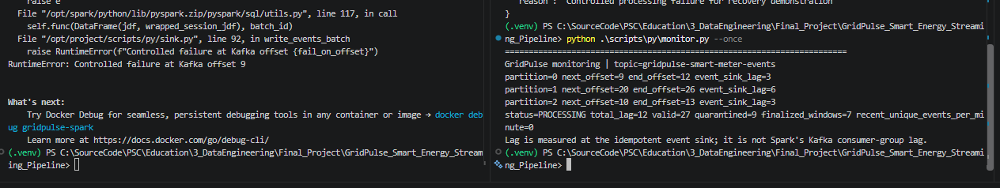
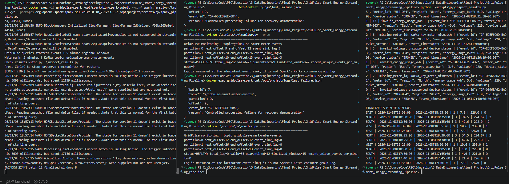
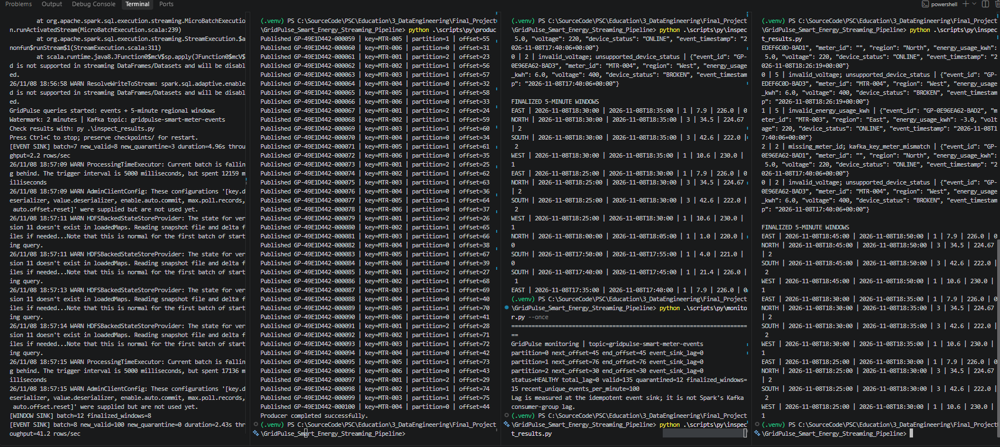

# GridPulse Energy — Reliable Smart Energy Streaming Pipeline

**Executor:** Li R.  
**Date:** 08 November 2026  
**Status (08 November 2026):** **COMPLETE — T01–T10 passed within the demonstrated test scope.** Final live monitor: 135 valid, 12 quarantine, 15 finalized regional windows, total event-sink lag 0 (`HEALTHY`). T10 used a 100-event burst; sustained overload / maximum capacity were **not** measured.

**Project scenario and assignment:** [Scenario.md](./Scenario.md)

## 1. Purpose

Build and verify an open-source streaming pipeline for smart-meter telemetry. The system receives data continuously, preserves meter-level Kafka ordering, validates messages, isolates incorrect records, calculates event-time energy metrics, and supports restart from Spark checkpoints.

This project implements the smart-energy practice scenario with **Apache Kafka 3.9.1**, **Spark Structured Streaming 3.5.7**, **Python 3.12**, and a lightweight **SQLite** demonstration sink.

Kafka is reused from the existing development environment. **No additional Kafka broker is created.** The SQLite sink avoids running a second heavy database service; the approach is suitable for this practical project rather than a production-scale metering platform.

## 2. Streaming architecture



The `meter_id` is the Kafka message key, keeping records for the same meter in one partition. Kafka guarantees ordering **within each partition**, not across the entire topic. Three partitions allow up to three active members of a conventional consumer group for this topic. See [Architecture and decisions](docs/architecture.md).

## 3. Project structure

```text
GridPulse_Smart_Energy_Streaming_Pipeline/
├── README.md                   # Project overview, setup and test status
├── README.txt                  # PowerShell command reference
├── Scenario.md                 # Original assignment (kept unchanged)
├── setup_progress_2026-11-08.md # Setup and execution milestones
├── docker-compose.yml
├── requirements.txt
├── .gitignore                  # Excludes .venv, checkpoints, runtime DB, xxx*
├── scripts/
│   ├── py/
│   │   ├── config.py
│   │   ├── producer.py
│   │   ├── consumer.py
│   │   ├── spark_pipeline.py
│   │   ├── sink.py
│   │   ├── monitor.py
│   │   └── inspect_results.py
│   └── ps/
├── docs/
│   ├── architecture.md
│   ├── validation_rules.md
│   ├── requirements_matrix.md
│   ├── test_plan.md
│   └── test_execution_2026-11-08.md  # Chronological screenshots and results
├── pic/                        # Screenshots from actual local execution
├── data/                       # Generated SQLite DB (not for Git)
├── checkpoints/                # Persistent Spark state (not for Git)
├── pid/                        # Runtime PID files (not for Git)
└── logs/                       # Optional failure diagnostics (not for Git)
```

The `scripts/py/` and `docs/` directories are part of this delivered layout. For a screenshot of the earlier local folder layout, see the [execution evidence](docs/test_execution_2026-11-08.md).

## 4. Smart-meter event schema

```json
{
  "event_id": "GP-ABC12345-001",
  "meter_id": "MTR-001",
  "region": "North",
  "energy_usage_kwh": 5.2,
  "voltage": 220.0,
  "device_status": "ONLINE",
  "event_timestamp": "2026-11-08T16:00:00+00:00"
}
```

**Topic:** `gridpulse-smart-meter-events`  
**Partitions:** 3  
**Key:** `meter_id`  
**Value:** JSON encoded as UTF-8

See [Validation rules](docs/validation_rules.md) for detailed checks and the [16-task requirements matrix](docs/requirements_matrix.md) for mapping tasks to evidence.

## 5. Environment preparation (Windows PowerShell)

Commands must be executed from the project directory. Use the installed Python **3.12**, not the global Python 3.14 interpreter.

```powershell
py -3.12 -m venv .venv
.\.venv\Scripts\Activate.ps1
python -m pip install -r .\requirements.txt
python -c "from kafka import KafkaProducer, KafkaConsumer; print('Kafka Python OK')"
```

Expected package: `kafka-python==2.2.15`. Spark runs **inside Docker**, so no local installation of PySpark is required for execution. The VS Code Python extension may use the local `.venv` for editing the host scripts.

### Start existing Kafka

```powershell
docker ps -a --filter "name=kafka-local"
docker start kafka-local
```

If Kafka is already running, `docker start` will simply report its container name. Verify the Docker network:

```powershell
docker inspect kafka-local --format '{{range $name, $net := .NetworkSettings.Networks}}{{$name}} {{end}}'
```

The existing network for these labs has been `runningapachekafkalocally_default`. If Docker reports a different name, adjust the external network name in `docker-compose.yml` **before** starting Spark.

### Create the Kafka topic

```powershell
docker exec kafka-local /opt/kafka/bin/kafka-topics.sh --create --if-not-exists --topic gridpulse-smart-meter-events --bootstrap-server localhost:9092 --partitions 3 --replication-factor 1
docker exec kafka-local /opt/kafka/bin/kafka-topics.sh --describe --topic gridpulse-smart-meter-events --bootstrap-server localhost:9092
```

If the topic already exists, `--if-not-exists` avoids an error, but **does not change its existing partition count**. Check `PartitionCount: 3` in the description.

### Start the Spark container

```powershell
docker compose up -d spark
docker ps --filter "name=gridpulse-spark"
docker exec gridpulse-spark getent hosts kafka-local
```

Expected: an IP address and `kafka-local`. The container is restricted to **2 CPU equivalents, 3 GiB RAM and 4 GiB RAM+swap**. Stop unused Spark, Airflow and MinIO labs to avoid resource contention. Starting the container does not start the actual streaming application.

## 6. Run the complete pipeline

Use separate VS Code PowerShell terminals. Activate `.venv` in each terminal that runs host-side Python code.

### Terminal 1 — Spark (start first)

```powershell
docker exec -it gridpulse-spark /opt/spark/bin/spark-submit --conf spark.jars.ivy=/tmp/.ivy2 --packages org.apache.spark:spark-sql-kafka-0-10_2.12:3.5.7 /opt/project/scripts/py/spark_pipeline.py
```

The first startup may download the Kafka connector from Maven repositories. Wait for:

```text
GridPulse queries started: events + 5-minute regional windows
Watermark: 2 minutes
```

**Do not close this terminal.** Two independent Structured Streaming queries operate here: an event validation/SQLite sink, and an event-time window aggregation sink. Each has its own checkpoint directory.

### Terminal 2 — Producer

```powershell
python .\scripts\py\producer.py --mode baseline
```

The baseline sends multiple meters and regions, a duplicate business event and several intentionally invalid records. Actual Kafka partition IDs and offsets are determined by Kafka and **must be recorded from the run**, not assumed in advance.

### Terminal 3 — Monitor

```powershell
python .\scripts\py\monitor.py
```

This displays Kafka end offsets, next processed offsets from the SQLite event sink, approximate backlog per partition, and counts of trusted/quarantined/finalized rows. These numbers describe **event-sink progress**, not Kafka consumer-group commits made by Spark.

### Terminal 4 — Inspect outputs

```powershell
python .\scripts\py\inspect_results.py
```

Inspect the database after the event-sink processing message appears. Use the output as evidence for quality checks, key/offset tracking, valid events and quarantine.

### Optional — Raw Kafka consumer

```powershell
python .\scripts\py\consumer.py --max-messages 20
```

The standalone consumer displays the exact Kafka key, JSON value, partition and offset. Its consumer-group behaviour is separate from Spark. To explore Kafka group assignment, run additional inspector processes with the same `--group` while new events are published, and verify actual assignments rather than assuming each consumer receives equal data.

## 7. Filtering and data quality

Spark parses Kafka JSON using a declared `StructType`. Validation checks required fields, key-to-meter matching, numeric ranges, permitted status values, and a parseable event timestamp. Valid events have standardized uppercase regions and derived fields:

- `usage_category`: `HIGH` when energy usage reaches 10 kWh, otherwise `NORMAL`.
- `voltage_status`: `NORMAL` for 210–240 V inclusive; `CHECK` for accepted values outside that band.

Invalid events are written to `quarantine_events` with original JSON, topic, partition, offset, and failure reason. The `valid_events` table has a unique `event_id`, so repeating the same event does not duplicate its business record.

```powershell
python .\scripts\py\producer.py --mode invalid
python .\scripts\py\inspect_results.py
```

## 8. Event-time windows, watermarks and late data

Regional energy summaries are calculated in **5-minute tumbling windows**, using device `event_timestamp`. A **2-minute watermark** limits the aggregation and deduplication state. Duplicate event IDs are suppressed by `dropDuplicatesWithinWatermark` within the documented watermark guarantee (Spark 3.5.7).

The window query uses **Append mode** and emits a finalized window only after the watermark passes the end of that window. Therefore, **no rows in `energy_windows` immediately after baseline is normal**, not an error.

Run these test modes in this order **after the first batch is fully ingested**:

```powershell
python .\scripts\py\producer.py --mode late
python .\scripts\py\producer.py --mode advance
python .\scripts\py\inspect_results.py
```

`late` produces a recent delayed event and an event from 15 minutes earlier. `advance` deliberately generates **one synthetic future-dated event** to move the watermark forward for a short demonstration; it is not normal production telemetry. A very late event may remain present in `valid_events` while being excluded from the aggregate after watermark cleanup.

Because of Kafka partitions, trigger scheduling and watermark progression, exact window timing and row counts must be checked from actual outputs.

## 9. Monitoring, lag and backpressure

```powershell
python .\scripts\py\monitor.py --once
python .\scripts\py\producer.py --mode burst --count 100 --interval 0
python .\scripts\py\monitor.py --once
```

If Kafka receives records faster than the event sink can commit, **event-sink lag** grows. Monitor the time series, not one reading. The monitor's `HEALTHY / PROCESSING / LAGGING` thresholds are demonstration labels, not production SLOs. The Spark aggregation query has its **own** checkpoint and can lag independently.

Capacity planning must consider arrival rate, processing rate, Kafka partitions, Spark CPU/RAM, state-store size, storage throughput and sink performance. A sustained incoming rate greater than processing capacity causes backlog and processing latency to rise.

## 10. Checkpoints and controlled recovery

The volume mount preserves:

```text
checkpoints/events/
checkpoints/windows/
```

For a safe restart demonstration:

1. Stop the Spark application. For this particular Docker setup, **Ctrl+C in the terminal was insufficient on the first attempt** because the Spark JVM/Python processes continued inside the container. Use `docker top gridpulse-spark`, then `docker stop gridpulse-spark` and verify `docker inspect -f "{{.State.Running}}" gridpulse-spark` returns `false`. Kafka remains running; do not remove either checkpoint directory.
2. While Spark is stopped, publish more events: `python .\scripts\py\producer.py --mode baseline`.
3. Start the container with `docker start gridpulse-spark`, then submit the **same** Spark command again **exactly once**, without modifying checkpoint locations.
4. Run `python .\scripts\py\inspect_results.py` and `python .\scripts\py\monitor.py --once` to verify resumed processing and no duplicate trusted records.

The optional `--fail-on-offset NUMBER` flag in `spark_pipeline.py` deliberately fails the **event-sink query** upon encountering that unprocessed Kafka offset. Use a newly published, known upcoming offset for this test; the flag does nothing if the offset is already checkpointed. The failed SQL micro-batch is rolled back, and `logs/last_failure.json` captures the error context. Restart without the flag to allow the batch to be retried.

**Do not delete checkpoints for a normal restart.** Checkpoint compatibility depends on preserving query structure and stateful operator settings. The two independent sinks are idempotent for retries, but their commits are not a single global atomic transaction.

## 11. SQL sinks and reliability

SQLite tables created automatically by `sink.py`:

| Table | Purpose | Duplicate protection |
|---|---|---|
| `valid_events` | Trusted standardized readings | `PRIMARY KEY(event_id)` |
| `quarantine_events` | Invalid source records and reasons | `PRIMARY KEY(topic, partition, offset)` |
| `energy_windows` | Finalized regional 5-minute summaries | `PRIMARY KEY(region, window_start, window_end)` |
| `source_progress` | Event-sink next offset per Kafka partition | Transactional `MAX(next_offset)` UPSERT |

The event sink writes all rows and its progress updates in a SQLite transaction. Window results are upserted by region and window boundaries, so a retried batch does not create an extra window row. **This does not guarantee a globally atomic exactly-once transaction across both independent streaming queries.**

## 12. Final verified results (08 Nov 2026)

**All ten planned tests have recorded PASS results within their stated scopes.** See the [full chronological execution log](docs/test_execution_2026-11-08.md), [screenshot index (24 original PNGs)](docs/screenshot_index_2026-11-08.md), and [final test report](docs/final_test_report_2026-11-08.md). This status supersedes any earlier *pending* notes retained as historical checkpoints in the execution log.

| ID | Test | Evidence / actual observation | Result |
|---|---|---|---|
| T01 | Kafka and environment | Kafka topic with 3 partitions; Spark connectivity | PASS |
| T02 | Baseline event delivery | 12 Kafka messages published, event sink processed | PASS |
| T03 | Validation and quarantine | 8 unique valid / 3 invalid | PASS |
| T04 | Duplicate suppression in trusted sink | One duplicate event ID did not create another valid row | PASS (observed) |
| T05 | Late events and event-time windows | 11 valid / 3 quarantine / 6 finalized windows after `late` + `advance` | PASS |
| T06 | Monitoring and event-sink lag | HEALTHY, lag 0 across 3 partitions | PASS (observed) |
| T07 | Standalone Kafka consumer | 15 messages over partitions 0 / 1 / 2, offsets 0–2 / 0–7 / 0–3 | PASS |
| T08 | Checkpoint recovery | 12 messages buffered with Spark stopped, lag 12 → 0; 19/6 → 27/9 | PASS |
| T09 | Controlled failure and clean retry | RuntimeError at P0 offset 9, failure JSON and unchanged event-sink progress; clean restart → 35 valid, 12 quarantine, lag 0 | PASS |
| T10 | Burst ingestion and catch-up | 100 messages, new_valid=100, new_quarantine=0; 2.43s, ~41.2 rows/sec, lag 0 | PASS (100-event burst) |

### Baseline and watermark

The initial producer emitted **12** messages. The event sink committed **8 valid**, **3 quarantine**; one repeated business ID was not duplicated in the trusted table. A separate `late` + `advance` test produced **11 valid**, **3 quarantine** and **6 finalized** 5-minute windows with 2-minute watermark; the very-late record remained in the trusted event sink but did not alter the previously closed North window in that run.





### T07 — Kafka consumer inspection

The independent `gridpulse-inspector` read **15 messages**: partition 0 = 3, partition 1 = 8, partition 2 = 4. Original payloads included a duplicate, invalid records, `LATE`, `VERY-LATE`, and `ADVANCE`. The inspector used a distinct group and did not modify Spark checkpoints. Only a single inspector process was tested (multi-member rebalance not demonstrated).



### T08 — checkpoint recovery

The first `Ctrl+C` attempt was **inconclusive** because Spark processes remained active in Docker. On the verified retest, `docker inspect` returned `false` after stopping the Spark container. Kafka buffered 12 events while it was stopped, and the event-sink lag rose to **12** while SQLite totals remained at **19 valid / 6 quarantine / 7 windows**. Restarting the container and the existing checkpointed stream restored processing: **27 valid / 9 quarantine / 7 windows, lag 0, HEALTHY**, with Kafka end offsets equal to sink next offsets **9 / 20 / 10**.





### T09 — controlled failure, transaction rollback and retry

T09 started with **12 queued Kafka messages** (`end_offset` P0/P1/P2 = 12 / 26 / 13; sink next offsets = 9 / 20 / 10). Running with `--fail-on-offset 9` raised `RuntimeError: Controlled failure at Kafka offset 9`. The diagnostic JSON recorded `batch_id=7`, `partition=0`, `offset=9`, event ID `GP-66EB26E-004`. Post-failure monitoring still showed **27 valid / 9 quarantine / lag 12**, consistent with a rollback and no event-sink progress committed from the failing batch.

A clean restart **without** the failure flag processed **8 new valid and 3 new quarantined** messages (one duplicate did not create another trusted row). Final monitor: **35 valid / 12 quarantine / 15 windows / lag 0**. This demonstrates transaction rollback and successful replay in the SQLite event sink for the tested case; it does **not** prove global atomic exactly-once delivery across two independent Spark queries.





### T10 — burst ingestion and catch-up

Command used:

```powershell
python .\scripts\py\producer.py --mode burst --count 100 --interval 0
```

The producer published 100 messages; Spark recorded `[EVENT SINK] batch=8 new_valid=100 new_quarantine=0 duration=2.43s throughput=41.2 rows/sec`. Final monitoring reported **135 valid / 12 quarantine / 15 finalized windows / HEALTHY / lag 0**, with next offsets and end offsets **45/45, 76/76, 30/30** for partitions 0/1/2. These values match 100 additional valid events and no residual event-sink backlog.



**Scope limitation:** The result verifies a *single 100-event burst* and subsequent catch-up. It does not measure sustained input overload, the system's maximum throughput, or a quantified backlog-growth/recovery curve. Earlier 5-second micro-batch overruns were observed, but no sustained backpressure threshold was established.

## 13. Evidence, reproducibility and caveats

- Final snapshot: **135 valid / 12 quarantined / 15 finalized windows; lag 0**. This is supported by the **live user screenshots**, not by the older SQLite database included in the originally uploaded `Final_Project.zip` (which contains the earlier baseline state of 8 / 3 / 0).
- The three Kafka partition next offsets were **45 / 76 / 30**, equal to end offsets. This is **event-sink progress** recorded in SQLite, **not Spark consumer-group committed offsets**.
- Window aggregates run as a separate Structured Streaming query and checkpoint, without a single atomic transaction spanning both SQLite sinks.
- The event sink applies business-event idempotence; the controlled retry did not increase counts unexpectedly. This is evidence for the tested retry, not a universal exactly-once guarantee.
- The synthetic future-dated `ADVANCE` record was used only to demonstrate event-time window finalization.
- The screenshot collection preserves initial troubleshooting, partial attempts and final PASS results **chronologically**. Earlier interim logs labelled `pending` should not be read as the project's final state.
- Runtime files (`.venv/`, `data/`, `checkpoints/`, `pid/`, `logs/`) belong to the local workstation and must remain outside Git. Keep the actual checkpoints for future restarts; never overwrite them with an exported documentation package.

For each original screenshot see [Screenshot Evidence Index](docs/screenshot_index_2026-11-08.md); for actual terminal observations and the chronological record see [Execution Log](docs/test_execution_2026-11-08.md).

## 14. Safe shutdown

```powershell
# Confirm streaming processes, then stop Spark container without removing data:
docker top gridpulse-spark
docker stop gridpulse-spark
# Kafka may remain running for other courses/labs:
python .\scripts\py\monitor.py --once
```

**Do not use `docker compose down -v`, delete `checkpoints/`, delete your live SQLite database, or reset Kafka offsets merely to stop the lab.**
