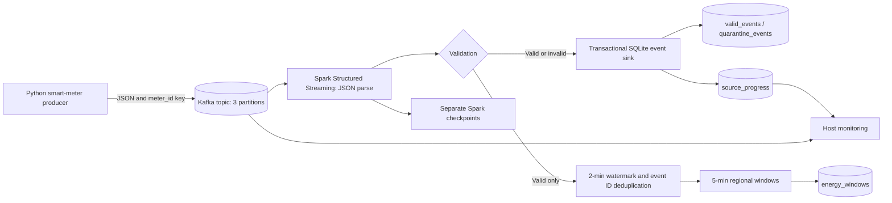

# GridPulse Architecture and Design Decisions

## Data path

## Local implementation

- Reuse Kafka container `kafka-local` (no second broker); topic `gridpulse-smart-meter-events` has three partitions and replication factor one (sufficient only for a one-broker lab).
- Key events by `meter_id` to keep a device's messages in one Kafka partition; Kafka ordering is guaranteed within a partition, not globally.
- Spark 3.5.7 runs in Docker with the matching Kafka connector. Host Python 3.12 uses `kafka-python` for producer, inspector and monitor.
- Two Structured Streaming queries share source logic but have independent checkpoints: `checkpoints/events/` and `checkpoints/windows/`.
- Events sink uses one SQLite transaction per Spark micro-batch and `PRIMARY KEY(event_id)` for unique trusted rows. Quarantine is unique by topic/partition/offset. `source_progress` is updated in the same transaction as event sink writes.
- Windows stream validates, watermarks event time by 2 minutes, deduplicates event IDs in state and groups by regional tumbling windows of 5 minutes. SQLite window sink uses upserts for retry-safe window keys.
- `monitor.py` measures committed SQLite event-sink progress relative to Kafka end offsets. It is **not** Kafka group lag for the independent Spark window query.

## Limitations

SQLite is convenient for a small local exercise, not a large concurrent production streaming warehouse. Kafka replication factor 1 tolerates no broker loss. Source event validation can persist old records in `valid_events` even when the watermark rejects them from the aggregate. Two streaming queries do **not** share a global exactly-once transaction. `ADVANCE` is an intentionally future-dated test message; it is not a production strategy for watermark control.

See [execution evidence](test_execution_2026-11-08.md) and [test plan](test_plan.md).
