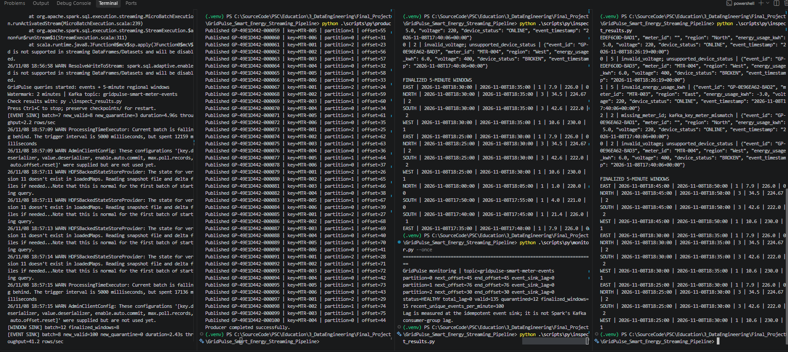

# GridPulse — Final Validation Report

**Project:** GridPulse Smart Energy Streaming Pipeline  
**Course:** Streaming Data Pipelines with Kafka and Spark (Edureka)  
**Date:** 2026-11-08  
**Test execution status:** **COMPLETE — T01–T10 PASS within observed test scopes**  
**Evidence:** 24 original PNG screenshots (see [chronological image index](screenshot_index_2026-11-08.md)).

## Executive result

The local Kafka → Spark Structured Streaming → SQLite smart-meter pipeline was exercised end-to-end: validation, quarantine, duplicate suppression, event-time windows, late arrivals, inspection, lag monitoring, offline buffering, checkpoint restart, injected event-sink failure/rollback, clean replay, and a bounded burst.

| Final monitored KPI | Value |
|---|---:|
| Trusted `valid_events` | **135** |
| `quarantine_events` | **12** |
| Finalized 5-minute regional `energy_windows` | **15** |
| Kafka topic partitions | **3** |
| Sink next offsets (P0/P1/P2) | **45 / 76 / 30** |
| Kafka end offsets (P0/P1/P2) | **45 / 76 / 30** |
| Total event-sink lag | **0** |
| Monitoring status | **HEALTHY** |

## Completed test register

| ID | Focus | Key evidence | Status |
|---|---|---|---|
| T01 | Environment / Kafka | Existing broker, 3 partitions; network resolution | PASS |
| T02 | Baseline Kafka → Spark | 12 messages sent; Spark event sink processed | PASS |
| T03 | Validation + quarantine | 8 unique trusted / 3 quarantined | PASS |
| T04 | Idempotent trusted sink | Duplicate ID did not increase valid rows | PASS (observed) |
| T05 | Late arrivals + watermark | 6 closed regional windows after `late` + `advance` | PASS |
| T06 | Event-sink lag | Lag zero on all three partitions | PASS |
| T07 | Raw Kafka inspection | 15 source messages with offsets in 3 partitions | PASS |
| T08 | Offline buffering + checkpoint restart | Lag 12 while stopped → lag 0 after restart; 27 valid / 9 quarantine | PASS |
| T09 | Injected error + rollback + retry | Offset 9 error and JSON; 27/9 unchanged; clean replay → 35/12, lag 0 | PASS |
| T10 | Bounded burst + catch-up | 100 events processed; ~41.2 rows/s; final 135/12, lag 0 | PASS for 100-event burst |

## Observed progression of SQLite/event-sink state

| Milestone | Valid | Quarantine | Finalized windows | Event sink lag |
|---|---:|---:|---:|---:|
| Baseline | 8 | 3 | 0 | 0 |
| Late + advance | 11 | 3 | 6 | 0 |
| T08 before verified offline interval | 19 | 6 | 7 | 0 |
| T08 while Spark stopped | 19 | 6 | 7 | 12 |
| T08 recovered | 27 | 9 | 7 | 0 |
| T09 failed batch before retry | 27 | 9 | 7 | 12 |
| T09 retry completed | 35 | 12 | 15 | 0 |
| T10 100-event burst completed | **135** | **12** | **15** | **0** |

The 19/6/7 state was reached during an earlier *inconclusive* stop attempt: `Ctrl+C` did not stop the Spark processes still running inside Docker. The documented T08 recovery proof uses a later verified `docker stop` and twelve messages buffered while the container was actually stopped.

## Reliability evidence

**T08:** The container was confirmed stopped (`.State.Running=false`), and Kafka accepted 12 new messages. SQLite event-sink progress remained behind, yielding `lag=12`. After restarting with unchanged checkpoints and database, `lag=0` and counts advanced by 8 trusted plus 3 quarantine rows, consistent with one duplicate source record.

**T09:** An intentional `RuntimeError` on partition 0, Kafka offset 9 was recorded in `logs/last_failure.json`, with batch ID 7 and event ID `GP-66EB26E-004`. Monitored sink progress did not advance in the failed batch. A clean restart without the flag then caught up to zero lag; new valid/quarantine counts were 8/3. This supports transaction rollback and idempotent event-sink replay for this observed case.

**T10:** The producer emitted 100 messages with zero send interval. Spark handled 100 trusted events in the recorded event-sink batch: **2.43 seconds, 41.2 rows/sec**, then monitoring reached `HEALTHY` with no event-sink backlog. Exact offsets observed: P0 45/45, P1 76/76, P2 30/30.

## Scope and limitations

1. **Bounded burst, not saturation:** T10 tested a single 100-event burst; it did not show a sustained overload threshold or a measured rise-and-fall backlog curve. The previous test plan mentioned 200; the **actual executed count was 100**.
2. **Event-sink lag:** The monitor compares Kafka end offsets with SQLite `source_progress`; it is not a measurement of Spark's committed Kafka consumer-group positions or of window query lag.
3. **Window query independence:** The event and window sinks have separate Structured Streaming queries and checkpoints; there is no global cross-query atomic commit.
4. **Idempotence:** No duplicate trusted rows appeared in the tested replay. These observations are not a blanket exactly-once guarantee for arbitrary distributed failure modes.
5. **Single raw inspector:** T07 did not demonstrate group rebalancing with multiple simultaneous consumers.
6. **Source archive age:** The database included in the uploaded `Final_Project.zip` is an *earlier snapshot* (8 valid / 3 quarantine / 0 windows). Final counters derive from later live screenshots; the export deliberately excludes runtime SQLite and checkpoints.
7. **Performance warning:** `Current batch is falling behind` was observed in earlier stages. It was not accompanied by a persisting backlog in the final T10 measurement; do not extrapolate a production SLA from this local run.

## Deliverables and non-destructive export

- [README](../README.md): architecture, setup, reproducibility and final test summary.
- [Chronological execution log](test_execution_2026-11-08.md): intermediate outputs, mistakes, fixes, final results.
- [Screenshot index](screenshot_index_2026-11-08.md): all 24 PNGs in order.
- [Test plan](test_plan.md): test cases and pass criteria.
- [Requirements matrix](requirements_matrix.md): scenario-to-implementation traceability.
- Original `Scenario.md` and Python scripts retained without modification.
- Export contains no live `.venv`, checkpoints, SQLite, process IDs or error logs. Preserve those locally if future testing/restarts are planned.

**Conclusion:** The defined practical test cycle is complete, and the observed pipeline passes the targeted correctness, recovery and bounded-load scenarios. Further capacity benchmarking would be a separate optional exercise, not a prerequisite to this test-cycle completion.
