# GridPulse — Original Screenshot Evidence Index

**Date:** 2026-11-08  
**Total:** 24 original PNG captures  
**Order:** Chronological execution order, including troubleshooting and intermediate snapshots.

Screenshots are retained at original resolution without cropping or changing their image contents. Earlier states labelled *pending* or *inconclusive* are intentionally preserved and superseded by the later verified PASS results.

| # | Stage | Evidence | File |
|---:|---|---|---|
| 01 | Infrastructure | Kafka topic and environment verified | [`gridpulse_kafka_topic_setup_verified_2026-11-08.png`](../pic/gridpulse_kafka_topic_setup_verified_2026-11-08.png) |
| 02 | Infrastructure | Local folder snapshot | [`gridpulse_project_folder_structure_2026-11-08.png`](../pic/gridpulse_project_folder_structure_2026-11-08.png) |
| 03 | Baseline | Producer + Spark baseline execution | [`gridpulse_baseline_producer_spark_verified_2026-11-08.png`](../pic/gridpulse_baseline_producer_spark_verified_2026-11-08.png) |
| 04 | Baseline | Baseline producer, event sink, monitoring | [`gridpulse_baseline_e2e_overview_2026-11-08.png`](../pic/gridpulse_baseline_e2e_overview_2026-11-08.png) |
| 05 | Baseline | Quarantine inspection | [`gridpulse_baseline_validation_quarantine_2026-11-08.png`](../pic/gridpulse_baseline_validation_quarantine_2026-11-08.png) |
| 06 | Watermark | Late + advance, 6 finalized windows | [`gridpulse_late_advance_watermark_verified_2026-11-08.png`](../pic/gridpulse_late_advance_watermark_verified_2026-11-08.png) |
| 07 | T07 | Independent consumer: 15 Kafka messages | [`gridpulse_t07_consumer_inspection_verified_2026-11-08.png`](../pic/gridpulse_t07_consumer_inspection_verified_2026-11-08.png) |
| 08 | T08 | Pre-check: SQLite rows and finalized windows | [`gridpulse_t08_before_recovery_sqlite_2026-11-08.png`](../pic/gridpulse_t08_before_recovery_sqlite_2026-11-08.png) |
| 09 | T08 | Pre-check: monitor lag zero | [`gridpulse_t08_before_recovery_monitor_2026-11-08.png`](../pic/gridpulse_t08_before_recovery_monitor_2026-11-08.png) |
| 10 | T08 | Spark running; not yet checkpoint recovery | [`gridpulse_t08_spark_running_no_backlog_2026-11-08.png`](../pic/gridpulse_t08_spark_running_no_backlog_2026-11-08.png) |
| 11 | T08 | Initial Ctrl+C stop attempt; process status uncertain | [`gridpulse_t08_spark_stop_attempt_console_2026-11-08.png`](../pic/gridpulse_t08_spark_stop_attempt_console_2026-11-08.png) |
| 12 | T08 | Producer after first stop attempt (attempt inconclusive) | [`gridpulse_t08_producer_after_stop_attempt_2026-11-08.png`](../pic/gridpulse_t08_producer_after_stop_attempt_2026-11-08.png) |
| 13 | T08 | Sink already caught up; proved earlier stop attempt inconclusive | [`gridpulse_t08_unexpected_sink_catchup_monitor_2026-11-08.png`](../pic/gridpulse_t08_unexpected_sink_catchup_monitor_2026-11-08.png) |
| 14 | T08 | Docker top: Spark driver still active | [`gridpulse_t08_spark_processes_still_running_after_ctrl_c_2026-11-08.png`](../pic/gridpulse_t08_spark_processes_still_running_after_ctrl_c_2026-11-08.png) |
| 15 | T08 | Docker inspect: container definitively stopped | [`gridpulse_t08_spark_container_stopped_verified_2026-11-08.png`](../pic/gridpulse_t08_spark_container_stopped_verified_2026-11-08.png) |
| 16 | T08 | While stopped: 12 new messages, lag 12 | [`gridpulse_t08_offline_buffering_12_kafka_events_lag_2026-11-08.png`](../pic/gridpulse_t08_offline_buffering_12_kafka_events_lag_2026-11-08.png) |
| 17 | T08 | Checkpoint restart; event sink processing | [`gridpulse_t08_restart_event_sink_batch6_in_progress_2026-11-08.png`](../pic/gridpulse_t08_restart_event_sink_batch6_in_progress_2026-11-08.png) |
| 18 | T08 | Final: 27 valid, 9 quarantine, 7 windows, lag 0 | [`gridpulse_t08_checkpoint_recovery_passed_lag0_2026-11-08.png`](../pic/gridpulse_t08_checkpoint_recovery_passed_lag0_2026-11-08.png) |
| 19 | T09 | Before fault: Kafka backlog 12, sink unchanged | [`gridpulse_t09_pre_failure_offline_buffering_lag12_2026-11-08.png`](../pic/gridpulse_t09_pre_failure_offline_buffering_lag12_2026-11-08.png) |
| 20 | T09 | Injected failure on offset 9; sink lag remains 12 | [`gridpulse_t09_controlled_failure_offset9_rollback_lag12_2026-11-08.png`](../pic/gridpulse_t09_controlled_failure_offset9_rollback_lag12_2026-11-08.png) |
| 21 | T09 | Failure report JSON and unchanged event-sink offsets | [`gridpulse_t09_failure_report_json_and_rollback_monitor_2026-11-08.png`](../pic/gridpulse_t09_failure_report_json_and_rollback_monitor_2026-11-08.png) |
| 22 | T09 | Clean retry: Spark new_valid=8, new_quarantine=3 | [`gridpulse_t09_retry_spark_batch7_and_window_progress_2026-11-08.png`](../pic/gridpulse_t09_retry_spark_batch7_and_window_progress_2026-11-08.png) |
| 23 | T09 | Recovered: 35 valid, 12 quarantine, 15 windows, lag 0 | [`gridpulse_t09_recovery_pass_valid35_quarantine12_lag0_2026-11-08.png`](../pic/gridpulse_t09_recovery_pass_valid35_quarantine12_lag0_2026-11-08.png) |
| 24 | T10 | 100-event burst: 41.2 rows/s; 135 valid, 12 quarantine, lag 0 | [`gridpulse_t10_burst100_spark_monitor_final_pass_2026-11-08.png`](../pic/gridpulse_t10_burst100_spark_monitor_final_pass_2026-11-08.png) |

## Chronological gallery

### 01. Infrastructure — Kafka topic and environment verified
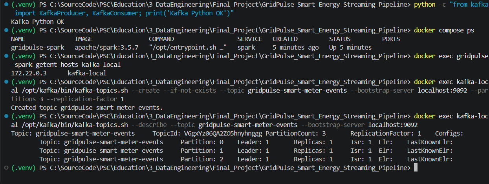

### 02. Infrastructure — Local folder snapshot
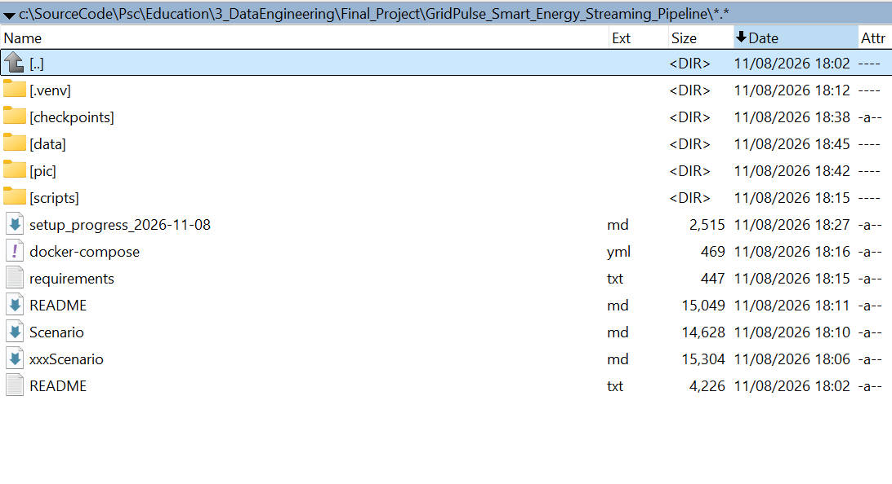

### 03. Baseline — Producer + Spark baseline execution
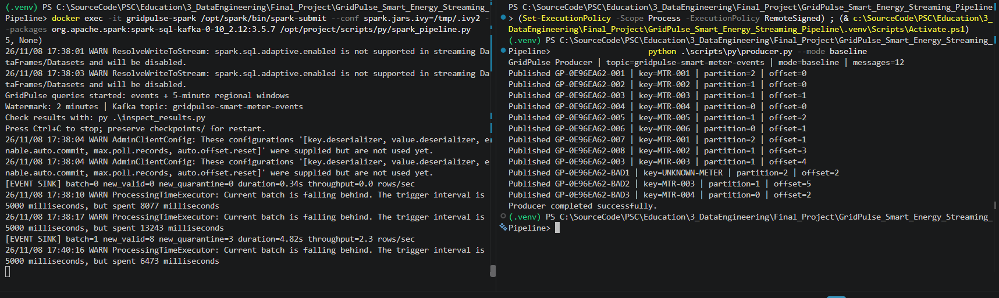

### 04. Baseline — Baseline producer, event sink, monitoring
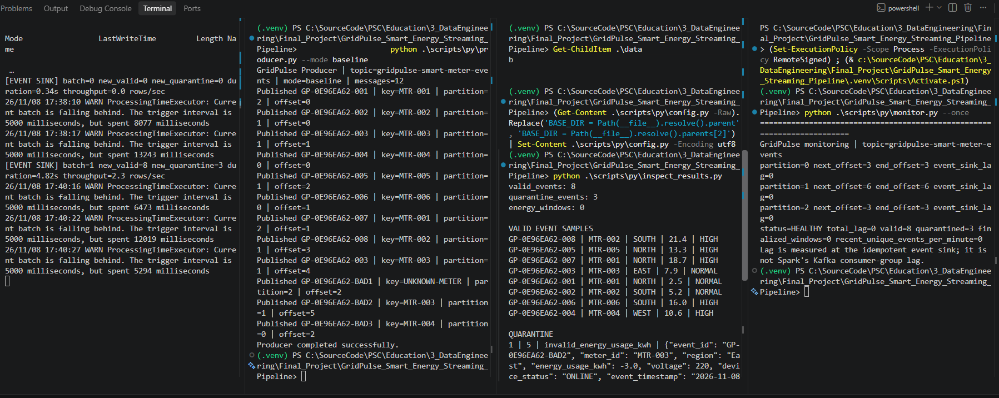

### 05. Baseline — Quarantine inspection
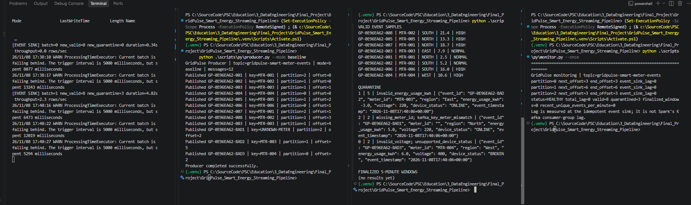

### 06. Watermark — Late + advance, 6 finalized windows
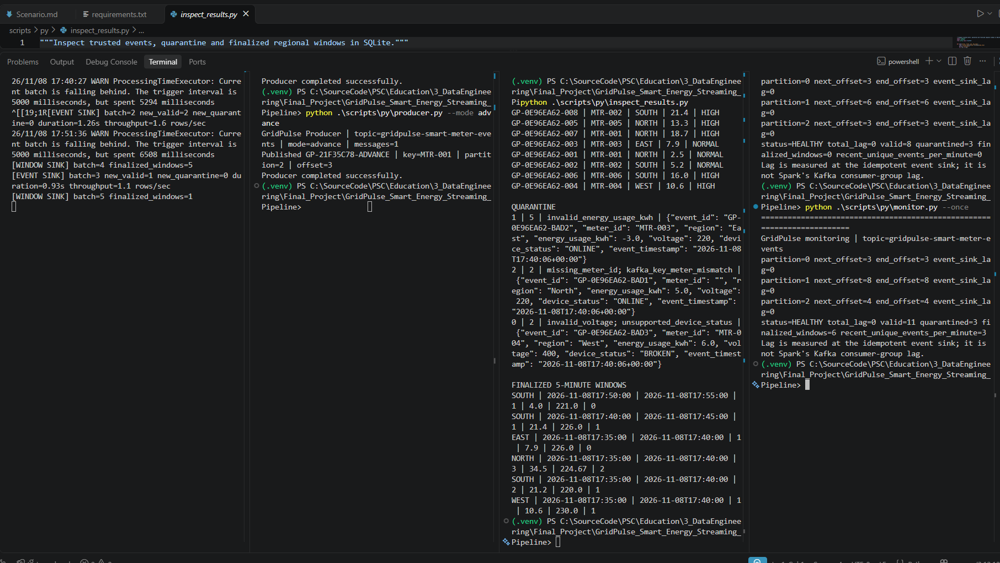

### 07. T07 — Independent consumer: 15 Kafka messages
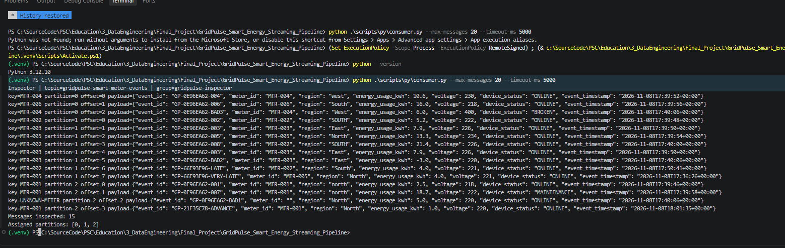

### 08. T08 — Pre-check: SQLite rows and finalized windows
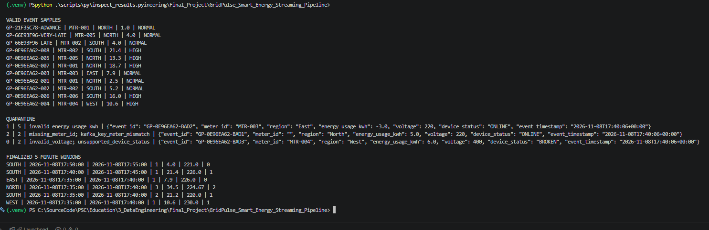

### 09. T08 — Pre-check: monitor lag zero
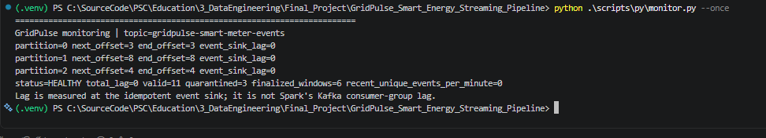

### 10. T08 — Spark running; not yet checkpoint recovery
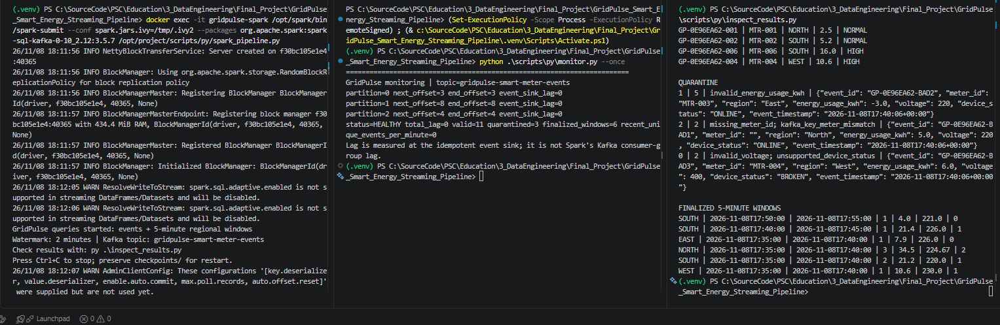

### 11. T08 — Initial Ctrl+C stop attempt; process status uncertain
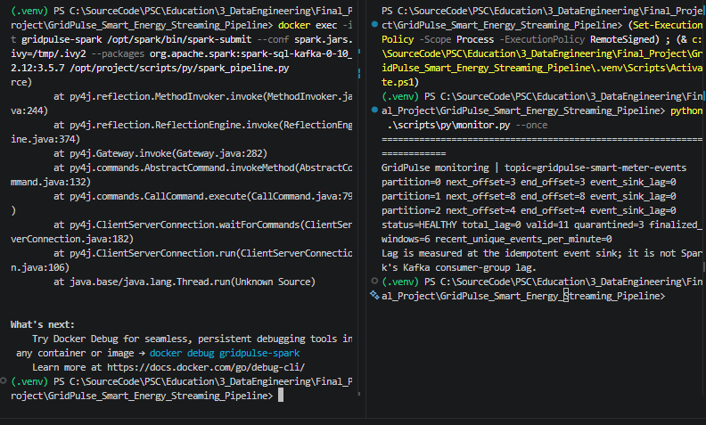

### 12. T08 — Producer after first stop attempt (attempt inconclusive)
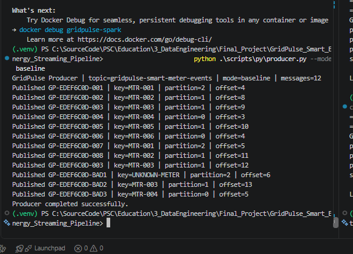

### 13. T08 — Sink already caught up; proved earlier stop attempt inconclusive
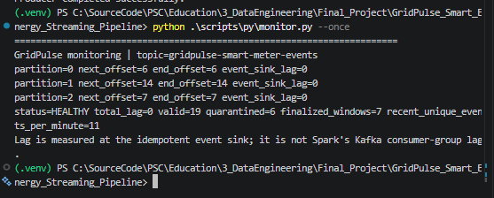

### 14. T08 — Docker top: Spark driver still active
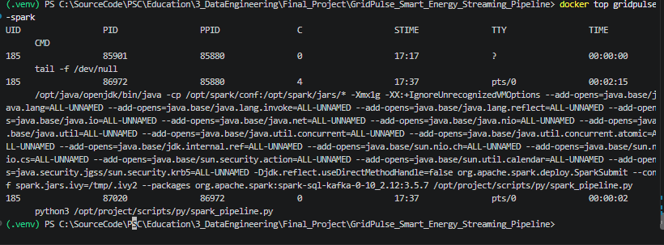

### 15. T08 — Docker inspect: container definitively stopped
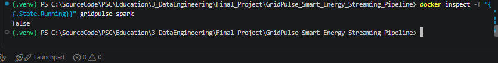

### 16. T08 — While stopped: 12 new messages, lag 12
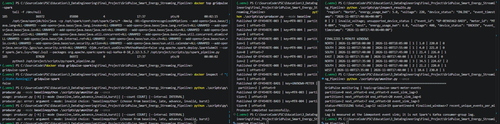

### 17. T08 — Checkpoint restart; event sink processing
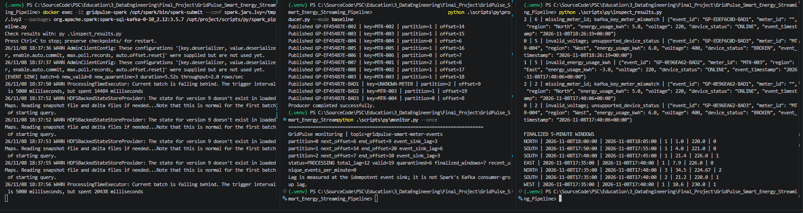

### 18. T08 — Final: 27 valid, 9 quarantine, 7 windows, lag 0
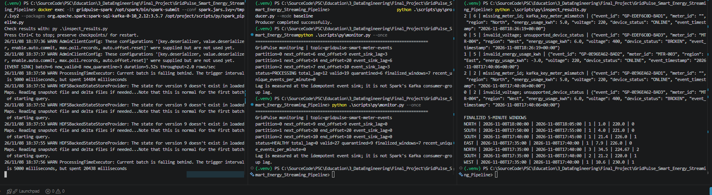

### 19. T09 — Before fault: Kafka backlog 12, sink unchanged
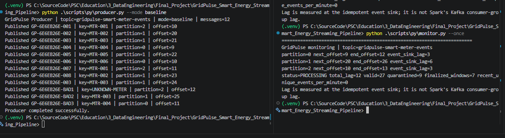

### 20. T09 — Injected failure on offset 9; sink lag remains 12
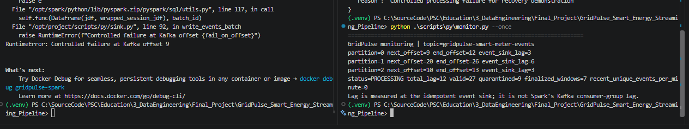

### 21. T09 — Failure report JSON and unchanged event-sink offsets
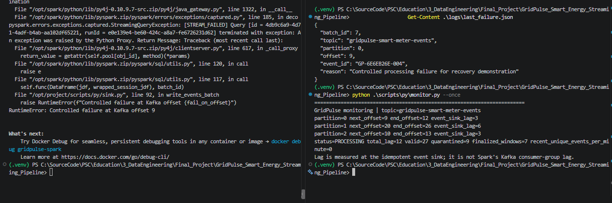

### 22. T09 — Clean retry: Spark new_valid=8, new_quarantine=3
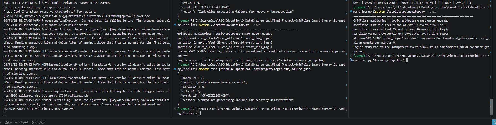

### 23. T09 — Recovered: 35 valid, 12 quarantine, 15 windows, lag 0
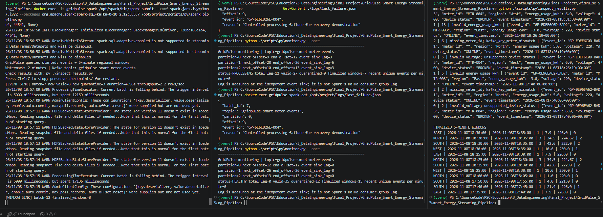

### 24. T10 — 100-event burst: 41.2 rows/s; 135 valid, 12 quarantine, lag 0
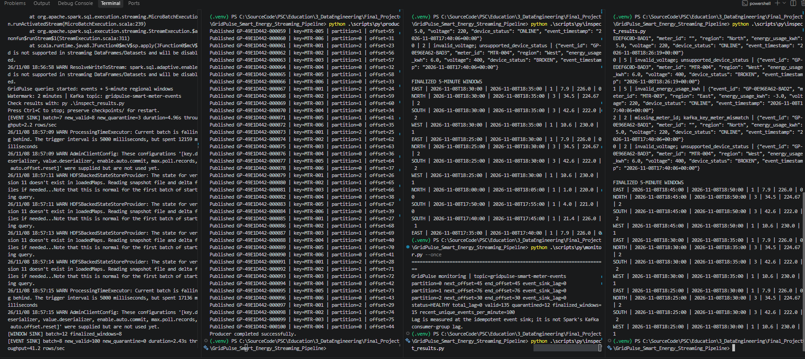
