# Execution Log — GridPulse Smart Energy Streaming Pipeline

**Date:** 2026-11-08  
**Executor:** Li R.  
**Evidence:** Genuine local screenshots; observations from shown console output.  
**Historical status at the first checkpoint:** Environment / topic, baseline E2E, validation/quarantine, event-time window finalization and standalone Kafka consumer inspection **PASS**. Recovery, controlled failure and load test **NOT YET VERIFIED**.


## Final verification snapshot — 2026-11-08

**Outcome: T01–T10 PASS within documented scope.** Final live state after T10: **135 trusted / 12 quarantined / 15 finalized windows**, all event-sink partition lags **0**, monitor **HEALTHY**. See [final report](final_test_report_2026-11-08.md) and [24 original screenshots in chronological order](screenshot_index_2026-11-08.md). The entries below capture *what was known at each stage*; historical phrases such as "pending" remain as an audit trail and were superseded by later PASS observations.

## Test evidence in chronological project sequence

### 01. Environment and Kafka topic setup — PASS

Python 3.12 `.venv` and `kafka-python` imported; `gridpulse-spark` container used Spark 3.5.7; DNS inside Spark resolved `kafka-local`; Kafka topic `gridpulse-smart-meter-events` had 3 partitions and replication factor 1. Existing Kafka broker was reused.

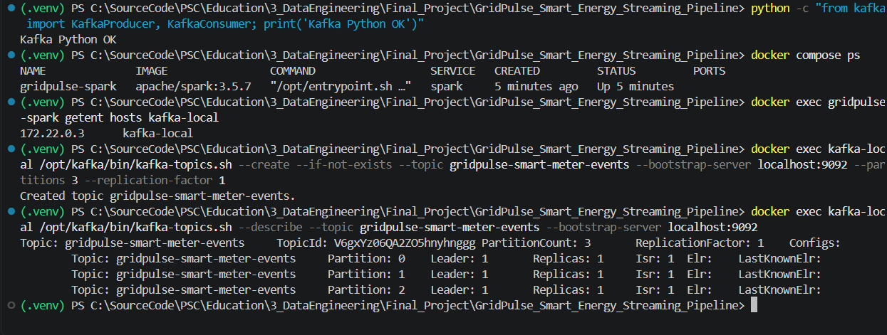

### 02. Local project directory snapshot — RECORDED

The screenshot shows the actual local project folder with `.venv`, `checkpoints`, `data`, `pid`, `scripts`, `README.md`, `Scenario.md`, `xxxScenario.md`, `docker-compose.yml`, `requirements.txt` and `setup_progress_2026-11-08.md`. Later-added `docs/` and the new evidence files were not part of the earlier screenshot. The `xxxScenario.md` working copy was not altered.

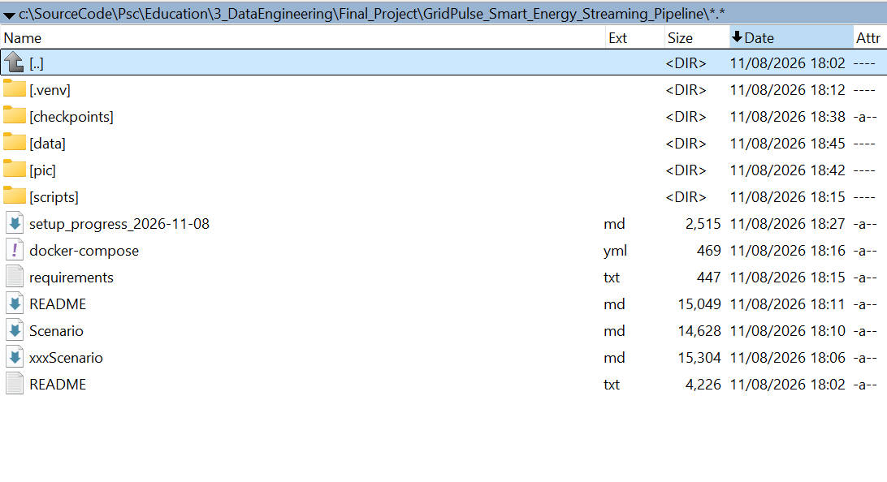

### 03. Spark queries started and baseline producer completed — PASS

Command sequence (PowerShell in the project root):

```powershell
docker exec -it gridpulse-spark /opt/spark/bin/spark-submit --conf spark.jars.ivy=/tmp/.ivy2 --packages org.apache.spark:spark-sql-kafka-0-10_2.12:3.5.7 /opt/project/scripts/py/spark_pipeline.py
python .\scripts\py\producer.py --mode baseline
```

Producer published 12 Kafka records: 8 distinct valid events, a deliberate repeated event ID, and 3 invalid events. Same-meter records retained stable Kafka keys; messages were distributed across partitions 0, 1, and 2. Spark printed an event sink batch with `new_valid=8`, `new_quarantine=3`.

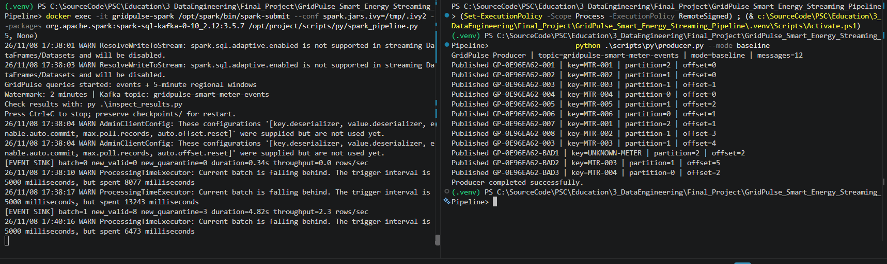

### 04. Baseline end-to-end dashboard — PASS

First full four-terminal capture confirmed:

| Observation | Baseline |
|---|---:|
| Kafka messages published | 12 |
| Distinct trusted SQLite records | 8 |
| Quarantine SQLite records | 3 |
| Finalized windows | 0 (expected before watermark advancement) |
| Partition 0: `next_offset` / `end_offset` | 3 / 3 |
| Partition 1: `next_offset` / `end_offset` | 6 / 6 |
| Partition 2: `next_offset` / `end_offset` | 3 / 3 |
| Total event-sink lag | 0 |
| Status | HEALTHY |

The duplicate record appeared in Kafka but was not inserted a second time into SQLite `valid_events` because the table is keyed by `event_id`. Event-time windows were not yet eligible for append-mode emission.

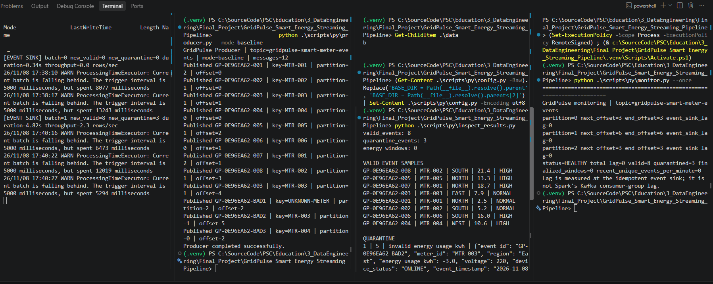

### 05. Baseline data quality and quarantine details — PASS

The inspection displayed 8 valid records and three quarantined records with these exact reasons (some records can have multiple validations failing):

| Bad source record | Quarantine reason(s) | Observable cause |
|---|---|---|
| `GP-0E96EA62-BAD2` | `invalid_energy_usage_kwh` | Negative energy (-3.0) |
| `GP-0E96EA62-BAD1` | `missing_meter_id; kafka_key_meter_mismatch` | Empty meter ID vs fallback Kafka key |
| `GP-0E96EA62-BAD3` | `invalid_voltage; unsupported_device_status` | 400 V and `BROKEN` |

Note: run IDs vary on future reruns. This table refers to the supplied baseline execution, not expected fixed IDs.

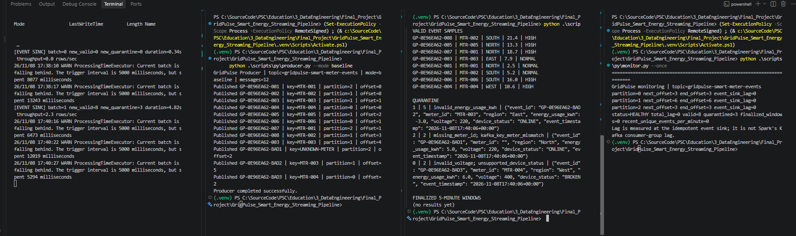

### 06. Late arrivals, watermark advance, finalized windows — PASS

While Spark remained running, the following commands were executed:

```powershell
python .\scripts\py\producer.py --mode late
python .\scripts\py\producer.py --mode advance
python .\scripts\py\inspect_results.py
python .\scripts\py\monitor.py --once
```

`late` generates 2 messages: one delayed by about 45 seconds (`MTR-002`, SOUTH, 4.0 kWh) and one 15 minutes behind (`MTR-005`, NORTH, 4.0 kWh). `advance` publishes 1 *synthetic, future-dated* valid event, intended to move the event-time watermark in this controlled lab.

Spark output showed `[EVENT SINK] batch=2 new_valid=2`, `[EVENT SINK] batch=3 new_valid=1`, `[WINDOW SINK] batch=4 finalized_windows=5` and `[WINDOW SINK] batch=5 finalized_windows=1`. Subsequent SQLite and monitor results:

| Metric | Actual result |
|---|---:|
| Valid unique events | **11** |
| Quarantined events | **3** |
| Finalized 5-minute regional windows | **6** |
| Partition 0 next/end offsets | 3 / 3 |
| Partition 1 next/end offsets | 8 / 8 |
| Partition 2 next/end offsets | 4 / 4 |
| Total event-sink lag | **0** |
| Monitor status | **HEALTHY** |
| Recent unique events/minute at snapshot | 3 |

**Finalized window samples (UTC)** — values copied from the displayed result:

| Region | Window start | Window end | Readings | Total kWh | Avg voltage | High-usage count |
|---|---|---|---:|---:|---:|---:|
| SOUTH | 17:50 | 17:55 | 1 | 4.0 | 221.0 | 0 |
| SOUTH | 17:40 | 17:45 | 1 | 21.4 | 226.0 | 1 |
| EAST | 17:35 | 17:40 | 1 | 7.9 | 226.0 | 0 |
| NORTH | 17:35 | 17:40 | 3 | 34.5 | 224.67 | 2 |
| SOUTH | 17:35 | 17:40 | 2 | 21.2 | 220.0 | 1 |
| WEST | 17:35 | 17:40 | 1 | 10.6 | 230.0 | 1 |

`SOUTH 17:50–17:55` (4.0 kWh) is direct evidence of the delayed 45-second event being included in a finalized window. `NORTH 17:35–17:40` remains 34.5 kWh across 3 readings (the three baseline North readings), showing that the separate 15-minute-old 4.0-kWh event did not inflate that finalized aggregate. The very-late event can still be found in the `valid_events` sink: event-level validation and watermark-based aggregation eligibility are distinct decisions.

A future-dated `ADVANCE` record is **not normal production telemetry**. It was used for this reproducible exercise and its own future window need not be finalized in this snapshot.

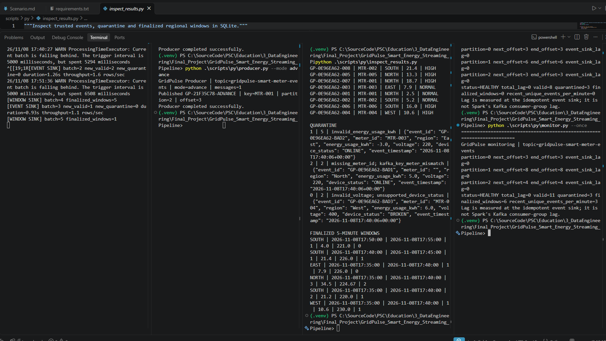

### 07. Standalone Kafka Consumer Inspection — PASS (2026-11-08)

The project-specific Python environment (`.venv`) was activated in PowerShell after a `Python was not found` message from the Windows system interpreter alias. The user ran:

```powershell
python .\scripts\py\consumer.py --max-messages 20 --timeout-ms 5000
```

**Observed directly in the supplied terminal output:**

```text
Inspector | topic=gridpulse-smart-meter-events | group=gridpulse-inspector
Messages inspected: 15
Assigned partitions: [0, 1, 2]
```

| Kafka partition | Offsets observed | Messages | Content checks |
|---|---|---:|---|
| 0 | 0–2 | 3 | 2 valid baseline, `BAD3` |
| 1 | 0–7 | 8 | 4 baseline valid, a repeated `GP-0E96EA62-003`, `BAD2`, `LATE`, `VERY-LATE` |
| 2 | 0–3 | 4 | 2 baseline valid, `BAD1`, `ADVANCE` |
| **Total** | — | **15** | 12 baseline + 2 late + 1 advance |

All offsets were consecutive **within their respective partitions**. The repeated event `GP-0E96EA62-003` occurs at offsets 1 and 4 of partition 1: Kafka retained both messages, while the downstream trusted sink stores one record per business event ID. The Kafka key `UNKNOWN-METER` for `BAD1` and invalid payloads remained visible in the raw topic, as designed. The inspector assigned all three partitions to this single instance of the `gridpulse-inspector` group.

The source `consumer.py` uses `enable_auto_commit=False`, so this inspection does not advance committed consumer offsets or mutate Spark checkpoints. A **single-consumer assignment** was verified; reassignment or cooperative load balancing with multiple concurrent group members was **not** tested. The observed total is historical; reruns can contain additional data.

**Screenshot evidence (actual VS Code execution):**

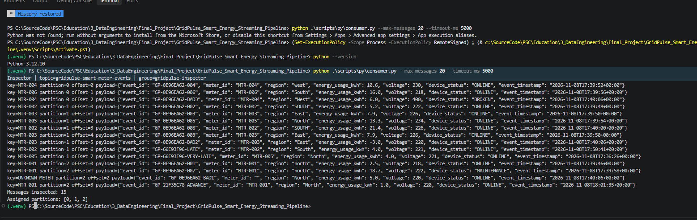


### 08. Checkpoint Recovery — pre-restart baseline captured (2026-11-08)

**Status: PRE-CHECK PASSED; STOP / RESTART / RECOVERY NOT YET TESTED.**

Before intentionally stopping Spark, the operator ran these commands in the activated Python virtual environment from the project root:

```powershell
python .\scripts\py\inspect_results.py
python .\scripts\py\monitor.py --once
```

**Actual SQLite event and window inspection:**

- 11 trusted events (includes `GP-21F35C78-ADVANCE`, `GP-66E93F96-VERY-LATE`, and `GP-66E93F96-LATE`).
- 3 quarantined source events, with errors `invalid_energy_usage_kwh`, `missing_meter_id; kafka_key_meter_mismatch`, and `invalid_voltage; unsupported_device_status`.
- 6 finalized regional 5-minute windows, matching the earlier event-time test: SOUTH 17:50–17:55 (1 reading, 4.0 kWh), SOUTH 17:40–17:45 (1, 21.4), EAST 17:35–17:40 (1, 7.9), NORTH 17:35–17:40 (3, 34.5), SOUTH 17:35–17:40 (2, 21.2), WEST 17:35–17:40 (1, 10.6). All times UTC.

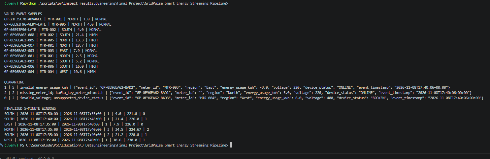

**Actual event-sink lag monitoring:**

| Partition | `next_offset` | Kafka `end_offset` | Event-sink lag |
|---|---:|---:|---:|
| 0 | 3 | 3 | 0 |
| 1 | 8 | 8 | 0 |
| 2 | 4 | 4 | 0 |
| **Total** | **15** | **15** | **0** |

Monitor reported `status=HEALTHY`, `valid=11`, `quarantined=3`, `finalized_windows=6`, and `recent_unique_events_per_minute=0`. This is an event-sink progress metric, not a standard Kafka consumer-group commit lag.

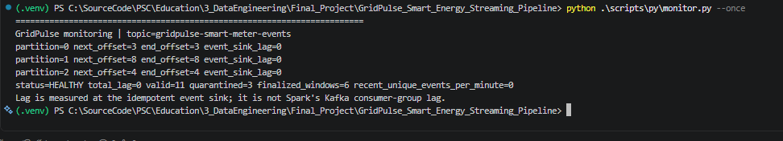

**Follow-up screenshot — Spark running, recovery still unverified:**

The next provided capture shows the Spark command active in the first terminal, with `GridPulse queries started: events + 5-minute regional windows`. The monitor still displays Kafka end/next offsets **3/3, 8/8, 4/4**, `total_lag=0`, **11 trusted**, **3 quarantined**, **6 finalized windows**, and `HEALTHY`. The SQLite inspection still contains the same trusted/quarantine/window rows. **No stop confirmation or new Kafka records published during downtime appear in this capture.** Therefore, this screenshot confirms a healthy running pipeline, **not recovery of previously unprocessed Kafka records**. T08 remains IN PROGRESS / NOT VERIFIED.

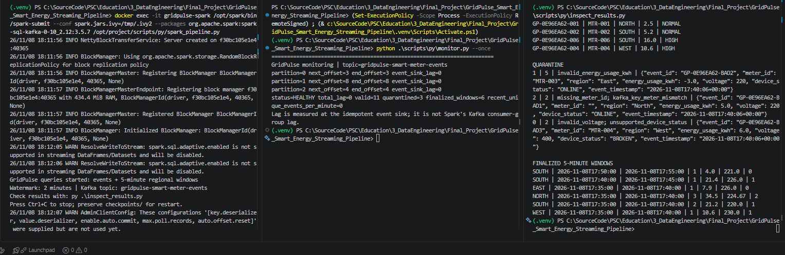

**Next pending recovery operations (do not mark as passed until separately observed):** stop the running Spark process via Ctrl+C without deleting `checkpoints/events` or `checkpoints/windows`; publish 12 new baseline records while Spark is stopped; verify Kafka end offsets grow and the event sink stays unchanged; restart the *same* Spark command with the existing checkpoints; verify expected idempotent event inserts, processed offsets, and no replayed duplicates. A new baseline generates 8 distinct valid events, one duplicate business event, and 3 invalid events, so **19 trusted and 6 quarantined** are expected if no other events are published; actual counts must be confirmed. The number of finalized windows may differ because of watermark effects from the prior synthetic future-timestamped ADVANCE event.

## Warnings and interpretation

The Spark console repeatedly warned `Current batch is falling behind` (5-second trigger; some micro-batches required more than 5 seconds). This highlights limited local CPU/memory and/or job setup overhead. The monitor eventually showed **event-sink lag 0**, but this does not measure the aggregation query's internal Kafka lag, and zero event-sink lag at one instant does not prove sustained capacity.

## Source ZIP snapshot versus screenshot evidence

The original supplied `Final_Project.zip` contains `data/gridpulse.db` captured at the **earlier baseline point**: 8 valid, 3 quarantined and 0 windows. The newer live state (11, 3, 6) exists in the subsequent user screenshot. **No archive SQLite rows or Spark checkpoints were modified or manufactured to match the screenshot.** When packaging this documentation update, keep the source runtime snapshot distinct from later test evidence.

## Pending verification at this historical checkpoint

- Optional: multi-consumer group rebalance demonstration (one inspector with all three partitions already verified).
- Controlled Spark stop/restart with both checkpoint directories retained; publish records while stopped, verify restored progress and stable counts.
- Trigger a known new offset with `--fail-on-offset`, capture the failure/rollback, restart normally, verify no duplicate business records.
- Conduct `burst --count 200 --interval 0` with before/after monitoring and Spark console timings. Verify catch-up rather than merely recording one lag reading.

Next steps and test criteria: [test_plan.md](test_plan.md).


### T08 — first stop/publish attempt: INCONCLUSIVE (2026-11-08, ~18:24–18:26 local)

**Evidence note:** The screenshots show that the planned interval with Spark fully stopped was **not demonstrated**. Do not mark checkpoint recovery as passed on this attempt. The user issued `Ctrl+C` to the foreground `docker exec -it ... spark-submit` command. A Java/Py4J stack trace appeared and the PowerShell prompt returned, but this only proves the *local docker exec command* ended; it does **not** conclusively prove that every Spark streaming process had exited inside the container. The following monitor snapshot was still at 11 valid / 3 quarantine / 6 windows, with Kafka end offsets 3 / 8 / 4 and event-sink lag zero.

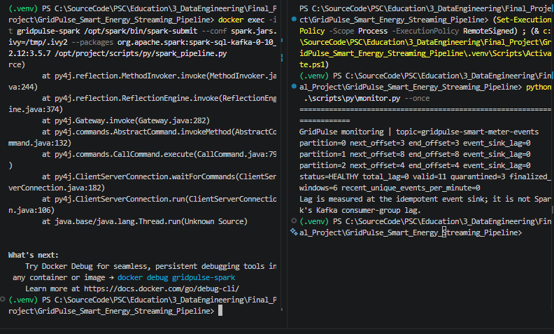

The user then ran `python .\scripts\py\producer.py --mode baseline` and the producer reported **12 successfully published records** (8 distinct valid business events, one duplicate, 3 invalid). The partition distribution in the ensuing monitor corresponds to +3 events on partition 0, +6 on partition 1, and +3 on partition 2; Kafka end offsets advanced to **6 / 14 / 7** (27 messages in total).

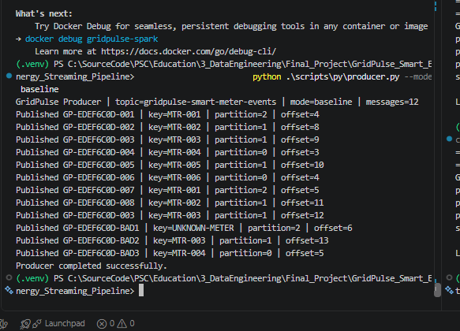

**Unexpected immediate monitoring state, after publication:**

| Metric | Before | After publication | Delta |
|---|---:|---:|---:|
| Kafka end offsets, P0/P1/P2 | 3 / 8 / 4 | **6 / 14 / 7** | +3 / +6 / +3 |
| SQLite event-sink `next_offset`, P0/P1/P2 | 3 / 8 / 4 | **6 / 14 / 7** | +3 / +6 / +3 |
| Event-sink total lag | 0 | **0** | 0 |
| Trusted valid records | 11 | **19** | +8 |
| Quarantine | 3 | **6** | +3 |
| Finalized regional windows | 6 | **7** | +1 |
| Monitor status | HEALTHY | **HEALTHY** | — |

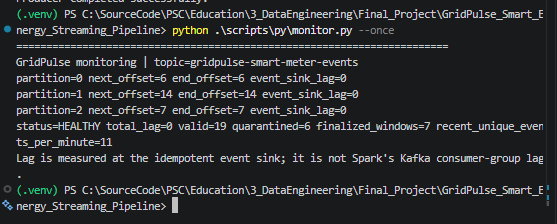

**Interpretation:** Data processing and transactional deduplication appear successful: 12 Kafka messages produced 8 unique valid rows and 3 invalid rows; the duplicate did not increase the trusted count. However, all sink offsets had already advanced **before the intended controlled restart**, so this run does not prove buffering during downtime or restoration from checkpoints. A remaining Spark process inside `gridpulse-spark` is a plausible cause, but it has not yet been independently verified with `docker top`. The monitor's `HEALTHY` means sink lag zero, not that Spark stopped or started.

**Corrective verification (pending):** Run `docker top gridpulse-spark` to inspect processes; stop only the Spark container with `docker stop gridpulse-spark` (external Kafka stays up); verify it is stopped with `docker ps --filter name=gridpulse-spark`; publish **a new** baseline while the Spark container is truly stopped; verify `event_sink_lag=12` and stable SQLite counters (19 / 6 / 7); start the container, then launch Spark using the **original checkpoint paths** and compare results. Never delete either checkpoint directory or reset Kafka. After this extra baseline, expect 27 unique valid events and 9 quarantined source rows if no other messages are sent, while finalized window totals remain data-/watermark-dependent.


### T08 retest — Spark container stopped; Kafka offline buffering confirmed (2026-11-08, ~18:30–18:33 local)

**Status: OFFLINE BUFFERING PASS; CHECKPOINT RESTART / RECOVERY STILL PENDING.**

The earlier `Ctrl+C` did **not** stop the in-container pipeline: `docker top gridpulse-spark` revealed `python3 /opt/project/scripts/py/spark_pipeline.py` and the JVM still running. This directly explains why the first retest batch was consumed immediately.

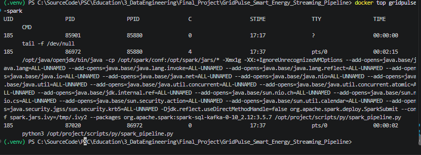

The operator ran `docker stop gridpulse-spark` and confirmed `docker inspect -f "{{.State.Running}}" gridpulse-spark` returned **false**. Kafka was left running.

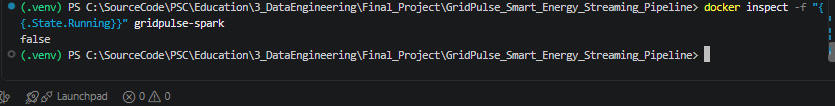

While the Spark container was stopped, the producer successfully published a fresh 12-message `baseline` batch with generated event IDs prefixed `GP-EF45487E-...`. The screenshot also contains two harmless argparse errors caused by concatenating commands as `baselinepython`; the subsequent properly separated `--mode baseline` command finished successfully. Monitoring immediately afterward showed the sink had **not** advanced:

| Metric | Before offline publish | After offline publish |
|---|---:|---:|
| Kafka end offsets P0 / P1 / P2 | 6 / 14 / 7 | **9 / 20 / 10** |
| Event sink next offsets P0 / P1 / P2 | 6 / 14 / 7 | **6 / 14 / 7** |
| Event sink lag P0 / P1 / P2 | 0 / 0 / 0 | **3 / 6 / 3** |
| Total event sink lag | 0 | **12** |
| Valid trusted rows | 19 | **19** |
| Quarantine rows | 6 | **6** |
| Finalized 5-minute windows | 7 | **7** |
| Monitor status | HEALTHY | **PROCESSING** |

**Interpretation:** All 12 records were durably accepted by Kafka during the demonstrably stopped Spark interval, while SQLite records, the event sink's committed offsets and finalized windows stayed unchanged. The monitor's `PROCESSING` label represents backlog from an inactive sink; it **does not** mean Spark is executing. This independently verifies the *offline buffering* phase of the recovery scenario. A successful restart from the unchanged checkpoints and sink catch-up has **not yet** been shown, so T08 must not be marked complete.

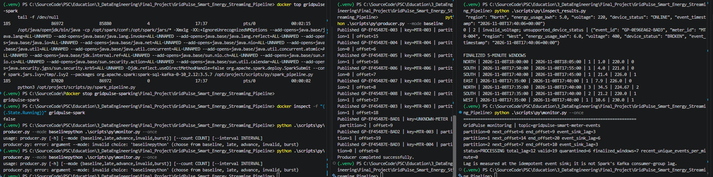

**Next verification:** `docker start gridpulse-spark`; then launch exactly one `spark-submit` for `/opt/project/scripts/py/spark_pipeline.py` using the original mounted checkpoints. Wait for both streaming queries to initialize, then run `inspect_results.py` and `monitor.py --once`. Expected if no further records are published: Kafka end offsets 9 / 20 / 10; sink next offsets 9 / 20 / 10; total lag 0; 27 trusted events (8 new unique), 9 quarantine rows (3 new invalid), and a finalized-window count that must be observed rather than assumed. Keep SQLite, `checkpoints/events`, `checkpoints/windows`, and Kafka intact. Two *different* baseline batches have already been generated in this T08 sequence; do not confuse the first fully consumed batch (19 / 6 / 7) with this second batch pending in Kafka.


### T08 restart — event-sink batch processed; post-recovery verification pending (2026-11-08, ~18:38 local)

**Status: RESTART PROGRESS OBSERVED — FINAL PASS NOT YET VERIFIED.** Following the confirmed offline buffering of 12 records, the Spark container was restarted and the streaming job was relaunched using the existing application/checkpoint configuration. The console now shows:

```text
[EVENT SINK] batch=6 new_valid=8 new_quarantine=3 duration=5.52s throughput=2.0 rows/sec
```

This is consistent with the expected **8 newly valid + 3 newly quarantined** baseline records (one duplicate is not counted as a new trusted record). It is evidence that the event sink is processing after restart. The capture also shows benign-looking HDFS-backed state-store messages about reading snapshot/delta files during startup and microbatch-overrun warnings. Their presence alone does **not** prove a failure or a successful stateful recovery.

**Important timing caveat:** The adjacent `monitor.py --once` output still displays the **pre-restart** `PROCESSING` state, `lag=12`, `valid=19`, `quarantine=6`, `finalized_windows=7` because it was run before this event-sink batch completed. Do not interpret those counters as the final post-recovery state, and do not mark T08 PASS from this screenshot alone.

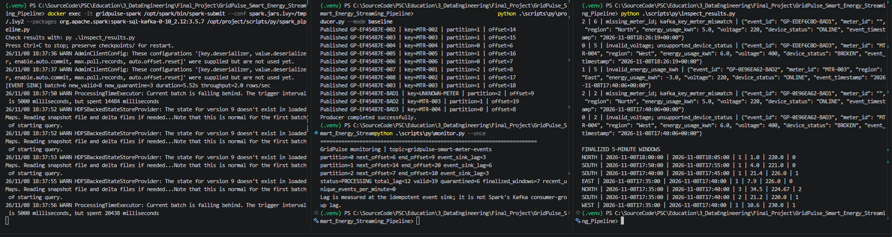

**Required final checks (with Spark left running):** re-run `python .\scripts\py\monitor.py --once` and `python .\scripts\py\inspect_results.py`. Confirm sink next offsets **9/20/10** (equal to topic end offsets), lag **0**, valid **27**, quarantine **9**, and inspect the finalized windows for correct stateful behavior. If these hold, T08 can be marked PASS; if not, investigate the observed discrepancy before changing the test status. Preserve evidence with an additional final screenshot.


### T08 final — checkpoint recovery **PASS** (2026-11-08, ~18:40 local)

**Evidence captured after Spark restart and catch-up.** The original checkpoint directories and existing SQLite database were retained. The Spark event sink had logged batch 6 with `new_valid=8` and `new_quarantine=3`. A subsequent, fresh `monitor.py --once` run reported:

| Kafka partition | `next_offset` (sink) | Kafka `end_offset` | Event-sink lag |
|---|---:|---:|---:|
| 0 | 9 | 9 | 0 |
| 1 | 20 | 20 | 0 |
| 2 | 10 | 10 | 0 |
| **All** | **39** | **39** | **0** |

Monitoring status: **HEALTHY**; SQLite totals: **27 valid**, **9 quarantine**, **7 finalized 5-minute regional windows**. Before the offline interval, counters were **19 / 6 / 7** and event-sink lag was 0; with the container verified stopped, a fresh 12-message baseline produced sink lag 12 (end offsets **9/20/10**, previous sink next offsets **6/14/7**). After restarting with the original checkpoints, sink progress caught up to the topic with **8 additional valid** and **3 additional quarantined** records, consistent with the 12-message input containing one duplicate business event. Previously stored windows remained at **7** without a newly observed duplicate-window insertion.

**Result:** T08 checkpoint-based **event-sink recovery** and offline Kafka buffering **PASS**. The evidence demonstrates continued processing from saved progress, rather than a fresh empty pipeline. The window stream was restarted with its prior checkpoint; a newly finalized *post-restart* window was not separately observed, so a dedicated deep stateful-window-recovery test would be an additional check if required. The interim `HDFSBackedStateStoreProvider` snapshot/delta and `Current batch is falling behind` log messages did not prevent catch-up.

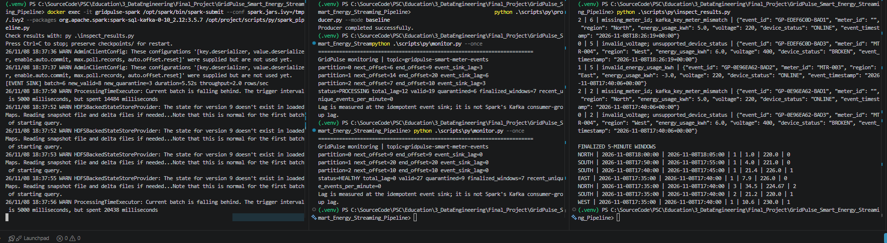

**Next tests pending:** T09 controlled failure and retry, T10 measured burst/backpressure. Avoid resetting checkpoints, SQLite or the Kafka topic between tests.


### T09 — Controlled Failure & Retry: Kafka backlog staged before failure injection (2026-11-08, ~18:46 local)

**Status: PRE-INJECTION BUFFERING VERIFIED; CONTROLLED FAILURE AND RETRY NOT YET VERIFIED.**

With the Spark container stopped, the operator successfully published 12 additional baseline messages (`GP-66EB26E-...`) to the existing Kafka topic. The producer output reports all 12 messages published. Monitoring immediately afterward shows the event sink has **not processed these records**:

| Partition | Sink `next_offset` | Kafka `end_offset` | Sink lag |
|---|---:|---:|---:|
| 0 | 9 | 12 | 3 |
| 1 | 20 | 26 | 6 |
| 2 | 10 | 13 | 3 |
| **Total** | **39** | **51** | **12** |

SQLite counters remain **27 trusted / 9 quarantined / 7 finalized windows**, with monitor `status=PROCESSING`. This label describes outstanding event-sink lag and does not indicate an active Spark process. The screenshot captures producer and monitor evidence together.

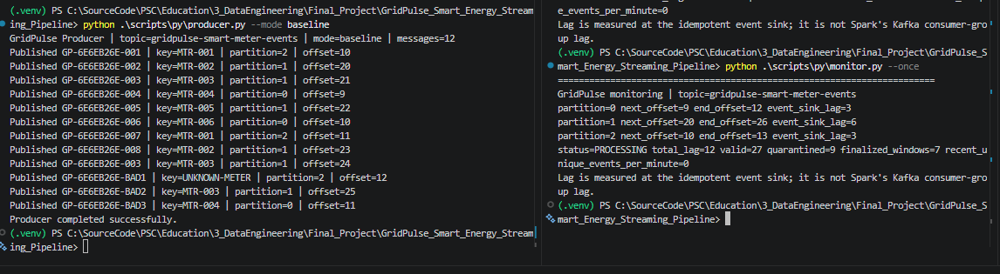

**Next operation (not yet performed):** Start `gridpulse-spark` and run one Spark driver with `--fail-on-offset 9`. In the newly buffered range, partition 0 has offsets 9–11; the other new partition offsets are 20–25 and 10–12, respectively. `write_events_batch()` raises `RuntimeError` after writing `logs/last_failure.json` when the selected source offset is observed, then rolls back the active SQLite transaction; the event and window streams have separate checkpoints and transactions. After the expected exception, capture `logs/last_failure.json`, `monitor.py --once`, and actual event-sink database state before a subsequent clean restart **without the failure flag**. Do not mark T09 PASS until rollback and retry results have been observed.


### T09 — controlled failure injection observed (2026-11-08, ~18:51 local)

**Status: failure injection observed / rollback evidence consistent; recovery pending.** Spark was run with `--fail-on-offset 9`. The user screenshot shows `RuntimeError: Controlled failure at Kafka offset 9` from `write_events_batch` and a returned PowerShell prompt after `spark-submit` exited. A fresh `monitor.py --once` reading still showed event-sink `next_offset` **P0=9, P1=20, P2=10** against Kafka end offsets **12, 26, 13**, with **total lag 12**, **27 trusted**, **9 quarantined**, and **7 finalized windows**. This is consistent with the `connection.rollback()` exception handler in `sink.py` and proves the failed micro-batch did **not** advance the event sink progress. The separate window sink has its own checkpoint and may advance independently; no new window appears in this capture.

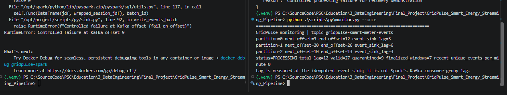

**Failure report path in source:** `sink.py` writes `/opt/project/logs/last_failure.json`, mounted to host project `logs/` under `docker-compose.yml`. If the host file appears missing, first check inside the running container with `docker exec gridpulse-spark cat /opt/project/logs/last_failure.json`; do not infer failure absence because the file was not found on the host. The stack trace already demonstrates the injected exception.

**Remaining T09 acceptance:** restart the pipeline **without `--fail-on-offset`**, retaining the same checkpoints; verify end and sink next offsets **12 / 26 / 13** and zero lag, **35 trusted** and **12 quarantined** records (if no more records are published); verify previous rows have not duplicated. The finalized-window count is watermark dependent.


### T09 — failure report confirmed and event-sink rollback retained (2026-11-08, ~18:52 local)

A subsequent console screenshot confirmed `Get-Content .\logs\last_failure.json` succeeded on the host. The JSON contained:

```json
{
  "batch_id": 7,
  "topic": "gridpulse-smart-meter-events",
  "partition": 0,
  "offset": 9,
  "event_id": "GP-66EB26E-004",
  "reason": "Controlled processing failure for recovery demonstration"
}
```

Post-failure monitoring still reported sink next offsets **9 / 20 / 10**, topic end **12 / 26 / 13**, lag **12**, **27 valid**, **9 quarantine**, **7 finalized windows**. This agrees with SQLite transaction rollback at the failed event-sink batch; a separate window stream could have progressed independently.

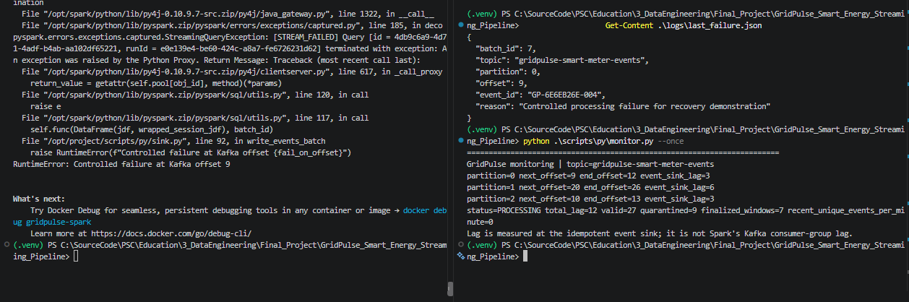

### T09 — clean restart, processing observed (2026-11-08, ~18:57 local)

Spark was restarted without `--fail-on-offset` while preserving checkpoints and SQLite. Its console reported:

```text
[EVENT SINK] batch=7 new_valid=8 new_quarantine=3 duration=4.96s throughput=2.2 rows/sec
[WINDOW SINK] batch=12 finalized_windows=8
```

An adjacent monitoring output was captured *before* event sink completion and still showed lag=12. This interim snapshot is not the T09 final monitoring result.

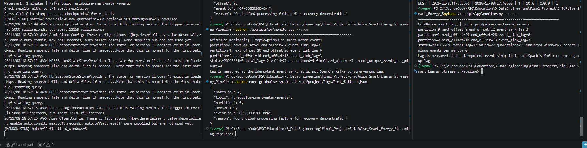

### T09 — Controlled Failure & Retry **PASS** (2026-11-08, ~18:59 local)

A later **fresh** monitor confirmed:

| Partition | sink `next_offset` | Kafka `end_offset` | Lag |
|---|---:|---:|---:|
| 0 | 12 | 12 | 0 |
| 1 | 26 | 26 | 0 |
| 2 | 13 | 13 | 0 |
| **All** | **51** | **51** | **0** |

**HEALTHY, valid=35, quarantine=12, finalized_windows=15, lag=0.** Compared with the pre-failure database (27/9), the batch added 8 unique valid and 3 quarantine records; the remaining Kafka message was a repeated business event. The tested error caused no advancement of event-sink counters while failing, and a clean restart caught up without duplicating the trusted event IDs. This supports **T09 PASS for the controlled rollback/retry scenario**. The two independent sinks are not covered by a cross-query atomicity guarantee.

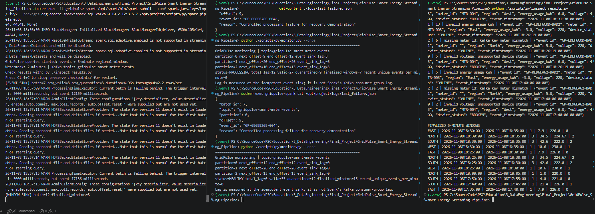

### T10 — 100-event Burst / Backpressure observation **PASS for bounded burst** (2026-11-08, ~19:01 local)

The Spark pipeline remained running. The producer command was:

```powershell
python .\scripts\py\producer.py --mode burst --count 100 --interval 0
```

Producer completed successfully and Spark displayed:

```text
[EVENT SINK] batch=8 new_valid=100 new_quarantine=0 duration=2.43s throughput=41.2 rows/sec
```

Fresh monitor:

| Partition | sink `next_offset` | Kafka `end_offset` | Lag |
|---|---:|---:|---:|
| 0 | 45 | 45 | 0 |
| 1 | 76 | 76 | 0 |
| 2 | 30 | 30 | 0 |
| **All** | **151** | **151** | **0** |

**Final state: HEALTHY, valid=135, quarantine=12, finalized_windows=15, lag=0.** `inspect_results.py` showed the regional window outputs; the screenshot captures the producer completion, Spark event sink, monitor, and SQLite inspection.

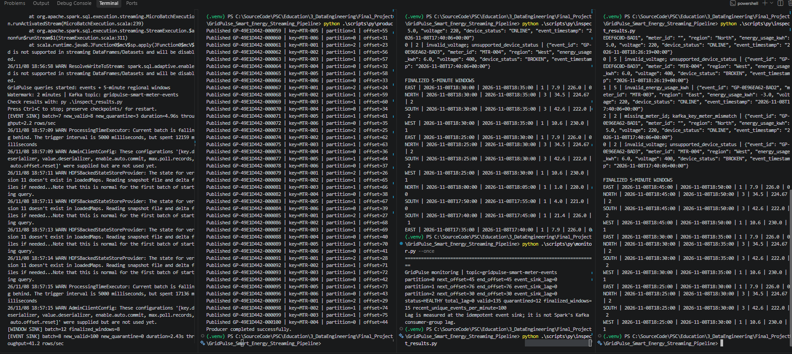

**Interpretation:** The 100-event burst processed in a 2.43-second event-sink batch (~41.2 rows/s) and drained the event sink backlog by the final measurement. Previous trigger-overrun warnings do not establish a sustained backpressure limit. A longer saturation test and time-series sampling would be *additional*, not part of this completed 100-event acceptance run.

### Final test outcome

**T01–T10 PASS (within test-specific scope).** All 24 screenshot artifacts are preserved; refer to [screenshot_index_2026-11-08.md](screenshot_index_2026-11-08.md). No original `Scenario.md` content, Python code, SQLite DB, or Spark checkpoints were modified in this documentation package.
