# Environment & Kafka Setup — Verified Evidence

**Project:** GridPulse Smart Energy Streaming Pipeline  
**Date:** 2026-11-08  
**Executor:** Li R.  
**Status:** Completed practical test cycle, T01–T10 PASS within observed scope. Final state: 135 valid / 12 quarantine / 15 finalized windows / event sink lag 0 / HEALTHY.

## Confirmed from console screenshot

- The Python 3.12 virtual environment (`.venv`) was active.
- `KafkaProducer` and `KafkaConsumer` imported successfully; console output: `Kafka Python OK`.
- Docker Compose showed `gridpulse-spark` running with image `apache/spark:3.5.7`.
- DNS resolution inside Spark container succeeded: `kafka-local` resolved to `172.22.0.3` at the time of the test.
- A Kafka topic named `gridpulse-smart-meter-events` was created successfully using the existing `kafka-local` broker.
- The topic was verified with **3 partitions** (0, 1, 2) and **replication factor 1** (single-broker test environment).

## Commands shown / validated

```powershell
python -c "from kafka import KafkaProducer, KafkaConsumer; print('Kafka Python OK')"
docker compose ps
docker exec gridpulse-spark getent hosts kafka-local
docker exec kafka-local /opt/kafka/bin/kafka-topics.sh --create --if-not-exists --topic gridpulse-smart-meter-events --bootstrap-server localhost:9092 --partitions 3 --replication-factor 1
docker exec kafka-local /opt/kafka/bin/kafka-topics.sh --describe --topic gridpulse-smart-meter-events --bootstrap-server localhost:9092
```

## Troubleshooting to include in final README

- The initial `python -m pip install -r .\requirements.txt` command was cancelled by the user, causing `ModuleNotFoundError: No module named 'kafka'`.
- Running `python -m pip install --no-cache-dir kafka-python==2.2.15` in the activated `.venv` resolved the Python import issue.
- `kafka-python` is a Python package; `kafka-local` is the existing Docker Kafka broker container. They are distinct.
- Two Docker commands were accidentally joined as `docker compose versiondocker compose config`; running `docker compose config` separately succeeded.
- Docker Compose runs the Spark service and uses the existing external network; it does not create a second Kafka broker.

## Screenshot evidence

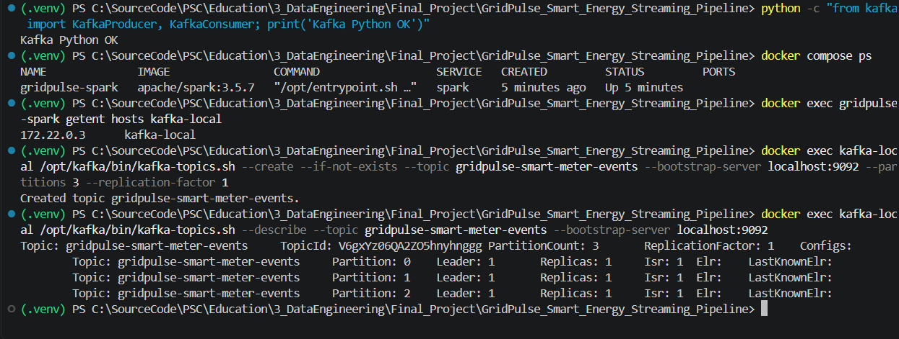

## Execution milestones after setup

1. **Baseline producer and Spark:** 12 messages published with meter keys across 3 partitions. Spark event sink recorded 8 new valid events and 3 quarantined events; duplicate event ID did not create another trusted record.
2. **Baseline SQLite inspection:** `valid_events=8`, `quarantine_events=3`, `energy_windows=0`. Event-sink lag remained 0 at offsets 3/6/3. No finalized windows were expected yet in append mode.
3. **Late event + advance:** producer published two delayed records, then one synthetic future timestamp. The event sink subsequently reached 11 valid, 3 quarantine; the window sink finalized **6** regional windows. Monitoring was `HEALTHY`, event-sink lag 0, partition end/next offsets 3/8/4.
4. **Kafka consumer inspection (T07):** 15 messages inspected across assigned partitions `[0, 1, 2]` with consecutive offsets `0–2`, `0–7` and `0–3`. Included duplicate, invalid, late and advance records. No Spark checkpoints were changed.
5. **T08 pre-check screenshots:** SQLite still held 11 trusted, 3 quarantined, and 6 finalized windows. Event-sink lag across 3 partitions was 0. A later screenshot shows Spark running with the same counters, but does not show newly published messages during a stopped interval. **Checkpoint recovery is not yet verified.**
6. **Observed Spark warning:** periodic micro-batches exceeded the 5-second trigger. This is performance/backpressure evidence, not by itself a data-loss error.

### Visual sequence

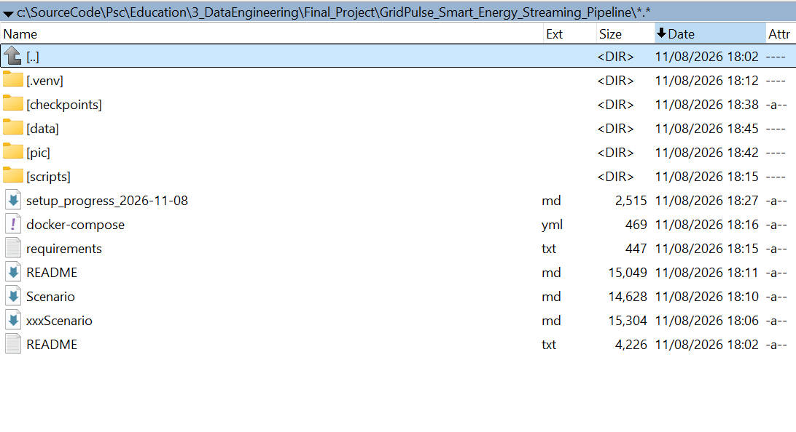

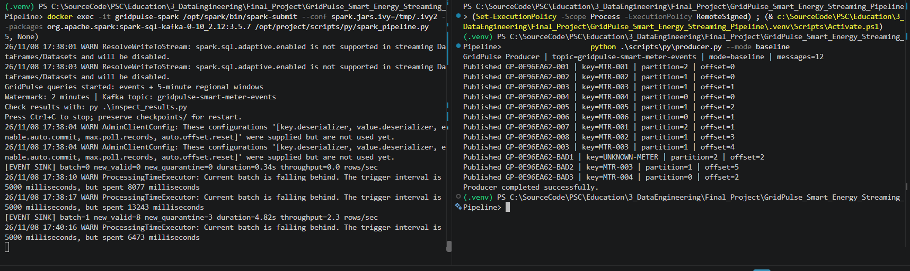

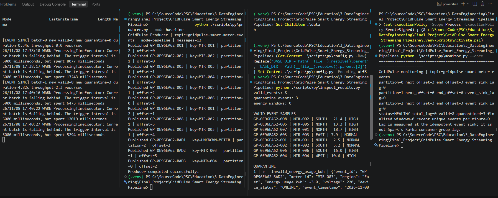

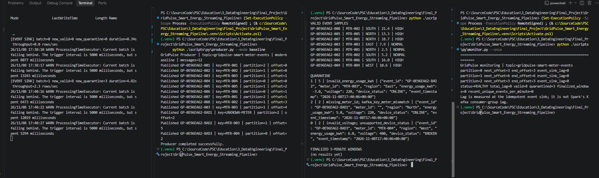

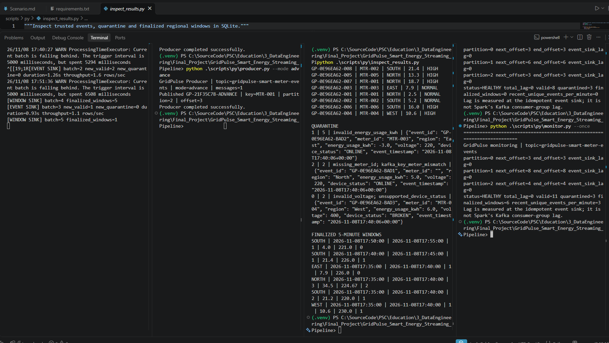

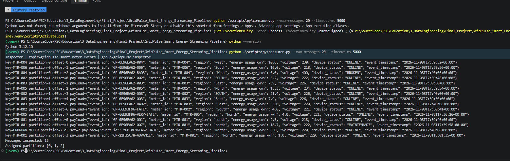

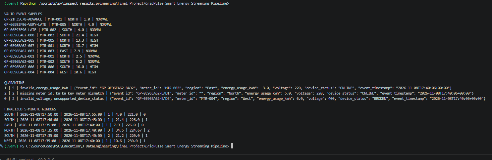

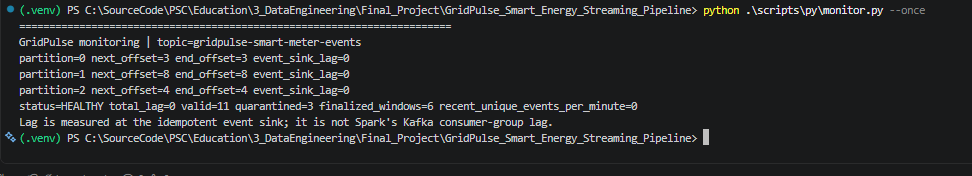

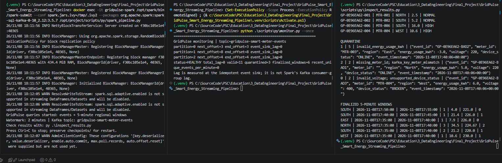

See [chronological test execution](docs/test_execution_2026-11-08.md) for the recorded command sequence and an explicit separation between the original ZIP database snapshot and later screenshot evidence.

**Next stage at that point (historical):** controlled failure/retry (T09), then a measured burst test (T10). Both were subsequently completed, as documented below.


7. **T08 initial stop/publish attempt — INCONCLUSIVE.** `Ctrl+C` ended foreground Docker CLI, but the new 12-record baseline was already processed without an observed backlog. Source progress advanced to 6/14/7; counts reached 19 trusted, 6 quarantined, 7 windows and lag 0. No data loss is evident, but *checkpoint recovery has not been demonstrated*. Three screenshots saved in `pic/`. Next: inspect `docker top gridpulse-spark`; stop only Spark container, publish during confirmed downtime, and restart with unchanged checkpoints.


8. **T08 retest — offline Kafka buffering PASS; restart pending.** `docker top` verified the JVM and Python streaming process survived the earlier Ctrl+C. After `docker stop gridpulse-spark`, `docker inspect ... .State.Running` returned `false`. A fresh `baseline` producer run published 12 messages, Kafka end offsets moved from 6/14/7 to **9/20/10**, while the sink progress remained **6/14/7**, yielding **lag=12** (3/6/3) and `status=PROCESSING`. SQLite retained **19 valid, 6 quarantine, 7 finalized windows**. This proves buffering during downtime but not checkpoint recovery. Evidence:

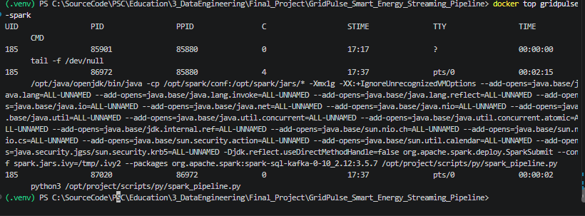

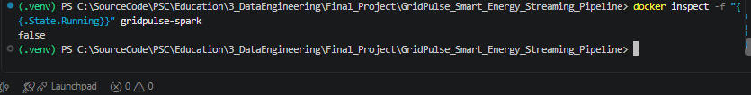

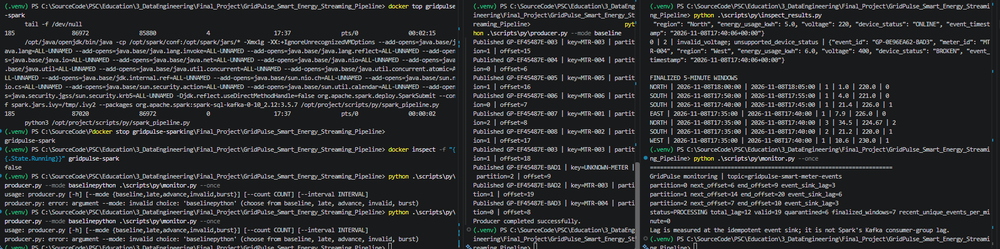


9. **T08 restart processing observed; final check pending.** Spark submitted again with the existing pipeline/checkpoint configuration. Console printed `[EVENT SINK] batch=6 new_valid=8 new_quarantine=3`, but the `monitor.py` snapshot in the screenshot ran earlier and still showed the pre-restart lag=12 / valid=19 / quarantine=6 / windows=7. Run a fresh `monitor.py --once` and `inspect_results.py` before declaring T08 PASS.

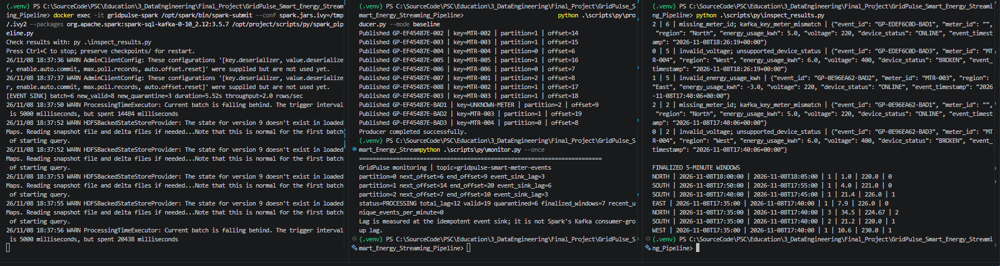


10. **T08 checkpoint recovery — PASS.** Fresh post-restart monitor showed partition sink next offsets equal to Kafka end offsets **9/9**, **20/20**, **10/10**, for lag **0** and `status=HEALTHY`. SQLite totals became **27 trusted / 9 quarantined / 7 regional windows** (previously 19 / 6 / 7 before the stopped interval). The 12 buffered Kafka records yielded 8 new valid, 3 quarantined, 1 duplicate; prior finalized windows remained intact. The event-sink checkpoint recovery is confirmed. A new finalized window after restart was not independently demonstrated.

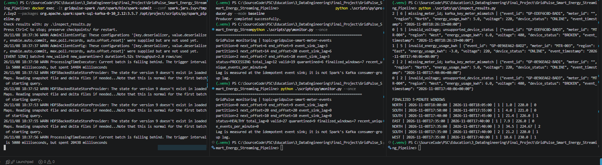

**Remaining:** T09 controlled failure/retry and T10 measured burst/backpressure.


11. **T09 pre-injection Kafka buffering — PASS (2026-11-08, ~18:46 local).** Spark had been stopped, producer published 12 new baseline messages, Kafka end offsets advanced to **12 / 26 / 13**, while SQLite event sink next offsets stayed **9 / 20 / 10** (`lag=12`: 3/6/3). Database remained **27 trusted / 9 quarantine / 7 windows**. This is only the T09 precondition. Artificial failure, transaction rollback, and subsequent recovery are **still pending**. Evidence: `pic/gridpulse_t09_pre_failure_offline_buffering_lag12_2026-11-08.png`.


## Final updates — T09 retry and T10 burst completed (2026-11-08)

**T09 Controlled Failure & Retry — PASS.** An injected exception on P0 offset 9 was recorded in `/opt/project/logs/last_failure.json` (`batch_id=7`, `event_id=GP-66EB26E-004`). Before retry, sink progress stayed at 9/20/10 against Kafka end offsets 12/26/13, lag 12; SQLite remained at 27 trusted / 9 quarantined / 7 windows. Clean restart without the failure flag processed 8 new trusted and 3 new quarantine events; a later fresh monitor showed 35/12/15, end/next offsets 12/26/13, lag 0, HEALTHY.

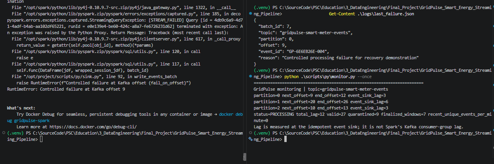

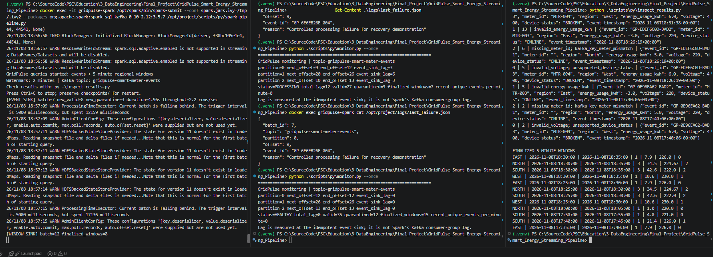

**T10 100-event Burst — PASS within bounded scope.** `producer.py --mode burst --count 100 --interval 0` published 100 messages. Spark reported `batch=8 new_valid=100 new_quarantine=0 duration=2.43s throughput=41.2 rows/sec`. Final monitor: **135 valid / 12 quarantine / 15 finalized windows / HEALTHY / lag 0**, with P0/P1/P2 next=end offsets **45 / 76 / 30**. This does not by itself establish sustained backpressure capacity.

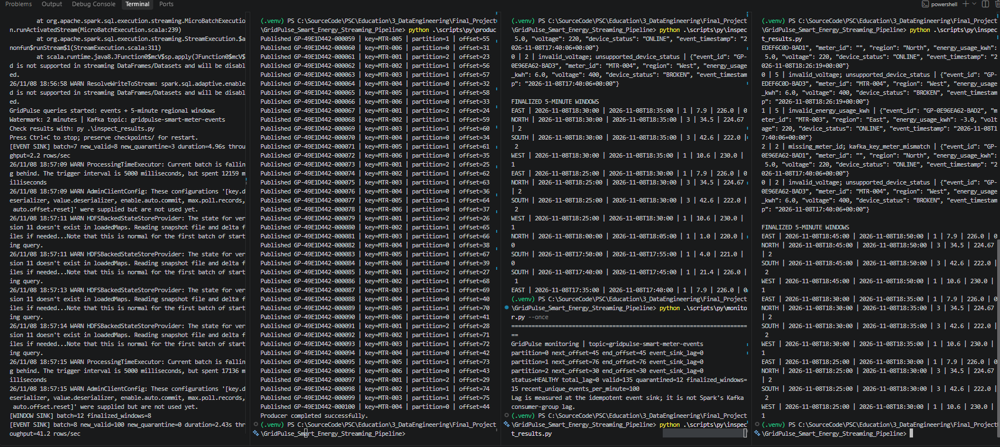

**Final authoritative result:** see [final test report](docs/final_test_report_2026-11-08.md), [test log](docs/test_execution_2026-11-08.md), and [ordered index of all 24 screenshots](docs/screenshot_index_2026-11-08.md). Prior 'pending' or 'restart pending' entries above are historical notes, not the final project status.
