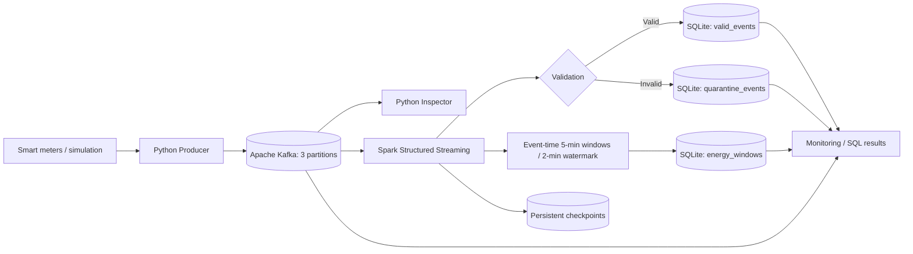

# GridPulse Energy — Reliable Smart Energy Streaming Pipeline

**Executor:** Li R.  
**Date:** 08 November 2026  
**Status:** Implementation prepared; end-to-end execution and screenshots pending

**Project scenario and assignment:** [Scenario.md](./Scenario.md)

## 1. Purpose

Build and verify an open-source streaming pipeline for smart-meter telemetry. The system receives data continuously, preserves meter-level Kafka ordering, validates messages, isolates incorrect records, calculates event-time energy metrics, and supports restart from Spark checkpoints.

This project implements the smart-energy practice scenario with **Apache Kafka 3.9.1**, **Spark Structured Streaming 3.5.7**, **Python 3.12**, and a lightweight **SQLite** demonstration sink.

Kafka is reused from the existing development environment. **No additional Kafka broker is created.** The SQLite sink avoids running a second heavy database service; the approach is suitable for this practical project rather than a production-scale metering platform.

## 2. Streaming architecture



The `meter_id` is the Kafka message key, keeping records for the same meter in one partition. Kafka guarantees ordering **within each partition**, not across the entire topic. Three partitions allow up to three active members of a conventional consumer group for this topic. See [Architecture and decisions](docs/architecture.md).

## 3. Project structure

```text
GridPulse_Smart_Energy_Streaming_Pipeline/
├── README.md                   # Full project documentation
├── README.txt                  # PowerShell command reference
├── Scenario.md                 # Original project scenario and requirements
├── config.py                   # Shared topic/broker configuration
├── producer.py                 # Baseline, invalid, late and burst events
├── consumer.py                 # Kafka event/key/partition/offset inspection
├── spark_pipeline.py           # Spark streaming validation + aggregation
├── sink.py                     # Transactional SQLite sinks and progress
├── monitor.py                  # Kafka end offsets versus sink progress
├── inspect_results.py          # Trusted events, quarantine and windows
├── docker-compose.yml          # One Spark container, existing Kafka network
├── requirements.txt           # Host-side Kafka client dependency
├── .gitignore                  # Excludes environments and runtime data
├── docs/
│   ├── architecture.md
│   ├── validation_rules.md
│   ├── test_plan.md
│   └── requirements_matrix.md
├── pic/                        # Save execution screenshots here
├── data/                       # Generated SQLite DB; do not commit
├── checkpoints/                # Persistent Spark progress; do not commit
├── logs/                       # Error context; do not commit
└── tests/                      # Basic source and SQLite-sink tests
```

## 4. Smart-meter event schema

```json
{
  "event_id": "GP-ABC12345-001",
  "meter_id": "MTR-001",
  "region": "North",
  "energy_usage_kwh": 5.2,
  "voltage": 220.0,
  "device_status": "ONLINE",
  "event_timestamp": "2026-11-08T16:00:00+00:00"
}
```

**Topic:** `gridpulse-smart-meter-events`  
**Partitions:** 3  
**Key:** `meter_id`  
**Value:** JSON encoded as UTF-8

See [Validation rules](docs/validation_rules.md) for the complete schema and acceptance criteria, and the [16-task requirements matrix](docs/requirements_matrix.md) for the implementation-to-assignment mapping.

## 5. Environment preparation (Windows PowerShell)

Commands must be executed from the project directory. Use the installed Python **3.12**, not the global Python 3.14 interpreter.

```powershell
py -3.12 -m venv .venv
.\.venv\Scripts\Activate.ps1
python -m pip install -r .\requirements.txt
python -c "from kafka import KafkaProducer, KafkaConsumer; print('Kafka Python OK')"
```

Expected package: `kafka-python==2.2.15`. Spark runs **inside Docker**, so no local installation of PySpark is required for execution. The VS Code Python extension may use the local `.venv` for editing the host scripts.

### Start existing Kafka

```powershell
docker ps -a --filter "name=kafka-local"
docker start kafka-local
```

If Kafka is already running, `docker start` will simply report its container name. Verify the Docker network:

```powershell
docker inspect kafka-local --format '{{range $name, $net := .NetworkSettings.Networks}}{{$name}} {{end}}'
```

The existing network for these labs has been `runningapachekafkalocally_default`. If Docker reports a different name, adjust the external network name in `docker-compose.yml` **before** starting Spark.

### Create the Kafka topic

```powershell
docker exec kafka-local /opt/kafka/bin/kafka-topics.sh --create --if-not-exists --topic gridpulse-smart-meter-events --bootstrap-server localhost:9092 --partitions 3 --replication-factor 1
docker exec kafka-local /opt/kafka/bin/kafka-topics.sh --describe --topic gridpulse-smart-meter-events --bootstrap-server localhost:9092
```

If the topic already exists, `--if-not-exists` avoids an error, but **does not change its existing partition count**. Check `PartitionCount: 3` in the description.

### Start the Spark container

```powershell
docker compose up -d spark
docker ps --filter "name=gridpulse-spark"
docker exec gridpulse-spark getent hosts kafka-local
```

Expected: an IP address and `kafka-local`. The container is restricted to **2 CPU equivalents, 3 GiB RAM and 4 GiB RAM+swap**. Stop unused Spark, Airflow and MinIO labs to avoid resource contention. Starting the container does not start the actual streaming application.

## 6. Run the complete pipeline

Use separate VS Code PowerShell terminals. Activate `.venv` in each terminal that runs host-side Python code.

### Terminal 1 — Spark (start first)

```powershell
docker exec -it gridpulse-spark /opt/spark/bin/spark-submit --conf spark.jars.ivy=/tmp/.ivy2 --packages org.apache.spark:spark-sql-kafka-0-10_2.12:3.5.7 /opt/project/spark_pipeline.py
```

The first startup may download the Kafka connector from Maven repositories. Wait for:

```text
GridPulse queries started: events + 5-minute regional windows
Watermark: 2 minutes
```

**Do not close this terminal.** Two independent Structured Streaming queries operate here: an event validation/SQLite sink, and an event-time window aggregation sink. Each has its own checkpoint directory.

### Terminal 2 — Producer

```powershell
python .\producer.py --mode baseline
```

The baseline sends multiple meters and regions, a duplicate business event and several intentionally invalid records. Actual Kafka partition IDs and offsets are determined by Kafka and **must be recorded from the run**, not assumed in advance.

### Terminal 3 — Monitor

```powershell
python .\monitor.py
```

This displays Kafka end offsets, next processed offsets from the SQLite event sink, approximate backlog per partition, and counts of trusted/quarantined/finalized rows. These numbers describe **event-sink progress**, not Kafka consumer-group commits made by Spark.

### Terminal 4 — Inspect outputs

```powershell
python .\inspect_results.py
```

Inspect the database after the event-sink processing message appears. Use the output as evidence for quality checks, key/offset tracking, valid events and quarantine.

### Optional — Raw Kafka consumer

```powershell
python .\consumer.py --max-messages 20
```

The standalone consumer displays the exact Kafka key, JSON value, partition and offset. Its consumer-group behaviour is separate from Spark. To explore Kafka group assignment, run additional inspector processes with the same `--group` while new events are published, and verify actual assignments rather than assuming each consumer receives equal data.

## 7. Filtering and data quality

Spark parses Kafka JSON using a declared `StructType`. Validation checks required fields, key-to-meter matching, numeric ranges, permitted status values, and a parseable event timestamp. Valid events have standardized uppercase regions and derived fields:

- `usage_category`: `HIGH` when energy usage reaches 10 kWh, otherwise `NORMAL`.
- `voltage_status`: `NORMAL` for 210–240 V inclusive; `CHECK` for accepted values outside that band.

Invalid events are written to `quarantine_events` with original JSON, topic, partition, offset, and failure reason. The `valid_events` table has a unique `event_id`, so repeating the same event does not duplicate its business record.

```powershell
python .\producer.py --mode invalid
python .\inspect_results.py
```

## 8. Event-time windows, watermarks and late data

Regional energy summaries are calculated in **5-minute tumbling windows**, using device `event_timestamp`. A **2-minute watermark** limits the aggregation and deduplication state. Duplicate event IDs are suppressed by `dropDuplicatesWithinWatermark` within the documented watermark guarantee (Spark 3.5.7).

The window query uses **Append mode** and emits a finalized window only after the watermark passes the end of that window. Therefore, **no rows in `energy_windows` immediately after baseline is normal**, not an error.

Run these test modes in this order **after the first batch is fully ingested**:

```powershell
python .\producer.py --mode late
python .\producer.py --mode advance
python .\inspect_results.py
```

`late` produces a recent delayed event and an event from 15 minutes earlier. `advance` deliberately generates **one synthetic future-dated event** to move the watermark forward for a short demonstration; it is not normal production telemetry. A very late event may remain present in `valid_events` while being excluded from the aggregate after watermark cleanup.

Because of Kafka partitions, trigger scheduling and watermark progression, exact window timing and row counts must be checked from actual outputs.

## 9. Monitoring, lag and backpressure

```powershell
python .\monitor.py --once
python .\producer.py --mode burst --count 200 --interval 0
python .\monitor.py --once
```

If Kafka receives records faster than the event sink can commit, **event-sink lag** grows. Monitor the time series, not one reading. The monitor's `HEALTHY / PROCESSING / LAGGING` thresholds are demonstration labels, not production SLOs. The Spark aggregation query has its **own** checkpoint and can lag independently.

Capacity planning must consider arrival rate, processing rate, Kafka partitions, Spark CPU/RAM, state-store size, storage throughput and sink performance. A sustained incoming rate greater than processing capacity causes backlog and processing latency to rise.

## 10. Checkpoints and controlled recovery

The volume mount preserves:

```text
checkpoints/events/
checkpoints/windows/
```

For a safe restart demonstration:

1. Stop Spark with **Ctrl+C** in Terminal 1; do not remove either checkpoint directory.
2. While Spark is stopped, publish more events: `python .\producer.py --mode baseline`.
3. Start the **same** Spark command again, without modifying checkpoint locations.
4. Run `python .\inspect_results.py` and `python .\monitor.py --once` to verify resumed processing and no duplicate trusted records.

The optional `--fail-on-offset NUMBER` flag in `spark_pipeline.py` deliberately fails the **event-sink query** upon encountering that unprocessed Kafka offset. Use a newly published, known upcoming offset for this test; the flag does nothing if the offset is already checkpointed. The failed SQL micro-batch is rolled back, and `logs/last_failure.json` captures the error context. Restart without the flag to allow the batch to be retried.

**Do not delete checkpoints for a normal restart.** Checkpoint compatibility depends on preserving query structure and stateful operator settings. The two independent sinks are idempotent for retries, but their commits are not a single global atomic transaction.

## 11. SQL sinks and reliability

SQLite tables created automatically by `sink.py`:

| Table | Purpose | Duplicate protection |
|---|---|---|
| `valid_events` | Trusted standardized readings | `PRIMARY KEY(event_id)` |
| `quarantine_events` | Invalid source records and reasons | `PRIMARY KEY(topic, partition, offset)` |
| `energy_windows` | Finalized regional 5-minute summaries | `PRIMARY KEY(region, window_start, window_end)` |
| `source_progress` | Event-sink next offset per Kafka partition | Transactional `MAX(next_offset)` UPSERT |

The event sink writes all rows and its progress updates in a SQLite transaction. Window results are upserted by region and window boundaries, so a retried batch does not create an extra window row. **This does not guarantee a globally atomic exactly-once transaction across both independent streaming queries.**

## 12. Verification and screenshots

Keep visual evidence in `pic/` and follow [Test plan](docs/test_plan.md). Verify the actual topic, partitions, producer offsets, raw consumer keys, Spark status, invalid-event reasons, aggregated regional totals, lag and checkpoint-based restart. Screenshots must be added only after the corresponding local execution.

## 13. Completion criteria (project requirements)

| Area | Implementation / evidence | Verification |
|---|---|---|
| Architecture, key, partitions | Docs + `docker-compose.yml` + topic CLI | Pending |
| Python Producer / Consumer | `producer.py`, `consumer.py` | Pending |
| Spark Structured Streaming | `spark_pipeline.py` | Pending |
| Validation / enrichment / quarantine | Spark parsing + `sink.py` | Pending |
| Event-time windows / watermark | 5-minute window / 2-minute watermark | Pending |
| Deduplication and idempotency | Spark state + SQLite unique keys/UPSERT | Pending |
| Checkpoints and restart | Persistent `checkpoints/` + recovery test | Pending |
| Lag / throughput / capacity | `monitor.py` + burst test | Pending |
| Full end-to-end results | SQL queries + screenshots | Pending |

**Status:** Source implementation and documentation prepared. Do not mark this project as executed, recovered or end-to-end verified until the commands and tests run in the target Docker/Kafka environment.

## 14. Shutdown

Stop active foreground processes with `Ctrl+C` and, when finished:

```powershell
docker compose stop spark
```

Only stop Kafka when other projects no longer need it:

```powershell
docker stop kafka-local
```

Do not remove the broker, delete `checkpoints/`, or run destructive Docker commands against existing data.
